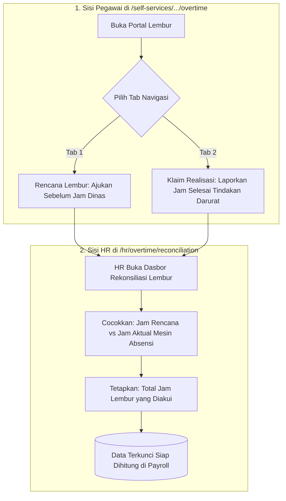

# Panduan Pengguna — Sub-Modul 09: Manajemen Lembur Staf

## 1. Informasi Modul

| Field | Keterangan |
| --- | --- |
| Nama Sub-Modul | Rencana Lembur, Klaim Realisasi Lembur & Rekonsiliasi Jam Lembur HR |
| Sasaran Pengguna | Staf Medis/Umum (Pelaksana), Kepala Ruangan (Pemberi Tugas), dan HR Payroll (Auditor Jam) |
| Alamat URL | • Layanan Mandiri Lembur: `http://localhost:3000/self-services/human-resource/overtime` • Rekonsiliasi Lembur HR: `http://localhost:3000/hr/overtime/reconciliation` |

---

## 2. Kapan & Mengapa Modul Ini Digunakan?

Pelayanan rumah sakit memiliki dua jenis lembur yang berbeda:
1. **Lembur Terencana (*Pre-Overtime*)**: Ditugaskan atasan sebelum pekerjaan dimulai (misal perawat diminta membantu shift karena lonjakan pasien rawat inap).
2. **Lembur Tindakan Darurat / Cito (*Post-Overtime*)**: Staf sedang menangani operasi atau tindakan medis gawat darurat yang tidak boleh dihentikan di tengah jalan. Staf mengajukan klaim jam aktual lembur setelah operasi selesai.
3. **Rekonsiliasi HR**: Tim HR membandingkan jam klaim dengan data fisik mesin absensi sebelum uang lembur dibayarkan di slip gaji.

---

## 3. Langkah-Langkah Penggunaan Layar

### Langkah A: Pegawai Mengajukan Lembur Mandiri (Dual-Tab)
1. Buka `http://localhost:3000/self-services/human-resource/overtime`.
2. Anda akan melihat dua tombol tab di bawah judul halaman:
   - **Tab "Rencana Lembur (Pre-Overtime)"**: Klik tab ini jika ingin mengajukan izin penugasan lembur sebelum bekerja. Klik tombol **"Buat Rencana Lembur"** $\rightarrow$ isi tanggal, estimasi jam mulai, jam selesai, dan alasan penugasan.
   - **Tab "Klaim Realisasi (Post-Overtime)"**: Klik tab ini jika Anda baru saja menyelesaikan lembur tindakan darurat. Klik tombol **"Klaim Jam Lembur"** $\rightarrow$ isi jam pelaksanaan riil dan uraian tugas yang dikerjakan (contoh: *Asistensi Operasi Cito Laparatomi Eksplorasi Pasien Pendarahan*).
3. Klik tombol **Simpan**.

### Langkah B: Tim HR Melakukan Rekonsiliasi Jam Lembur
1. Masuk ke `http://localhost:3000/hr/overtime/reconciliation`.
2. Periksa kartu metrik ringkasan jam lembur rumah sakit:
   - **Total Jam Lembur Diajukan**: Jumlah jam yang diklaim staf.
   - **Total Jam Terverifikasi**: Jumlah jam yang lolos audit fisik.
   - **Tertunda Rekonsiliasi**: Jam lembur yang masih butuh verifikasi.
3. Pada tabel data, perhatikan 3 kolom komparasi utama:
   - **Kolom Jam Rencana**: Jam yang diajukan staf.
   - **Kolom Jam Aktual Mesin**: Jam tap fisik yang tercatat pada mesin absensi.
   - **Kolom Jam Diakui HR**: Durasi jam sah yang disetujui untuk dibayarkan.
4. Gunakan filter pencarian untuk menyaring per ruangan (misal: "Instalasi Kamar Operasi").

---

## 4. Skenario Latihan Mandiri untuk Klien

* **Latihan 1: Mengajukan Klaim Lembur Realisasi**:
  - Masuk ke tab **Klaim Realisasi** $\rightarrow$ klik tombol klaim.
  - Masukkan tanggal hari ini, jam mulai `14:00`, jam selesai `17:00` (durasi 3 jam), isi uraian tugas *"Menangani tindakan resusitasi darurat pasien trauma kepala"*.
  - Simpan dan pastikan data baru muncul di tabel dengan status `Pending`.
* **Latihan 2: Memeriksa Rekonsiliasi**:
  - Buka `/hr/overtime/reconciliation` dan temukan nama staf yang baru saja mengajukan klaim.
  - Perhatikan bahwa jam lembur tersebut sudah masuk ke dalam antrean audit tim HR.

---

## 5. Dampak pada Modul Lain

* Jam lembur yang disahkan di layar rekonsiliasi ini dikonversi otomatis menjadi nominal rupiah upah lembur resmi pada **Sub-Modul 10 (Penggajian Payroll)**.
