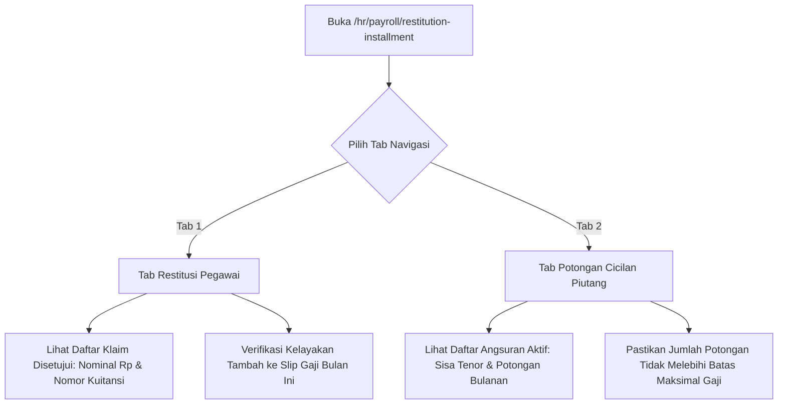

# Panduan Pengguna — Sub-Modul 11: Restitusi & Potongan Cicilan Gaji

## 1. Informasi Modul

| Field | Keterangan |
| --- | --- |
| Nama Sub-Modul | Monitoring Restitusi Klaim & Potongan Cicilan Piutang Karyawan |
| Sasaran Pengguna | Staf HR Payroll, Bagian Piutang Keuangan (*Accounts Receivable*), dan Manajer SDM |
| Lokasi Menu Sidebar | **Operasional HR $\rightarrow$ Restitusi & Cicilan Payroll** |
| Alamat URL | `http://localhost:3000/hr/payroll/restitution-installment` |

---

## 2. Kapan & Mengapa Modul Ini Digunakan?

Pada siklus penggajian bulanan, ada dua penyesuaian khusus di luar gaji pokok dan lembur:
1. **Restitusi Pegawai (Penambahan Uang)**: Klaim penggantian biaya kacamata kerja, biaya berobat darurat saat tugas luar kota, atau seminar profesi yang disetujui untuk ditambahkan ke slip gaji.
2. **Potongan Cicilan Piutang (Pengurangan Uang)**: Angsuran pinjaman darurat karyawan, cicilan kasbon rumah sakit, atau potongan pinjaman koperasi pegawai yang wajib dipotong langsung dari gaji bulanan.

---

## 3. Langkah-Langkah Penggunaan Layar

### Langkah 1: Membuka Dasbor Finansial Payroll
1. Akses `http://localhost:3000/hr/payroll/restitution-installment`.
2. Periksa kartu metrik ringkasan nominal uang:
   - **Total Restitusi Disetujui**: Jumlah nominal rupiah klaim pengobatan/kacamata yang siap dibayarkan.
   - **Total Cicilan Piutang Aktif**: Jumlah nominal rupiah potongan pinjaman karyawan bulan ini.

### Langkah 2: Memeriksa Tab Restitusi Pegawai
1. Klik tab **"Restitusi Pegawai"**.
2. Anda akan melihat tabel memuat: Nama Pegawai, Nomor Referensi Klaim, Jenis Klaim (misal: *Penggantian Lensa Kacamata Medis*), Periode Gaji, dan Nominal (Contoh: `Rp 500.000`).
3. Kolom status menampilkan badge hijau `Disetujui` jika klaim sudah divalidasi keabsahan kuitansinya.

### Langkah 3: Memeriksa Tab Potongan Cicilan Piutang
1. Beralih ke tab **"Potongan Cicilan Piutang"**.
2. Tabel menampilkan: Nama Pegawai, Nomor Akad Pinjaman, Jumlah Angsuran Bulanan (Contoh: `Rp 350.000`), Sisa Bulan Cicilan, dan Status Pinjaman (`Aktif`).
3. Gunakan kotak pencarian untuk mencari nama pegawai tertentu.

---

## 4. Skenario Latihan Mandiri untuk Klien

* **Latihan 1: Memeriksa Format Mata Uang**:
  - Buka kedua tab dan perhatikan bahwa seluruh angka finansial diformat rapi dalam mata uang Rupiah Indonesia (contoh: `Rp 1.250.000`).
* **Latihan 2: Memfilter Nama Karyawan**:
  - Ketik nama karyawan di kotak pencarian; tabel akan menyaring secara instan apakah karyawan tersebut memiliki klaim restitusi atau potongan pinjaman aktif pada bulan berjalan.

---

## 5. Dampak pada Modul Lain

* Nominal pada tab Restitusi otomatis menjadi pos **Penambahan** pada kalkulasi slip gaji di **Sub-Modul 10 (Penggajian Payroll)**.
* Nominal pada tab Cicilan Piutang otomatis menjadi pos **Potongan Resmi** pada slip gaji dan mengurangi saldo sisa pinjaman karyawan di modul Keuangan (*Finance*).
