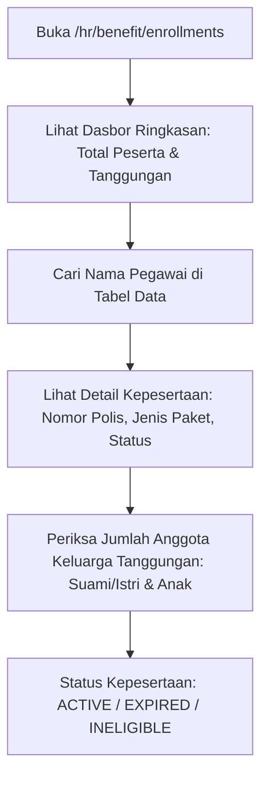

# Panduan Pengguna — Sub-Modul 12: Benefit & Jaminan Tanggungan

## 1. Informasi Modul

| Field | Keterangan |
| --- | --- |
| Nama Sub-Modul | Pendaftaran Benefit Asuransi & Tanggungan Keluarga Karyawan |
| Sasaran Pengguna | HR Benefit Officer, Staf Klaim Asuransi, dan Manajer SDM |
| Lokasi Menu Sidebar | **Sumber Daya Manusia $\rightarrow$ Enrollment Benefit Pegawai** |
| Alamat URL | `http://localhost:3000/hr/benefit/enrollments` |

---

## 2. Kapan & Mengapa Modul Ini Digunakan?

Rumah sakit kelas atas menyediakan fasilitas perlindungan kesehatan bagi pegawai dan keluarga intinya (suami/istri dan anak sah). Modul ini digunakan untuk:
1. Memantau kepesertaan jaminan BPJS Kesehatan dan BPJS Ketenagakerjaan seluruh staf.
2. Merekam keikutsertaan asuransi kesehatan swasta tambahan (*Top-up Health Insurance*).
3. Mengelola daftar anggota keluarga yang sah (*tanggungan*) agar berhak mendapatkan fasilitas bebas biaya berobat atau kamar rawat inap khusus di rumah sakit sendiri (*Staff Clinic / Self-Insured*).

---

## 3. Langkah-Langkah Penggunaan Layar

### Langkah 1: Membuka Dasbor Benefit
1. Buka sidebar kiri $\rightarrow$ Klik menu **Sumber Daya Manusia**.
2. Klik sub-menu **Enrollment Benefit Pegawai** (atau akses `http://localhost:3000/hr/benefit/enrollments`).
3. Periksa kartu metrik ringkasan di bagian atas:
   - **Total Karyawan Terdaftar**: Jumlah staf aktif yang memiliki jaminan benefit.
   - **Total Anggota Tanggungan**: Jumlah total jiwa keluarga (pasangan & anak) yang tercatat dalam sistem penjaminan.

### Langkah 2: Memeriksa Data Polis & Paket Manfaat
1. Pada tabel data, Anda dapat melihat informasi:
   - **Nama Pegawai & NIK RS**.
   - **Jenis Program Benefit**: Contoh: *BPJS Kesehatan Kelas 1*, *Asuransi Rawat Inap Eksekutif VIP*, *Santunan Kematian*.
   - **Nomor Polis / Nomor Kartu Peserta**.
   - **Tanggal Efektif Berlaku**: Tanggal awal perlindungan aktif.
   - **Jumlah Tanggungan Terdaftar**: Contoh: `3 Jiwa (1 Istri, 2 Anak)`.
   - **Status**: Ditandai badge hijau `Active`.

### Langkah 3: Menggunakan Filter Pencarian
* Gunakan kotak pencarian untuk mencari berdasarkan nomor kartu peserta atau nama staf.

---

## 4. Skenario Latihan Mandiri untuk Klien

* **Latihan 1: Memeriksa Penjaminan Keluarga**:
  - Cari nama staf perawat senior di tabel.
  - Periksa kolom tanggungan keluarga; pastikan nomor kartu BPJS anak dan pasangan tercatat valid.
* **Latihan 2: Memeriksa Status Polis**:
  - Perhatikan badge status; pastikan tidak ada staf aktif yang memiliki status `Expired` atau `Ineligible` agar staf tidak ditolak saat membutuhkan perawatan darurat di rumah sakit.

---

## 5. Dampak pada Modul Lain

* Data kepesertaan yang aktif di sini langsung terhubung ke **Sistem Kasir & Pendaftaran Pasien (Billing SIMRS)**. Saat anak pegawai berobat di poliklinik atau IGD, sistem billing otomatis mendeteksi diskon atau penjaminan 100% biaya rumah sakit.
* Iuran premi bulanan otomatis dipotongkan pada **Sub-Modul 10 (Penggajian Payroll)**.
