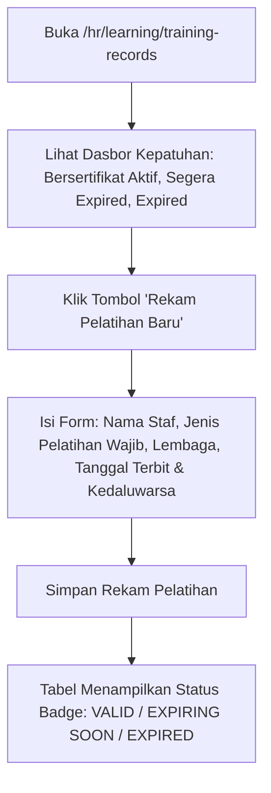

# Panduan Pengguna — Sub-Modul 16: Pelatihan Wajib Akreditasi & Diklat Staf

## 1. Informasi Modul

| Field | Keterangan |
| --- | --- |
| Nama Sub-Modul | Pelatihan Wajib Akreditasi Rumah Sakit, Sertifikasi & Diklat Kompetensi |
| Sasaran Pengguna | Bagian Diklat (Pendidikan & Pelatihan) HR, Seluruh Staf Rumah Sakit, dan Asesor Akreditasi |
| Lokasi Menu Sidebar | **Operasional HR $\rightarrow$ Pelatihan & Sertifikasi** |
| Alamat URL | `http://localhost:3000/hr/learning/training-records` |

---

## 2. Kapan & Mengapa Modul Ini Digunakan?

Standar akreditasi rumah sakit (STARKES / KARS / JCI) mewajibkan seluruh karyawan rumah sakit (dokter, perawat, analis lab, staf IT, hingga petugas keamanan/satpam) memiliki sertifikat keselamatan yang masih berlaku aktif:
1. **BHD (Bantuan Hidup Dasar / Resusitasi Jantung Paru)**.
2. **PPI (Pencegahan & Pengendalian Infeksi)**.
3. **KPRS (Keselamatan Pasien Rumah Sakit)**.
4. **K3RS & Simulasi Kebakaran (Penggunaan APAR / Code Red)**.

Modul ini digunakan untuk mencatat keikutsertaan pelatihan, memantau masa aktif sertifikat, serta memberikan peringatan dini sebelum sertifikat staf kedaluwarsa.

---

## 3. Langkah-Langkah Penggunaan Layar

### Langkah 1: Memantau Dasbor Kepatuhan Akreditasi
1. Buka `http://localhost:3000/hr/learning/training-records`.
2. Periksa kartu metrik ringkasan di bagian atas:
   - **Sertifikasi Aktif**: Jumlah sertifikat staf yang sah dan berlaku.
   - **Mendekati Kedaluwarsa**: Jumlah staf yang masa berlaku sertifikatnya akan habis dalam 60 hari ke depan.
   - **Kedaluwarsa (*Expired*)**: Jumlah staf yang sertifikatnya sudah habis masa berlakunya dan wajib segera dijadwalkan pelatihan ulang (*refresher*).

### Langkah 2: Merekam Sertifikat Pelatihan Baru
1. Klik tombol **"Rekam Pelatihan Baru"** di pojok kanan atas.
2. Pada modal dialog, isi formulir:
   - **Nama Pegawai**: Pilih staf yang baru selesai mengikuti pelatihan.
   - **Jenis Pelatihan**: Pilih dari daftar (misal: *Bantuan Hidup Dasar / Basic Life Support*).
   - **Lembaga Penyelenggara**: Contoh: *Pusdiklat Kemenkes RI* atau *Unit Diklat Internal RS*.
   - **Nomor Sertifikat**: Nomor registrasi resmi sertifikat.
   - **Tanggal Terbit**: Tanggal lulus ujian pelatihan.
   - **Tanggal Kedaluwarsa**: Tanggal habis masa berlaku (misal 2 tahun sejak terbit).
3. Klik **Simpan Rekam Pelatihan**.

### Langkah 3: Menemukan Sertifikat yang Hampir Habis
1. Gunakan filter pencarian atau perhatikan kolom status di tabel:
   - 🟢 Badge Hijau (`Valid`): Sertifikat masih berlaku lama.
   - 🟡 Badge Kuning (`Expiring Soon`): Masa berlaku tersisa kurang dari 60 hari.
   - 🔴 Badge Merah (`Expired`): Sertifikat sudah kedaluwarsa.

---

## 4. Skenario Latihan Mandiri untuk Klien

* **Latihan 1: Merekam Sertifikat BHD Baru**:
  - Masukkan data pelatihan BHD untuk satu orang perawat dengan masa berlaku 2 tahun ke depan.
  - Simpan dan pastikan baris baru berstatus hijau `Valid`.
* **Latihan 2: Simulasi Peringatan Kedaluwarsa**:
  - Buat data pelatihan dengan tanggal kedaluwarsa 20 hari dari hari ini.
  - Perhatikan bahwa sistem otomatis melabeli statusnya dengan badge kuning `Expiring Soon`.

---

## 5. Dampak pada Modul Lain

* Kepatuhan sertifikat ini menjadi syarat wajib verifikasi pada **Sub-Modul 14 (Kredensialing Dokter & Perawat)** dan menjadi bukti penilaian pada instrumen survei akreditasi rumah sakit (STARKES Bab KPS).
