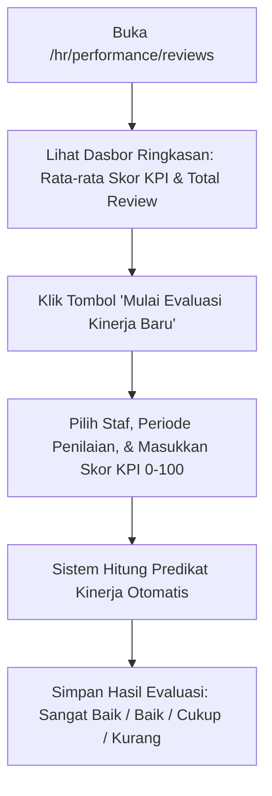

# Panduan Pengguna — Sub-Modul 17: Evaluasi Kinerja & Nilai KPI Staf

## 1. Informasi Modul

| Field | Keterangan |
| --- | --- |
| Nama Sub-Modul | Penilaian Kinerja Berkala, Skor Capaian KPI & Evaluasi Jenjang Karier Staf |
| Sasaran Pengguna | Kepala Instalasi/Ruangan (Penilai), Manajer HR, dan Direktur SDM |
| Lokasi Menu Sidebar | **Operasional HR $\rightarrow$ Tinjauan Kinerja Staf** |
| Alamat URL | `http://localhost:3000/hr/performance/reviews` |

---

## 2. Kapan & Mengapa Modul Ini Digunakan?

1. **Evaluasi Tahunan/Semesteran**: Mengukur pencapaian Key Performance Indicators (KPI) staf medis dan non-medis.
2. **Kenaikan Jenjang Karier Klinis (*Clinical Ladder*)**: Menjadi dasar kenaikan tingkat perawat (PK I $\rightarrow$ PK II $\rightarrow$ PK III $\rightarrow$ PK IV $\rightarrow$ PK V).
3. **Penentuan Insentif & Remunerasi**: Skor kinerja menentukan besaran bonus tahunan atau insentif jasa pelayanan rumah sakit.

---

## 3. Langkah-Langkah Penggunaan Layar

### Langkah 1: Memantau Dasbor Kinerja Staf
1. Akses `http://localhost:3000/hr/performance/reviews`.
2. Periksa kartu metrik ringkasan di atas:
   - **Total Evaluasi Selesai**: Jumlah staf yang telah dinilai kinerjanya.
   - **Rata-rata Skor KPI Rumah Sakit**: Rata-rata nilai capaian seluruh departemen (skala 0–100).
   - **Evaluasi Dalam Proses (*In Progress*)**: Lembar penilaian yang masih draf.

### Langkah 2: Mengisi Penilaian Kinerja Baru
1. Klik tombol **"Mulai Evaluasi Baru"** di pojok kanan atas.
2. Pada formulir dialog, isi:
   - **Nama Pegawai**: Pilih staf yang dinilai.
   - **Unit Pelayanan**: Otomatis terisi sesuai penempatan staf.
   - **Periode Penilaian**: Contoh: `Semester II - Tahun 2026`.
   - **Skor Capaian KPI (Angka 0–100)**: Contoh `92`.
   - **Catatan & Rekomendasi Penilai**: Catatan kelebihan dan area perbaikan staf.
3. Klik tombol **Simpan Evaluasi**.

### Langkah 3: Membaca Predikat Kinerja
Sistem secara otomatis mengonversi skor angka menjadi predikat kualitatif resmi:
* Skor $90 - 100$: Badge Hijau `Sangat Baik` (Berhak promosi / insentif maksimal).
* Skor $75 - 89$: Badge Biru `Baik` (Memenuhi standar pelayanan RS).
* Skor $60 - 74$: Badge Kuning `Cukup` (Perlu pendampingan mentor).
* Skor $< 60$: Badge Merah `Kurang` (Wajib mengikuti evaluasi ulang/diklat remedial).

---

## 4. Skenario Latihan Mandiri untuk Klien

* **Latihan 1: Membuat Lembar Penilaian Baru**:
  - Masukkan evaluasi untuk perawat IGD dengan skor `95`.
  - Simpan dan perhatikan sistem melabeli baris tersebut dengan predikat `Sangat Baik`.
* **Latihan 2: Pengujian Batas Skor**:
  - Coba masukkan skor angka `150` atau `-10`.
  - Sistem menolak penyimpanan: *"Skor KPI harus berada dalam rentang angka 0 hingga 100."*

---

## 5. Dampak pada Modul Lain

* Skor kinerja ini menjadi syarat dokumen kenaikan golongan gaji pada **Sub-Modul 02 (Workforce Core)** dan penetapan bonus insentif pada **Sub-Modul 10 (Penggajian Payroll)**.
