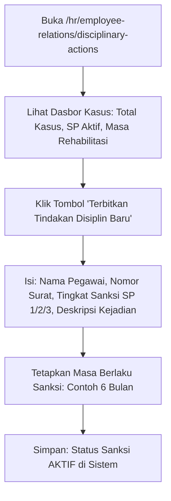

# Panduan Pengguna — Sub-Modul 19: Hubungan Kerja & Disiplin SP

## 1. Informasi Modul

| Field | Keterangan |
| --- | --- |
| Nama Sub-Modul | Penanganan Kasus Hubungan Kerja, Pelanggaran Tata Tertib & Sanksi Surat Peringatan (SP) |
| Sasaran Pengguna | HR Hubungan Industrial, Kepala Ruangan, Komite Etik & Hukum RS, dan Direktur SDM |
| Lokasi Menu Sidebar | **Operasional HR $\rightarrow$ Kasus Disiplin & SP** |
| Alamat URL | `http://localhost:3000/hr/employee-relations/disciplinary-actions` |

---

## 2. Kapan & Mengapa Modul Ini Digunakan?

Penegakan kedisiplinan dan kode etik di rumah sakit berhubungan langsung dengan keselamatan pasien dan reputasi rumah sakit. Modul ini digunakan saat:
1. Terjadi pelanggaran disiplin kerja (misal: sering terlambat dinas kronis, meninggalkan pos jaga pasien tanpa izin, atau mangkir).
2. Terjadi pelanggaran etika pelayanan atau Standar Prosedur Operasional (SPO) medis.
3. HR menerbitkan sanksi formal bertingkat (Teguran, SP 1, SP 2, hingga SP 3).

---

## 3. Langkah-Langkah Penggunaan Layar

### Langkah 1: Memantau Dasbor Disiplin Pegawai
1. Buka `http://localhost:3000/hr/employee-relations/disciplinary-actions`.
2. Periksa kartu metrik ringkasan di atas:
   - **Kasus Aktif**: Jumlah kasus pelanggaran yang sedang berjalan.
   - **Surat Peringatan Terbit**: Jumlah sanksi SP yang masih berlaku masa aktifnya.
   - **Kasus Selesai / Rehabilitasi**: Staf yang telah selesai menjalani masa sanksi dan kembali berstatus bersih.

### Langkah 2: Menerbitkan Surat Peringatan (SP) Baru
1. Klik tombol **"Terbitkan Sanksi Baru"** di pojok kanan atas.
2. Pada formulir dialog, isi:
   - **Nama Pegawai**: Pilih staf yang melakukan pelanggaran.
   - **Nomor Dokumen SP**: Contoh: `SP.01/HRD-MMC/X/2026`.
   - **Tingkat Sanksi**: Pilih dari pilihan baku:
     - `Teguran Tertulis`
     - `Surat Peringatan 1 (SP 1)`
     - `Surat Peringatan 2 (SP 2)`
     - `Surat Peringatan 3 (SP 3 / Skorsing)`
   - **Uraian Pelanggaran**: Contoh: *Meninggalkan ruang rawat inap selama 3 jam saat dinas malam tanpa izin Kepala Ruangan*.
   - **Tanggal Berlaku & Tanggal Berakhir**: Standar masa berlaku SP menurut undang-undang adalah 6 bulan.
3. Klik tombol **Simpan Tindakan Disiplin**.

---

## 4. Skenario Latihan Mandiri untuk Klien

* **Latihan 1: Menerbitkan SP 1**:
  - Catat satu tindakan SP 1 untuk staf yang melakukan pelanggaran kehadiran.
  - Perhatikan baris baru muncul dengan badge kuning `SP 1` dan tanggal kedaluwarsa 6 bulan ke depan.
* **Latihan 2: Memeriksa Riwayat Sanksi**:
  - Gunakan filter pencarian untuk melihat rekam jejak kedisiplinan staf sebelum memutuskan promosi jabatan.

---

## 5. Dampak pada Modul Lain

* Staf yang memiliki status SP aktif otomatis diblokir dari kelayakan pengajuan promosi atau kenaikan jenjang klinis di **Sub-Modul 17 (Kinerja KPI)**, dan tunjangan kinerjanya dapat dipotong di **Sub-Modul 10 (Penggajian Payroll)**.
