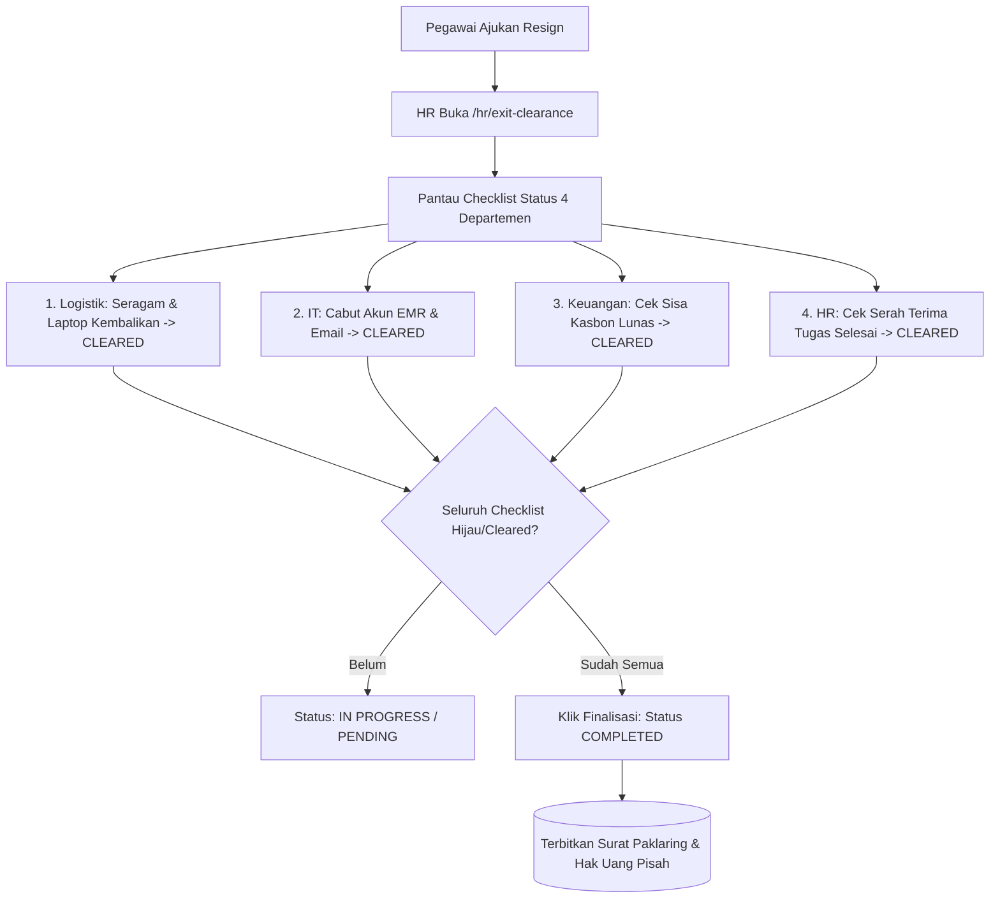

# Panduan Pengguna — Sub-Modul 20: Kliring Aset & Exit Clearance

## 1. Informasi Modul

| Field | Keterangan |
| --- | --- |
| Nama Sub-Modul | Pemantauan Exit Clearance, Kliring Aset & Pengakhiran Hubungan Kerja (Offboarding) |
| Sasaran Pengguna | Staf yang Berhenti (Resignee), Tim IT, Tim Keuangan, Tim Logistik/Aset, dan Tim HRD |
| Lokasi Menu Sidebar | **Sumber Daya Manusia $\rightarrow$ Exit Clearance Karyawan** |
| Alamat URL | `http://localhost:3000/hr/exit-clearance` |

---

## 2. Kapan & Mengapa Modul Ini Digunakan?

Ketika seorang dokter, perawat, atau karyawan umum mengundurkan diri (*resign*) atau memasuki usia pensiun, rumah sakit wajib memastikan tidak ada kewajiban klinis, data rahasia, maupun aset finansial yang terbengkalai. Modul ini menyediakan **Checklist Bebas Tanggungan Lintas 4 Departemen**:
1. **Departemen Pelayanan Medis**: Menjamin seluruh resume medis pasien telah ditandatangani.
2. **Departemen IT / SIMRS**: Menjamin akun rekam medis elektronik (EMR) dan email korporat dinonaktifkan.
3. **Departemen Logistik & Rumah Tangga**: Menjamin seragam dinas, ID card, dan laptop inventaris telah dikembalikan.
4. **Departemen Keuangan (Finance)**: Menjamin pelunasan pinjaman kasbon atau pemotongan dari uang pesangon/kompensasi akhir.

---

## 3. Langkah-Langkah Penggunaan Layar

### Langkah 1: Membuka Dasbor Exit Clearance
1. Masuk ke `http://localhost:3000/hr/exit-clearance`.
2. Periksa kartu metrik ringkasan di atas:
   - **Proses Berjalan (*In Progress*)**: Karyawan yang sedang menjalani masa pemberitahuan (*one month notice*) dan proses kliring.
   - **Selesai Kliring (*Completed*)**: Karyawan yang seluruh kewajibannya sudah bebas dan tuntas.

### Langkah 2: Memantau Progres Checklist Lintas Departemen
1. Pada tabel data, perhatikan kolom checklist departemen:
   - **Status Unit Logistik/Aset**: Menampilkan badge `Cleared` (jika inventaris sudah diterima) atau `Pending`.
   - **Status Unit IT**: Menampilkan badge `Cleared` (jika akses SIMRS & email sudah ditutup).
   - **Status Unit Keuangan**: Menampilkan badge `Cleared` (jika bebas utang/kasbon).
   - **Status Unit HR**: Menampilkan verifikasi akhir kepegawaian.

### Langkah 3: Finalisasi & Penerbitan Surat Pengalaman Kerja (*Paklaring*)
1. Jika seluruh 4 kolom departemen telah berstatus hijau (`Cleared`), tombol **"Selesaikan Kliring (*Complete Clearance*)"** akan aktif.
2. Klik tombol tersebut untuk mengunci status akhir.
3. HR mencetak Surat Keterangan Pengalaman Kerja (*Paklaring*) dan memproses pembayaran uang pisah / kompensasi cuti tahunan yang belum terpakai.

---

## 4. Skenario Latihan Mandiri untuk Klien

* **Latihan 1: Memeriksa Status Karyawan Resign**:
  - Buka tabel exit clearance dan pilih salah satu karyawan yang sedang proses berhenti.
  - Perhatikan departemen mana yang masih bertanda merah/kuning (belum selesai kliring).
* **Latihan 2: Pengujian Keamanan Sistem**:
  - Coba selesaikan proses kliring saat salah satu departemen (misal Keuangan) masih berstatus `Pending`.
  - Sistem akan menolak finalisasi: *"Proses exit clearance belum dapat diselesaikan karena masih ada tanggungan di Departemen Keuangan."*

---

## 5. Dampak pada Modul Lain

* Saat status berubah menjadi `Completed`, status pegawai di **Sub-Modul 02 (Workforce Core)** otomatis diubah menjadi `Non-Aktif / Resigned` dan namanya tidak akan muncul lagi di pembuat jadwal **Sub-Modul 06 (Roster)** maupun daftar gaji **Sub-Modul 10 (Payroll)**.
