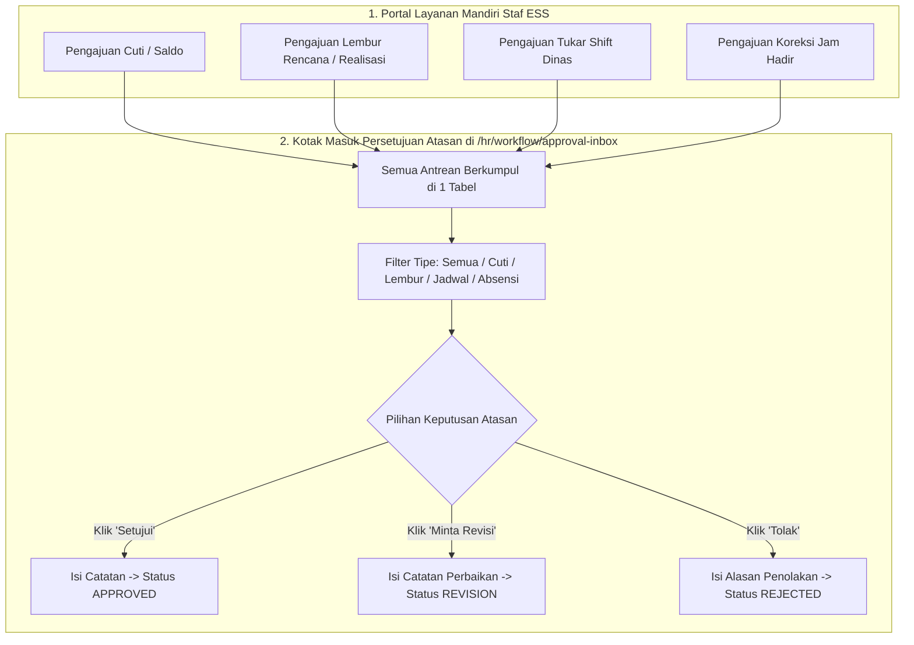

# Panduan Pengguna — Sub-Modul 21: Layanan Mandiri Staf (ESS) & Kotak Masuk Persetujuan

## 1. Informasi Modul

| Field | Keterangan |
| --- | --- |
| Nama Sub-Modul | Portal Layanan Mandiri Pegawai (*Employee Self-Service*) & Kotak Masuk Persetujuan Terpadu (*Unified Approval Inbox*) |
| Sasaran Pengguna | • Seluruh Staf Medis & Non-Medis (Pemohon) • Seluruh Kepala Ruangan, Kepala Instalasi & Direktur (Penyetuju) |
| Lokasi Menu Sidebar | • Mandiri: **Layanan Mandiri $\rightarrow$ Human Resource $\rightarrow$ ...** • Atasan: **Sumber Daya Manusia $\rightarrow$ Kotak Masuk Persetujuan** |
| Alamat URL | • Mandiri Cuti: `http://localhost:3000/self-services/human-resource/leave` • Mandiri Lembur: `http://localhost:3000/self-services/human-resource/overtime` • Mandiri Jadwal & Tukar Shift: `http://localhost:3000/self-services/human-resource/schedule` • Mandiri Koreksi Absensi: `http://localhost:3000/self-services/human-resource/attendance-correction` • Mandiri Presensi Harian: `http://localhost:3000/self-services/human-resource/attendance` • **Kotak Masuk Persetujuan Atasan**: `http://localhost:3000/hr/workflow/approval-inbox` |

---

## 2. Kapan & Mengapa Modul Ini Digunakan?

1. **Bagi Staf**: Menghilangkan birokrasi formulir kertas. Staf dapat melihat jadwal jaga, mengajukan cuti, mengajukan lembur darurat, menukar shift dengan rekan kerja, atau mengoreksi jam absensi langsung dari layar ponsel/laptop.
2. **Bagi Atasan (Kepala Ruangan/Manajer/Direktur)**: Menghemat waktu secara drastis. Atasan tidak perlu lagi membuka 5 menu berbeda untuk memeriksa permohonan staf; **cukup membuka 1 layar Kotak Masuk Persetujuan (*Unified Approval Inbox*)** untuk memutuskan seluruh pengajuan bawahannya.

---

## 3. Langkah-Langkah Penggunaan Layar

### Bagian A: Staf Mengajukan Permohonan (Contoh: Tukar Shift)
1. Buka `http://localhost:3000/self-services/human-resource/schedule`.
2. Klik tombol **"Tukar Shift Rekan Sejawat"**.
3. Pada modal formulir:
   - Pilih rekan kerja pengganti (misal: *Ners Budi*).
   - Pilih tanggal shift Anda yang ingin ditukar.
   - Pilih tanggal shift rekan pengganti.
   - Masukkan alasan pertukaran (misal: *Tugas menghadiri wisuda keluarga*).
4. Klik **Kirim Permohonan**.

### Bagian B: Atasan Memutuskan Permohonan di Kotak Masuk Persetujuan
1. Masuk sebagai Kepala Ruangan $\rightarrow$ Buka `http://localhost:3000/hr/workflow/approval-inbox`.
2. Periksa kartu metrik antrean di atas:
   - **Menunggu Persetujuan (*Pending*)**: Jumlah permohonan yang butuh keputusan Anda hari ini.
   - **Disetujui (*Approved*)**: Jumlah permohonan yang telah disetujui.
   - **Ditolak (*Rejected*)**: Permohonan yang ditolak.
   - **Butuh Revisi (*Revision*)**: Permohonan yang dikembalikan ke staf.
3. Gunakan **Filter Jenis Dokumen** untuk melihat jenis tertentu (pilih: *Semua*, *Cuti*, *Lembur*, *Jadwal Dinas*, atau *Koreksi Absensi*).
4. Pada baris permohonan staf, Anda memiliki 3 tombol aksi:
   - **Tombol "Setujui (*Approve*)"**: Klik tombol hijau $\rightarrow$ modal konfirmasi muncul $\rightarrow$ masukkan catatan persetujuan $\rightarrow$ status baris berubah menjadi `Approved`. Data langsung diterapkan ke jadwal dinas!
   - **Tombol "Minta Revisi (*Revision*)"**: Klik tombol kuning $\rightarrow$ tuliskan hal yang wajib diperbaiki staf (misal: *Mohon lampirkan bukti surat sakit dari dokter*) $\rightarrow$ status berubah menjadi `Revision` dan permohonan kembali ke staf.
   - **Tombol "Tolak (*Reject*)"**: Klik tombol merah $\rightarrow$ masukkan alasan resmi penolakan (misal: *Kuota perawat di ruangan tidak mencukupi untuk cuti bersamaan*) $\rightarrow$ status berubah menjadi `Rejected`.

---

## 4. Skenario Latihan Mandiri untuk Klien

* **Latihan 1: Simulasi Pengajuan dan Persetujuan**:
  - Buka `/self-services/human-resource/leave` dan ajukan cuti 1 hari.
  - Buka `/hr/workflow/approval-inbox`, Anda akan melihat pengajuan cuti tersebut muncul paling atas.
  - Klik tombol **Setujui**, tulis catatan *"Disetujui, harap serah terima pasien sebelum cuti"*, lalu konfirmasi.
  - Amati status berubah menjadi hijau `Approved`.
* **Latihan 2: Pengujian Fitur Minta Revisi**:
  - Ajukan klaim lembur tanpa uraian tugas di portal lembur.
  - Buka Kotak Masuk Persetujuan $\rightarrow$ klik tombol **Minta Revisi**.
  - Tuliskan *"Tolong jelaskan nama pasien operasi darurat yang ditangani"*.
  - Perhatikan status baris berubah menjadi kuning `Revision` dan tercatat pada riwayat audit.

---

## 5. Dampak pada Modul Lain

* Persetujuan yang diputuskan di Kotak Masuk Terpadu ini langsung memperbarui **Sub-Modul 06 (Jadwal Roster)**, **Sub-Modul 07 (Kehadiran)**, **Sub-Modul 08 (Saldo Cuti)**, dan **Sub-Modul 09 (Jam Lembur Payroll)** secara otomatis dan terintegrasi penuh.
