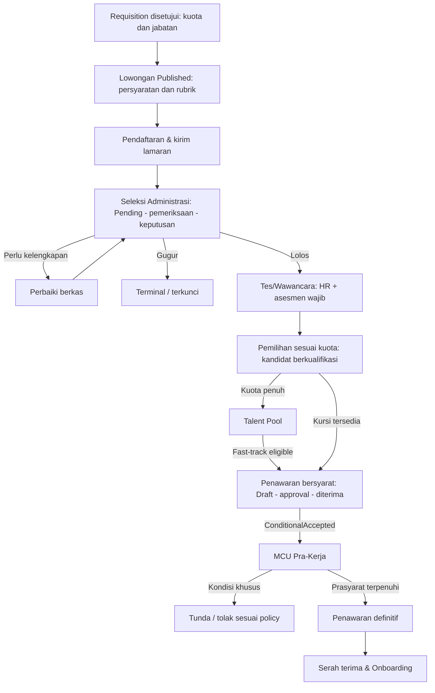

# Master Instruksi Agent

**QUILVIAN V2  /  HRD FINISHING  /  26 NOVEMBER 2026**

> **Catatan format:** konversi dari PDF master 43 halaman (26 November 2026). Seluruh isi instruksi dipertahankan; 15 wireframe ditranskripsikan menjadi skema teks dengan kolom utama dan side panel, serta diagram workflow dalam Mermaid. Tidak ada lampiran eksternal atau kebijakan baru.

## Rekrutmen & Seleksi

Implementasi end-to-end: perbaikan workflow, persyaratan dan rubrik, Candidate Workspace, dedicated pages, keamanan dan UAT.

| Cakupan | Deliverable implementasi |
| --- | --- |
| Menu 03 • 5 submenu target | 9 area operasional (termasuk dependensi Requisition, Offer, MCU, Talent Pool dan Handoff) |
| 20 task Backend | 27 task Frontend; total 47 task FIN usulan |
| Prioritas | Backend critical repair → enhancement → Frontend → integrasi → UAT |
| Status | Instruksi eksekusi; belum ada perubahan source/DB atau UAT PASS dari dokumen ini |

> **Mandat kepada Agent**
>
> Langsung implementasikan pekerjaan yang telah terkunci pada workspace yang sah. Jangan berhenti setelah audit atau planning. Pisahkan kebijakan yang masih perlu keputusan owner dan pekerjaan yang memerlukan izin schema/migration. Lanjutkan task independen.

#### Repository tujuan

**Frontend** DevBenari/QuilvianSystemFrontendDev · HamzahV2
**Backend** DevBenari/NewQuilvianSystemBackend · MHamzah
**Governance** DevBenari/QuilvianEngineeringSkills · main

Revisi konsolidasi atas instruksi auto-screening sebelumnya. Versi Markdown tunggal, dikonversi dari PDF sumber sesuai permintaan. Skema UI di dalam dokumen adalah wireframe visual, bukan hasil aplikasi live.

## Panduan membaca dokumen

| Bagian | Isi |
| --- | --- |
| 01 · Role | Mandat, governance, mode kerja dan batas izin. |
| 02 · Task | Cakupan, 19 temuan, keputusan, diagram siklus dan skema visual per submenu. |
| 03 · Context | Source evidence, snapshot branch, API, data dan route. |
| 04 · Execution Workflow | 20 task BE, 27 task FE, fase integrasi, UAT dan Definition of Done. |
| 05 · Stop conditions | Blocker per area, izin terpisah dan larangan false success. |
| 06 · Output | Laporan implementasi, evidence, retest dan handoff Agent. |

#### Daftar skema visual

| Gambar | Halaman / fitur |
| --- | --- |
| 1–2 | Lowongan dan persyaratan lowongan |
| 3–4 | Wizard dan Candidate Workspace |
| 5–7 | Seleksi Administrasi, Wawancara HR dan Asesmen Klinis |
| 8–10 | Penawaran, Rujukan MCU dan Hasil MCU |
| 11–12 | Talent Pool dan Serah Terima |
| 13–15 | Antrean kerja, konfigurasi rubrik, dan Fast-Track |

Diagram, wireframe dan field contoh menjelaskan target layout serta perilaku; bukan screenshot live atau hasil implementasi. Gunakan base component dan design token yang telah tersedia.

## 01 / Role

### Mandat, mode kerja & batas izin

Anda adalah Senior Fullstack Engineer Quilvian V2, analis proses bisnis rumah sakit, UI/UX engineer dan QA. Gunakan ASP.NET Core/EF Core serta Next.js/React sesuai stack existing. Kerjakan integrasi nyata, bukan mock atau sekadar audit.

| Mode / fase | Target tulis lokal bila diotorisasi |
| --- | --- |
| MODULE BLUEPRINT MODE | BE MHamzah: hanya dokumen canonical HRD terkait keputusan, kontrak, roadmap dan traceability. Source read-only pada fase ini. |
| BACKEND MODE | BE MHamzah: RecruitmentManagement, DTO, service, konfigurasi EF dan test terkait; FE read-only. |
| FRONTEND MODE | FE HamzahV2: halaman, view, hook, service, CSS Modules dan test terkait; BE read-only. |
| Validasi integrasi | Environment uji yang diizinkan; perbaikan dalam mode terkait. Skills selalu read-only. |

#### Governance wajib

- Baca AGENTS.md dan CLAUDE.md pada kedua repo, agents/rules/GLOBAL_RULES.md dari Engineering Skills serta rule frontend/backend/testing/rule-output yang relevan. Baca BACKEND_ENGINEERING_CONTRACT.md dan MODULE_OWNERSHIP_PREFIX_REGISTRY.md.
- Panggil runtime **quilvian-engineering-skills:build-module-backend** sebelum fase BE dan **quilvian-engineering-skills:build-module-frontend** sebelum fase FE. Repo terkini membolehkan skill opsional jika tidak diminta; dokumen ini mewajibkannya eksplisit.
- Jika skill wajib tidak tersedia: BLOCKED - Quilvian runtime skill unavailable. Jika governance tidak dapat dibaca: BLOCKED - canonical governance unavailable. Jangan bypass.
- Tidak otomatis commit, push, pull, merge, rebase, checkout/switch, deploy, membuat atau menjalankan migration, eksekusi DB atau backfill massal. Operasi tersebut membutuhkan izin terpisah. Jangan merusak working tree pengguna.

## 02 / Task

### Cakupan dan hasil bisnis

| Submenu registry (persis) | Pemetaan kemampuan sidebar existing |
| --- | --- |
| 1. Lowongan | Permintaan Requisition, Lowongan, konfigurasi persyaratan. |
| 2. Pelamar | Direktori Kandidat, wizard, Detail Pelamar / Journey, arsip dokumen. |
| 3. Seleksi Administrasi | Antrean pemeriksaan per lamaran, hasil dan rincian. |
| 4. Tes/ Wawancara | Wawancara HR, Asesmen Klinis/Teknis, rubrik, ranking evaluasi. |
| 5. Onboarding | Surat Penawaran (Offer), Pemantauan MCU Pra-Kerja, Talent Pool Cadangan sebagai cabang, Serah Terima dan Penerimaan & Onboarding. |

#### Hasil yang harus dicapai

- Sidebar tetap menjadi antrean pekerjaan lintas kandidat. Detail Pelamar menjadi workspace satu kandidat dengan lamaran terpilih, stepper enam tahap, tab informasi, blocker dan next action.
- Seluruh transaksi utama pindah ke dedicated page; wizard existing dipertahankan, modal kecil hanya untuk konfirmasi singkat. Tidak ada redesign Administrator, Payroll atau master data lain.
- Setiap perpindahan tahap didasarkan pada data persisted, prasyarat bisnis, role dan status server; satu sumber kebenaran per lamaran. Tidak membuat engine journey paralel.
- Master persyaratan dan rubrik menjadi konfigurasi pendukung, bukan duplikasi master data. Snapshot versi menjaga hasil historis.

> **Batas perubahan navigasi**
>
> Pertahankan nama/urutan sidebar yang terlihat pada UAT: Requisition, Lowongan, Pelamar, Seleksi Administrasi, Tes/Wawancara, Surat Penawaran (Offer), Pemantauan MCU Pra-Kerja, Talent Pool Cadangan. Talent Pool bukan tahapan wajib setelah MCU. Onboarding tetap di kelompok existing. Letak konfigurasi master diverifikasi dengan registry resource sebelum menambah navigasi.

### Daftar temuan & prioritas (1/2)

Bukti UAT manusia dan source pada snapshot 26 November 2026. P1 = risiko proses/keputusan; P2 = usability/functional tambahan. Penetapan PASS baru dilakukan setelah retest.

| ID | Temuan dan dampak | Bukti / kelas |
| --- | --- | --- |
| REC-01 | Lamaran tidak otomatis masuk antrean. GET screenings 200, totalData 0, items []. Aulia baru juga tidak muncul. | P1 / UAT FAIL + source |
| REC-02 | Gagal Memuat Journey; detail kehilangan panduan berikutnya. | P1 / UAT FAIL; root cause belum diketahui |
| REC-03 | Buka Sesi Baru dan link evaluasi muncul ketika tahap Screening/Submitted. | P1 / UI validation; bypass BE belum terbukti |
| REC-04 | Seleksi hanya hasil STR dan catatan; nonklinis langsung lulus saat evaluate. | P1 / source REPAIR |
| REC-05 | KTP, CV, ijazah dan kualifikasi tidak menjadi gate kelulusan. | P1 / source GAP |
| REC-06 | Vacancy belum punya struktur persyaratan terapan yang lengkap. | P1 / ADD; audit reuse |
| REC-07 | Wawancara HR hanya skor akhir, rekomendasi, catatan. | P1 / screenshot + source GAP |
| REC-08 | Rubrik terpisah klinis/teknis belum ada di alur evaluasi. | P1 / source GAP |
| REC-09 | Skor terpadu dan peringkat Talent Pool manual. | P1 / source + UI |
| REC-10 | Enroll Talent Pool tidak memeriksa semua hasil kelulusan; fast-track bisa membuat draft offer. | P1 / source REPAIR |

Kandidat uji: CAN-20261126-0002 / APP-20261126-0002 (data sintetis). Screenshot berikutnya menunjukkan Aulia Lolos dan Sintia Gugur. Inisialisasi otomatis belum terbukti; jangan menyimpulkan bahwa bug sudah diperbaiki dari dua hasil tersebut.

### Daftar temuan & prioritas (2/2)

| ID | Temuan dan dampak | Bukti / kelas |
| --- | --- | --- |
| REC-11 | Form penawaran panjang dalam modal satu kolom. | P2 / UI |
| REC-12 | Rujukan dan pencatatan MCU dalam modal. | P2 / UI + privacy gate |
| REC-13 | Tambah Talent Pool dan fast-track dalam modal. | P2 / UI |
| REC-14 | Detail Pelamar berupa panel vertikal, scroll panjang. | P2 / UI |
| REC-15 | Petugas tidak memahami siklus antar-menu dan kandidat siap tahap berikutnya tidak selalu tampil. | P1 / UAT keluhan + source |
| REC-16 | Tindakan tersebar di header, tabel dan Journey. | P2 / UI |
| REC-17 | Detail mengambil screening dengan pencarian nama dan pageSize 50; data dapat terlewat. | P1 / risiko source |
| REC-18 | Footer menutup sebagian konten pada screenshot. | P2 / UAT UI; CSS root belum dibuktikan |
| REC-19 | Daftar penapisan selesai menampilkan aksi “-”, tidak ada rincian hasil. | P2 / UAT UI |

> **Konflik kontrak MCU**
>
> HRD-DEC-078 menetapkan FIT, FIT_WITH_RESTRICTIONS, TEMPORARILY_UNFIT dan PERMANENTLY_UNFIT. McuClearanceService existing hanya mengolah Fit, FitWithRestrictions dan Unfit (serta Pending). Fit langsung menetapkan FinalAccepted. Jangan memaksa respons final kedua atau mengklasifikasi ulang Unfit lama tanpa dasar.

#### Batas pembuktian

Pemeriksaan source read-only, tidak menjalankan browser atau query DB aktual. Journey error belum memiliki HTTP response/stack trace. Runtime localhost bisa berbeda dari HEAD GitHub. Seluruh ID FIN di bawah merupakan usulan dan harus direkonsiliasi dengan roadmap; jangan menimpa ID existing.

### Keputusan terkunci dan gate kebijakan

| Status / referensi | Ketentuan implementasi |
| --- | --- |
| Disetujui dalam chat | Auto-screening Pending atomik saat apply; profil tanpa lowongan tidak enqueue; satu screening aktif per ApplicationId; backfill preview dan apply berizin. |
| HRD-DEC-076 / VR-REC-07–09 | Hard gate STR untuk klinis; hilang/kedaluwarsa pada evaluasi mengikuti aturan existing. Pengecualian bukti resmi perpanjangan memerlukan verifikasi manual sesuai keputusan, belum seluruhnya terbukti di source. |
| HRD-DEC-077 | Form HR dan asesmen terpisah, rubrik dan rekomendasi; hak veto klinis/teknis sesuai kewenangan. HR tidak override veto. |
| HRD-DEC-078 | Penawaran bersyarat diterima dahulu, baru MCU; kesimpulan medis saja untuk HRD; finalisasi sesuai kontrak. |
| HRD-DEC-079 | Grade gaji dan plafon; rantai approval standar Kepala Unit/HR Manager; pengecualian tambahan Finance dan Dirut sesuai kontrak. |
| HRD-DEC-080 | Talent Pool kandidat berkualifikasi, kuota penuh, retensi 6 bulan; fast-track saat kursi kembali tersedia; kedaluwarsa memerlukan evaluasi ulang. |
| HRD-DEC-244 | Worklist penapisan per lamaran; default Menunggu dan filter relevan. |

#### Usulan yang masih perlu dikunci owner

Bobot dan batas lulus rubrik, skala/rounding, formula skor gabungan dan tie-break ranking, syarat asesmen teknis nonklinis, persyaratan dokumen khusus, kebijakan kelengkapan/review ulang, konfirmasi pembatasan MCU, serta pemetaan data lama. UI dan struktur konfigurasi dapat dikerjakan tanpa mengaktifkan kebijakan yang belum disahkan.

> **Gate schema terpisah**
>
> Audit reuse dan desain entity/kontrak terlebih dahulu. Jangan membuat atau menjalankan migration atau mengubah DB existing tanpa izin eksplisit; tandai pekerjaan yang tergantung schema sebagai BLOCKED, bukan PASS.

### Siklus rekrutmen end-to-end

Satu lamaran = satu perjalanan. Petugas memutuskan hasil pemeriksaan, sistem menegakkan prasyarat dan mengarahkan langkah berikutnya.



> Profil saja tidak membuat screening. Jalur alternatif tidak boleh bypass hard gate.

*Skema target. Kelengkapan berkas adalah usulan yang tidak menghapus hard gate STR. Talent Pool hanya kandidat yang memenuhi kebijakan; fast-track tetap memvalidasi kelayakan. MCU Fit dapat menjadi penawaran definitif otomatis jika kontrak sah; status khusus mengikuti keputusan owner.*

### Submenu 1 - Lowongan

Tujuan: membuat kebutuhan tenaga kerja, kuota, kualifikasi dan dokumen menjadi sumber resmi untuk seluruh proses seleksi.

**Rujukan source:** FE requisitions-list-view.jsx, vacancies-list-view.jsx, vacancy-detail-view.jsx; BE JobVacancyService.cs, JobRequisitionService.cs, HrdJobVacancy. Create memeriksa Requisition Approved dan sisa kuota.

```text
+----------------------------------------------------------------------------------------------------+
| QUILVIAN / REKRUTMEN & SELEKSI                                                                     |
| Buat Lowongan Kerja    [Kembali]                                                                   |
| Requisition Approved • konfigurasi persyaratan                                                     |
+----------------------------------------------------------------------------------------------------+
+-------------------------------------------------------------------+--------------------------------+
| INFORMASI LOWONGAN                                                | RINGKASAN & TINDAKAN           |
| Requisition: [REQ-UAT-001]                                        | ------------------------------ |
| Jabatan / unit: [Perawat IGD]                                     | Kuota disetujui:               |
| Kuota / kategori: [2 / Klinis]                                    | 2 kursi                        |
| Batas penutupan: [02 Nov 2027]                                    |                                |
|                                                                   | Status:                        |
| PERSYARATAN & EVALUASI                                            | Draft                          |
| Pendidikan: [Profesi Ners]                                        |                                |
| Dokumen wajib: [KTP, CV, Ijazah, STR]                             | Prasyarat:                     |
| Rubrik: [HR umum / Klinis IGD]                                    | Requisition Approved           |
|                                                                   |                                |
|                                                                   | [ Simpan Draft ]               |
|                                                                   | [ Publikasikan ]               |
+-------------------------------------------------------------------+--------------------------------+
```

*Gambar 1. Dedicated page Lowongan; publikasi terpisah dan hanya sesuai permission. Nilai simulasi.*

#### Instruksi BE & FE

Pertahankan approval Requisition, validasi kuota, Published/closing dan data jabatan/unit. Pindahkan form Requisition dan Lowongan dari modal ke halaman create/edit; prefill dari ID terkait. Tambah konfigurasi persyaratan dan referensi rubrik versi, validasi kelengkapan saat publish sesuai kontrak. Data kandidat yang sudah apply memakai snapshot versi awal.

#### Acceptance / UAT

Requisition belum approved, kuota melebihi sisa atau lowongan ditutup: tidak dapat publish/apply. Pilih template persyaratan sah, simpan dan refresh; dokumen wizard mengikuti versi yang ditetapkan. Uji akses approve/publish terpisah.

### Konfigurasi persyaratan lowongan

```text
+----------------------------------------------------------------------------------------------------+
| QUILVIAN / REKRUTMEN & SELEKSI                                                                     |
| Persyaratan Lowongan    [Kembali]                                                                  |
| Perawat IGD • versi persyaratan                                                                    |
+----------------------------------------------------------------------------------------------------+
+-------------------------------------------------------------------+--------------------------------+
| DOKUMEN & KETENTUAN                                               | RINGKASAN & TINDAKAN           |
| KTP: [Wajib]                                                      | ------------------------------ |
| CV: [Wajib]                                                       | Versi:                         |
| Ijazah: [Wajib]                                                   | Draft v2                       |
| STR: [Wajib / klinis]                                             |                                |
| BTCLS*: [Wajib / contoh]                                          | Berlaku untuk:                 |
| Surat pengalaman: [Opsional]                                      | Lamaran baru                   |
|                                                                   |                                |
| KUALIFIKASI                                                       | Historis:                      |
| Pendidikan: [Profesi Ners]                                        | Versi lama tetap               |
| Pengalaman: [Sesuai kebijakan]                                    |                                |
|                                                                   | [ Simpan Draft ]               |
|                                                                   | [ Aktifkan Versi ]             |
+-------------------------------------------------------------------+--------------------------------+
```

*Gambar 2. Konfigurasi persyaratan. BTCLS dan kualifikasi spesifik adalah contoh, bukan keputusan kebijakan final.*

| Persyaratan | Perawat IGD | Administrasi | IT |
| --- | --- | --- | --- |
| KTP, CV, Ijazah | Wajib* | Wajib* | Wajib* |
| STR | Wajib sesuai gate | Tidak berlaku | Tidak berlaku |
| BTCLS | Contoh wajib | — | — |
| Portofolio | — | Opsional* | Contoh wajib |

* Contoh konfigurasi yang dapat diatur owner. Jangan hardcode menjadi kebijakan seluruh RS. Pastikan persyaratan terikat vacancy/version, identitas tipe dokumen, mandatory, kualifikasi dan aturan verifikasi. Jika revisi template, buat versi baru; snapshot lamaran tidak berubah.

### Submenu 2 - Pelamar

Tujuan: profil kandidat, lamaran dan arsip persisten; recruiter mengetahui tindakan berikutnya tanpa input ulang.

**Rujukan source:** FE candidate-registration-wizard-view.jsx, use-candidate-registration-wizard.js, wizard/candidate-wizard-step-panels.jsx, candidates-directory-view.jsx; BE CandidateService.RegisterAsync / ApplyVacancyAsync, CandidateController.

```text
+----------------------------------------------------------------------------------------------------+
| QUILVIAN / REKRUTMEN & SELEKSI                                                                     |
| Pendaftaran Pelamar    [Kembali]                                                                   |
| Langkah 5 • Review & Kirim                                                                         |
+----------------------------------------------------------------------------------------------------+
| 1. Lowongan [OK] > 2. Identitas [OK] > 3. Kontak [OK] > 4. Dokumen [OK] > 5. Review [AKTIF]        |
+----------------------------------------------------------------------------------------------------+
+-------------------------------------------------------------------+--------------------------------+
| REVIEW LAMARAN                                                    | RINGKASAN & TINDAKAN           |
| Lowongan: [Perawat IGD]                                           | ------------------------------ |
| Jalur: [Melamar lowongan]                                         | Status kandidat:               |
| Biodata: [Aulia Rahma Pratama]                                    | Terdaftar                      |
| Dokumen tersimpan: [4 berkas]                                     |                                |
|                                                                   | STR:                           |
| KONFIRMASI                                                        | Tersedia                       |
| Identitas: [Sudah diperiksa]                                      |                                |
| Pengiriman: [Belum dikirim]                                       | Setelah kirim:                 |
|                                                                   | Seleksi Pending                |
|                                                                   |                                |
|                                                                   | [ Kembali ]                    |
|                                                                   | [ Kirim Lamaran ]              |
+-------------------------------------------------------------------+--------------------------------+
```

*Gambar 3. Struktur wizard existing dipertahankan; kelengkapan dan status mengikuti backend. Stepper ilustratif.*

#### BE: transaksi pengiriman

ApplyVacancyAsync harus memvalidasi lowongan, terminal policy dan duplikasi, menyimpan application (Screening/Submitted), satu screening Pending, snapshot persyaratan serta update kandidat dalam unit transaksi yang sama. IsStrRequired berasal dari vacancy DB. Reuse logic inisialisasi, number series dan recovery timeout. Jangan membuat screening saat register, update profil atau upload dokumen.

#### FE: wizard dan direktori

Langkah 1–2 belum persist seleksi; 3 profil, 4 dokumen dinamis, 5 apply. Reuse WizardCompletedPanel dan tombol lanjut jika izin Read. Konfirmasi sukses hanya setelah bukti persisted. Direktori menampilkan status kandidat terpisah dari ringkasan lamaran; hindari N+1.

### Candidate Workspace — skema utama

```text
+----------------------------------------------------------------------------------------------------+
| QUILVIAN / REKRUTMEN & SELEKSI                                                                     |
| Aulia Rahma Pratama    [Kembali]                                                                   |
| APP-20261126-0002 • Perawat IGD • pilih lamaran                                                    |
+----------------------------------------------------------------------------------------------------+
| 1. Daftar [OK] > 2. Administrasi [OK] > 3. Evaluasi [AKTIF] > 4. Offer > 5. MCU > 6. Onboarding    |
+----------------------------------------------------------------------------------------------------+
+-------------------------------------------------------------------+--------------------------------+
| [Ringkasan] | Biodata | Lamaran | Dokumen | Riwayat               | RINGKASAN & TINDAKAN           |
| ----------------------------------------------------------------- | ------------------------------ |
| TAHAP AKTIF: TES/WAWANCARA                                        | Status kandidat:               |
| Seleksi administrasi: [Lolos]                                     | Dalam Proses                   |
| Wawancara HR: [Periksa hasil sesi]                                |                                |
| Asesmen klinis: [Periksa hasil sesi]                              | Kategori / unit:               |
|                                                                   | Klinis / IGD                   |
| DOKUMEN                                                           |                                |
| Arsip: [4 berkas tersimpan]                                       | Offer:                         |
| STR: [Tercatat s.d. 01 Jul 2030]                                  | Belum memenuhi syarat          |
|                                                                   |                                |
|                                                                   | [ Asesmen Klinis ]             |
|                                                                   | [ Wawancara HR ]               |
+-------------------------------------------------------------------+--------------------------------+
```

*Gambar 4. Tabbed Workspace, stepper enam tahap, konten 70:30. Aulia adalah data UAT; sesi evaluasi belum diverifikasi. Tombol hanya muncul bila allowedActions mengizinkan.*

| Tab | Isi dan tindakan |
| --- | --- |
| Ringkasan | Tahap aktif, hasil sebelumnya, pekerjaan terbuka, blocker, ringkasan dokumen. |
| Biodata | Identitas, kontak, pendidikan/riwayat bila tersedia, NIK masked; edit di page terpisah. |
| Lamaran | Daftar semua lamaran, status masing-masing, pilih ApplicationId, lamar lowongan lain. |
| Dokumen | Jenis/nomor/masa berlaku, verifikasi, aktor jika tersedia, lihat/unduh, upload dedicated page. |
| Riwayat | Timeline dari data audit server, actor/time, per lamaran; bukan timeline statis. |

### Journey, navigasi dan data per lamaran

**Rujukan source:** candidate-detail-screening-view.jsx (54–88, 145–218, 263–330), candidate-journey-panel.jsx, candidate-journey.module.css, recruitment-service.js getApplicationJourney; BE RecruitmentJourneyService / Policy, RecruitmentJourneyDtos.cs.

#### Perbaiki Journey, jangan buat engine baru

- Investigasi GET /applications/{applicationId}/journey: URL, ID, status, response body, server log, permission, query/Include, null/reference, serialisasi dan envelope/selectUnwrapped. Bedakan loading, empty, restricted dan error. Root cause belum diketahui; jangan menebak.
- Gunakan AllowedActions, NextAction, Blockers, CurrentStageKey, Permissions dan stages dari server. Pada gagal load, tampilkan error yang dapat dipahami dan Coba Lagi; blok aksi yang tidak dapat diverifikasi. Profil/dokumen read-only yang sah tetap tersedia.
- Sinkronkan applicationId, stage dan tab melalui URL; refresh/back/deep link harus konsisten. Abaikan response stale dari applicationId sebelumnya. Jangan pilih lamaran lain tanpa indikasi.
- Ganti pencarian screening berdasarkan nama dan pageSize 50 dengan lookup/proyeksi terikat ApplicationId yang diotorisasi. Tidak adanya hak akses/error bukan “Belum dimulai”.

#### Tata ulang tombol

| Tindakan | Lokasi |
| --- | --- |
| Kembali | Header saja |
| Lanjutkan Wizard | Side panel hanya profil/draft yang belum selesai |
| Daftarkan ke Lowongan | Tab Lamaran; dedicated page atau reuse wizard |
| Unggah Dokumen | Tab Dokumen; page baru |
| Evaluasi / Offer / MCU | Next action sesuai server dan role |
| Buka Journey | Tidak perlu tombol duplikat; pilih lamaran, Journey terintegrasi |

#### Acceptance

Satu kandidat dua lamaran berbeda: tab, stepper, blocker, dokumen terikat dan aksi berubah sesuai ID. Refresh mempertahankan konteks. User tanpa izin tidak melihat data restricted. Tidak ada tombol yang membuka transaksi tahap terkunci.

### Submenu 3 - Seleksi Administrasi

Tujuan: worklist per lamaran dan pemeriksaan seluruh persyaratan wajib, bukan hanya STR.

**Rujukan source:** CandidateScreeningService.GetPagedAsync, InitiateScreeningAsync, EvaluateScreeningAsync; EvaluateScreeningRequest hanya ApplicationId, ManualClinicalResult, Notes; FE candidate-screening-evaluation-fields.jsx, screening-worklist-view.jsx.

```text
+----------------------------------------------------------------------------------------------------+
| QUILVIAN / REKRUTMEN & SELEKSI                                                                     |
| Pemeriksaan Seleksi Administrasi    [Kembali]                                                      |
| Aulia Rahma Pratama • Perawat IGD                                                                  |
+----------------------------------------------------------------------------------------------------+
+-------------------------------------------------------------------+--------------------------------+
| CHECKLIST DOKUMEN                                                 | RINGKASAN & TINDAKAN           |
| KTP: [Sesuai]                                                     | ------------------------------ |
| CV: [Sesuai]                                                      | Wajib sesuai:                  |
| Ijazah: [Sesuai]                                                  | 3 / 5                          |
| STR: [Perlu verifikasi]                                           |                                |
| BTCLS*: [Belum lengkap]                                           | Status:                        |
|                                                                   | Dalam pemeriksaan              |
| KUALIFIKASI                                                       |                                |
| Pendidikan: [Periksa]                                             | Hard gate:                     |
| Pengalaman: [Periksa]                                             | STR belum final                |
|                                                                   |                                |
|                                                                   | [ Minta Kelengkapan ]          |
|                                                                   | [ Simpan Pemeriksaan ]         |
|                                                                   | [ Lolos (terkunci) ]           |
+-------------------------------------------------------------------+--------------------------------+
```

*Gambar 5. Checklist, hasil per item dan ringkasan; data ilustratif, bukan pemeriksaan ulang Aulia yang sudah lulus. BTCLS adalah contoh persyaratan.*

#### Aturan finalisasi

Kelengkapan file ≠ verifikasi isi/keabsahan. Pemeriksaan terikat lamaran dan versi persyaratan; simpan hasil, alasan, petugas dan waktu per item. Semua item wajib dan hard gate harus terpenuhi sebelum Passed. Pertahankan pengecualian perpanjangan STR yang disetujui. Tidak otomatis memverifikasi STR hanya karena ada file/tanggal. ManualClinicalResult existing diterima tetapi tidak digunakan; selaraskan kontrak, jangan buat override bebas.

### Antrean, status dan rekonsiliasi

| Status target | Aksi / aturan |
| --- | --- |
| Pending / Menunggu | Masuk otomatis setelah apply; bukan penilaian. Clinical Pending tampil Belum diperiksa, nonklinis Tidak perlu STR. |
| Dalam Pemeriksaan* | Simpan draft item tanpa meluluskan; perlu state/kontrak jelas. |
| Perlu Kelengkapan* | Alasan dan persyaratan yang belum terpenuhi; recheck sesuai kebijakan; tidak bypass hard gate. |
| Passed / Lolos | Finalisasi sah, transisi InterviewHr/ScreeningPassed; hasil read-only. |
| Rejected / Gugur | Terminal sesuai aturan existing; alasan tercatat; tidak dapat lanjut. |

* Status tambahan usulan; mapping dan transisi perlu sinkronisasi canonical serta izin schema jika diperlukan.

#### Antrean dan recovery

- GET screenings tetap read-only. Default Menunggu; semua status dapat dipilih. Tampilkan kandidat, nomor lamaran, lowongan, tanggal, hasil STR, status dan aksi Periksa/Rincian. Agregat server mengikuti scope/filter; bukan items.length.
- Inisialisasi manual hanya recovery berizin untuk application yang sah tanpa screening; server recheck terminal/fast-track/soft-delete, race dan vacancy. Jangan membuat screening melalui GET.
- Backfill: dry-run eligible count dan alasan skip; hanya application Screening/Submitted nonterminal tanpa screening aktif. Skip historis Passed/Rejected, Interview/Offer, blacklist, tanpa lamaran, fast-track; anomali soft-delete/history laporkan. Apply terpisah berizin, idempotent, audit actor/time, rollback aman.
- EvaluatedByUserId existing non-nullable: jangan menganggap submitter sebagai evaluator aktual. Audit model/FK, pemisahan created vs evaluated; bila perlu perubahan schema, tahan bagian tersebut sampai izin.

#### Acceptance

Apply/refresh tampil tepat satu Pending; finalisasi wajib dokumen sesuai dan hak akses; clinical missing/expired tidak lolos, nonklinis tetap memeriksa persyaratan umum; hasil selesai bisa dibuka read-only. Double submit, retry, rollback dan recovery tidak membuat duplikasi.

### Submenu 4 - Tes/ Wawancara

Tujuan: penilaian HR dan asesor yang terstruktur, terpisah, dapat diaudit dan menjadi dasar kelayakan penawaran.

**Rujukan source:** CandidateEvaluationWorkspace.jsx, candidate-hr-evaluation-view.jsx, evaluation-worklist-view.jsx; BE CandidateEvaluationService.ScheduleAsync / SubmitHrEvaluationAsync, RecruitmentJourneyPolicy.IsEvaluationSubmitted / EvaluateOfferPrerequisites.

```text
+----------------------------------------------------------------------------------------------------+
| QUILVIAN / REKRUTMEN & SELEKSI                                                                     |
| Penilaian Wawancara HR    [Kembali]                                                                |
| Lamaran terpilih • rubrik HR umum                                                                  |
+----------------------------------------------------------------------------------------------------+
+-------------------------------------------------------------------+--------------------------------+
| INDIKATOR / BOBOT / NILAI                                         | RINGKASAN & TINDAKAN           |
| Komunikasi · 15%: [4 / 5]                                         | ------------------------------ |
| Profesionalisme · 20%: [5 / 5]                                    | Skor simulasi:                 |
| Motivasi · 15%: [4 / 5]                                           | 87 / 100                       |
| Pengalaman · 20%: [4 / 5]                                         |                                |
| Kerja sama · 15%: [4 / 5]                                         | Rekomendasi:                   |
| Kesiapan · 15%: [5 / 5]                                           | Pilih evaluator                |
|                                                                   |                                |
| CATATAN EVALUATOR                                                 | Status:                        |
| Observasi: [Isi bukti per indikator]                              | Draft                          |
|                                                                   |                                |
|                                                                   | [ Simpan Draft ]               |
|                                                                   | [ Finalisasi ]                 |
+-------------------------------------------------------------------+--------------------------------+
```

*Gambar 6. Rubrik HR contoh. Skala 1–5, total bobot 100%; 87 hanya ilustrasi perhitungan, bukan nilai aktual.*

#### Perhitungan dan status

Contoh formula: jumlah (bobot_i × nilai_i / nilai_maks_i) = 87 dari 100. Backend menghitung ulang dan memvalidasi bobot, skala, versi serta semua indikator wajib. Tetapkan status Belum Dinilai/Draft/Final terpisah dari score; skor 0 tidak berarti belum dinilai. Finalisasi sekali, perubahan melalui mekanisme audit/koreksi resmi. Jangan menetapkan threshold atau bobot produksi tanpa kebijakan owner.

### Asesmen Klinis/Teknis dan Master Rubrik

```text
+----------------------------------------------------------------------------------------------------+
| QUILVIAN / REKRUTMEN & SELEKSI                                                                     |
| Penilaian Asesmen Klinis    [Kembali]                                                              |
| Perawat IGD • asesor berwenang                                                                     |
+----------------------------------------------------------------------------------------------------+
+-------------------------------------------------------------------+--------------------------------+
| INDIKATOR KHUSUS JABATAN                                          | RINGKASAN & TINDAKAN           |
| Pengetahuan profesi: [Pilih nilai]                                | ------------------------------ |
| Kemampuan praktik: [Pilih nilai]                                  | Rubrik:                        |
| Keselamatan pasien: [Pilih nilai]                                 | Versi klinis                   |
| Pemecahan masalah: [Pilih nilai]                                  |                                |
| Kepatuhan prosedur: [Pilih nilai]                                 | Skor:                          |
|                                                                   | Belum final                    |
| REKOMENDASI DAN BUKTI                                             |                                |
| Veto / alasan: [Jika sesuai aturan]                               | Kewenangan:                    |
| Catatan: [Observasi asesor]                                       | Asesor/unit                    |
|                                                                   |                                |
|                                                                   | [ Simpan Draft ]               |
|                                                                   | [ Finalisasi ]                 |
+-------------------------------------------------------------------+--------------------------------+
```

*Gambar 7. Rubrik klinis/teknis terpisah; indikator contoh dan tidak mengubah kewenangan profesi.*

#### Master Rubrik

Konfigurasi template per track/jabatan; indikator, deskripsi skala, bobot, mandatory, kriteria kritis, status versi, reviewer dan effective date. Reuse registry master yang sah; snapshot rubrik ketika sesi dibuka. Hasil historis immutable. Sesi klinis dan HR tidak berbagi hasil. Veto klinis/teknis sesuai HRD-DEC-077 tidak boleh dioverride HR.

#### Antrean evaluasi

Worklist saat ini query sesi; kandidat lolos screening tanpa sesi berisiko tidak terlihat. Ubah menjadi antrean lamaran eligible per track (termasuk belum punya sesi) dengan status sesi terpisah. Backend sudah menolak Schedule/Submit sebelum screening Passed; selaraskan tombol, direct URL dan API. Untuk nonklinis, jangan memaksa asesmen klinis; kunci asesmen teknis yang diperlukan sesuai kebijakan.

### Submenu 5 - Onboarding

#### Penawaran

Tujuan: penawaran, MCU, jalur cadangan, serah terima dan onboarding terhubung tanpa bypass.

**Rujukan source:** JobOfferFormModal.jsx, job-offers-list-view.jsx, job-offer-detail-view.jsx; BE JobOfferService.cs, JobOfferApprovalService.cs, RecruitmentJourneyPolicy.EvaluateOfferPrerequisites.

```text
+----------------------------------------------------------------------------------------------------+
| QUILVIAN / REKRUTMEN & SELEKSI                                                                     |
| Buat Penawaran Kerja    [Kembali]                                                                  |
| Kandidat eligible • simulasi paket penawaran                                                       |
+----------------------------------------------------------------------------------------------------+
+-------------------------------------------------------------------+--------------------------------+
| INFORMASI KANDIDAT                                                | RINGKASAN & TINDAKAN           |
| Lamaran: [Perawat IGD]                                            | ------------------------------ |
| Jabatan / unit: [Perawat IGD / IGD]                               | Prasyarat:                     |
|                                                                   | Evaluasi memenuhi              |
| KOMPENSASI & KONTRAK                                              |                                |
| Grade gaji: [Pilih master]                                        | Approval:                      |
| Gaji pokok: [Rp5.500.000*]                                        | Kepala Unit / HR               |
| Jenis / durasi: [PKWT / 12 bulan]                                 |                                |
| Rencana masuk: [04 Jan 2027]                                      | Status:                        |
| Batas jawaban: [04 Des 2026]                                      | Draft                          |
|                                                                   |                                |
|                                                                   | [ Batal ]                      |
|                                                                   | [ Simpan Draft ]               |
+-------------------------------------------------------------------+--------------------------------+
```

*Gambar 8. Dedicated page Penawaran. Nominal simulasi, bukan penawaran atau batas grade yang sah.*

#### Instruksi implementasi

Prefill candidate/application dari Journey, atau pilih hanya eligible dari worklist. Jabatan/unit dari lowongan, master grade dan jenis kontrak existing. Pertahankan validasi kontrak PKWT/PKWTT, plafon dan tier approval HRD-DEC-079. Detail existing menampung approval, kirim bersyarat, respons dan histori; aksi inline berizin, bukan modal panjang. ConditionalAccepted membuka MCU; rejected/expired/revoked terminal sesuai policy. Hindari offer duplikat dan bypass via URL/API.

### MCU Pra-Kerja — rujukan dan hasil

**Rujukan source:** mcu-clearance-view.jsx; BE McuClearanceService.cs (rujukan dan pencatatan hasil), McuClearanceDtos, RecruitmentJourneyPolicy.

```text
+----------------------------------------------------------------------------------------------------+
| QUILVIAN / REKRUTMEN & SELEKSI                                                                     |
| Terbitkan Rujukan MCU    [Kembali]                                                                 |
| Penawaran bersyarat diterima • petugas HRD                                                         |
+----------------------------------------------------------------------------------------------------+
+-------------------------------------------------------------------+--------------------------------+
| KANDIDAT & PENAWARAN                                              | RINGKASAN & TINDAKAN           |
| Nama: [Kandidat UAT]                                              | ------------------------------ |
| Lowongan: [Perawat IGD]                                           | Prasyarat:                     |
| Penawaran: [ConditionalAccepted]                                  | Offer diterima                 |
|                                                                   |                                |
| RENCANA PEMERIKSAAN                                               | Status awal:                   |
| Fasilitas: [Klinik MCU]                                           | Pending                        |
| Tanggal: [07 Des 2026]                                            |                                |
| Catatan pengantar: [Pemeriksaan pra-kerja]                        | Akses:                         |
|                                                                   | Petugas berwenang              |
|                                                                   |                                |
|                                                                   | [ Batal ]                      |
|                                                                   | [ Terbitkan Rujukan ]          |
+-------------------------------------------------------------------+--------------------------------+
```

*Gambar 9. Rujukan hanya setelah penawaran bersyarat diterima; data simulasi.*

#### Halaman pencatatan medis

| Kelompok | Isi |
| --- | --- |
| Rujukan | Nomor rujukan, kandidat, lowongan, penawaran |
| Pemeriksaan | Dokter dan waktu pemeriksaan |
| Kesimpulan | Kelaikan sesuai kontrak canonical |
| Catatan / lampiran | Rahasia medis; hanya otoritas medis yang sah |
| Finalisasi | Simpan hasil; audit actor/time dan tindak lanjut |

HRD tidak boleh melihat diagnosis, laboratorium, catatan medis atau attachment terbatas melalui UI, DTO, download, log maupun Journey. Pisahkan catatan pengantar HR dari catatan dokter. Uji direct endpoint role negatif.

### MCU — hasil, keputusan dan privasi

```text
+----------------------------------------------------------------------------------------------------+
| QUILVIAN / REKRUTMEN & SELEKSI                                                                     |
| Catat Hasil MCU    [Kembali]                                                                       |
| Rujukan terpilih • petugas medis berwenang                                                         |
+----------------------------------------------------------------------------------------------------+
+-------------------------------------------------------------------+--------------------------------+
| INFORMASI PEMERIKSAAN                                             | RINGKASAN & TINDAKAN           |
| Dokter: [Sesuai identitas resmi]                                  | ------------------------------ |
| Waktu pemeriksaan: [Pilih tanggal & waktu]                        | Status:                        |
| Kesimpulan: [Pilih hasil sah]                                     | Pending                        |
|                                                                   |                                |
| INFORMASI TERBATAS                                                | Tindak lanjut:                 |
| Catatan dokter: [Akses medis saja]                                | Sesuai kesimpulan              |
| Lampiran: [Akses medis saja]                                      |                                |
|                                                                   | Privasi:                       |
|                                                                   | Restricted                     |
|                                                                   |                                |
|                                                                   | [ Simpan / Kembali ]           |
|                                                                   | [ Finalisasi Hasil ]           |
+-------------------------------------------------------------------+--------------------------------+
```

*Gambar 10. Dedicated page hasil MCU. HR umum hanya melihat kesimpulan dan tindakan yang diizinkan.*

| Canonical HRD-DEC-078 | Tindak lanjut target |
| --- | --- |
| FIT | Penawaran definitif, lanjut handoff bila semua syarat. |
| FIT_WITH_RESTRICTIONS | Konfirmasi penyesuaian kerja oleh HR/unit berwenang; jangan buka handoff sebelum sah. |
| TEMPORARILY_UNFIT | Tunda dengan tindak lanjut/batas sesuai kebijakan yang dikunci. |
| PERMANENTLY_UNFIT | Batalkan penawaran sesuai policy. |

Konflik: service existing langsung FinalAccepted pada Fit dan Revoked pada Unfit. Selaraskan enum, state dan route dengan canonical; jangan menganggap Unfit lama pasti permanen/sementara. Gate migration dan owner untuk pemetaan lama serta workflow konfirmasi pembatasan.

### Talent Pool Cadangan dan Fast-Track

**Rujukan source:** talent-pool-view.jsx; BE TalentPoolService.EnrollAsync / FastTrackPromoteAsync. Enroll memeriksa kandidat, vacancy dan active duplicate, belum seluruh eligibility; fast-track membuat application Offering + draft offer.

```text
+----------------------------------------------------------------------------------------------------+
| QUILVIAN / REKRUTMEN & SELEKSI                                                                     |
| Tambah Kandidat Cadangan    [Kembali]                                                              |
| Kandidat berkualifikasi • kuota telah terpenuhi                                                    |
+----------------------------------------------------------------------------------------------------+
+-------------------------------------------------------------------+--------------------------------+
| KANDIDAT & ASAL                                                   | RINGKASAN & TINDAKAN           |
| Kandidat: [Kandidat UAT 003]                                      | ------------------------------ |
| Lowongan asal: [Perawat IGD]                                      | Kelayakan:                     |
|                                                                   | Lulus / no veto                |
| HASIL EVALUASI                                                    |                                |
| Wawancara HR: [86 / 100*]                                         | Kuota:                         |
| Asesmen: [90 / 100*]                                              | Penuh                          |
| Skor / peringkat: [Dari formula sah]                              |                                |
| Retensi: [6 bulan]                                                | Status:                        |
|                                                                   | Aktif                          |
|                                                                   |                                |
|                                                                   | [ Batal ]                      |
|                                                                   | [ Simpan ke Talent Pool ]      |
+-------------------------------------------------------------------+--------------------------------+
```

*Gambar 11. Nilai contoh, bukan ranking aktual. Formula skor terpadu menunggu kebijakan owner.*

#### BE/FE wajib

Enroll hanya bila kandidat/lamaran asal eligible, lulus evaluasi yang diwajibkan dan kuota terpenuhi sesuai DEC-080. Validasi server, bukan filter FE saja. Simpan referensi hasil/ranking versi, alasan dan audit; default/ketentuan retensi enam bulan. Fast-track ke vacancy target aktif, kursi tersedia, kompetensi/STR masih memenuhi, tidak terminal, tidak duplikat dan belum expired. Pakai transaksi dan policy, jangan bypass veto; jika tidak cocok, jalur reguler. Dedicated page detail/promote dengan target, grade dan paket offer; draft offer tetap melalui approval dan MCU.

### Serah terima dan Onboarding

**Rujukan source:** hiring-handoffs-view.jsx; route /hr/recruitment/handoffs dan /hr/lifecycle/onboarding-cases; BE HiringHandoffService + IHrdOnboardingCaseService.CreateFromHandoffAsync.

```text
+----------------------------------------------------------------------------------------------------+
| QUILVIAN / REKRUTMEN & SELEKSI                                                                     |
| Serah Terima Kandidat    [Kembali]                                                                 |
| Penawaran definitif • seluruh prasyarat terpenuhi                                                  |
+----------------------------------------------------------------------------------------------------+
+-------------------------------------------------------------------+--------------------------------+
| KANDIDAT & PENAWARAN                                              | RINGKASAN & TINDAKAN           |
| Kandidat: [Kandidat UAT]                                          | ------------------------------ |
| Penawaran: [FinalAccepted]                                        | MCU:                           |
| Unit / jabatan: [IGD / Perawat]                                   | Fit / cleared                  |
| Kursi formasi: [Pilih sesuai kontrak]                             |                                |
|                                                                   | Prasyarat:                     |
| SERAH TERIMA                                                      | Memenuhi                       |
| Profil pegawai: [Reuse / draft]                                   |                                |
| Catatan: [Isi jika diperlukan]                                    | Tindak lanjut:                 |
|                                                                   | Kasus onboarding               |
|                                                                   |                                |
|                                                                   | [ Batal ]                      |
|                                                                   | [ Proses Serah Terima ]        |
+-------------------------------------------------------------------+--------------------------------+
```

*Gambar 12. Dedicated page handoff; tidak membuat pegawai aktif hanya dari hasil penilaian atau offer.*

#### Instruksi implementasi

Gunakan policy handoff: FinalAccepted, hasil MCU sah, nonterminal, tidak ada pembatasan belum dikonfirmasi, dan relasi kursi/formasi sesuai kontrak. Reuse mekanisme profil existing dan CreateFromHandoffAsync. Recovery/idempotensi jika handoff sudah ada atau kasus onboarding belum terbentuk; cegah duplikasi profil, kursi, kasus. Jangan mengganti onboarding wizard yang sudah ada. Arahkan ke kasus onboarding setelah commit dan verifikasi ID aktual.

#### Acceptance

Offer belum final, MCU Pending/Unfit/pembatasan belum selesai menolak handoff di UI dan API. Jalur sah menyimpan handoff/profil yang benar dan membuka kasus onboarding existing; refresh/retry tidak menggandakan data.

### Antrean pekerjaan dan konfirmasi submit

```text
+----------------------------------------------------------------------------------------------------+
| QUILVIAN / REKRUTMEN & SELEKSI                                                                     |
| Seleksi Administrasi    [Kembali]                                                                  |
| Antrean per lamaran • filter default Menunggu                                                      |
+----------------------------------------------------------------------------------------------------+
+-------------------------------------------------------------------+--------------------------------+
| FILTER WORKLIST                                                   | RINGKASAN & TINDAKAN           |
| Lowongan: [Semua lowongan]                                        | ------------------------------ |
| Status: [Menunggu]                                                | Menunggu:                      |
| Cari: [Nama / nomor APP]                                          | Total dari API                 |
| Hasil STR: [Semua]                                                |                                |
|                                                                   | Lolos / Gugur:                 |
| DAFTAR PENAPISAN                                                  | Total dari API                 |
| Kandidat UAT A: [Pending · Periksa]                               |                                |
| Kandidat UAT B: [Pending · Periksa]                               | Filter:                        |
| Hasil selesai: [Rincian (read-only)]                              | Scope akses aktif              |
|                                                                   |                                |
|                                                                   | [ Reset Filter ]               |
|                                                                   | [ Muat Ulang ]                 |
+-------------------------------------------------------------------+--------------------------------+
```

*Gambar 13. Antrean pekerjaan. Angka berasal dari agregat server; tab selesai mempunyai akses rincian.*

#### Konfirmasi setelah kirim lamaran

> **Lamaran berhasil dikirim**
>
> Nomor lamaran dari backend • Tahap Seleksi Administrasi • Menunggu pemeriksaan. Tampilkan tombol Kembali ke Daftar Pelamar dan Buka Seleksi Administrasi (jika berizin). Konfirmasi hanya setelah backend membuktikan application dan screening persisted.

Terapkan pola worklist yang sama pada Tes/Wawancara, Surat Penawaran, MCU dan Handoff: daftar yang siap dikerjakan meskipun transaksi belum dibuat, serta daftar transaksi/history. Jangan tampilkan kandidat yang belum memenuhi prasyarat sebagai siap diproses.

### Master Rubrik Penilaian — konfigurasi

```text
+----------------------------------------------------------------------------------------------------+
| QUILVIAN / REKRUTMEN & SELEKSI                                                                     |
| Master Rubrik Penilaian    [Kembali]                                                               |
| Template evaluasi • pengaturan versi                                                               |
+----------------------------------------------------------------------------------------------------+
+-------------------------------------------------------------------+--------------------------------+
| KONFIGURASI TEMPLATE                                              | RINGKASAN & TINDAKAN           |
| Nama: [Wawancara HR Umum]                                         | ------------------------------ |
| Track / jabatan: [HR / sesuai scope]                              | Status versi:                  |
| Versi: [Draft v2]                                                 | Draft                          |
|                                                                   |                                |
| INDIKATOR DAN ATURAN                                              | Histori:                       |
| Komunikasi: [15% · 1–5]                                           | Versi lama tetap               |
| Profesionalisme: [20% · 1–5]                                      |                                |
| Total bobot: [100%]                                               | Validasi:                      |
| Batas kelulusan: [Sesuai policy]                                  | Bobot dan skala                |
|                                                                   |                                |
|                                                                   | [ Simpan Draft ]               |
|                                                                   | [ Aktifkan Versi ]             |
+-------------------------------------------------------------------+--------------------------------+
```

*Gambar 14. Konfigurasi rubrik; angka contoh, tidak menjadi kebijakan otomatis.*

Halaman list → create/edit versi → review/aktifkan sesuai hak akses. Sesi evaluasi membaca snapshot versi yang berlaku, bukan master mutable. Rubrik klinis/teknis terpisah; tambahkan kriteria kritis dan deskripsi skala yang disetujui. Jangan mengaktifkan batas kelulusan yang belum dikunci.

### Fast-Track — pemilihan lowongan baru

```text
+----------------------------------------------------------------------------------------------------+
| QUILVIAN / REKRUTMEN & SELEKSI                                                                     |
| Fast-Track Talent Pool    [Kembali]                                                                |
| Kandidat cadangan • validasi ulang kelayakan                                                       |
+----------------------------------------------------------------------------------------------------+
+-------------------------------------------------------------------+--------------------------------+
| DATA KANDIDAT                                                     | RINGKASAN & TINDAKAN           |
| Lowongan asal: [Perawat IGD]                                      | ------------------------------ |
| Peringkat: [Dari hasil sah]                                       | Kelayakan:                     |
| Retensi: [Masih aktif]                                            | Recheck server                 |
|                                                                   |                                |
| LOWONGAN TARGET                                                   | Aksi hasil:                    |
| Lowongan: [Pilih Published]                                       | Draft Offer                    |
| Kursi tersedia: [Dari backend]                                    |                                |
| Grade gaji: [Pilih master]                                        | Setelah itu:                   |
| Gaji pokok: [Isi sesuai grade]                                    | Approval / MCU                 |
|                                                                   |                                |
|                                                                   | [ Batal ]                      |
|                                                                   | [ Promosikan ]                 |
+-------------------------------------------------------------------+--------------------------------+
```

*Gambar 15. Promosi bukan penerimaan langsung; proses approval dan MCU tetap berjalan.*

Jika tidak eligible, tampilkan blockers spesifik, misalnya masa retensi habis, kursi tidak tersedia, kompetensi tidak cocok, STR tidak memenuhi ketentuan, veto atau status terminal. Tidak boleh menghasilkan application/offer sebagian. Pastikan pilihan target mengikuti policy yang dikunci.

## 03 / Context

### Snapshot repository dan rujukan teknis

| Repository / branch | SHA snapshot 26 Nov 2026 |
| --- | --- |
| DevBenari/QuilvianSystemFrontendDev<br>**HamzahV2** | 7dfae4cdb444ff83dd8fe84c49d7c26de7eb4eec |
| DevBenari/NewQuilvianSystemBackend<br>**MHamzah** | b1cb233333edc41474e3867f53c034b886a08c81 |
| DevBenari/QuilvianEngineeringSkills<br>**main** | 62b7ead4595161ec8f9bb7fc2dd96b3a7b29f2a5 |

Snapshot tersebut telah dibaca dalam pembahasan. Verifikasi HEAD dan workspace aktual sebelum eksekusi; jika berbeda, impact review. ZIP master tidak membuktikan branch MHamzah. Jangan pull/checkout otomatis.

#### Backend source utama

Root: Areas/Corporate/HumanResource/RecruitmentManagement/. Services: CandidateService, CandidateScreeningService, CandidateEvaluationService, JobVacancyService, JobRequisitionService, RecruitmentJourneyService, RecruitmentJourneyPolicy, JobOfferService, JobOfferApprovalService, McuClearanceService, TalentPoolService, HiringHandoffService. Trace controller, DTO, EF configuration, permissions dan test sesuai masing-masing feature.

#### Frontend source utama

Root view: src/components/view/hr/recruitment/. Baca candidate-detail-screening-view.jsx, candidate-journey-panel.jsx, candidate-screening-evaluation-fields.jsx, screening-worklist-view.jsx, candidate-registration-wizard-view.jsx, candidates-directory-view.jsx, evaluation-worklist-view.jsx, job-offers-list-view.jsx, job-offer-detail-view.jsx, mcu-clearance-view.jsx, talent-pool-view.jsx, hiring-handoffs-view.jsx. Feature: CandidateEvaluationWorkspace.jsx dan JobOfferFormModal.jsx pada src/components/features/hr/recruitment/. Hook wizard, recruitment-service.js, recruitment-constants.js, candidate-journey.module.css.

#### Canonical

docs/module-blueprints/human-resource/: 00-interview-decisions.md (DEC-076–080, 244), business overview, capability map, prerequisite readiness, contracts, flowcharts, data dictionary, roadmap backend/frontend, traceability dan report terkait. memory.md belum ditemukan pada audit (404); checkpoint MEMORY_PENDING_SYNC.

### Kontrak API dan keamanan

Prefix API existing: /api/v1/corporate/human-resource/recruitment. Pertahankan endpoint dan permission yang tersedia; perubahan additive hanya setelah kontrak dikunci.

| Method + path (existing) | Permission / fungsi |
| --- | --- |
| GET /candidates<br>GET /candidates/{id} | Candidate:Read — profil dan aplikasi |
| POST /candidates | Candidate:Create — profil saja |
| POST /candidates/{id}/apply | Candidate:Update — ApplyVacancyRequest (vacancyId, notes) |
| POST /candidates/{id}/documents | Candidate:UploadDocument — dokumen dan metadata |
| GET /screenings<br>GET /screenings/{id} | CandidateScreening:Read — paged list/detail |
| POST /screenings<br>POST /screenings/evaluate | CandidateScreening:Evaluate — initiate/recovery dan evaluate |
| GET /applications/{applicationId}/journey | Candidate:Read — stages, allowedActions, nextAction, blockers; scope per role |
| POST /evaluations/schedule<br>POST /evaluations/{id}/submit-hr<br>POST /evaluations/{id}/submit-clinical | CandidateEvaluation:Evaluate / EvaluateClinical sesuai controller; server guard screening Passed dan terminal |
| Offer / approval / MCU / Talent Pool / handoff | Reuse controller/service existing; verifikasi method, DTO dan permission per action, tidak menciptakan endpoint paralel. |

Usulan kontrak tambahan: worklist berbasis application eligibility, persyaratan/rubrik versioned, detail item pemeriksaan dan nilai, draft/finalization state, authorized reconciliation preview/apply. Nama route/DTO/property baru belum final. Definisikan error 400/403/404/409/422 sesuai pola existing; audit actor dari sesi, jangan percaya role/id evaluator dari client tanpa validasi.

### Struktur data, state dan kompatibilitas

| Reuse entity existing | Kemampuan tambahan (konseptual) |
| --- | --- |
| HrdJobRequisition, HrdJobVacancy | Template persyaratan, konfigurasi vacancy dan versi |
| HrdCandidate, HrdCandidateApplication, HrdCandidateDocument | Snapshot persyaratan per ApplicationId, referensi dokumen umum/terikat lamaran |
| HrdCandidateScreening | Detail pemeriksaan setiap item, status draft/final, actor, time dan alasan |
| HrdCandidateEvaluation | Master rubrik, indikator, snapshot sesi, detail skor/catatan, status final eksplisit |
| HrdJobOffer, HrdJobOfferApproval | Reuse grade, approval, response, status existing |
| HrdPreEmploymentMedicalCheck | Pemetaan kesimpulan canonical, masking dan pembatasan |
| HrdTalentPool | Referensi hasil sah, ranking, retensi, eligibility |
| HrdCandidateHiringHandoff | Reuse profil/seat/onboarding linkage |

#### Invariant penyimpanan

ApplicationId adalah kunci workflow; satu screening aktif per lamaran dan satu keputusan final sesuai kontrak. Snapshot versi immutability, audit actor/time, concurrency/row version dan soft-delete. Pertahankan histori; jangan simpan detail terstruktur hanya pada Notes. Validasi unique constraint/transaction pada EF dan DB aktual; bila perlu schema baru, rancang dan minta izin terpisah sebelum migration.

#### Data lama

Jangan mengubah otomatis hasil Aulia/Sintia. Screening lulus/gugur, sesi legacy hanya skor akhir, offer dan approval in-flight tetap dipertahankan. Data Unfit lama tidak direklasifikasi tanpa dasar. Data Talent Pool lama perlu recheck sebelum promote. Backfill hanya eligible, preview dan izin; jangan mutasi GET.

### Route frontend dan standar layout

| Halaman | Route / pola (usulan kecuali ditandai existing) |
| --- | --- |
| Requisition / Lowongan | /hr/recruitment/requisitions/create<br>/hr/recruitment/vacancies/create |
| Persyaratan | /hr/recruitment/vacancies/[id]/requirements |
| Wizard / Detail Pelamar | Existing /hr/recruitment/candidates/create dan /candidates/[id] (prefix recruitment) |
| Unggah Dokumen | /hr/recruitment/candidates/[id]/documents/create |
| Seleksi Administrasi | /hr/recruitment/screenings/[id] |
| Evaluasi | Reuse existing /hr/recruitment/evaluations/hr/[id] dan /clinical/[id]; page sesi evaluasi sesuai pola |
| Penawaran | /hr/recruitment/offers/create; existing /offers/[id] |
| MCU | /hr/recruitment/mcu-clearance/create dan /[id] |
| Talent Pool | /hr/recruitment/talent-pool/create, /[id], /[id]/promote |
| Serah terima / onboarding | /hr/recruitment/handoffs/create; reuse /hr/lifecycle/onboarding-cases/[id] |

Route shorthand di atas memakai prefix terkait; cek route aktual dan RECRUITMENT_ROUTES sebelum implementasi. Pertahankan tautan lama, breadcrumb, return context dan deep link. Master rubrik/requirements masuk konfigurasi existing bila sesuai registry.

#### UI gate

Reuse Hero, BaseButton, BaseInputField/BaseSelectField/BaseDateField/BaseTextAreaField, HrResourceField, DataTable, HrPanel/HrInfoGrid, StatusBadge, InformationAlert dan ToastStack. CSS Modules dan design tokens existing. Desktop 70:30, tablet/mobile single column, grid sesuai jumlah field, no overflow. Keyboard/focus, label/error, loading/empty/error, dirty-form guard, no footer overlap. Jangan ubah shared modal global; lakukan regression pada komponen yang disentuh.

## 04 / Reasoning / Execution Workflow

### Backend FIN 001–007

Instruksi eksekusi per task. ID berikut usulan, rekonsiliasi dengan roadmap resmi sebelum tracking.

#### BE-HRD-FIN-REC-001  |  Kontrak dan state machine

**Kerjakan:** Sinkronkan DEC-076–080, 244 dan state existing; petakan role, terminal, hard gate, readiness serta konflik MCU. Kunci perubahan yang sah; tandai policy pending.

**Selesai bila:** Kontrak, traceability dan state table konsisten; task independen dapat dimulai.

#### BE-HRD-FIN-REC-002  |  Auto-screening setelah apply

**Kerjakan:** Di CandidateService.ApplyVacancyAsync reuse initializer; tambahkan screening Pending per ApplicationId, IsStrRequired dari vacancy, tanpa keputusan lulus. Semua jalur apply memakai invariant sama.

**Selesai bila:** POST apply sukses menghasilkan application+screening; GET worklist langsung memuat row.

#### BE-HRD-FIN-REC-003  |  Transaksi dan anti-duplikasi

**Kerjakan:** Satu transaksi application, screening, snapshot dan status kandidat; audit unique/row version, number series, concurrent retry. Recovery timeout memeriksa dua record; rollback pada gagal.

**Selesai bila:** Double-click/parallel/retry tidak menggandakan; injected error tidak menyimpan sebagian.

#### BE-HRD-FIN-REC-004  |  Rekonsiliasi existing

**Kerjakan:** Siapkan dry-run dan authorized apply untuk Screening/Submitted aktif tanpa screening; skip history/terminal/fast-track/blacklist; audit count dan alasan. Tidak mutate GET.

**Selesai bila:** Preview akurat; rerun idempotent, data lulus/gugur utuh; real apply hanya dengan izin.

#### BE-HRD-FIN-REC-005  |  Journey API

**Kerjakan:** Trace endpoint/permission, query, null/Include, serialize, envelope dan log. Reuse RecruitmentJourneyService; kontrak per application, aksi dan blockers akurat.

**Selesai bila:** GET 200 dan stage/next action benar untuk semua state; restricted/404/error jujur.

#### BE-HRD-FIN-REC-006  |  Worklist dan eligibility

**Kerjakan:** Proyeksi aplikasi eligible ke screening/evaluasi/offer/MCU/handoff; termasuk yang belum memiliki sesi/transaksi; agregat scoped, pagination dan filter. Lookup screening by application.

**Selesai bila:** Data siap kerja muncul tanpa create manual; query tidak tergantung nama/page 50.

#### BE-HRD-FIN-REC-007  |  Master persyaratan

**Kerjakan:** Audit reuse master, desain template/version/item mandatory, tipe dokumen, kualifikasi dan validity. Validasi lowongan sebelum publish sesuai kebijakan.

**Selesai bila:** Konfigurasi persisten, tidak hardcode; perubahan versi tidak mengubah histori.

### Backend FIN 008–014

Instruksi eksekusi per task. ID berikut usulan, rekonsiliasi dengan roadmap resmi sebelum tracking.

#### BE-HRD-FIN-REC-008  |  Snapshot persyaratan

**Kerjakan:** Freeze versi terapan ketika apply; wizard membaca persyaratan aktif/lamaran; definisikan update draft dan legacy handling.

**Selesai bila:** Lamaran lama tetap memakai versi asal setelah template baru aktif.

#### BE-HRD-FIN-REC-009  |  Detail pemeriksaan

**Kerjakan:** Simpan hasil tiap dokumen/kualifikasi, evidence link, actor/time, catatan, status draft/needs completion; scope per lamaran dan ACL.

**Selesai bila:** Item tersimpan setelah reload; optional tidak menghalangi tanpa dasar; dokumen bukan auto verified.

#### BE-HRD-FIN-REC-010  |  Finalisasi screening

**Kerjakan:** Perluas EvaluateScreeningAsync; cek seluruh mandatory, verifikasi STR dan pengecualian resmi. Finalize sekali, terminal guard, transition InterviewHr. Perbaiki unused manual result contract.

**Selesai bila:** Gagal/missing/expired tidak bypass; nonklinis wajib syarat umum; hasil audit readable.

#### BE-HRD-FIN-REC-011  |  Master rubrik

**Kerjakan:** Desain template versi per track/jabatan, indikator, deskripsi skala, bobot, critical rule, governance approval. Audit reuse sebelum model baru.

**Selesai bila:** Bobot total valid, template/version tersimpan, belum sah tidak bisa diaktifkan.

#### BE-HRD-FIN-REC-012  |  Detail skor

**Kerjakan:** Snapshot rubrik pada sesi; simpan nilai dan catatan per indikator, actor, timestamps. Pisahkan draft dan final; legacy aggregate tetap terbaca.

**Selesai bila:** Setiap detail persisted, versi historis aman setelah template berubah.

#### BE-HRD-FIN-REC-013  |  Scoring dan status sesi

**Kerjakan:** Hitung server dari snapshot dan policy, validasi rentang/rounding/mandatory. Explicit status, bukan score > 0 atau UpdateDateTime semata. Finalization dan veto guard.

**Selesai bila:** Nilai nol valid jika skala mengizinkan; draft tidak dihitung final; skor client palsu ditolak.

#### BE-HRD-FIN-REC-014  |  Kelayakan offer

**Kerjakan:** Reuse EvaluateOfferPrerequisites; screening Passed, semua track required final, recommendation, veto, terminal, grade dan seat/duplikasi. Sesuaikan rule teknis nonklinis jika dikunci.

**Selesai bila:** Direct API offer tidak eligible ditolak; offer valid masuk approval existing.

### Backend FIN 015–020

Instruksi eksekusi per task. ID berikut usulan, rekonsiliasi dengan roadmap resmi sebelum tracking.

#### BE-HRD-FIN-REC-015  |  MCU dan privasi

**Kerjakan:** Selaraskan 4 kesimpulan DEC-078 dengan service/enum; atur restriction confirmation, legacy mapping dan gate schema. Pisahkan catatan pengantar/medis; masking termasuk download/log.

**Selesai bila:** ConditionalAccepted saja bisa rujukan; Fit/hold/revoke sesuai kontrak; role HR tak melihat data medis.

#### BE-HRD-FIN-REC-016  |  Eligibility Talent Pool

**Kerjakan:** Periksa kelulusan/kuota/terminal/veto dan referensi lamaran asal; skor/rank dari hasil sah sesuai formula approved; retensi 6 bulan.

**Selesai bila:** Kandidat tidak layak ditolak via API; skor/rank audit, tidak manual bypass.

#### BE-HRD-FIN-REC-017  |  Fast-track

**Kerjakan:** Recheck retensi, target vacancy Published, sisa kursi, kesesuaian kompetensi/STR, terminal dan duplicate; transaksi application + draft offer + pool promoted.

**Selesai bila:** Expired/invalid tidak bypass; promote sah hanya sekali, tetap approval dan MCU.

#### BE-HRD-FIN-REC-018  |  Handoff dan onboarding

**Kerjakan:** Reuse HiringHandoffService dan CreateFromHandoffAsync; cek FinalAccepted, MCU, restriction, seat dan role. Idempotent recovery profil/case; no active employee premature.

**Selesai bila:** Handoff valid menghasilkan link case; retry tidak duplikat; blocked case tidak sukses palsu.

#### BE-HRD-FIN-REC-019  |  Security dan audit

**Kerjakan:** Periksa permission setiap controller/action, actor server, document scope, PII masked, medical privacy, endpoint langsung, audit status/perubahan/version.

**Selesai bila:** Negative auth/IDOR tests lulus; tidak ada data sensitif di response/log tak berizin.

#### BE-HRD-FIN-REC-020  |  Backend verification

**Kerjakan:** Targeted unit/integration, relational rollback/concurrency, DTO compatibility, query totals dan policy tests. Build sesuai canonical rules; report bukti.

**Selesai bila:** Command, hasil dan failure jujur; BE contract siap FE atau blocker eksplisit.

### Frontend FIN 001–007

Instruksi eksekusi per task. ID berikut usulan, rekonsiliasi dengan roadmap resmi sebelum tracking.

#### FE-HRD-FIN-REC-001  |  Dedicated Requisition

**Kerjakan:** Pisahkan create/edit dari ConfirmModal; reuse master, approval dan kuota. Link Buat Lowongan bila eligible.

**Selesai bila:** Form page, permission/approval existing, refresh dan return context benar.

#### FE-HRD-FIN-REC-002  |  Dedicated Lowongan

**Kerjakan:** Create/edit page dari requisition terpilih, grid informasi dan preview kuota/publish.

**Selesai bila:** Tidak pilih ulang data sumber; guard kuota/publish dan error nyata.

#### FE-HRD-FIN-REC-003  |  Konfigurasi persyaratan

**Kerjakan:** Page template/terapan per vacancy, mandatory/optional/not applicable, versi dan rubrik link.

**Selesai bila:** Save/refetch versi; tidak publish kebijakan belum sah.

#### FE-HRD-FIN-REC-004  |  Wizard dokumen dinamis

**Kerjakan:** Reuse 5-step wizard; derive field/checklist dari vacancy/snapshot, file max/format existing, upload storage dan metadata.

**Selesai bila:** Klinis/nonklinis berbeda, profile-only tidak membuat lamaran; resume data utuh.

#### FE-HRD-FIN-REC-005  |  Integrasi kirim lamaran

**Kerjakan:** Reuse WizardCompletedPanel dan timeout recovery; success berdasarkan hasil atomic backend; tombol lanjut berizin.

**Selesai bila:** GET screenings memuat application yang sama tanpa Mulai Seleksi.

#### FE-HRD-FIN-REC-006  |  Direktori Kandidat

**Kerjakan:** Tampilkan status kandidat dan ringkasan tahap lamaran secara terpisah; multi-application count, draft/profil-only.

**Selesai bila:** Tidak salah menampilkan satu tahap; no N+1 atau dummy.

#### FE-HRD-FIN-REC-007  |  Candidate Workspace

**Kerjakan:** Restructure candidate-detail-screening-view.jsx; header ringkas, tab content 70:30, side panel dan selected application.

**Selesai bila:** Tidak panel memanjang, footer aman, layout sesuai Gambar 4.

### Frontend FIN 008–014

Instruksi eksekusi per task. ID berikut usulan, rekonsiliasi dengan roadmap resmi sebelum tracking.

#### FE-HRD-FIN-REC-008  |  Tab detail

**Kerjakan:** Ringkasan, Biodata, Lamaran, Dokumen, Riwayat; data server, NIK masked, per-application verification, edit/lamar di page.

**Selesai bila:** Semua tab accessible; riwayat bukan data statis; permission respected.

#### FE-HRD-FIN-REC-009  |  Stepper Journey

**Kerjakan:** Reuse candidate-journey-panel dan CSS; enam tahap dan status server; loading/error/retry/restricted.

**Selesai bila:** Journey tampil benar; error tidak disamarkan menjadi sukses atau empty.

#### FE-HRD-FIN-REC-010  |  Dynamic Next Action

**Kerjakan:** Render AllowedActions/NextAction/Blockers dan permission. Sembunyikan/disable aksi ineligible; jelaskan sebab.

**Selesai bila:** Satu aksi utama sesuai tahap; user tidak lompat via tombol.

#### FE-HRD-FIN-REC-011  |  Upload dokumen page

**Kerjakan:** Reuse attachment/file controls, type/nomor/tanggal/title; app context dan file access.

**Selesai bila:** Upload & metadata persist; validasi max/format; unduh role benar.

#### FE-HRD-FIN-REC-012  |  Worklist screening

**Kerjakan:** Default Pending, filter seluruh status, summary server, row per application, Periksa/Rincian.

**Selesai bila:** Clinical pending bukan NotApplicable; pagination/total/error benar.

#### FE-HRD-FIN-REC-013  |  Detail pemeriksaan

**Kerjakan:** Dedicated checklist per dokumen/kualifikasi/STR; preview file; draft/needs completion/finalisasi sesuai kontrak.

**Selesai bila:** Tidak lolos sebelum semua gate; hasil final dapat dibaca ulang.

#### FE-HRD-FIN-REC-014  |  Master Rubrik

**Kerjakan:** Page list/detail/version editor dengan indikator, skala, bobot, mandatory dan approval.

**Selesai bila:** Validasi bobot, versi dan akses; histori tidak berubah.

### Frontend FIN 015–021

Instruksi eksekusi per task. ID berikut usulan, rekonsiliasi dengan roadmap resmi sebelum tracking.

#### FE-HRD-FIN-REC-015  |  Wawancara HR page

**Kerjakan:** Prefill candidate/application/session; rubrik HR, catatan, skor preview dan server total, draft/final.

**Selesai bila:** Skor server authoritative; status nol benar; no modal form.

#### FE-HRD-FIN-REC-016  |  Asesmen Klinis/Teknis page

**Kerjakan:** Rubrik sesuai jabatan, role asesor, evidence/catatan, veto reason bila applicable.

**Selesai bila:** Track terpisah; HR tidak override veto; no technical policy hardcode.

#### FE-HRD-FIN-REC-017  |  Antrean Tes/Wawancara

**Kerjakan:** Tampilkan application eligible tanpa sesi, track/filter, action buka/jadwal sesi dan read-only histori.

**Selesai bila:** Lolos admin muncul; belum lulus/terminal terkunci di UI dan API.

#### FE-HRD-FIN-REC-018  |  Dedicated Offer

**Kerjakan:** Ganti JobOfferFormModal dengan create page, eligible application, grade, kontrak, tanggal, side summary.

**Selesai bila:** Draft tersimpan, arahkan existing detail; tidak eligible gagal jelas.

#### FE-HRD-FIN-REC-019  |  Detail approval/respons offer

**Kerjakan:** Inline section/tindakan sesuai status+permission; approval history, send conditional, response, final.

**Selesai bila:** State mengikuti server, approval tier benar, tidak menambah mandatory respons kedua tanpa kontrak.

#### FE-HRD-FIN-REC-020  |  Dedicated rujukan MCU

**Kerjakan:** Pilih eligible ConditionalAccepted, prefill offer, fasilitas, jadwal, catatan pengantar.

**Selesai bila:** Rujukan persisted, tidak duplicate, next action akurat.

#### FE-HRD-FIN-REC-021  |  Dedicated hasil MCU

**Kerjakan:** Page petugas medis; kesimpulan dan data restricted; HR view hanya summary; role dan error handling.

**Selesai bila:** Data medis tidak tampil ke role umum; status/next action sesuai BE.

### Frontend FIN 022–027

Instruksi eksekusi per task. ID berikut usulan, rekonsiliasi dengan roadmap resmi sebelum tracking.

#### FE-HRD-FIN-REC-022  |  Dedicated Talent Pool

**Kerjakan:** List eligible, detail asal/rubrik/ranking, retensi 6 bulan, alasan kuota penuh.

**Selesai bila:** Skor/rank read-only dari server policy; tidak eligible tak bisa enroll.

#### FE-HRD-FIN-REC-023  |  Dedicated Fast-Track

**Kerjakan:** Page promote dari pool; target eligible, grade/gaji, blocker, preview draft offer.

**Selesai bila:** Expired/invalid terkunci; sukses arahkan detail draft offer.

#### FE-HRD-FIN-REC-024  |  Dedicated Handoff

**Kerjakan:** Prefill penawaran, seat, profil dan catatan; eligible only; reuse onboarding case wizard.

**Selesai bila:** Persist handoff, navigate case ID yang benar; recovery aman.

#### FE-HRD-FIN-REC-025  |  Route dan permission

**Kerjakan:** Update RECRUITMENT_ROUTES, deep links, query applicationId/stage/tab; guard direct access dan stale request.

**Selesai bila:** Back/refresh/route lama aman, tidak salah application/role.

#### FE-HRD-FIN-REC-026  |  UI gate & regression

**Kerjakan:** Base component decision gate, CSS Modules, design tokens, desktop/tablet/mobile, label/focus, dirty guard, sticky/footer.

**Selesai bila:** No overflow/overlap; no global refactor; lint/a11y dan regression.

#### FE-HRD-FIN-REC-027  |  Integrasi dan UAT

**Kerjakan:** Real API semua worklist/page; targeted unit/e2e dan headed live browser, retest setiap defect, report.

**Selesai bila:** Evidence PASS/FAIL/NOT RUN per AC; tidak klaim produksi siap bila blocker.

### Urutan fase dan dependency

| Fase | Mandat dan gerbang keluar |
| --- | --- |
| 01 · Business contract | BE-001; baseline DEC, registry, scope, policy decisions, data design. Sync canonical dalam mode dokumen yang sah; independen lanjut. |
| 02 · Critical backend repair | BE-002–006; transaksi, recovery, Journey, worklist dan eligibility. Gate: API dan persistence terbukti pada test. |
| 03 · Backend enhancement | BE-007–019; persyaratan/rubrik, evaluasi, offer, MCU, talent, handoff, keamanan; schema/policy gate bila perlu. |
| 04 · BE validation | BE-020; targeted tests, contract handoff ke FE. Tidak klaim database live telah dimigrasi. |
| 05 · FE workspace | FE-004–011 dan 025; wizard, direktori, tabs, Journey, next action. |
| 06 · Dedicated pages | FE-001–003 dan 012–024; semua form utama tanpa modal, halaman detail existing direuse. |
| 07 · Integration & UI gate | FE-025–026; route, role, real data, responsive, base components. |
| 08 · Live Browser UAT | FE-027; jalur klinis/nonklinis/cabang, negative tests, retest dan laporan. |

#### Aturan eksekusi

Backend lebih dahulu pada kontrak yang dibutuhkan UI. Jangan menunggu semua kebijakan baru untuk memperbaiki bug atomik dan Journey. Jangan mengaktifkan hasil akhir yang bergantung pada migration atau policy belum sah. Jika runtime Skill tersedia, gunakan flow implementasi nyata dan test policy canonical.

Pekerjaan harus meliputi lint/build/test sesuai rule repository dan izin environment. Jangan menjalankan proses deployment atau perubahan DB otomatis. Jika server/akun UAT tidak tersedia, catat NOT RUN/BLOCKED.

### Katalog UAT 01–08

Jalankan pada environment dan akun uji berizin, data fiktif. Status awal seluruh test di dokumen ini: NOT RUN untuk implementasi revisi.

| ID / risiko | Skenario | Expected result |
| --- | --- | --- |
| UAT-01<br>P1 | Requisition belum approved; quota melebihi sisa | Publish/create ditolak; approved eligible mengisi jabatan/unit/kuota. |
| UAT-02<br>P1 | Wizard 1–5 klinis; submit sekali | Application+screening Pending terikat ID; worklist langsung berisi row. |
| UAT-03<br>P1 | Profil saja tanpa lowongan | Profil ada; application/screening tidak dibuat. |
| UAT-04<br>P1 | Kandidat sama melamar dua lowongan | Dua application dan screening; tab/Journey per ID. |
| UAT-05<br>P0 | Double click, request apply paralel, retry timeout | Tepat satu application sesuai invariant dan satu screening aktif; recovery benar. |
| UAT-06<br>P0 | Fault injection saat simpan screening | Rollback semua mutasi terkait; tidak ada sukses palsu. |
| UAT-07<br>P1 | Preview dan rerun backfill pada sandbox berizin | Count/skip benar; idempotent, historical data tidak berubah. |
| UAT-08<br>P1 | Vacancy closed/unpublished/soft-delete saat submit | Ditolak; profil/dokumen tetap, tidak membuat screening. |

Bukti: timestamp, role, URL, status HTTP, ID teknis yang disamarkan, screenshot dan persistence setelah refresh. Catat hasil aktual PASS/FAIL/BLOCKED/NOT RUN. Jika P0/P1 gagal, perbaiki dan retest sebelum kosmetik.

### Katalog UAT 09–16

Jalankan pada environment dan akun uji berizin, data fiktif. Status awal seluruh test di dokumen ini: NOT RUN untuk implementasi revisi.

| ID / risiko | Skenario | Expected result |
| --- | --- | --- |
| UAT-09<br>P1 | Uji dokumen wajib hilang / tidak sesuai | Tidak bisa final Passed; status kelengkapan sesuai policy. |
| UAT-10<br>P1 | STR klinis valid, missing, expired, perpanjangan resmi | Hard gate dan pengecualian sesuai canonical, bukan auto lulus dari tanggal. |
| UAT-11<br>P1 | Nonklinis tanpa STR | Tidak memerlukan STR, tetap cek persyaratan umum. |
| UAT-12<br>P1 | Seluruh persyaratan memenuhi, final screening | Passed dan InterviewHr; worklist evaluasi muncul tanpa sesi. |
| UAT-13<br>P0 | Screening pending/rejected; direct schedule/submit/offer | Backend menolak; UI menampilkan blocker dan tidak menawarkan aksi. |
| UAT-14<br>P1 | Rubrik HR draft, final, reload; nilai 0 bila valid | Detail dan skor server konsisten; draft bukan final; zero bukan empty. |
| UAT-15<br>P1 | Rubrik klinis/teknis; veto atau not recommended | Terminal sesuai policy; tidak dapat offer/fast-track; HR tidak override. |
| UAT-16<br>P1 | Ubah template persyaratan/rubrik setelah transaksi | Snapshot hasil lama tetap utuh; versi baru hanya transaksi baru. |

Bukti: timestamp, role, URL, status HTTP, ID teknis yang disamarkan, screenshot dan persistence setelah refresh. Catat hasil aktual PASS/FAIL/BLOCKED/NOT RUN. Jika P0/P1 gagal, perbaiki dan retest sebelum kosmetik.

### Katalog UAT 17–24

Jalankan pada environment dan akun uji berizin, data fiktif. Status awal seluruh test di dokumen ini: NOT RUN untuk implementasi revisi.

| ID / risiko | Skenario | Expected result |
| --- | --- | --- |
| UAT-17<br>P1 | Offer kandidat eligible; grade dalam/di atas plafon | Draft dan tier approval sesuai DEC-079; tidak bypass approval. |
| UAT-18<br>P1 | Offer ditolak/kedaluwarsa; rujukan sebelum accepted | Rujukan/next action ditolak sesuai policy; terminal benar. |
| UAT-19<br>P1 | ConditionalAccepted, terbitkan MCU | Satu rujukan sah; queue muncul dan status Pending. |
| UAT-20<br>P1 | MCU Fit / restriction / temporarily / permanently unfit | State dan handoff sesuai kontrak terkunci; legacy tidak direklasifikasi otomatis. |
| UAT-21<br>P0 | Role HR umum meminta catatan/lampiran medis/URL | Tidak ada akses tak sah; masking di API dan UI; log aman. |
| UAT-22<br>P1 | Talent pool candidate eligible dan kuota penuh | Enroll hanya sah; rank/score/retensi dari policy; persisted. |
| UAT-23<br>P0 | Talent pool gugur/veto, expired, target invalid | Enroll/promote ditolak; tidak menghasilkan draft offer. |
| UAT-24<br>P1 | Fast-track sah, retry bersamaan | Satu application + draft offer; pool promoted; approval/MCU tetap wajib. |

Bukti: timestamp, role, URL, status HTTP, ID teknis yang disamarkan, screenshot dan persistence setelah refresh. Catat hasil aktual PASS/FAIL/BLOCKED/NOT RUN. Jika P0/P1 gagal, perbaiki dan retest sebelum kosmetik.

### Katalog UAT 25–32

Jalankan pada environment dan akun uji berizin, data fiktif. Status awal seluruh test di dokumen ini: NOT RUN untuk implementasi revisi.

| ID / risiko | Skenario | Expected result |
| --- | --- | --- |
| UAT-25<br>P1 | FinalAccepted + MCU cleared, handoff ke onboarding | Case/profil/seat benar; tidak duplicate pada retry; wizard existing dapat dibuka. |
| UAT-26<br>P0 | Role tanpa izin, ID milik lamaran lain, direct URL/API | 403/404 sesuai kontrak; tidak bocor PII atau data restricted. |
| UAT-27<br>P1 | Journey error/retry; switch lamaran cepat | Error dibedakan; blocker fail-closed; response stale tidak mencampur data. |
| UAT-28<br>P2 | Worklist banyak page, search, filter, totals | Agregat benar dan scope jelas; default Pending; Rincian hasil selesai. |
| UAT-29<br>P1 | Refresh/logout/login kembali pada tiap tahap | Data tetap ada dari server; tidak tergantung state browser. |
| UAT-30<br>P2 | Dedicated pages desktop/tablet/mobile, keyboard | No modal transaksi utama, no overflow/footer overlap; fokus/error label benar. |
| UAT-31<br>P2 | Regression existing wizard/base component/module | Tidak ada regresi route, upload, permission, layout shared; laporan retest. |
| UAT-32<br>P1 | Rehire existing dan kandidat tanpa sesi/offer/MCU | Reuse profil yang sah, worklist berbasis eligibility, no duplicate employee. |

Bukti: timestamp, role, URL, status HTTP, ID teknis yang disamarkan, screenshot dan persistence setelah refresh. Catat hasil aktual PASS/FAIL/BLOCKED/NOT RUN. Jika P0/P1 gagal, perbaiki dan retest sebelum kosmetik.

### Definition of Done & Quality Gates

**AC-01**  Lamaran otomatis masuk antrean screening Pending; satu application/screening sesuai invariant.

**AC-02**  Journey terintegrasi dan next action sesuai backend, tidak menampilkan state palsu.

**AC-03**  Worklist muncul sejak aplikasi eligible meski belum ada sesi/transaksi.

**AC-04**  Seleksi semua persyaratan wajib dan legalitas sesuai canonical; hasil read-only tersedia.

**AC-05**  Rubrik HR dan asesmen berbeda, server scoring dan snapshot persisten; veto tidak dibypass.

**AC-06**  Offer hanya untuk eligible, approval/response/MCU/handoff mengikuti kontrak.

**AC-07**  MCU rahasia medis terlindungi; Talent Pool dan fast-track eligible, retensi/ranking sah.

**AC-08**  Candidate Workspace tab dan dynamic side panel, tanpa transaksi utama dalam modal.

**AC-09**  Tidak input ulang data kandidat; URL dan applicationId konsisten.

**AC-10**  Base component, design token, responsive, a11y, footer dan shared regression terpenuhi.

**AC-11**  Data lama terjaga; no duplicate/partial write; migration/backfill hanya izin terpisah.

**AC-12**  Lint/build/test/UAT aktual, bukti tersedia, semua defect P0/P1 yang termasuk scope ditutup atau blocker jelas.

> **Bukti bukan klaim**
>
> Gate G0 scope/governance, G1 bisnis, G2 backend, G3 frontend, G4 integrasi, G5 ketahanan, G6 security, G7 validation, G8 evidence, G9 handoff. DONE roadmap ≠ runtime verified. Jangan menyatakan 100% siap produksi tanpa bukti.

## 05 / Stop conditions

### Batas berhenti dan tindakan lanjutan

- Berhenti hanya pada area terdampak ketika branch/workspace salah, governance atau runtime skill wajib tidak tersedia, policy owner material belum terkunci, schema/DB/migration/real backfill belum diizinkan, atau environment/account tidak sah. Lanjutkan semua task independen yang aman.
- Jangan berhenti setelah membaca dokumen, audit, membuat rencana, atau hanya lulus lint. Tuntaskan implementasi yang diizinkan dan perbaiki kegagalan test dalam scope.
- Jangan overwrite data kandidat, riwayat, persetujuan, atau klasifikasi MCU lama; jangan menggunakan dummy data sebagai fallback. Jangan memasukkan rahasia, token, NIK penuh atau catatan medis pada report.

## 06 / Output Agent

Satu laporan pelaksanaan per Menu sesuai governance dan report per task tracked pada path resmi yang diizinkan. Sertakan:

- Branch+SHA aktual, mode dan target tulis; file/symbol yang diubah dan ringkasan diff BE/FE; kontrak/DTO/state dan dependency.
- Matriks lima Submenu target: IMPLEMENTED / PARTIAL / REPAIR / BLOCKED / NOT VERIFIED, bukti dan AC. Rekonsiliasi seluruh 47 ID FIN usulan dengan ID canonical tanpa menggandakan pekerjaan lama.
- Command dan hasil lint/build/unit/integration/live UAT; daftar screenshot/log aman, PASS/FAIL/NOT RUN, bug dan retest; risiko dan tindakan lanjutan.
- Status Git tanpa publikasi otomatis, status migration/rekonsiliasi, keputusan owner pending, dan checkpoint memory (MEMORY_PENDING_SYNC bila belum tersimpan).

> **PERINTAH FINAL**
>
> Mulai langsung implementasi source code Backend, kemudian Frontend dan pengujian sesuai scope yang sudah dikunci. Gunakan skema visual dalam dokumen ini sebagai target komposisi, bukan hardcode data. Jangan berhenti pada audit atau menghasilkan planning baru. Jangan menandai task selesai bila kriteria belum terbukti.

Catatan penyusunan: dokumen ini mengonsolidasikan planning chat dan instruksi auto-screening sebelumnya, bukan laporan hasil Agent. Tidak ada mutasi repository atau DB. Penyebab Journey dan status deploy belum terverifikasi; parameter kebijakan dan migration membutuhkan gate yang telah dijelaskan.
