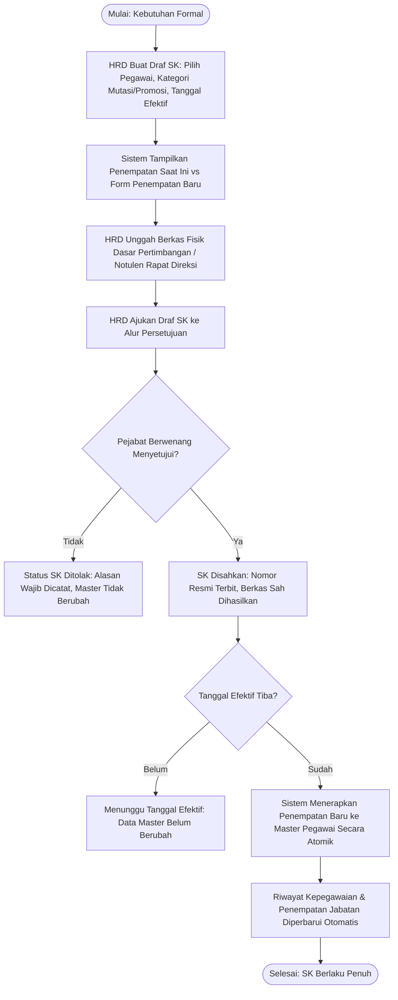
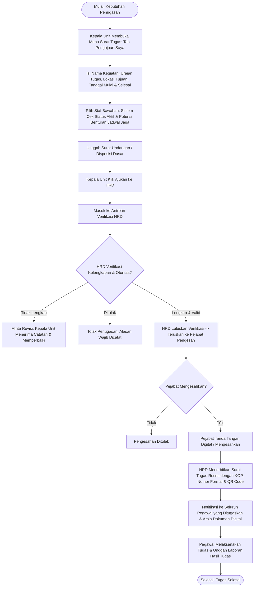
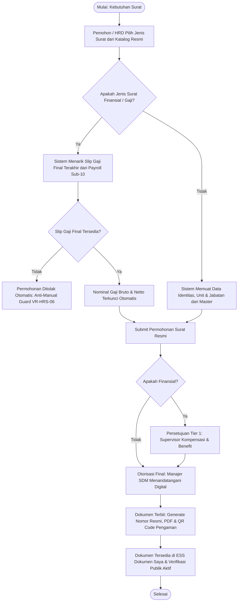
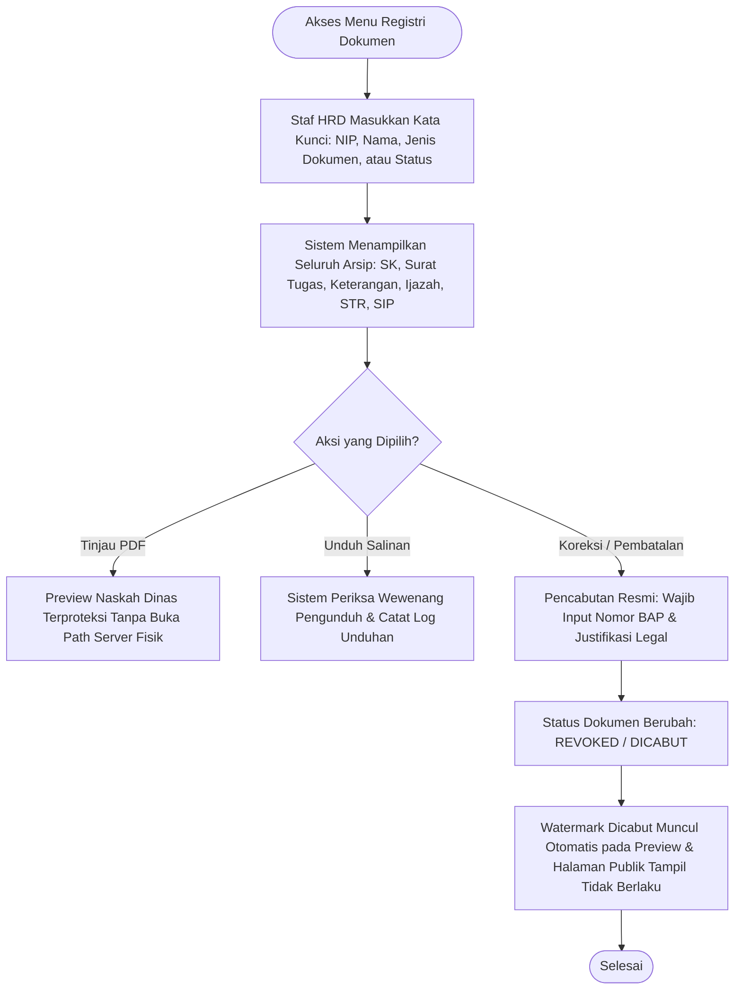
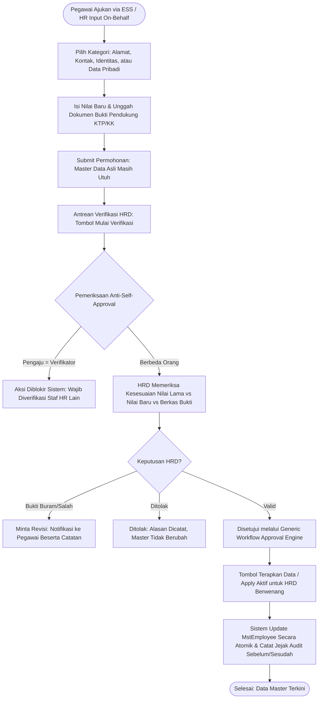
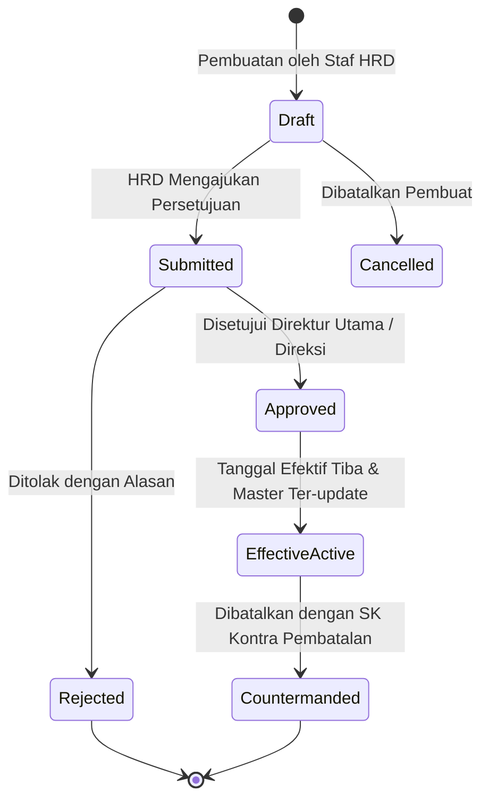
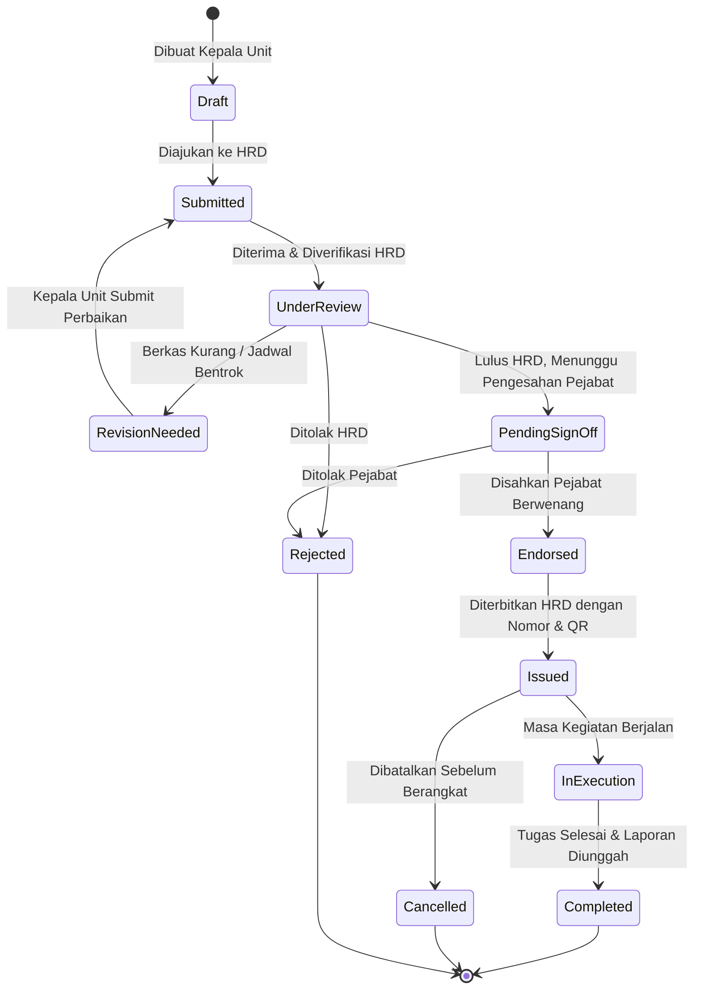
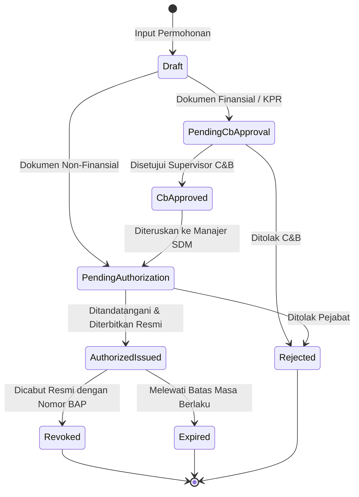

# Alur Bisnis, Tata Kelola Keputusan, dan Siklus Hidup Administrasi Kepegawaian SIMRS Quilvian V2

**Dokumen**: `02_ALUR_BISNIS_DAN_KEPUTUSAN.md`  
**Modul**: Corporate / Human Resource Management (HRD)  
**Menu Induk**: Administrasi Kepegawaian  
**Tanggal**: 11 November 2026  
**Status**: Disetujui untuk Desain Sistem & Tata Kelola  

---

## 1. Prinsip Utama dan Batas Keselamatan Rumah Sakit

Sistem Informasi Manajemen Rumah Sakit (SIMRS) Quilvian mengadopsi prinsip keselamatan klinis, kepatuhan ketenagakerjaan, dan integritas finansial:

> **Prinsip Utama Tata Kelola:**
> 1. **Pemisahan Kewenangan (Segregation of Duties / Four-Eyes Principle)**: Pengaju, pemeriksa/verifikator, dan pejabat pengesah naskah dinas kepegawaian tidak boleh dijabat oleh orang yang sama dalam satu transaksi.
> 2. **Anti-Self-Approval**: Pegawai maupun pejabat struktural dilarang keras memverifikasi, mengesahkan, atau menerapkan keputusan resmi untuk kepentingannya sendiri.
> 3. **Non-Duplikasi Master Pegawai**: Semua tindakan administratif merujuk pada `MstWorkforceProfile` dan `MstEmployee` tunggal; tidak diperbolehkan membuat master bayangan atau entitas ad-hoc.
> 4. **Integritas Penghasilan Resmi (Anti-Manual Payroll Guard)**: Seluruh pencantuman nominal gaji pada surat keterangan wajib bersumber dari slip gaji final Sub-10 Payroll yang berstatus *Published* atau *Finalized*. Dilarang menyediakan isian manual nilai gaji.
> 5. **Pencabutan Akuntabel**: Naskah dinas resmi yang telah disahkan hanya dapat dibatalkan atau dicabut melalui penerbitan Berita Acara Pencabutan (BAP) resmi bernomor sah.

---

## 2. Matriks Otorisasi dan Kewenangan Per Peran

Berikut matriks target kewenangan operasional pada modul Administrasi Kepegawaian:

| Peran Pengguna | Buat / Ajukan SK | Ajukan Surat Tugas | Verifikasi Surat Tugas | Pengesahan Surat Tugas | Terbitkan Dokumen Resmi | Verifikasi Perubahan Data | Terapkan Perubahan (Apply) |
|---|---|---|---|---|---|---|---|
| **Kepala Unit / Kepala Instalasi** | Hanya usulan mutasi internal unit (bila diizinkan) | **Ya**, khusus untuk bawahan langsung dalam unitnya | Tidak Berwenang | Tidak (Kecuali ada pendelegasian resmi) | Tidak Berwenang | Tidak Berwenang | Tidak Berwenang |
| **Staf HRD (Administrasi)** | Membuat draf SK dan input data pembanding | Bila ditugaskan untuk kegiatan dinas HRD | **Ya**, memvalidasi kelengkapan berkas & benturan jadwal | Tidak (Bukan pejabat penandatangan) | **Ya**, setelah disahkan oleh pejabat berwenang | **Ya**, memeriksa KTP/KK/buku tabungan | Tidak (Menunggu approval tuntas) |
| **Manajer HRD / Direksi** | Memeriksa draf dan mengajukan ke Direktur | Sesuai disposisi manajemen | Meninjau hasil verifikasi staf | **Ya**, menandatangani secara digital sesuai kewenangan | **Ya**, mengotorisasi final naskah dinas | Menyetujui melalui inbox workflow | **Ya**, mengeksekusi apply ke master data |
| **Pegawai (Staff / Nakes)** | Tidak Berwenang | Tidak Berwenang | Tidak Berwenang | Tidak Berwenang | Hanya mengunduh dokumen sah miliknya | Mengajukan perubahan profil diri sendiri | Tidak Berwenang |
| **Auditor / Administrator** | Hak baca log audit (Read-only) | Hak baca arsip penugasan | Hak baca log verifikasi | Hak baca riwayat otorisasi | Hak verifikasi keaslian hash/QR | Hak baca log perubahan master data | Tidak Berwenang |

---

## 3. Alur Proses Bisnis Terperinci per Cakupan

### 3.1. Cakupan 1: Surat Keputusan (SK Kepegawaian)
*Contoh Skenario Nyata RS*: Perawat Pelaksana di Instalasi Rawat Inap dipromosikan menjadi Kepala Ruangan ICU Paviliun Garuda terhitung mulai tanggal 1 Desember 2026.

- **Tahap 1 (Penyusunan Draf)**: Staf HRD memilih pegawai dari master `MstWorkforceProfile`, menentukan jenis keputusan (Pengangkatan, Mutasi, Promosi, Rotasi, Demosi), tanggal berlaku efektif, serta mengisi unit/departemen/jabatan tujuan dan penyesuaian gaji pokok jika ada.
- **Tahap 2 (Pemeriksaan & Pengesahan)**: Direktur Utama / Direktur SDM meninjau berkas pertimbangan. Jika disetujui, nomor SK kepegawaian di-generate oleh modul penomoran otomatis.
- **Tahap 3 (Penerapan Tindakan / Apply)**: Tindakan pemindahan jabatan atau unit kerja hanya diterapkan ke data master pada saat tanggal efektif tercapai. Penerapan bersifat idempoten (tidak dapat dieksekusi ganda).

---

### 3.2. Cakupan 2: Surat Tugas (Official Duty Assignment)
*Contoh Skenario Nyata RS*: Kepala Instalasi Gawat Darurat (IGD) menugaskan 1 Dokter Jaga dan 2 Perawat IGD untuk mengawal pasien rujukan darurat ke RS Rujukan Nasional dengan mobil ambulans selama 2 hari.

- **Aturan Multi-Pegawai**: Satu Surat Tugas dapat memuat beberapa nama staf sekaligus (rombongan dinas/tim darurat).
- **Penanganan Benturan Jadwal**: Saat Kepala Unit memilih staf, sistem memeriksa apakah pegawai bersangkutan telah memiliki shift kerja terjadwal atau penugasan lain yang tumpang tindih. Jika ada, sistem menampilkan *warning* benturan jadwal agar unit dapat menyiapkan staf pengganti jaga (*covering shift*).

---

### 3.3. Cakupan 3: Surat Keterangan Resmi
*Contoh Skenario Nyata RS*: Dokter Spesialis mengajukan Surat Keterangan Bekerja Aktif untuk pengajuan visa seminar luar negeri, dan Perawat mengajukan Surat Keterangan Penghasilan untuk permohonan KPR perbankan.

---

### 3.4. Cakupan 4: Dokumen Administrasi & Registri
*Contoh Skenario Nyata RS*: Staf HRD mencari seluruh dokumen naskah dinas resmi dan dokumen kualifikasi (STR/SIP/Sertifikat) milik dokter spesialis untuk persiapan akreditasi rumah sakit oleh KARS.

---

### 3.5. Cakupan 5: Pengajuan Perubahan Data Karyawan
*Contoh Skenario Nyata RS*: Staf Farmasi baru saja pindah domisili dan menikah, mengajukan perubahan alamat KTP, susunan keluarga, dan nomor kontak darurat dengan melampirkan foto KTP baru dan Buku Nikah.

---

## 4. Siklus Hidup dan Diagram Status (State Machine)

### 4.1. Siklus Status Surat Keputusan (SK)

### 4.2. Siklus Status Surat Tugas

### 4.3. Siklus Status Surat Keterangan

---

## 5. Keputusan Bisnis yang Telah Dikunci (Locked Decisions)

1. **Pemisahan Pengesahan dan Penerbitan Surat Tugas**: Pengesahan adalah wewenang pejabat struktural rumah sakit (Direktur/Kabid) yang memiliki otoritas membebankan tugas kepada dokter/perawat. Penerbitan adalah fungsi administratif HRD untuk menerbitkan naskah dinas bernomor resmi.
2. **Kewenangan Kepala Unit Terbatas**: Kepala Unit hanya berhak memilih pegawai yang berada di bawah unit kerjanya langsung. Penugasan staf lintas unit wajib diajukan atau disetujui bersama oleh kepala unit terkait.
3. **Penyimpanan Gaji Otomatis**: Surat keterangan penghasilan tidak menerima masukan gaji manual; nilai gaji ditarik murni dari slip gaji sistem Payroll yang telah disahkan (*Published*).
4. **Keamanan URL Berkas**: Tidak ada tautan langsung (*direct public URL*) ke berkas PDF fisik di server. Seluruh pengunduhan wajib melalui endpoint controller yang memvalidasi token sesi dan izin pengunduh.
5. **Kekekalan Rekam Jejak (Audit Immutability)**: Rekaman audit perubahan profil (*old value* vs *new value*) dan Berita Acara Pencabutan surat tidak boleh dihapus (*hard delete*).

---

## 6. Pertanyaan Bisnis yang Memerlukan Konfirmasi Pemilik Sistem (Open Questions)

| No | Pertanyaan Bisnis | Rekomendasi Solusi Teknis | Status |
|---|---|---|---|
| Q-01 | Apakah Surat Tugas yang memuat penugasan klinis di luar RS (misal: bantuan medis bencana alam) memerlukan validasi otomatis terhadap keaktifan STR/SIP dokter bersangkutan? | **Direkomendasikan**: Tambahkan indikator peringatan (*warning*) bila masa berlaku STR/SIP staf yang dipilih kurang dari 30 hari atau telah kedaluwarsa. | Menunggu Konfirmasi User |
| Q-02 | Terkait pencabutan Surat Keterangan Finansial yang telah terlanjur diserahkan ke pihak luar (bank), apakah sistem perlu menyediakan fitur pencetakan surat pemberitahuan pencabutan untuk pihak ketiga? | **Direkomendasikan**: Sediakan tombol *Cetak Surat Pemberitahuan BAP Pencabutan* yang memuat nomor BAP, alasan, dan pernyataan ketidakberlakuan dokumen. | Menunggu Konfirmasi User |
| Q-03 | Untuk penugasan Surat Tugas multi-pegawai, apakah masing-masing pegawai menerima cetakan lembar surat terpisah (atas nama pribadi) atau satu lembar surat tugas bersama yang memuat daftar tabel peserta? | **Direkomendasikan**: Default adalah 1 surat resmi yang mencantumkan tabel lampiran daftar seluruh personel bertugas (praktik standar rumah sakit). | Menunggu Konfirmasi User |
