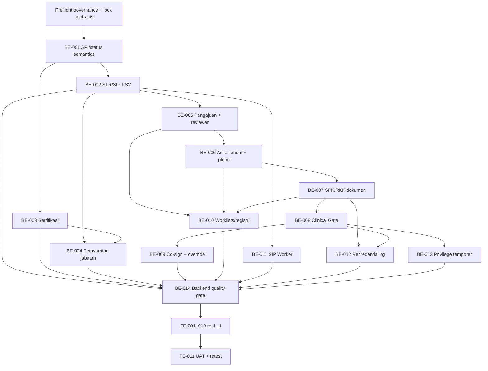

# MASTER INSTRUKSI AGENT - IMPLEMENTASI LANGSUNG HRD MENU 09: KOMPETENSI & KREDENSIAL

**Jenis dokumen:** SATU master prompt eksekusi Agent Fullstack Quilvian V2. **REVISI 1.1: skema UI frontend lengkap lima Submenu di bagian 2.6 (UI-09.1 sampai UI-09.5).** Bukan audit-only, bukan blueprint aspiratif, bukan bukti bahwa fitur telah selesai dikerjakan.  
**Target bisnis:** Kepegawaian > **Menu 09 - Kompetensi & Kredensial**, tepat **5 Submenu** dari registry 12 Menu / 61 Submenu pengguna.  
**Persetujuan:** Pengguna menyetujui seluruh pembahasan proses bisnis dan planning Menu 09 pada 19 November 2026. Jangan mengulang wawancara atau meminta persetujuan planning yang sudah terkunci.  
**Urutan EKSEKUSI WAJIB:** preflight governance singkat -> sinkronisasi kontrak bila perlu dan sah -> **implementasikan BACKEND terlebih dahulu** -> verifikasi kontrak/API -> **implementasikan FRONTEND** -> integrasi dan UAT live -> perbaikan hasil uji -> laporan berbukti.  
**Nomor task finishing:** `FIN-HRD-09-BE-001` sampai `FIN-HRD-09-BE-014` (14 task BE), dan `FIN-HRD-09-FE-001` sampai `FIN-HRD-09-FE-011` (11 task FE). Seluruh task FIN merupakan **PROPOSED / FINISHING_REGISTER_PENDING** hingga benar-benar diregistrasikan sesuai governance; namespace FIN **tidak menggantikan** `BE-HRD-*` dan `FE-HRD-*` dalam roadmap reguler.  
**Target lokasi dokumen di workspace Agent jika penulisan dokumen diizinkan:** `docs/module-blueprints/human-resource/docs/update/kompetensi-dan-kredensial/INSTRUKSI_AGENT_HRD_MENU_09_KOMPETENSI_DAN_KREDENSIAL.md` pada backend. Jangan membuat master instruksi baru per Submenu.  
**Snapshot audit GitHub read-only:** 19 November 2026; FE `HamzahV2` @ `59cf6a85093873c48d0a9b35891fe0469b4ecd96`; BE `MHamzah` @ `e750883dff7da0b3afbe1af6a16fb04205cdabad`; Engineering Skills `main` @ `201af64552b27873fd9af83c6722cf11b441bb1e`. SHA ini adalah sumber referensi, **bukan** commit hasil kerja Agent.  
**Status awal:** `PARTIAL / REPAIR / MISSING FRONTEND / RUNTIME NOT VERIFIED`. Tidak ada klaim database aktif, build sukses, API lulus, ataupun UAT PASS dari dokumen ini.
**Petunjuk untuk Agent:** setelah task backend di bagian 2.5, sebelum menulis JSX/CSS WAJIB buka bagian 2.6; kelima skema mencakup layout, tabel, filter, form, modal, action/role, flow, responsive dan acceptance.

> **PERINTAH UTAMA:** Setelah syarat branch, scope, rule, runtime skill, dan izin target tulis sah, **LANGSUNG UBAH SOURCE CODE di workspace** sesuai task FIN di bawah. Tidak cukup memberikan hasil analisis, checklist, rencana ulang, tampilan dummy, komentar TODO, Swagger tanpa implementasi, atau laporan yang mengaku DONE. Lakukan pekerjaan yang tidak terblokir sampai selesai, lalu uji dan laporkan bukti. Jangan commit/push/migrasi/deploy otomatis.

---

## 1. Role

Anda adalah **Senior Fullstack Engineer Quilvian V2**, **Backend Engineer ASP.NET Core / EF Core / PostgreSQL**, **Frontend Engineer Next.js / React / Redux**, **Business Process Analyst Rumah Sakit**, **UI/UX Engineer**, dan **QA/UAT Engineer**. Anda menerima mandat implementasi nyata khusus Menu 09, bukan mandat redesign seluruh modul HRD atau penulisan ulang EMR.

### 1.1 Target repository dan mode tulis eksplisit

| Fase | TASK MODE | Target tulis | Sumber yang tetap read-only |
|---|---|---|---|
| Preflight | `AUDIT MODE` | Tidak ada source ditulis | FE, BE, Skills |
| Sinkronisasi canonical jika diperlukan | `MODULE BLUEPRINT MODE` | **Hanya** `NewQuilvianSystemBackend/docs/module-blueprints/human-resource/**`, dalam izin governance khusus dokumen | Source FE/BE dan Skills |
| Eksekusi backend | `TASK MODE: BACKEND` / `BACKEND MODE` | `DevBenari/NewQuilvianSystemBackend` branch `MHamzah`: area HRD CredentialingManagement, master terkait, kontrak/integrasi backend owner yang berwenang | FE `HamzahV2`; Skills `main` |
| Eksekusi frontend sesudah BE | `FRONTEND MODE` | `DevBenari/QuilvianSystemFrontendDev` branch `HamzahV2`: route, view, service, slice, hook, navigation, style yang relevan dengan Menu 09 | Source BE `MHamzah`; Skills `main` |
| Verifikasi integrasi | `CROSS-REPO MODE` terbatas, bila diperlukan | Koordinasi perubahan lokal yang SUDAH diotorisasi untuk kedua target di atas; hormati batas masing-masing task/skill | Skills `main`; domain lain tanpa izin |
| Pelaporan engineering | Mode laporan sesuai `AGENTS.md` dan `rules/rule-output/` | Laporan tracked serta update roadmap/traceability **hanya jika governance mengizinkan** | Source selain target |

Persetujuan pengguna atas **planning dan pembuatan instruksi ini** adalah dasar scope task untuk Agent, **bukan** izin melakukan Git commit/push, migration, SQL execution, deployment, perubahan data production/shared, atau mengambil alih domain Health Services/Identity/Finance. Wewenang per task harus dikonfirmasi oleh kondisi workspace dan governance repo sebelum penulisan file terkait. **Jangan mengganti branch** apabila branch lokal bukan yang ditentukan; laporkan mismatch.

### 1.2 Runtime skill dan aturan wajib

1. Sebelum **setiap task source backend**, invoke registered runtime skill `quilvian-engineering-skills:build-module-backend`; sebelum **setiap task source frontend**, invoke `quilvian-engineering-skills:build-module-frontend`. Ini panggilan runtime IDE/Agent sungguhan, bukan sekadar membaca `SKILL.md` atau menyebut namanya di laporan.
2. Baca `AGENTS.md` dan `CLAUDE.md` pada kedua repo; `QuilvianEngineeringSkills/agents/rules/GLOBAL_RULES.md`; `agents/rules/backend/{TASK_RULES,TASK_CLASSIFICATION,API_RULES,DATABASE_RULES,CROSS_REPO_RULES,REVIEW_RULES,TEST_POLICY,role-access-rules,transaction-endpoint-standard}.md` dan aturan FE yang relevan.
3. Sebelum backend baru: baca `docs/engineering/BACKEND_ENGINEERING_CONTRACT.md`, `docs/engineering/MODULE_OWNERSHIP_PREFIX_REGISTRY.md` dan klasifikasikan `NEW CODE` / `TOUCHED LEGACY` / `LEGACY MIGRATION`, area, module, owner, prefix, QBE rule. **Pola legacy buruk tidak memberi izin menirunya pada kode baru.**
4. Sebelum JSX/CSS: baca `frontend-architecture.md`, `base-component-catalog.md`, `base-component-decision-gate.md`, `page-composition-patterns.md`, `design-tokens.md`, `ui-consistency-checklist.md`, `test-policy.md`; wajib reuse base component sah (bukan menulis ulang komponen generik).
5. Patuhi `rules/testing/` untuk uji live browser headed (satu Menu satu laporan UAT) dan `rules/rule-output/` untuk laporan/tracking. Backend `TEST_POLICY.md` **tidak** mengharuskan membuat test project otomatis; gunakan validasi relevan dan jangan membuat xUnit/Jest/dependency baru tanpa kewenangan eksplisit.
6. Jika runtime skill tidak terdaftar, status wajib persis: `BLOCKED - Quilvian runtime skill unavailable` (gunakan bentuk canonical dengan em dash bila runtime mendukung: `BLOCKED — Quilvian runtime skill unavailable`), **hentikan hanya fase implementasi yang membutuhkan skill itu**. Jangan bypass skill. Jika governance canonical tidak dapat dibaca: `BLOCKED — canonical governance unavailable`.
7. Jangan melakukan `git pull`, checkout, merge, rebase, reset, stash, commit, push, PR, deployment, pembuatan atau eksekusi migration, dan operasi langsung ke database tanpa otorisasi terpisah. Pertahankan local uncommitted changes dan hindari overwrite.

---

## 2. Task

### 2.1 Outcome dan lima label Submenu resmi yang TIDAK BOLEH DIUBAH

Bangun ulang **kelengkapan proses bisnis**, bukan arsitektur baru: data induk pegawai -> validasi legalitas STR/SIP -> verifikasi sertifikasi -> evaluasi syarat jabatan -> pengajuan kredensial -> peer review oleh komite yang tepat -> pleno -> pengesahan SPK/RKK -> aktivasi kewenangan per tindakan -> monitoring perpanjangan dan rekredensial -> pembatasan/penangguhan sesuai keputusan.

**Tepat lima label pengguna, termasuk spasi slash:**

1. **Data STR/ SIP**
2. **Sertifikasi Kompetensi**
3. **Persyaratan Jabatan**
4. **Status Kredensial**
5. **Masa Berlaku Kewenangan**

Jangan mengganti lima Submenu dengan label technical existing seperti `PSV`, `Whitebook`, `Director Approval`, `OPPE`, atau `Registri RKK`. Itu adalah **halaman/fitur internal pendukung**, bukan Submenu baru. Pertahankan URL existing dan lakukan alias/link menuju fitur lama ketika menata lima entry Menu 09. Jangan membuat dua master profesi, jabatan, lisensi, sertifikasi, maupun dua sistem SPK/RKK.

### 2.2 Keputusan bisnis TERKUNCI dan batas keselamatan pasien

| Referensi | Kewajiban implementasi | Perlakuan |
|---|---|---|
| Keputusan pengguna 19 Nov 2026 | Tepat 5 Submenu, perbaikan BE dahulu, FE berbasis API nyata, skema UI, task FIN, UAT | **LOCKED untuk scope finishing**; tidak perlu wawancara ulang |
| `HRD-DEC-146` | STR mengikuti ketentuan yang berlaku; SIP terkait tempat praktik; PSV bersumber primer; radar peringatan sampai kedaluwarsa | Reuse model/kontrak, validasi jenis lisensi & tanggal; **jangan menganggap semua STR otomatis seumur hidup atau semua kategori pengecualian identik** |
| `HRD-DEC-147` | Komite Medik, Keperawatan, dan Tenaga Kesehatan Lainnya terpisah; panel Mitra Bestari minimal 2 reviewer sesuai keputusan | Validasi reviewer, profesi, konflik kepentingan, ownership komite pada server |
| `HRD-DEC-148` | Pleno -> telaah pihak berwenang -> pengesahan resmi Direktur Utama; kewenangan per butir tindakan dengan klasifikasi mandiri / supervisi / ditolak | Pisahkan status dokumen, hak tanda tangan, reviewer, dan kode kewenangan |
| `HRD-DEC-149` (resolusi `HRD-DEC-005`) | Clinical hard-stop bertingkat, supervisor co-signature, emergency life-saving override yang diaudit | Terapkan server-side per transaksi dan batas owner klinis. Jangan menganggap catatan pada master privilege = approval order pasien |
| `HRD-DEC-150` | Kewenangan sementara dan darurat dibatasi durasi, pelaku, alasan, profesi dan cakupan | Validasi ketat izin, tanggal, histori, expiry; jangan longgarkan hak klinis global |
| `HRD-DEC-151` | SPK/RKK standar 3 tahun, radar H-90/H-60/H-30, draf rekredensial H-60 dan penangguhan ketika tidak diperpanjang | Jadwal idempoten, status yang konsisten, sumber OPPE nyata dan audit |
| `S-C1` (kontrak v18) | Kredensial, lisensi, SPK/RKK, clinical gate | Domain utama Menu 09 |
| `S-C1-OPPE` (kontrak v19) dan `S-C2` (kontrak v20) | OPPE/FPPE dan pelatihan adalah domain sumber yang TERPISAH | Integrasi read-only/contracted; jangan memindah pemilik data atau membuat ulang siklus OPPE |

**PENTING: KONFLIK NOMOR LEVEL.** Blueprint bisnis lama menamai `Level 4 = Mandiri`, `Level 3 = Supervisi`, dan `Level 1-2 = Tidak diberi`; source `CredentialingEnums.cs` justru memiliki `Level1_Independent`, `Level2_UnderSupervision`, `Level3_Proctored`, `Level4_NotPermitted`. **Jangan melakukan rename/renumber enum integer yang sudah tersimpan secara membabi buta.** Wajib gunakan makna semantik yang tunggal (`INDEPENDENT`, `SUPERVISED`, `PROCTORED`, `DENIED`), audit seluruh DTO/DB/UI/existing values, sediakan adapter kompatibilitas dan pengujian; kontrak klinis tak boleh ambigu sebelum gate diaktifkan. Bila perubahan persisted enum membutuhkan migration/approval atau owner memutuskan level tampilan lain, tandai hanya bagian klinis terdampak `BLOCKED`, lanjutkan task administratif yang aman.

**PENTING: BUKTI TANDA TANGAN.** Hash SHA-256, path file, dan metadata QR **bukan** bukti bahwa PDF fisik telah dibuat ataupun bukti bahwa tanda tangan elektronik bersertifikat sudah sah. Terapkan dokumen yang benar-benar tersimpan, verifikasi publik dengan data minimal, dan label otorisasi sesuai mekanisme yang disetujui. Jika perlu layanan sertifikat elektronik resmi, jangan mengarang vendor/credential; dokumentasikan integrasi yang benar dan tahan klaim `e-Sign certified` sampai pemilik menyediakannya.

**PENTING: BATAS AKSES KLINIS.** HRD adalah sumber riwayat kredensial; EMR/Health Services adalah owner transaksi pasien. Agent Menu 09 boleh memperbaiki kontrak, gate, audit dan adapter **pada domain yang diizinkan**, tetapi tidak boleh diam-diam mengedit EMR, obat, penjadwalan, ataupun akses IAM di luar owner. Untuk perubahan lintas modul, sediakan contract tests/handshake yang aman dan laporkan dependency bila izin belum ada. **Jangan mengklaim integrasi produksi berjalan** hanya karena endpoint `validate-gate` tersedia.

### 2.3 Per Submenu: implementasi end-to-end wajib

### Submenu 1 - Data STR/ SIP

**Tujuan bisnis dan aktor.** Mendata dan memverifikasi legalitas praktik tenaga medis/kesehatan; aktor: pemilik dokumen (ESS), HRD/sekretariat kredensial, petugas PSV, Komite sesuai profesi, pengawas penjadwalan; otoritas verifikasi tidak otomatis dimiliki pembuat dokumen.

**Pemicu, prasyarat, dan data.** Profil `MstWorkforceProfile` valid, profesi/penempatan tersambung; jenis STR/SIP dari `MstLicenseType` atau katalog resmi, nomor, penerbit, tanggal terbit, tanggal berakhir/seumur hidup bila sah, tempat praktik/faskes, status, lampiran bukti, sumber PSV, URL referensi, tanggal pemeriksaan, verifikator, alasan penolakan, histori perpanjangan, dan pencabutan. Jangan pernah meminta UUID manual dari pegawai.

**Alur normal yang harus benar-benar berfungsi.** (1) Pegawai memilih dokumen yang legal menurut profesi; (2) isi form dan upload yang sah; (3) server menyimpan sebagai `PendingVerification`; (4) verifikator memeriksa bukti terhadap sumber resmi dan memberi keputusan eksplisit `Verified` atau `Rejected`; (5) perpanjangan membuat riwayat dan me-reset PSV; (6) radar status H-90/H-60/H-30/H-7/H-0 menghitung berdasarkan tanggal server; (7) konsekuensi terhadap penjadwalan/clinical gate hanya sesuai izin dan kontrak terdokumentasi; (8) semua perubahan dan pelaku dapat ditelusuri setelah refresh.

**Existing/reuse wajib:** FE `credentialing-psv-dashboard-view.jsx`, `credentialing-license-radar-view.jsx`, `LicenseRenewalModal.jsx`, `src/lib/services/hr/credentialing-service.js`, `src/lib/state/slice/hr/credentialing/credentialing-slice.js`; BE `ProfessionalLicenseController`, `WfpCredentialLicenseController`, `CredentialVerificationService`, `WfpCredentialLicense`, `LicenseExpiryMonitoringWorker` dan master `LicenseTypeController`. Existing `POST /api/v1/corporate/hrd/credentialing/licenses`, `GET .../employee/{employeeId}`, `POST .../{id}/verify-psv`, `POST .../{id}/renew`, `GET .../radar/expiring`; juga API per profile `/api/v1/corporate/human-resource/workforce-profiles/{id}/credential-licenses`.

**Perbaikan wajib backend:**
- `PerformPrimarySourceVerificationAsync` saat ini mempercayai boolean `IsValidOnSource` dari request; jadikan keputusan petugas yang diotorisasi, bukan otomatis sumber kebenaran eksternal. Wajib validasi bukti primer/rujukan yang dapat diaudit, waktu, identitas petugas, catatan, status awal pending; bila integrasi Kemenkes/KKI resmi belum ada, nyatakan **PSV manual terdokumentasi** (tanpa klaim auto-check). Jangan memperbolehkan peserta/pegawai memverifikasi sendiri.
- `RegisterLicenseAsync` dan create endpoint per-profile: jangan izinkan request biasa menetapkan `IsPsvVerified` / `IsVerified` atau status final tanpa permission verifikator; cegah spoof `WorkforceProfileId`; validasi tanggal, jenis STR vs SIP, faskes, nonaktif/revoke, duplikat aktif, concurrent renew, dan scope pengguna.
- Bedakan STR seumur hidup vs SIP berkala, disesuaikan kebijakan/ketentuan terkini dan pengecualian yang disetujui. Clinical gate tidak boleh memilih lisensi dengan `OrderByDescending(ExpiredDate)` lalu menganggapnya SIP. Evaluasi **jenis, masa berlaku, verifikasi, dan faskes yang benar**.
- Perpanjangan harus mempertahankan histori, tidak menghapus bukti lama, me-reset PSV sebagaimana source sudah mulai lakukan; fail-closed yang telah terpasang tidak boleh dilepas sampai eligibility sah. Semua tindakan reaktif harus idempotent.
- Pemantauan background diperbolehkan sebagai pelengkap; perlindungan klinis tetap memvalidasi waktu efektif secara request-time agar tidak terdapat jendela salah izin saat worker terlambat.

**Perbaikan wajib frontend:** daftar sertifikat legal pegawai dan radar yang nyata; input pilihan pegawai/profesi/jenis lisensi dengan label, bukan GUID; form register/edit, unggah bukti dengan base file upload, detail dan histori, modal PSV dengan default `belum diputuskan` (bukan `isValidOnSource: true`), tombol hanya untuk role yang sah, validation state dan konfirmasi sebelum blokir. Gunakan server pagination/filter; error API harus tampak, bukan diganti data contoh.

**Exception:** dokumen tidak ditemukan/terbaca, tautan resmi tidak dapat diakses, nomor duplikat, masa berlaku kontradiktif, petugas tanpa role, perubahan SIP saat order berjalan, verifikasi ditolak, API 401/403/409/422/500, file ditolak, upload timeout, dua verifikator paralel.

**Acceptance criteria `AC-09-STR-01..08`:** create menghasilkan record DB pending; PSV hanya petugas berwenang dengan bukti; status bertahan setelah reload; perpanjangan menyimpan histori/reset PSV; expired tidak bisa dipakai sebagai SIP aktif; radar dan gate konsisten pada boundary date; permission/resource scope kuat; tidak ada submit sukses tanpa server. **UAT**: `UAT-09-STR-01..08`.

### Submenu 2 - Sertifikasi Kompetensi

**Tujuan bisnis dan aktor.** Menyimpan bukti kemampuan profesional dan pelatihan; pegawai/ESS mengusulkan sertifikat, HRD/diklat/verifikator meninjau, kepala unit melihat kepatuhan sesuai kewenangannya, komite hanya mengonsumsi bukti terverifikasi untuk kredensial.

**Data dan alur:** pegawai -> jenis sertifikat/kompetensi -> nama dan nomor -> penerbit -> tanggal terbit/akhir atau berlaku tanpa akhir jika sah -> jenis program (eksternal/internal) -> unggah berkas -> `Pending` -> `Verified`/`Rejected` oleh petugas lain -> portofolio dan peringatan kedaluwarsa -> perpanjangan/new version dengan histori. Sertifikat pelatihan resmi yang diterbitkan modul `LearningAndDevelopment` harus muncul sebagai sumber referensi tanpa dua catatan independen yang saling bertentangan.

**Existing/reuse wajib:** BE `WfpCertificationController` (GET/summary/filters, POST/PUT multipart, GET file, PATCH verify/status), `WfpCertification`, `WfpCertificationFileStorageService`, `TrxCertificationRenewalRequest`, `TrainingCertificatesController` dan `LearningAndDevelopment` portofolio; FE `src/components/view/hr/learning/training-certificates-view.jsx` dan master `/hr/master-data/certification-type` serta katalog pelatihan. `WfpCertificationController` memakai `/api/v1/corporate/human-resource/workforce-profiles/{id}/certifications`.

**Perbaikan wajib backend:** saat create, source mengizinkan `IsVerified` dari `[FromForm] CreateWfpCertificationRequest`. Hilangkan self-verification/bypass permission: create selalu pending kecuali actor memiliki izin proses verifikasi terpisah dengan audit eksplisit; lebih aman mengharuskan endpoint `PATCH .../{id}/verify`. Validasi berkas (jenis, MIME/signature, ukuran, path aman di luar public), kewajiban verifikasi, tanggal, nomor, ownership, duplikasi, pergantian versi dan pengendalian dokumen lama. Implementasikan daftar portofolio dan validitas agregat yang menggabungkan sumber internal dan eksternal dengan origin ID, jangan copy tanpa jejak. Status/expiry hanya membatasi layanan yang memang diwajibkan dan disetujui oleh rule persyaratan, bukan memblokir semua pegawai secara global.

**Perbaikan wajib frontend:** satu tampilan `Sertifikasi Kompetensi` dengan portofolio per pegawai, source internal/eksternal, status verifikasi, tanggal berakhir, file preview/download aman, upload/edit, modal verifikasi dan timeline. Reuse daftar sertifikat pelatihan; master jenis tetap di master data, bukan CRUD master kedua. Tampilkan keterkaitan sertifikat dengan persyaratan jabatan dan kredensial sebagai link baca.

**Exception:** upload gagal, sertifikat kadaluwarsa, nomor duplicate, issuer tidak valid, link file 404, salah role, klik verify dua kali, data pelatihan belum disinkronkan, dokumen dengan content-type palsu.

**Acceptance criteria `AC-09-CERT-01..08`:** create pending; upload/read/download aman; self-verify ditolak; verifikasi tersimpan beserta pemeriksa; duplikasi dicegah; portofolio tidak menampilkan ganda; expiry akurat; status tetap setelah reload. **UAT**: `UAT-09-CERT-01..08`.

### Submenu 3 - Persyaratan Jabatan

**Tujuan bisnis dan aktor.** Membandingkan persyaratan profesi/jabatan/unit dengan kompetensi, dokumen legal, sertifikasi dan kewenangan seseorang. Pemilik master jabatan HRD; persyaratan klinis disetujui pihak profesi/komite; kepala unit hanya menilai pegawai di bawah kewenangannya.

**Data dan alur:** pilih jabatan/unit/profesi existing -> baca template kompetensi wajib, minimum level, sertifikat wajib, bukti pendidikan/pelatihan, STR/SIP dan persyaratan kredensial yang relevan -> pilih pegawai dari penempatan definitif/berlaku -> backend mengevaluasi sumber authoritative -> per butir tunjukkan `Memenuhi`, `Belum Memenuhi`, `Perlu Verifikasi`, `Tidak Berlaku` + alasan, sumber bukti dan tanggal evaluasi -> tampilkan gap dan tindak lanjut ke pemilik domain. **Matriks ini informatif untuk HR dan tidak otomatis mengubah jabatan, mem-PHK pegawai, atau mencabut privilege klinis tanpa proses resmi.**

**Existing/reuse wajib:** `MstPositionCompetencyRequirement`, `CompetencyController` (`GET/POST/PUT/PATCH /api/v1/corporate/human-resource/master-data/competencies/positions/{positionId}/requirements`), `CredentialingRequirementController`, `MstCompetency`, `MstCredentialingRequirement`, master `MstPosition`/`MstProfession`, FE `/hr/master-data/competency`, `/hr/master-data/credentialing-requirement`, dan sumber penempatan/uraian tugas Menu 05/07.

**Perbaikan backend wajib:** buat endpoint evaluasi per pegawai/jabatan serta daftar gap berbasis join/per-query nyata dengan pagination; reuse ID master existing. Jelaskan parameter tanggal efektif, unit, jabatan, profesi, status evidence, rule `IsRequired`, `MinimumLevel`, `IsCertificationRequired`, `IsTrainingRequired`, `ValidityMonths`; jangan menjadikan semua sertifikat memenuhi semua requirement. Evaluasi harus deterministik dan mengembalikan `itemId`, required rule, evidence source ID, status, reason code dan as-of-date. Query harus scoped, no N+1 ekstrem, no cast `Guid` secara manual pada FE. Perubahan master harus memiliki permission dan audit; perubahan persyaratan tidak otomatis membatalkan penugasan resmi.

**Perbaikan frontend wajib:** dua perspektif dalam Submenu yang SAMA, yaitu `Persyaratan per Jabatan` dan `Kepatuhan Pegawai`, dengan filter jabatan/unit/profesi, tabel matrix per syarat, detail bukti, daftar belum terpenuhi, opsi ekspor jika kemampuan export existing tersedia. Reuse master competency/credentialing requirement; jangan buat master paralel.

**Exception:** pegawai belum punya penempatan definitif, pindah unit pada tanggal efektif, syarat tidak memiliki tanggal efektif, bukti sedang diverifikasi, pengisian master tidak lengkap, user lintas unit, role mengedit syarat tanpa izin.

**Acceptance criteria `AC-09-JOB-01..08`:** master dan hasil evaluasi konsisten; status belum verifikasi tidak dianggap memenuhi; perubahan bukti mengubah hasil evaluasi; tanggal efektif benar; tidak ada data master ganda; kontrol akses per unit; hasil dapat dibuka setelah reload; tidak ada tindakan kepegawaian otomatis. **UAT**: `UAT-09-JOB-01..08`.

### Submenu 4 - Status Kredensial

**Tujuan bisnis dan aktor.** Mengoperasionalkan credentialing dari pengajuan nakes sampai rekomendasi komite dan pengesahan SPK/RKK: pemohon, sekretariat, verifikator, minimal dua Mitra Bestari, ketua komite profesi yang benar, Direktur Pelayanan (sesuai kontrak), Direktur Utama, petugas audit/KMKP.

**Proses bisnis sah:** (1) pemohon ESS pilih tipe `InitialCredentialing` / `PrivilegeExpansion` / `Recredentialing`; (2) server memeriksa legalitas, portofolio wajib, persyaratan, profession-to-committee, konflik; (3) simpan application + versi snapshot persyaratan; (4) petugas assign minimal dua reviewer yang berbeda, bukan pemohon, sesuai profesi/komite; (5) masing-masing reviewer memberikan putusan per butir whitebook secara independen; (6) pleno memperlihatkan *semua* asesmen, konflik skor, notula/BAP, dan putusan; (7) telaah Direktur Pelayanan jika memang disetujui dalam workflow; (8) draf SPK/RKK nomor aman dari konkurensi; (9) pengesahan hanya actor berwenang, dokumen PDF dan QR benar-benar dibuat dan disimpan; (10) registri kewenangan update atomik, terhubung status request-time clinical gate, e-Dossier dan histori. Status ditolak/koreksi wajib punya alasan.

**Existing/reuse wajib:** FE portal `portal-credentialing-wizard-view.jsx`, `credentialing-whitebook-catalog-view.jsx`, `credentialing-peer-review-view.jsx`, `credentialing-committee-plenary-view.jsx`, `credentialing-director-console-view.jsx`, `credentialing-privilege-registry-view.jsx`, `credentialing-kmkp-audit-view.jsx`; BE `SpkRkkIssuanceController`, `CredentialingWorkflowService`, `CredentialingCommitteeService`, `SpkRkkIssuanceService`, `TrxCredentialingApplication`, `TrxClinicalPrivilegeAssessment`, `TrxSpkRkkIssuance`, `WfpClinicalPrivilege`, `MstCredentialingCommittee` dan catalog whitebook.

**Cacat P0/P1 yang harus diperbaiki, BUKAN sekadar dicatat:**
- `CreateApplicationAsync` hanya mengecek apakah ada *satu* lisensi `IsPsvVerified` tanpa pemeriksaan tipe SIP, faskes, waktu, revoke dan mandatory requirements. Terapkan eligibility lengkap sesuai keputusan dan profesi; aplikasi tidak boleh masuk jalur tanda tangan karena kelengkapan semu.
- `AssignPeerReviewersAsync` menyimpan assignment dalam `ComplianceResultJson`; `ConcludePlenarySessionAsync` menulis ulang field yang sama. **Jangan hilangkan riwayat reviewer saat pleno**. Gunakan persistence/relation owner yang aman, assessment history append-only atau versioned, lengkap dengan actor, timestamp, status, dan uniqueness.
- `SubmitPeerReviewAssessmentAsync` menaruh `application.Id` ke `TrxClinicalPrivilegeAssessment.ClinicalPrivilegeRequestId` walaupun model menunjuk `TrxClinicalPrivilegeRequest`. Audit foreign key dan relasi; perbaiki mapping tanpa mengorbankan data existing, serta cocokkan login assessor dengan reviewer yang ditunjuk. Jangan percaya `ReviewerWorkforceProfileId` dari body saja.
- Ada method `GetApplicationsByCommitteeAsync` pada service namun `SpkRkkIssuanceController` yang dibaca **belum mengekspos worklist**. Tambahkan read-only/list endpoint per komite dan actor, worklist reviewer, pleno, Direktur serta detail berisi butir privilege dan hasil review. Filter server, pagination, sort, permission, unit/komite access scope.
- `IssueSpkRkkDraftAsync` menggunakan `Count + 1` untuk nomor dan melakukan parsing snapshot dengan fallback `[]`. Ganti serial nomor dengan mekanisme number series resmi yang concurrency-safe, validasi snapshot wajib, jangan buat draft sukses bila butir sah hilang, cegah duplikat per aplikasi dan concurrent signing.
- `SignSpkRkkByDirectorGeneralAsync` menandai signed dan mengisi `SpkPdfFilePath`/`RkkPdfFilePath`/`QrCodeImagePath` tanpa terlihat membuat file pada service; ada `catch` parse snapshot yang hanya log lalu lanjut. Jadikan penerbitan fail-safe: verifikasi scope role, kesiapan pleno/telaah, semua butir, dokumen nyata, signature metadata jujur, atomic outbox/transaction, anti-double-sign, arsip e-Dossier dengan file yang benar. Jangan memberi status `Active` jika file/privilege belum berhasil dibuat secara benar.
- Status privilege hasil pleno harus menggunakan semantic mapping yang terkunci, bukan interpretasi angka `SupervisionLevel` yang tertukar. Catat supervisor yang ditunjuk untuk tindakan yang wajib supervisi.

**Perbaikan frontend wajib:** portal pengajuan nyata, worklist status berjenjang, reviewer inbox & asesmen tiap butir, perbandingan skor, konsol pleno, konsol Direksi, PDF preview/download yang benar, registri kewenangan aktif/per tindakan, alasan penolakan, loading/empty/error state, audit timeline. Halaman placeholder 30 baris yang sudah ada HARUS menjadi layar fungsional setelah endpoint BE tersedia; jangan mengganti dengan data dummy demi tampilan.

**Exception:** reviewer diri sendiri, duplikat reviewer, profesi tidak cocok, dua reviewer memberikan putusan berbeda, pembuat aplikasi mencoba signing, berkas kedaluwarsa di tengah review, dua operator menekan approve, nomor dokumen konflik, file gagal disimpan, user sudah berpindah komite, signature hash tidak cocok.

**Acceptance criteria `AC-09-CRD-01..12`:** seluruh transisi resmi persisten, daftar worklist relevan, item assessor valid dan tercatat, anti-self-review/committee isolation, pleno berdasar hasil reviewer, tidak ada nomor duplikat, PDF/SPK/RKK/QR benar tersedia, pengesahan satu kali oleh Direktur Utama sesuai izin, registri mengikuti keputusan semantik, histori audit tidak hilang, hak akses benar, dan tidak ada success palsu. **UAT**: `UAT-09-CRD-01..12`.

### Submenu 5 - Masa Berlaku Kewenangan

**Tujuan bisnis dan aktor.** Mengawasi periode efektif SPK/RKK dan setiap privilege klinis, risiko perpanjangan, jalur rekredensial, keputusan pembatasan, supervisor dan status izin kerja klinis. Aktor: nakes, petugas kredensial, komite, kepala unit, Direktur, scheduling, petugas audit.

**Data dan alur:** setiap SPK/RKK berisi `ValidFrom`, `ValidUntil`, status, daftar tindakan/kode, jenis privilege reguler/sementara/darurat, supervisor, nomor dokumen, riwayat dan alasan. Radar H-90/H-60/H-30 mengingatkan pihak yang relevan secara idempoten; H-60 membuat draf *recredentialing* sesuai keputusan, menarik data OPPE yang benar-benar ada atau memberi status `DATA_BELUM_CUKUP` tanpa skor buatan; aplikasi mengulang review/pleno/pengesahan; pada H-0 waktu server authoritative menolak privilege yang sudah lewat, worker memperbarui status dan audit, tanpa menonaktifkan status pegawai administratif. Pembaruan SPK/RKK harus menghindari putus layanan yang tidak sah dan menghindari privilege ganda aktif yang saling bertentangan.

**Existing/reuse wajib:** BE `SpkRkkExpiryMonitoringWorker`, `LicenseExpiryMonitoringWorker`, `WfpClinicalPrivilegeController`, `WfpComplianceAlertController`, `ClinicalPrivilegeGateService`, model `TrxRecredentialingApplication`, `WfpClinicalPrivilege`, `TrxSpkRkkIssuance`; FE `credentialing-recredentialing-cycle-view.jsx` (placeholder), `credentialing-license-radar-view.jsx`, `credentialing-fast-track-view.jsx`, `credentialing-privilege-registry-view.jsx`; OPPE dari `PerformanceManagement` `S-C1-OPPE` hanya melalui kontrak read/integration.

**Perbaikan backend wajib:**
- `SpkRkkExpiryMonitoringWorker` saat snapshot memeriksa tiap 12 jam, mengubah privilege menjadi `Expired`; keputusan `HRD-DEC-151` membahas suspend pada H-0. Sinkronkan semantik status secara backward-compatible serta gunakan guard request-time agar expiry efektif bahkan saat worker belum berjalan. Jangan menangguhkan SPK yang telah diganti sah atau seluruh privilege baru milik orang yang sama hanya karena SPK lama kedaluwarsa.
- Buat endpoint radar agregat global dan per pegawai: status tanggal, hari tersisa, dokumen terkait, action pending, `OPPE_READY / DATA_BELUM_CUKUP`, draf rekredensial, tindakan pending; server pagination/filter profesi/unit/komite/status.
- Lengkapi reminder H-90/H-60/H-30, deduplikasi notifikasi, pencatatan delivery, pembuatan draf H-60 idempoten, transisi submit/review/approve/suspend/restore dengan audit, dan integrasi hasil OPPE yang berasal dari record nyata. Jangan gunakan default skor/kriteria buatan.
- Temporary dan emergency privilege harus punya expiry, aktor resmi, alasan, scope tindakan dan supervisor; validasi masa berlaku sesuai keputusan `HRD-DEC-150`, pencabutan dan audit. Jangan memanfaatkan override darurat untuk memperpanjang semua izin tanpa batas.
- Clinical gate wajib mengecek aktif pada waktu transaksi dan privilege tindakan tertentu; co-sign harus berelasi ke order/encounter yang sah pada owner modul klinis, bukan sekadar catatan pada master privilege.

**Perbaikan frontend wajib:** radar masa berlaku SPK/RKK, filter H-90/H-60/H-30/kedaluwarsa/suspended, rincian per tindakan, timeline keputusan dan renewal, tombol pengajuan rekredensial, panel OPPE nyata/unknown, konsol sementara/darurat sesuai role, dan histori perubahan. Jangan menyamakan masa berlaku STR, SIP, sertifikat, dan SPK/RKK dalam satu indikator seakan dokumen itu identik.

**Exception:** worker tidak aktif, proses midnight/timezone, perpanjangan ketika kartu lama masih aktif, OPPE belum ada, recredential gagal, supervisor tidak aktif, privilege emergency kedaluwarsa, dua proses renew bersamaan, outage SIMRS, pemblokiran hasil status stale.

**Acceptance criteria `AC-09-EXP-01..10`:** radar sesuai waktu server, peringatan tidak duplikat, draf H-60 sekali, OPPE tak direkayasa, penangguhan berlaku tepat pada gate walau worker terlambat, SPK baru tidak ikut diblokir oleh yang lama, temporary/emergency auto-expire, histori ada, role benar dan workflow rekredensial utuh. **UAT**: `UAT-09-EXP-01..10`.

### 2.4 Matriks risiko kritis yang harus ditutup dengan PERUBAHAN SOURCE

| ID | Severity | Bukti SOURCE SEEN pada SHA audit | Tindakan wajib | Owner FIN |
|---|---|---|---|---|
| `M09-P0-01` | P0 | `ClinicalPrivilegeGateService.ValidateClinicalGateAsync` mengambil lisensi non-revoked terbaru tanpa pembatasan tipe SIP/faskes | Perbaiki eligibility SIP dan privilege berbasis per tindakan/waktu, audit regression | BE-002, BE-008 |
| `M09-P0-02` | P0 | `CredentialVerificationService.PerformPrimarySourceVerificationAsync` menetapkan PSV dari boolean request | Role-separated PSV, bukti/audit, tidak ada verifikasi otomatis palsu | BE-002, FE-002 |
| `M09-P0-03` | P0 | `WfpCertificationController.CreateCertification` menerima `IsVerified` dari form create | Nonaktifkan self-verify, pisahkan verify endpoint/permission/audit | BE-003, FE-003 |
| `M09-P0-04` | P0 | `CredentialingEnums.SupervisionLevel` bertentangan dengan label level keputusan canonical | Semantic mapping/versioned adapter kompatibel persisted data, gate fail-safe | BE-001, BE-006, BE-008 |
| `M09-P0-05` | P0 | `CredentialingWorkflowService.CreateApplicationAsync` cukup melihat satu lisensi PSV valid | Eligibility komplit menurut jenis, profesi, faskes, expiry, syarat | BE-005 |
| `M09-P0-06` | P0 | Reviewer assignment disimpan pada `ComplianceResultJson` lalu dioverwrite saat pleno | Histori reviewer, asesmen, BAP append-safe, role/committee scoped | BE-005, BE-006 |
| `M09-P0-07` | P0 | `TrxClinicalPrivilegeAssessment.ClinicalPrivilegeRequestId` diisi `application.Id`, sedangkan model menavigasi `TrxClinicalPrivilegeRequest` | Benahi relasi/foreign-key atau adapter tanpa migrasi liar, uji query hasil reviewer | BE-006 |
| `M09-P0-08` | P0 | `SpkRkkIssuanceService.IssueSpkRkkDraftAsync` memakai `Count+1`, fallback privilege `[]` | Number series concurrency-safe, snapshot wajib dan idempotensi | BE-007 |
| `M09-P0-09` | P0 | `SignSpkRkkByDirectorGeneralAsync` mengisi path PDF/QR tanpa terlihat menulis berkas; catch parsing bisa lanjut signed | Buat file nyata, status fail-safe, arsip atomik dan cek hash | BE-007 |
| `M09-P0-10` | P0 | `ProcessCoSignatureAsync` mengubah `WfpClinicalPrivilege.ApprovalNotes` tanpa ID order | Implementasi kontrak order-scoped/pending co-sign + audit, tidak melegalisasi tindakan salah | BE-009 |
| `M09-P0-11` | P0 | `SpkRkkExpiryMonitoringWorker` 12-jam dan menulis `Expired`, risiko time gap dan SPK lama mempengaruhi privilege baru | Server-time gate; status/version scope, expire worker idempoten | BE-008, BE-012 |
| `M09-P1-01` | P1 | FE `credentialing-peer-review-view.jsx`, `credentialing-committee-plenary-view.jsx` masing-masing 30 baris info alert | Endpoint worklist + halaman reviewer/pleno benar-benar berfungsi | BE-010, FE-006 |
| `M09-P1-02` | P1 | FE `credentialing-director-console-view.jsx` 30 baris info alert | Worklist Direktur, preview dokumen, action signing berotorisasi | BE-010, FE-007 |
| `M09-P1-03` | P1 | FE `credentialing-privilege-registry-view.jsx` 30 baris info alert | Registri global dengan permission/filter dan detail per tindakan | BE-010, FE-008 |
| `M09-P1-04` | P1 | FE `credentialing-recredentialing-cycle-view.jsx` 30 baris info alert | Endpoint radar, reminder, draf dan UI renewal nyata | BE-012, FE-009 |
| `M09-P1-05` | P1 | BE master persyaratan jabatan ada, belum ada evaluasi kepatuhan agregat yang terkonfirmasi | Endpoint evaluasi dengan bukti dan status per requirement | BE-004, FE-004 |
| `M09-P1-06` | P1 | Dua keluarga API lisensi/sertifikat/privilege berpotensi overlapping (`corporate/hrd` dan `corporate/human-resource`) | Satu sumber data authoritative dengan adapter/peta ID, tanpa create ganda | BE-001, FE-001 |
| `M09-P1-07` | P1 | `public-spk-rkk-verify-view.jsx` placeholder; backend controller tidak mengekspos verify hash publik | Endpoint verifikasi minimal/rate-limited, tanpa bocor data, QR ke URL yang benar | BE-007, FE-007 |
| `M09-P1-08` | P1 | Worker dan flag `runBackgroundJobs` terdaftar; eksekusi nyata belum terbukti | Verifikasi lifecycle worker dan strategi safety bila worker mati | BE-011, BE-012 |

`SOURCE SEEN` berarti metode/file benar-benar tersedia pada snapshot; temuan di atas **belum** dianggap `RUNTIME VERIFIED`. Agent wajib memperbaiki bug di task terkait, melakukan pengujian, dan menyertakan diff/file lokasi pascaperbaikan. Temuan yang ternyata sudah diperbaiki pada HEAD baru harus dibuktikan melalui source+uji; jangan menulis ulang kode yang sehat.

### 2.5 Penomoran task finishing dan urutan dependensi

**Aturan FIN:** gunakan ID baru `FIN-HRD-09-BE-NNN` dan `FIN-HRD-09-FE-NNN` hanya untuk finishing Menu 09. ID original `BE-HRD-206..221`, `FE-HRD-186..200` dan task slice `S-C1-OPPE` tetap sebagai referensi parent/traceability, bukan diganti atau dinomori ulang. Jangan mengubah nomor task FIN Menus 04-08. Cantumkan ID FIN yang sama pada laporan task, bukti dan register; update status hanya setelah implementasi tervalidasi.

#### Ringkasan task BACKEND FIRST (14 task)

| Task FIN | Prioritas | Isi pekerjaan konkret | Dependensi utama |
|---|---|---|---|
| `FIN-HRD-09-BE-001` | P0 | Normalisasi kontrak/status/ID/enum dan lapisan kompatibilitas | Preflight |
| `FIN-HRD-09-BE-002` | P0 | Perbaiki STR/SIP, PSV, eligibility, audit dan renewed license | BE-001 |
| `FIN-HRD-09-BE-003` | P0 | Sertifikasi, create pending, verified-by-other, file aman | BE-001 |
| `FIN-HRD-09-BE-004` | P1 | Engine kepatuhan persyaratan jabatan | BE-002, BE-003 |
| `FIN-HRD-09-BE-005` | P0 | Validasi aplikasi dan assignment reviewer | BE-001, BE-002 |
| `FIN-HRD-09-BE-006` | P0 | Asesmen/persidangan komite yang persisten | BE-005 |
| `FIN-HRD-09-BE-007` | P0 | Draf, nomor, pengesahan, PDF SPK/RKK, QR & arsip | BE-006 |
| `FIN-HRD-09-BE-008` | P0 | Clinical privilege gate legal & semantic | BE-001, BE-002, BE-007 |
| `FIN-HRD-09-BE-009` | P0 | Order-scoped supervisor co-sign dan life-saving override | BE-008; kontrak EMR owner |
| `FIN-HRD-09-BE-010` | P1 | Worklists per role dan registri privilege global | BE-005, BE-006, BE-007 |
| `FIN-HRD-09-BE-011` | P1 | Worker radar STR/SIP, event renewal, notifikasi | BE-002 |
| `FIN-HRD-09-BE-012` | P1 | Worker SPK/RKK, recredentialing H-90..H-0, OPPE | BE-007, BE-008 |
| `FIN-HRD-09-BE-013` | P1 | Privilege temporer/darurat, revocation, expiry & audit | BE-008, BE-012 |
| `FIN-HRD-09-BE-014` | P0/P1 | Quality/security gate, API regression, error & read model | Semua BE terkait |

#### INSTRUKSI PELAKSANAAN BACKEND (wajib UBAH SOURCE)

##### FIN-HRD-09-BE-001 - Kontrak API, model ID, status dan semantic mapping

- **Mode:** `BACKEND MODE`; klasifikasi QBE sebelum kode; baca dua keluarga endpoint existing dan `Repositories/ApplicationDbContext.cs`.
- **IMPLEMENTASI:** buat/perbaiki mapping DTO dan service agar workflow menggunakan `WorkforceProfileId`, `ApplicationId`, `SpkRkkIssuanceId`, `ClinicalPrivilegeCatalogId`, dan identitas actor yang konsisten. Bentuk `CredentialStatus`/`PrivilegeSemantic` hanya sebagai adapter yang dibuktikan dari source; jangan menambah enum atau tabel global tanpa kebutuhan dan registry. Pastikan `SupervisionLevel` legacy diterjemahkan satu arah, jelas antara wire format/internal DB/display; tolak nilai tak dikenal, hindari silent default `Independent`.
- Atur kontrak status legalitas, sertifikasi, asesmen, draf, pengesahan, aktif, supervisi, suspended, revoked, expired, dan error code. Gunakan satu source-of-truth persisted data untuk API legacy/new tanpa fork record.
- **Acceptance:** hasil serialisasi DTO memiliki ID dan semantic status stabil, client lama yang valid tetap bekerja atau mendapat adapter yang jelas; unit-of-work tidak salah menafsirkan level; response invalid eksplisit, bukan 200 success palsu.

##### FIN-HRD-09-BE-002 - STR/SIP dan PSV yang benar

- **Mode:** `BACKEND MODE`; perbaiki `CredentialVerificationService`, `ProfessionalLicenseController`, `WfpCredentialLicenseController`, DTO dan validators pada domain sendiri.
- **IMPLEMENTASI:** create pending; validasi jenis/faskes/tanggal/nomor dan otoritas dokumen; server ownership dan permission untuk submit/verify/renew/revoke; catat sumber PSV dan bukti verifikator, reset saat renew; perbaiki pemeriksaan SIP khusus terhadap STR lifetime; audit status transisi dan negative cases. Kontrak user tidak memberi izin akses portal pemerintah dengan credential palsu.
- **Acceptance:** pemohon tidak bisa verify sendiri atau spoof ID; SIP expired/tidak sesuai faskes gagal eligibility; STR lifetime tidak disalahartikan sebagai SIP; histori renew aman; data list/filter/summary benar-benar dari DB.

##### FIN-HRD-09-BE-003 - Sertifikasi kompetensi dan integritas verifikasi

- **Mode:** `BACKEND MODE`; perbaiki `WfpCertificationController`, `WfpCertificationFileStorageService` dan relasi existing `LearningAndDevelopment`.
- **IMPLEMENTASI:** create tidak menerima status Verified dari pemohon, validate file server-side + akses download, verify/reject terpisah dan audited, unique/duplicate guard menurut kebutuhan, portofolio agregat identitas sumber (internal pelatihan vs eksternal), status masa berlaku dan perpanjangan. Jika sertifikat internal sudah ada, tampilkan sebagai linked source bukan duplicative insert.
- **Acceptance:** tidak ada sertifikat verified dari create biasa; hak file scoped; missing file tidak diam-diam success; status dan asal data stabil sesudah reload.

##### FIN-HRD-09-BE-004 - Evaluasi persyaratan jabatan aktual

- **Mode:** `BACKEND MODE`; reuse master `MstPositionCompetencyRequirement`, `MstCredentialingRequirement`, `MstPosition`, profil/penempatan.
- **IMPLEMENTASI:** endpoint matrix status per jabatan/profesi/unit/pegawai dengan snapshot as-of-date; pelihara `MinimumLevel` dan rule per jenis bukti; `Pending Verification` tidak diperlakukan lulus, document expired tidak memenuhi; server filter/pagination/permission dan query efisien. Jangan menciptakan master jabatan baru.
- **Acceptance:** status dipengaruhi bukti DB yang sebenarnya dan dapat ditelusuri, read scope per pegawai/unit sah, tidak ada perubahan job/HR lifecycle otomatis.

##### FIN-HRD-09-BE-005 - Eligibility aplikasi kredensial & Mitra Bestari

- **Mode:** `BACKEND MODE`; target `CredentialingWorkflowService.CreateApplicationAsync` dan `AssignPeerReviewersAsync`.
- **IMPLEMENTASI:** prasyarat STR/SIP sesuai profesi, PSV, faskes, persyaratan/sertifikat mandatory, identitas pelamar dari login/permission, komite yang benar, state guard. Penunjukan reviewer minimal dua, ID unik, bukan pemohon, seprofesi/eligible, wilayah peran benar; assignment persisten dan tidak tertimpa field pleno. Cegah pengajuan ganda tak sah, terutama concurrent.
- **Acceptance:** satu lisensi PSV valid yang tidak relevan tidak meloloskan aplikasi; reviewer salah profesi/self/duplicate ditolak server; daftar reviewer tetap tersedia sesudah tahap pleno.

##### FIN-HRD-09-BE-006 - Asesmen dan sidang pleno dengan jejak keputusan

- **Mode:** `BACKEND MODE`; target `SubmitPeerReviewAssessmentAsync`, `ConcludePlenarySessionAsync`, DTO, relation `TrxClinicalPrivilegeAssessment`.
- **IMPLEMENTASI:** benahi FK/relasi permohonan, assessor auth vs reviewer assignment, satu atau versi asesmen jelas per reviewer+butir, larang self-review, preserve full score/comments/attachment/audit; expose detail matriks lintas reviewer untuk pleno; pleno hanya ketika minimum review tervalidasi, beda skor tampak; semua keputusan per privilege punya sumber. BAP wajib; reject/revise case tidak boleh membuat SPK sah.
- **Acceptance:** dua reviewer punya dua hasil yang dapat dibaca; perbedaan skor terlihat dan ada resolusi ketua; pleno tidak menghapus assignment; invalid state/role menyebabkan 403/409/422 yang sesuai.

##### FIN-HRD-09-BE-007 - Pengesahan SPK/RKK dan dokumen final yang riil

- **Mode:** `BACKEND MODE`; target `SpkRkkIssuanceService`, `SpkRkkIssuanceController`, document storage/e-Dossier dan number series existing.
- **IMPLEMENTASI:** nomor SPK/RKK race-safe dan unik, idempotensi draft/sign, validasi status pleno dan telaah berwenang, snapshot RKK nonempty/valid, signing actor Direksi benar; bangun PDF SPK dan PDF RKK yang **benar-benar ada**, format sesuai sumber resmi RS, nomor/date/role/penandatangan, QR hash diverifikasi melalui endpoint aman, arsip file sesuai storage governance; hubungkan privilege grant ke SPK aktif secara atomik/outbox durable. Apabila ada kegagalan render/storage/DB, jangan tampilkan `Active` dan jangan mengaktifkan privilege tanpa dokumen. Jangan hardcode `Direktur Utama RS Quilvian` sebagai pengganti profil pejabat resmi jika master tersedia.
- `VerificationHash` menguji integritas, bukan klaim tanda tangan tersertifikasi. Implementasikan verifikasi publik minimal (valid/tidak valid/ditarik/kedaluwarsa, nomor yang aman), rate limit, tanpa expose tanggal lahir/NIK/data pasien.
- **Acceptance:** dua request signing paralel tidak menghasilkan dua nomor/arsip; PDF dan QR bisa dibuka; hash invalid/expired ditolak; signing oleh bukan Direktur gagal; semua privilege hanya sesuai hasil pleno; arsip e-Dossier benar-benar dapat diunduh.

##### FIN-HRD-09-BE-008 - Clinical gate P0 dan status privilege yang authoritative

- **Mode:** `BACKEND MODE`; target `ClinicalPrivilegeGateService`, `WfpClinicalPrivilegeController`, model privilege, status dan rules.
- **IMPLEMENTASI:** cek SIP *berjenis SIP*, berlaku pada rumah sakit/entitas yang tepat, valid PSV, masa aktif waktu server; cek SPK/RKK terbaru yang **relevan** dan item privilege tertentu; privilege expired/revoked/suspended/denied harus blok. Gunakan semantic mapping level jelas (independent vs supervision/proctored vs denied), supervisor yang eligible, no privilege fallback. Perbaiki query EF yang tidak translatable bila ditemukan; tetapkan response reason code stabil dan fail-closed yang selaras keputusan.
- **Acceptance:** expired SIP/privilege tidak dapat melakukan tindakan biasa meski worker terlambat; STR lifetime saja tidak cukup; privilege dokter lain tidak bocor; professional with supervision mendapat `RequiresCoSignature`, bukan akses mandiri.

##### FIN-HRD-09-BE-009 - Co-signature order dan emergency override terikat konteks

- **Mode:** `BACKEND MODE`; perbaiki `ProcessCoSignatureAsync`, `RecordLifeSavingOverrideAsync`, `ClinicalPrivilegeGateController` dan adapter integrasi yang diizinkan.
- **IMPLEMENTASI:** jangan menjadikan `ApprovalNotes` pada privilege sebagai bukti order pasien telah disetujui; buat/read kontrak order-scoped pada owner transaksi klinis (order ID, encounter ID, supervisor, validUntil, action, actor, audit, idempotency). Jika owner EMR perlu source write di luar izin, buat kontrak/adaptor non-invasif dan **catat blocker integrasi end-to-end**, tidak membuat klaim UAT klinis lulus. Emergency override hanya actor berwenang, reason wajib, scope life-saving, identitas patient/encounter reference, audit KMKP, waktu, non-reusable token; tidak mengubah privilege permanen.
- **Acceptance:** supervisor tidak bisa menyetujui order lain, co-sign ditolak jika expired/salah actor, override tampil pada audit; tidak terjadi bypass permanent privilege.

##### FIN-HRD-09-BE-010 - Worklist komite/Direktur dan registri global

- **Mode:** `BACKEND MODE`; target `SpkRkkIssuanceController`, `ICredentialingWorkflowService`, worklist query/read models, global registry.
- **IMPLEMENTASI:** expose endpoint GET daftar permohonan menurut status/komite/reviewer, detail asesmen/pleno, draft SPK/RKK menunggu tanda tangan, registri per nakes/per tindakan/unit/status, report expiry; semua server-side filter/sort/pagination/summary/permission dan `availableActions` berdasarkan role+status. Pastikan method service yang sudah ada tetapi belum diroute dipakai, jangan duplikasi.
- **Acceptance:** setiap actor hanya melihat task yang relevan; GET list tanpa ID manual; frontend bisa mengisi placeholder dengan data real; perubahan action langsung reflected di list.

##### FIN-HRD-09-BE-011 - Radar perpanjangan STR/SIP & worker aman

- **Mode:** `BACKEND MODE`; target `LicenseExpiryMonitoringWorker`, `CredentialVerificationService`, alert model/event yang sudah ada.
- **IMPLEMENTASI:** kalkulasi H-90, H-60, H-30, H-7, H-0 berdasarkan UTC/tanggal bisnis RS yang disepakati; idempotensi dan record notifikasi per penerima; state expiry tersimpan; renewal memerlukan PSV baru; worker registrasi/flag `runBackgroundJobs` diverifikasi, status hasil tidak disimulasikan. Endpoint clinical gate tetap menjadi enforcement request-time jika worker offline.
- **Acceptance:** satu alert per level kebijakan, no spam on restart, H-0 bukan jendela izin karena penundaan worker, renewal benar setelah PSV sah.

##### FIN-HRD-09-BE-012 - Rekredensialing H-90..H-0 dan SPK/RKK lifecycle

- **Mode:** `BACKEND MODE`; target `SpkRkkExpiryMonitoringWorker`, `TrxRecredentialingApplication`, read interface OPPE dan expiry query.
- **IMPLEMENTASI:** gunakan siklus 3 tahun sesuai keputusan (tanpa asumsi berlaku semua temporary privilege), reminder dedup, draft H-60 idempotent dari SPK/RKK valid, OPPE berasal dari model `PerformanceManagement` yang benar; jika data OPPE tidak ada, tandai missing, **tidak** isi skor contoh; proses renew menyimpan versi dan tidak memblokir SPK baru karena SPK lama. Sinkronkan `Suspended` vs `Expired` untuk state bisnis/DB; request-time privilege gate harus cek tanggal efektif. Laporan worker ringkas tanpa sensitive payload.
- **Acceptance:** H-60 membuat maksimal satu draft per siklus, kondisi H-0 tepat, histori versi dapat dibaca, status pegawai tetap aktif secara administratif, OPPE kosong tampil jujur.

##### FIN-HRD-09-BE-013 - Privilege sementara/darurat, suspensi dan pencabutan

- **Mode:** `BACKEND MODE`; target `GrantTemporaryPrivilegeAsync`, `WfpClinicalPrivilegeController`, alert/history dan permission khusus.
- **IMPLEMENTASI:** validasi batas waktu sesuai keputusan approved (temporary max tiga bulan/ketentuan perpanjangan, emergency max 72 jam sesuai klasifikasi), pelaku berwenang, alasan, supervisor, scope whitebook, audit revocation dan automatic expiry. Pisahkan emergency *grant* dari life-saving *override* atas order tunggal. Jika historis menyimpan durasi berbentuk hari, definisikan perhitungan dan boundary tanpa memperpanjang diam-diam.
- **Acceptance:** request di luar limit ditolak, dua jenis jalur tidak tertukar, status habis masa berlaku otomatis tidak dapat dipakai di clinical gate.

##### FIN-HRD-09-BE-014 - Gerbang kualitas backend P0/P1 dan bukti API

- **Mode:** `BACKEND MODE`; **IMPLEMENTASI KOREKSI** semua defect hasil validasi, bukan hanya audit. Jalankan build yang diizinkan, peninjauan Swagger/static contracts, negative tests per endpoint/role/object, concurrent/idempotency checks, file storage, EF mapping dan permission gate; perbaiki kegagalan pada source yang menjadi scope Menu 09, lalu ulangi pemeriksaan.
- Sesuaikan kebijakan `rules/backend/TEST_POLICY.md`: automated test backend baru **tidak wajib** dan tidak boleh membuat project test baru secara default; user meminta **UAT**, bukan izin memperluas struktur test framework. API/manual integration checks digunakan jika environment test berizin. Catat `NOT RUN` bila tidak bisa.
- **Acceptance:** tidak ada P0 salah izin, status terbalik, sukses palsu atau korupsi data; setiap endpoint yang didukung ditrace method+URI+permission+DTO+actor+result; P1 yang belum tertutup punya blocker nyata/owner; baru kemudian mulai frontend.

#### Ringkasan task FRONTEND SETELAH BACKEND (11 task)

| Task FIN | Prioritas | Isi pekerjaan | Dependensi |
|---|---|---|---|
| `FIN-HRD-09-FE-001` | P0 | Kontrak Axios, Redux, navigation 5 Submenu, no mock | BE-001, BE-010 |
| `FIN-HRD-09-FE-002` | P0 | Layar Data STR/ SIP + PSV & renewal | BE-002, BE-011 |
| `FIN-HRD-09-FE-003` | P1 | Layar Sertifikasi Kompetensi | BE-003 |
| `FIN-HRD-09-FE-004` | P1 | Layar Persyaratan Jabatan dan matriks gap | BE-004 |
| `FIN-HRD-09-FE-005` | P0 | Pengajuan dan daftar Status Kredensial | BE-005, BE-010 |
| `FIN-HRD-09-FE-006` | P0 | Worklist reviewer dan Sidang Pleno | BE-006, BE-010 |
| `FIN-HRD-09-FE-007` | P0 | Konsol Direktur, dokumen/QR sah | BE-007, BE-010 |
| `FIN-HRD-09-FE-008` | P0 | Registri privilege dan status per tindakan | BE-008, BE-010 |
| `FIN-HRD-09-FE-009` | P1 | Radar Masa Berlaku Kewenangan | BE-011, BE-012, BE-013 |
| `FIN-HRD-09-FE-010` | P1 | UI consistency, permission, responsive, a11y | FE-001..009 |
| `FIN-HRD-09-FE-011` | P0/P1 | UAT menu, integrasi, retest & report berbukti | FE-001..010, BE-014 |

#### INSTRUKSI PELAKSANAAN FRONTEND

##### FIN-HRD-09-FE-001 - Adapter nyata, state dan navigasi 5 Submenu

- **Mode:** `FRONTEND MODE`; invoke `build-module-frontend`. Reuse `InstanceAxios`, service `src/lib/services/hr/credentialing-service.js`, slice `src/lib/state/slice/hr/credentialing/credentialing-slice.js`, `src/lib/state/store.jsx`; jangan mengintroduksi Axios instance atau Redux store kedua.
- **IMPLEMENTASI:** peta GET/POST/PUT/PATCH sesuai API backend aktual, domain error dari server, pagination/filter/sort, per-role `availableActions`, cancellation, normalized data ID, credential/license/verification status semantic; data bukan localStorage sebagai authority. Reorganisasi menu sidebar menjadi 5 label target dengan alias/child routes ke layar existing, pertahankan deep links dan permission.
- **Acceptance:** five Submenu dapat dinavigasi, empty `200 []` tidak dianggap error, 401/403/500 tidak berubah menjadi data dummy, format status stabil.

##### FIN-HRD-09-FE-002 - Data STR/ SIP

- **IMPLEMENTASI:** view terpadu lisensi legal, formulir dan attachment, komponen PSV yang explicit choice (tidak default valid), daftar/radar expiry dan modal renewal, detail provenance serta audit. Bagi fungsi ke tab/route internal existing `psv` dan `licenses/radar`; tidak buat dua registri.
- **Acceptance:** 8 AC STR, filter/pagination/submit/status/dokumen/expired tetap benar setelah refresh dan semua role terbatas.

##### FIN-HRD-09-FE-003 - Sertifikasi Kompetensi

- **IMPLEMENTASI:** portofolio internal+eksternal nyata, create pending, upload/download aman, verification/rejection modal, indikator masa berlaku dan gap persyaratan, link ke master jenis tanpa CRUD master kedua.
- **Acceptance:** 8 AC CERT, file access terotorisasi, status terverifikasi tidak bisa dipalsukan dari FE.

##### FIN-HRD-09-FE-004 - Persyaratan Jabatan

- **IMPLEMENTASI:** dua tab `Persyaratan Jabatan` dan `Kepatuhan Pegawai`, pilihan pegawai/jabatan/unit bernama, detail matrix per butir/bukti dan status, server filters; akses master update melalui capability master existing sesuai hak.
- **Acceptance:** 8 AC JOB, perubahan evidence diterima setelah reload, tidak ada GUID text input, kepala unit tak melihat unit lain.

##### FIN-HRD-09-FE-005 - Status Kredensial: permohonan & dashboard

- **IMPLEMENTASI:** hubungkan `portal-credentialing-wizard-view.jsx` dan status worklist; wizard validasi eligibility dari BE (bukan JS-only), pemilihan komite/profesi/whitebook, upload/portofolio, pernyataan, submit, detail status, available actions dan revisi/penolakan. Tampilkan proses hanya jika datanya nyata.
- **Acceptance:** id application dari response sah, refresh tidak menghilangkan status, unauthorized tidak dapat submit atas orang lain, invalid eligibility mendapat pesan spesifik.

##### FIN-HRD-09-FE-006 - Reviewer dan pleno operasional

- **IMPLEMENTASI:** ganti `credentialing-peer-review-view.jsx` dan `credentialing-committee-plenary-view.jsx` 30-baris placeholder dengan worklist real, asesmen per butir, dua reviewer independen, konflik skor, BAP dan keputusan. Permission error dan empty state jujur.
- **Acceptance:** reviewer hanya melihat assignment, satu assessor tidak dapat menilai diri sendiri, pleno mengikat dua review, semua state persisten.

##### FIN-HRD-09-FE-007 - Konsol Direktur dan dokumen resmi

- **IMPLEMENTASI:** ganti `credentialing-director-console-view.jsx` placeholder dengan worklist draft siap tanda tangan; tampilkan naskah SPK/RKK PDF yang benar-benar tersedia, daftar privilege per keputusan, pengesahan resmi sesuai permission, alasan jika ditahan, tombol download dan QR verify. Ganti `public-spk-rkk-verify-view.jsx` placeholder dengan verifikasi publik hasil minimum dari endpoint resmi bila tersedia dan berizin.
- **Acceptance:** hanya Direktur authorized dapat menyetujui, double click tidak menggandakan, download file nyata, hash invalid menampilkan tidak valid, data sensitif tidak bocor.

##### FIN-HRD-09-FE-008 - Registri status kewenangan klinis

- **IMPLEMENTASI:** ganti `credentialing-privilege-registry-view.jsx` placeholder dengan registri global paginated, filter profesi/unit/status/tindakan/periode, modal detail sumber SPK/RKK, supervisor dan badge semantic `Mandiri`, `Supervisi`, `Tidak Diizinkan`, `Suspended`, `Expired`, `Revoked` sesuai kontrak. UI tidak mengizinkan override gate hanya dengan mengubah state lokal.
- **Acceptance:** status berasal dari server, per tindakan dapat ditelusuri, hak baca/tulis terbatas dan konsisten dengan clinical gate.

##### FIN-HRD-09-FE-009 - Masa Berlaku Kewenangan

- **IMPLEMENTASI:** ganti `credentialing-recredentialing-cycle-view.jsx` placeholder; radial/timeline H-90/H-60/H-30/H-0, status expired/suspended, draf H-60, OPPE evidence status, request renewal, temporary/emergency privilege dan histori audit; jangan memakai angka summary statis. Tampilkan CTA sesuai `availableActions` backend.
- **Acceptance:** 10 AC EXP, data OPPE yang belum ada memberi empty/needs evidence state, worker offline tidak menampilkan izin palsu.

##### FIN-HRD-09-FE-010 - Design System, auth dan accessibility

- **IMPLEMENTASI:** jalankan base component gate; pilih `Hero`, `SummaryGrid`, `DataFilter`, `DataTable`, `FilterSelect`, `BaseButton`, `ConfirmModal`, `StatusBadge`, `InformationAlert`, `ToastStack`, base form controls, `BaseFileUpload`/`HrAttachmentField` jika sudah lolos kontrak; CSS Module/design tokens existing. Uji 1366 desktop, 768 tablet, 375 mobile: tidak ada layout terpotong, table scroll contained, modal fokus/keyboard accessible, label jelas, badges bukan satu-satunya indikator status. Gunakan satu gaya UI untuk kelima Submenu.
- **Acceptance:** kontrol pencarian, filter, reset, sort, pagination, modal, download dan akses role benar; tidak ada page putih tanpa pesan error, tanpa style global yang merusak modul lain.

##### FIN-HRD-09-FE-011 - Integrasi FE-BE, UAT dan regresi

- **IMPLEMENTASI:** jalankan suite manual berbasis test case bagian 4.5 di browser headed jika akun test dan server diizinkan. Perbaiki bug yang ditemukan di FE terkait; defect BE dikembalikan ke fase BE dengan mode yang tepat, jangan diam-diam mengubah BE saat FRONTEND MODE. Ulangi test sampai selesai/blocked terukur.
- **Acceptance:** setiap `UAT-09-*` memiliki PASS/FAIL/BLOCKED/NOT RUN, timestamp, role, langkah, expected/actual, screenshot/log aman, file path perbaikan dan retest. Satu laporan UAT Menu 09; status DONE hanya untuk bukti aktual.

### 2.6 SKEMA TAMPILAN FRONTEND TERPERINCI - KONTRAK WAJIB LIMA SUBMENU

> **REVISION 1.1 / UI CONTRACT.** Ini adalah rancangan operasional yang WAJIB diimplementasikan dalam task `FIN-HRD-09-FE-001..011`: untuk setiap Submenu ada layout, card, tab, filter, kolom tabel, form, modal, tombol, hak akses, alur klik, empty/error/loading, serta acceptance UI. Bukan bukti bahwa tampilan saat ini telah selesai. Semua angka dan baris wajib dari API/database; contoh skema bukan dummy data produksi. **Jangan selesai hanya dengan membuat sidebar, header, atau placeholder.**

#### 2.6.0 Navigasi final dan kerangka tampilan bersama

**Sidebar target: tepat lima label Submenu resmi, dalam urutan berikut.** Nama layar teknis existing tidak boleh menggantikan label target. Fitur pendukung diakses melalui tab atau deep-link, bukan menambah Submenu top-level. Jangan menghapus URL existing; gunakan pemetaan alias/tautan yang aman dan sesuai permission.

```text
Kepegawaian
  +-- Kompetensi & Kredensial
      +-- 1. Data STR/ SIP
      |      Tab: Dokumen | Verifikasi PSV | Radar Lisensi | Riwayat
      +-- 2. Sertifikasi Kompetensi
      |      Tab: Portofolio | Semua Sertifikat | Verifikasi | Riwayat
      +-- 3. Persyaratan Jabatan
      |      Tab: Persyaratan | Matriks Kepatuhan | Detail Gap
      +-- 4. Status Kredensial
      |      Tab: Permohonan | Mitra Bestari | Pleno | Direktur | Registri RKK
      +-- 5. Masa Berlaku Kewenangan
             Tab: Radar SPK/RKK | Rekredensial | Sementara/Darurat | Riwayat
```

| Submenu target | Route/view existing yang wajib direuse dan tetap bisa di-deep-link | Kebutuhan tampilan tambahan |
|---|---|---|
| Data STR/ SIP | `/corporate/hrd/credentialing/psv`, `/corporate/hrd/credentialing/licenses/radar`; `credentialing-psv-dashboard-view.jsx`, `credentialing-license-radar-view.jsx` | Entry terpadu: daftar dokumen, PSV, radar dan renewal |
| Sertifikasi Kompetensi | `/corporate/hrd/learning/certificates`; `training-certificates-view.jsx`; master certification-type existing | Portofolio sertifikat internal/eksternal dan worklist verifikasi |
| Persyaratan Jabatan | `/hr/master-data/competency`, `/hr/master-data/credentialing-requirement` | Matriks evaluasi syarat per pegawai dan jabatan; master tetap existing |
| Status Kredensial | `/portal/credentialing/application`, `/corporate/hrd/credentialing/whitebook`, `/peer-review`, `/committee-plenary`, `/director-approval`, `/privilege-registry` (dengan prefix existing) | Dashboard proses, worklist role, detail asesmen, pleno, dokumen sah |
| Masa Berlaku Kewenangan | `/corporate/hrd/credentialing/recredentialing-cycle`; OPPE existing; radar lisensi existing | Radar SPK/RKK terpisah dari radar lisensi dan histori rekredensial |

**Route aggregator baru hanya usulan jika memang diperlukan** setelah inspeksi `src/app/` dan `menu-items.jsx`. Jangan mengarang route sebagai source existing. Setiap entry sidebar harus menuju halaman yang bisa dibuka; jangan biarkan lima item sekadar menu kosong.

**Shell halaman desktop:**

```text
+-------------------- SIDEBAR -------------------+--------------------- AREA KONTEN --------------------------+
| Kepegawaian                                  | Breadcrumb: Kepegawaian > Kompetensi & Kredensial          |
|  Kompetensi & Kredensial                     |                                                         |
|   > Data STR/ SIP                            | [HERO] Nama Submenu         [Action utama] [Refresh]     |
|     Sertifikasi Kompetensi                   |        Deskripsi singkat manfaat operasional RS        |
|     Persyaratan Jabatan                      |                                                         |
|     Status Kredensial                        | [KPI 1] [KPI 2] [KPI 3] [KPI 4] [KPI 5]                |
|     Masa Berlaku Kewenangan                  |                                                         |
|                                              | [Search...........] [Filter A] [Filter B] [Reset]       |
|                                              | [Tab utama] [Tab sekunder] [Tab histori]               |
|                                              | +-----------------------------------------------------+ |
|                                              | | TABEL / WORKLIST / MATRIX SESUAI SUBMENU           | |
|                                              | | row: identitas, dokumen, status, aksi yang sah      | |
|                                              | +-----------------------------------------------------+ |
|                                              | [Pagination]                      [Error/Toast/Alert] |
+----------------------------------------------+---------------------------------------------------------+
```

**Base component dan urutan visual:** `Hero` -> `SummaryGrid` -> `DataFilter` (prop aktual `searchKeyword`, filter sebagai children) -> internal tabs / `InformationAlert` -> `DataTable` dan pagination server -> `BaseDetailView`/panel detail atau modal existing -> `ToastStack`. Gunakan `BaseButton`, `FilterSelect`, `StatusBadge`, `ConfirmModal`, `base-form-control`, input selector resource bernama, design token dan CSS module existing. `BaseDrawer`/`BaseFileUpload` hanya jika sudah tersedia dan diizinkan oleh base-component decision gate; jika tidak, reuse panel/form/file existing yang sah. Dilarang menciptakan sistem komponen generik kedua.

**Responsive gate wajib:** desktop 1366px KPI 4-5 kolom jika cukup, tablet 768px 2 kolom, mobile 375px 1 kolom; filter tambahan collapse, tab scroll/wrap, tabel scroll **di dalam kontainer** bukan memotong halaman, modal punya max-height dan scroll body, CTA/label tetap terbaca. Status selalu memakai label teks, bukan warna saja; keyboard `Tab`, focus management, aria label/role valid; loading, error dan empty tidak saling tertukar.

**State universal:** `HTTP 200 items=[]` = empty state, bukan API error; API `401/403/404/409/422/500` dan timeout ditampilkan secara jujur dengan retry ketika aman. `SummaryGrid` memakai total dari server, bukan jumlah baris halaman pertama jika paginated. Tombol mutasi dinonaktifkan saat submit dan hanya sukses bila server mengonfirmasi. Tidak ada fallback dummy/nama pegawai/UUID, tanggal legal dibuat di klien, maupun status disahkan hanya melalui Redux. Pemilihan pegawai menggunakan searchable resource selector, bukan text input GUID. Scope data dan available actions dibatasi server.

---
#### UI-09.1 - Data STR/ SIP (`FIN-HRD-09-FE-002`)

**Pengguna:** petugas HRD/verifikator dokumen, tenaga kesehatan ESS, pejabat berizin. **Hasil halaman:** kelola legalitas, periksa sumber primer, tindak lanjut habis masa berlaku, lihat histori. `STR` tidak boleh dianggap sama dengan `SIP` faskes pada tindakan klinis.

**Wireframe halaman utama:**

```text
+ Data STR/ SIP ------------------------------------------- [Tambah Dokumen] [Refresh] ---+
| [Total Dokumen] [Menunggu PSV] [Terverifikasi] [Segera Habis] [Kedaluwarsa]          |
| Cari pegawai/no lisensi [...........] Jenis [STR/SIP] Profesi [v] Unit [v] PSV [v]   |
| Masa berlaku [v]                                                    [Reset Filter]    |
| [Daftar Dokumen] [Meja Verifikasi PSV] [Radar Kedaluwarsa] [Riwayat]                |
| +-----+-----------------+--------+--------------+-----------+---------+------+----+ |
| | No  | Pegawai/Profesi | STR/SIP| Nomor        | Faskes    | Valid sd| PSV  |Aksi| |
| +-----+-----------------+--------+--------------+-----------+---------+------+----+ |
| | API | Data server     | SIP    | Data server  | Data RS   | Tanggal |Pending|View| |
| +-----+-----------------+--------+--------------+-----------+---------+------+----+ |
| [n data dari total server]                                [< Prev] [Hal] [Next >]    |
+-------------------------------------------------------------------------------------+
```

| Blok/Tab | Informasi wajib | Aksi dan perilaku |
|---|---|---|
| Ringkasan | Total STR/SIP, `Verified`, `Pending`, expiring H-90/H-30, `Expired` (scope role) | Update dari API, jangan angka statis |
| Daftar Dokumen | Nama/kode pegawai, profesi+unit, jenis, nomor, penerbit, tempat praktik, issue/expiry, PSV dan radar | `Detail`, `Verifikasi`, `Perpanjang`, `Riwayat` sesuai permission; table sort/pagination |
| Meja Verifikasi | Dokumen pending lintas pegawai berizin, file bukti, sumber PSV, tanggal, penanggung jawab | `Lihat` dan `Verifikasi/Tolak` hanya verifier; endpoint worklist nyata |
| Radar | Kategori H-90/H-60/H-30/H-7/H-0, hari tersisa, pegawai, unit, prioritas | CTA `Perpanjang` sesuai hak; fail-closed hanya transaksi BE/role sah |
| Riwayat/Detail | Versi dokumen lama-baru, auditor, hasil PSV, lampiran aman, status revoked, tanggal perubahan | Tidak dapat mengubah histori dari local state |

**Skema modal A: Tambah Dokumen STR/SIP** (panel maksimal tinggi viewport):

```text
+ TAMBAH DOKUMEN ---------------------------------------------- [X] +
| IDENTITAS: Pegawai [Searchable selector v / dari akun ESS]       |
|            Profesi [read-only] Unit [read-only]                   |
| DOKUMEN  : Jenis ( ) STR ( ) SIP                                 |
|            Nomor [.........................]                     |
|            Penerbit [......................]                     |
|            Tanggal Terbit [date]  Berlaku sampai [date]           |
|            Seumur hidup [checkbox jika sah untuk jenis STR]      |
|            Tempat praktik/faskes [........] (khusus SIP)         |
| BUKTI    : Lampiran PDF/image [Upload] [Preview aman]            |
|            Catatan [.................................]           |
|                                     [Batal] [Simpan Pending]     |
+-----------------------------------------------------------------+
```

Field wajib: `WorkforceProfileId` dipatok akun ESS atau dipilih HR berizin, `LicenseType`, `LicenseNumber`, `Issuer`, `IssueDate`, `ExpiredDate` kondisional, `IsLifetimeStr` sesuai ketentuan, `PracticeLocation` dan identitas faskes untuk SIP, lampiran jika kontrak mengharuskan, catatan opsional. Validasi duplikasi, format, tanggal, ukuran/tipe file, role, status awal `PendingVerification`. Tidak ada checkbox `Verified` pada form create.

**Skema modal B: Verifikasi Sumber Primer (PSV):**

```text
+ VERIFIKASI SUMBER PRIMER --------------------------------- [X] +
| Identitas Pegawai / Jenis / Nomor / Penerbit [read-only]        |
| [Lihat dokumen] [Buka referensi sumber resmi (aman)]           |
| Hasil (WAJIB PILIH, tidak ada default):                       |
|    ( ) Valid sesuai sumber    ( ) Tidak valid / Tolak         |
| Sumber PSV [KKI/SATUSEHAT SDMK/Dinkes/Lainnya v]              |
| URL / nomor referensi [................................]      |
| Bukti pemeriksaan [Upload/bukti bila tersedia]                |
| Catatan/alasan [........................................]     |
| Tanggal/aktor verifikasi [dari server, tidak bisa diedit]     |
|                            [Batal] [Konfirmasi keputusan]      |
+---------------------------------------------------------------+
```

**Tidak boleh `isValidOnSource: true` sebagai default.** Jika pemeriksaan otomatis sumber pemerintah belum terintegrasi, label eksplisit `Verifikasi manual sumber primer`; jangan claim `auto verified`. Untuk hasil `Rejected`, alasan wajib. Aktor dan waktu berasal dari token/auth server.

**Modal C: Perpanjang:** ringkasan dokumen lama read-only; nomor baru, tanggal baru, lokasi, file baru, alasan; preview before/after; tombol `Kirim perpanjangan`; versi lama tetap histori, PSV versi baru kembali pending hingga diverifikasi. Untuk `Cabut`/`Blokir Kedaluwarsa`, gunakan `ConfirmModal` dan akibatnya ditampilkan, hanya bila endpoint+permission tersedia, tidak ada global action palsu.

**Alur wajib:** `list -> tambah -> pending di DB -> PSV verifier -> verified/rejected -> radar -> renewal -> pending ulang -> riwayat`. Gunakan `loading/empty/error`, visual expiry dari server, dan akses file yang role-bound.

**Acceptance UI:** tidak ada tanggal sentinel seperti 2099 ditampilkan mentah untuk STR seumur hidup; SIP memperlihatkan faskes dan tidak otomatis memenuhi tanpa PSV; perubahan bertahan refresh; tombol high-risk disabled tanpa hak; kasus `UAT-09-STR-01..08` dan `UAT-09-REG-09`.

---

#### UI-09.2 - Sertifikasi Kompetensi (`FIN-HRD-09-FE-003`)

**Pengguna:** pegawai ESS, HRD, admin kompetensi, verifikator dan kepala unit berizin. **Hasil halaman:** satu portofolio sertifikat internal+eksternal, tidak membuat rekaman ganda dengan Learning & Development.

```text
+ Sertifikasi Kompetensi ------------------------------------- [Tambah Sertifikat] [Refresh] --+
| [Total Sertifikat] [Verified] [Pending] [Segera Habis] [Expired]                          |
| Cari sertifikat/pegawai [............] Jenis [v] Sumber [v] Unit [v] Status [v] [Reset]  |
| [Portofolio Pegawai] [Semua Sertifikat] [Antrean Verifikasi] [Riwayat]                    |
| +-----------------+-------------------+---------+----------+----------+---------+-------+ |
| | Pegawai/Profesi | Sertifikat/Nomor  | Penerbit| Sumber   | Valid sd | Status  | Aksi  | |
| +-----------------+-------------------+---------+----------+----------+---------+-------+ |
| | Data server     | Data server       | Institusi| Eksternal| Tanggal  | Pending | Detail| |
| +-----------------+-------------------+---------+----------+----------+---------+-------+ |
| [Pagination server]                                       [Detail] [Verifikasi sesuai role] |
+-------------------------------------------------------------------------------------------+
```

| Tab | Komponen dan proses wajib |
|---|---|
| Portofolio | Pemilih pegawai (ESS otomatis diri sendiri), header profil read-only, KPI kepemilikan, daftar dokumen+training internal, link ke syarat jabatan yang relevan |
| Semua Sertifikat | Tabel nama, jenis, nomor, penerbit, sumber `Internal`/`Eksternal`, tanggal terbit/berlaku, verified/expired, file, aksi detail/perbarui sesuai izin |
| Antrean Verifikasi | Worklist pending; preview file aman, hasil `Valid` atau `Tolak` tanpa default; alasan, actor dan timestamp server; tidak ada self-approve |
| Riwayat | Timeline sertifikat versi lama, renewal, pembatalan, approval/rejection dan alasan; non-editable |

**Modal Tambah Sertifikat:** `Pegawai` resource selector/diri sendiri, `Jenis Sertifikasi` dari master `MstCertificationType`, `Nama Sertifikat`, `Nomor Sertifikat`, `Penerbit`, `IssueDate`, `ExpiredDate`/`IsLifetime` bila sah, `Sumber` (untuk external create; internal dari Learning), `Lampiran PDF/JPG/PNG`, `Keterangan`. Footer `[Batal] [Simpan Menunggu Verifikasi]`. `IsVerified` **tidak** dapat dipilih pembuat/pemohon; server memaksa pending. Form validasi duplikasi, tanggal dan upload aman.

**Modal Verifikasi:** header sertifikat read-only + pratinjau bukti -> radio `Valid/Tolak` tanpa pilihan awal -> alasan wajib bila tolak -> konfirmasi -> server audit -> reload list. `Verify` khusus verifikator; penolakan bukan hapus. File detail hanya via endpoint unduh terotorisasi, bukan direct storage URL.

**Panel Detail:** identitas penerbit, jenis, nomor, masa berlaku, dua badge terpisah `Status Verifikasi` dan `Status Expiry`, sumber pelatihan/evidence, digunakan untuk syarat jabatan apa, histori auditor. Sertifikat `Expired` tidak dihitung memenuhi jabatan, meskipun pernah `Verified`.

**Acceptance UI:** semua angka bersumber API; internal/eksternal tidak duplikat; file/preview berhak akses; upload gagal mempertahankan state form, tidak memberi toast sukses; portofolio konsisten setelah refresh. UAT `UAT-09-CERT-01..08`.

---
#### UI-09.3 - Persyaratan Jabatan (`FIN-HRD-09-FE-004`)

**Pengguna:** HRD/kepala unit berizin/master kompetensi. **Tujuan:** membandingkan kualifikasi jabatan menurut master existing dengan evidence pegawai yang berlaku pada tanggal efektif, tanpa otomatis mengubah jabatan dan status kontrak.

```text
+ Persyaratan Jabatan ------------------------------------- [Kelola Master*] [Refresh] --+
| [Total Jabatan] [Pegawai Dievaluasi] [Memenuhi] [Perlu Verifikasi] [Ada Gap]           |
| [Persyaratan per Jabatan] [Matriks Kepatuhan Pegawai]                                 |
| Unit [v] Jabatan [Search v] Profesi [v] Pegawai [Search v] Kepatuhan [v] [Reset]      |
| +------------------+-------------------+--------------------+-------------+---------+ |
| | Pegawai          | Jabatan / Unit    | Syarat / Minimum   | Bukti Aktif | Status  | |
| +------------------+-------------------+--------------------+-------------+---------+ |
| | Data server      | Data server       | Data server        | Data server | Ada Gap | |
| +------------------+-------------------+--------------------+-------------+---------+ |
| [Lihat gap / Tindak lanjut]                                          [Pagination]    |
+------------------------------------------------------------------------------------+
```

**Tab Persyaratan per Jabatan:** selector `Unit`, `Jabatan` dan `Profesi`; panel ringkasan kode/nama/rumpun/unit; tabel `Kompetensi`, `Level minimal`, `Wajib sertifikasi?`, `Wajib pelatihan?`, `Metode asesmen`, `Masa berlaku`, `Status master`; tombol `Lihat` dan, hanya jika berhak, `Kelola Persyaratan` ke master existing. Jangan mengimplementasikan master edit ganda yang menghasilkan dua sumber kebenaran.

**Tab Matriks Kepatuhan:** selector pegawai/jabatan sesuai assignment efektif, tanggal evaluasi dan status; KPI `Total Syarat`, `Terpenuhi`, `Perlu Verifikasi`, `Belum Memenuhi`; tabel **satu baris per butir**: `Syarat`, `Minimum`, `Bukti aktual (nomor/sertifikat/STR)`, `Verifikasi`, `Valid s.d.`, `Hasil`, `Alasan`, `Tindakan`. Nilai status berasal dari engine backend `FIN-HRD-09-BE-004`; jangan hitung dari komponen React secara otoritatif.

**Skema panel detail gap:**

```text
+ DETAIL PEMENUHAN PERSYARATAN -------------------------- [X] +
| Pegawai : [nama, kode, unit, profesi] (read-only)          |
| Jabatan : [kode/nama, efektif sejak]                      |
| Syarat  : [kode, kompetensi, level minimum]               |
| Evidence ditemukan: [sertifikat/lisensi, status, nomor]   |
| Status  : [Memenuhi/Perlu Verifikasi/Belum Memenuhi]      |
| Alasan  : [belum ada/pending/expired/level kurang]        |
| Tindakan: [Buka Data STR/SIP] [Buka Sertifikasi]          |
| Versi master/tanggal penilaian: [dari server]             |
|                                              [Tutup]      |
+----------------------------------------------------------+
```

**Modal/Editor master (jika diizinkan):** `PositionId` dipilih dari master, `CompetencyId`, `MinimumLevel`, `IsRequired`, `IsCertificationRequired`, `IsTrainingRequired`, `AssessmentMethod`, `ValidityMonths`, `IsActive` mengikuti DTO existing; validasi harus sama BE, tidak menambahkan field efektif baru tanpa kontrak persisten. Submit hanya pemegang hak edit master; user lain readonly.

**Aturan badge:** `Memenuhi` bila semua mandatory evidence sah+aktif; `Perlu Verifikasi` bila bukti ada tapi belum disetujui; `Belum Memenuhi` bila hilang/expired/level kurang; `Belum Dapat Dinilai` untuk jabatan/aturan tak tersedia. Cegah asumsi bahwa perubahan jabatan berlaku sebelum tanggal efektif. Tidak memberi privilege tindakan otomatis hanya karena syarat jabatan terpenuhi.

**Acceptance UI:** filter per unit+role, bukti dan asal aturan dapat ditelusuri, perubahan master/sertifikat segera tercermin setelah reload, tidak ada input GUID mentah, belum ada jabatan ditangani jujur. UAT `UAT-09-JOB-01..08`.

---

#### UI-09.4 - Status Kredensial (`FIN-HRD-09-FE-005..008`)

**Pengguna:** nakes, sekretariat komite, Mitra Bestari, Ketua Komite, Direktur Pelayanan, Direktur Utama, petugas audit dengan hak masing-masing. **Tujuan:** seluruh siklus permohonan -> evaluasi -> pengesahan -> registri terlihat nyata tetapi hak tindakan tidak tercampur.

**Dashboard dan daftar permohonan:**

```text
+ Status Kredensial --------------------------------------- [Ajukan Kredensial*] [Refresh] --+
| [Total Pengajuan] [Review Aktif] [Menunggu Pleno] [Menunggu Dirut] [SPK/RKK Aktif]        |
| Cari pegawai/nomor [..............] Komite [v] Profesi [v] Status [v] Tanggal [v] [Reset]|
| [Permohonan] [Mitra Bestari] [Sidang Pleno] [Pengesahan Dirut] [Registri RKK]          |
| +---------------+-------------------+-------------+-------------+----------+----------+ |
| | Nomor         | Pegawai / Profesi | Komite      | Jenis       | Tahap    | Aksi     | |
| +---------------+-------------------+-------------+-------------+----------+----------+ |
| | ID dari API   | Data dari API     | Medik       | Initial     | InReview | Detail   | |
| +---------------+-------------------+-------------+-------------+----------+----------+ |
| [Pagination server]                    [Available actions hanya dari server+permission]  |
+-----------------------------------------------------------------------------------------+
```

**Detail permohonan:** stepper berbasis status server, bukan navigasi yang memajukan workflow dengan klik langsung:

```text
[1 Dokumen Terverifikasi] -> [2 Diajukan] -> [3 Reviewer Assigned]
    -> [4 Review Lengkap] -> [5 Pleno dan BAP] -> [6 Telaah Pimpinan]
    -> [7 Pengesahan Dirut] -> [8 SPK/RKK Aktif / Ditolak / Suspended]
```

Panel ringkasan: identitas/profesi/unit, komite, jenis dan nomor aplikasi, daftar STR/SIP/sertifikat yang dipakai, whitebook yang diajukan, reviewer resmi, tanggal serta alasan setiap perubahan state, rekomendasi final, nomor PDF SPK/RKK setelah sah, audit. Hanya state yang benar-benar didukung backend boleh tampil sebagai state tercapai.

**Subview 1 - Wizard pengajuan ESS:**

```text
+ AJUKAN KREDENSIAL (WIZARD) ----------------------------------+
| STEP 1: Profil pegawai / profesi / unit [dari sesi; readonly]|
| STEP 2: Legalitas STR/SIP dan PSV   [readonly + link benahi]  |
| STEP 3: Jenis pengajuan           [Awal/Perpanjang/Ekspansi] |
| STEP 4: Komite & whitebook        [pilih butir yang sah]     |
| STEP 5: Lampiran bukti            [jika kontrak mendukung]   |
| STEP 6: Ringkasan & pernyataan    [checkbox keabsahan]       |
|                                     [Kembali] [Kirim]       |
+-------------------------------------------------------------+
```

`WorkforceProfileId` tidak boleh editable/spoof. Backend cek eligibility sebelum submit dan saat transaksi. Jika STR/SIP belum sah atau sertifikasi belum terpenuhi, tampil alasan spesifik dan link koreksi, bukan `Submitted` palsu. Field lampiran jangan dibuat seolah tersimpan bila BE belum mendukung.

**Subview 2 - Meja Kerja Mitra Bestari (reviewer):**

```text
+ MEJA KERJA MITRA BESTARI -----------------------------------------------+
| [Tugas Saya] [Belum Dinilai] [Selesai] [Cari aplikasi]                   |
| Aplikasi/Komite/Profesi [readonly]   Batas waktu [dari server]         |
| +--------------+---------------+-------------------+-----------------+ |
| | Butir tindakan| Bukti        | Tingkat rekomendasi| Catatan reviewer| |
| +--------------+---------------+-------------------+-----------------+ |
| | Whitebook A   | [Lihat]       | [Mandiri v]       | [.............] | |
| | Whitebook B   | [Lihat]       | [Supervisi v]     | [.............] | |
| +--------------+---------------+-------------------+-----------------+ |
| Catatan umum [........................] Supervisor jika dibutuhkan [v] |
|                            [Simpan Draft*] [Kirim Penilaian]            |
+------------------------------------------------------------------------+
```

`Simpan Draft*` hanya jika kontrak backend menyediakan state draft. Reviewer hanya membuka assigned applications, tidak self-review, dan tidak boleh mengganti reviewer ID melalui body. UI menampilkan semantic `Mandiri`, `Di bawah supervisi`, `Tidak diizinkan`; backend yang mendefinisikan kode enum dan validasinya, bukan FE menentukan dari ordinal 1/4. Bukti dan identitas penilai berasal server.

**Subview 3 - Sidang Pleno:**

```text
+ SIDANG PLENO KOMITE ---------------------------------------------------+
| Nomor aplikasi [API]   Komite [API]  Review selesai [2/2 dari API]     |
| +------------+--------------------+------------------+---------------+|
| | Butir      | Reviewer 1         | Reviewer 2       | Hasil Final   ||
| +------------+--------------------+------------------+---------------+|
| | Tindakan A | Mandiri            | Supervisi        | [pilih v]     ||
| +------------+--------------------+------------------+---------------+|
| [Beda pendapat: wajib penjelasan keputusan]                          |
| BAP Nomor [.........] Tanggal [date] Catatan [................]      |
|                                          [Tunda] [Tolak] [Rekomendasikan]|
+-----------------------------------------------------------------------+
```

Hasil 2 reviewer wajib ditampilkan side-by-side beserta alasan/jenis bukti, jumlah reviewer nyata, divergence highlighted dengan label teks, dan `BAP` disimpan backend. Tidak bisa pleno tanpa reviewer lengkap atau oleh komite yang salah; status penolakan tidak menghasilkan SPK/RKK aktif.

**Subview 4 - Konsol Direktur dan dokumen:**

```text
+ PENGESAHAN SPK / RKK ------------------------------------------------+
| [Menunggu Pengesahan] [Dikembalikan] [Sudah Disahkan]                |
| Pegawai / rekomendasi pleno / paraf pejabat [read-only dari server] |
| [Preview PDF SPK yang nyata]    [Preview PDF lampiran RKK]         |
| Tabel: Butir tindakan | Mandiri/Supervisi/Ditolak | Supervisor     |
| Nomor resmi [BE]  Rentang berlaku [BE]  QR/Hash [BE]                |
| Alasan pengembalian [input jika menolak]                            |
|                   [Kembalikan] [Tanda Tangani Resmi - hanya Dirut] |
+----------------------------------------------------------------------+
```

Tidak menampilkan dokumen `PDF tersedia` jika server hanya memiliki path string. Setelah signed, harus tersedia file benar-benar bisa diunduh, nomor unik, verifikasi hash/QR, dan e-Dossier. Tanda tangan elektronik harus memenuhi kebijakan tanda tangan yang sah; hash saja tidak otomatis sama dengan tanda tangan tersertifikasi. `SignDirector` gagal = tidak sukses UI; dua klik tidak menerbitkan dua dokumen.

**Subview 5 - Registri RKK:** tabel global `Pegawai`, `Profesi`, `Komite`, `No SPK/RKK`, `Kode/Nama tindakan`, `Level semantic`, `Supervisor`, `Valid from/until`, `Status Active/Suspended/Expired/Revoked`, `Aksi Detail`. Filter per pegawai/profesi/unit/jenis tindakan dengan scope izin. Detail menampilkan sumber dokumen sah dan jejak grant/suspensi. Tidak ada tombol bypass legalisasi kewenangan bagi HRD biasa.

**Batas owner:** `ClinicalPrivilegeHardStopModal` dan `ModalSupervisorCoSignature` untuk order pasien harus diintegrasikan pada domain SIMRS/EMR **hanya bila owner klinis dan mode tulis lintas domain mengizinkan**. Jangan menggantinya dengan tombol approve order di layar HRD.

**Acceptance UI:** seluruh role melihat worklist sesuai tugas; form reviewer, pleno, direktur, registri benar-benar menyimpan dan reload; placeholder 30 baris existing diganti dengan layar nyata setelah API siap; UAT `UAT-09-CRD-01..12`, `UAT-09-REG-02..05`.

---
#### UI-09.5 - Masa Berlaku Kewenangan (`FIN-HRD-09-FE-009`)

**Pengguna:** sekretariat kredensial, kepala komite, nakes, Direktur Pelayanan, audit sesuai izin. **Tujuan:** memantau masa berlaku keputusan SPK/RKK, peringatan dan siklus rekredensial, kewenangan sementara/darurat, serta status klinis authoritative. Jangan mencampur radar SIP/STR dengan radar SPK/RKK.

**Halaman radar:**

```text
+ Masa Berlaku Kewenangan ------------------------------------ [Refresh] [Rekredensial*] --+
| [Aktif] [H-90] [H-60] [H-30] [Kedaluwarsa] [Suspended] [Temporary/Emergency]          |
| Cari nama/SPK [............] Komite [v] Profesi [v] Unit [v] Status [v] [Reset]     |
| [Radar SPK/RKK] [Siklus Rekredensial] [Sementara/Darurat] [Riwayat]                |
| +----------------+------------+----------+------------+-----------+---------+-----+ |
| | Nakes/Profesi  | No SPK/RKK | Jenis    | Berlaku sd | Hari sisa | Status  |Aksi | |
| +----------------+------------+----------+------------+-----------+---------+-----+ |
| | Data dari API  | Data API   | Regular  | Tanggal    | H-60      | Draft   |View | |
| +----------------+------------+----------+------------+-----------+---------+-----+ |
| [Peringatan: countdown tampilan bukan izin klinis; gate BE memeriksa saat order]        |
+---------------------------------------------------------------------------------------+
```

**Tab Radar SPK/RKK:** filter status `Normal`, `H-90`, `H-60`, `H-30`, `H-0/Expired`, `Suspended`, `Revoked` dan `Active`, *server pagination*, data komite, tanggal terbit/sah/mulai/akhir, hari sisa, nomor SPK-RKK dan tindakan `Lihat`, `Ajukan Perpanjangan` bila hak dan state memungkinkan. Modal detail menampilkan versi SPK saat ini/yang lalu, daftar privilege+supervisor, riwayat peringatan, alasan suspension, dokumen valid yang dapat diunduh.

**Tab Siklus Rekredensial:**

```text
+ DETAIL REKREDENSIALING ----------------------------------------------+
| Pegawai / profesi / komite             [Data server readonly]       |
| SPK/RKK saat ini / tanggal akhir       [Data server readonly]       |
| Kesehatan lisensi & PSV                 [Valid/Perlu Verifikasi]     |
| OPPE/FPPE                               [Tersedia/Data Belum Cukup] |
| Syarat / bukti wajib                    [Checklist hasil server]     |
| Draft H-60                              [Belum / Draft / Submitted] |
| Tahap                                   [Komite / Review / Direktur]|
|              [Lihat Draf] [Lengkapi Bukti] [Ajukan ke Komite*]       |
+----------------------------------------------------------------------+
```

`*` CTA hanya jika endpoint server dan permission tersedia. Draft H-60 hanya satu per periode/siklus, datang dari BE, tidak dibuat lokal. Bila OPPE tidak tersedia tampil `DATA_BELUM_CUKUP`, bukan skor atau recommendation sintetis.

**Tab Sementara/Darurat:** tabel `Nama`, `Tipe Temporary/Emergency`, `Butir tindakan`, `Alasan`, `Pengesah`, `Supervisor`, `Tanggal mulai/akhir`, `Status`, `Aksi`. Form role-specific: `Pegawai`, `Tipe`, `Tindakan dari whitebook`, `Urgensi`, `Alasan`, `Supervisor`, `Masa berlaku`, `Lampiran/No keputusan jika API tersedia`. Validasi server untuk maksimal durasi sesuai `HRD-DEC-150`; tidak mengizinkan grant tanpa keabsahan dan approver. Emergency override life-saving adalah **event klinis per tindakan**, bukan tombol yang dapat dipakai untuk memberi privilege permanen.

**Tab Riwayat:** timeline immutable/append-only (sesuai desain server) dari `Draft -> Submitted -> Reviewed -> Plenary -> Signed -> Active -> Renewed/Suspended/Expired/Revoked`; tampil actor, tanggal, nomor sumber, alasan dan hash dokumen bila relevan. Jangan mengasumsikan semua state ada pada backend; tampilkan yang benar-benar dicatat.

**Wireframe timeline detail:**

```text
Siklus SPK/RKK (sumber API)
[SIGNED] --> [ACTIVE] --------- [H-90] ---- [H-60] ---- [H-30] ---- [H-0]
                                    |          |                       |
                                Reminder    Draft baru          Renewed atau
                                                           Suspended/Expired
```

**Perilaku P0:** expiration pada H-0 harus diputuskan secara **request-time di clinical gate backend**, bukan menunggu worker atau refresh browser. SPK lama yang expired tidak boleh men-suspend privilege dari SPK baru yang masih sah. Status kontrak/pegawai tetap terpisah. Browser tidak boleh membolehkan tindakan terlarang karena field `isAllowed` sempat tersimpan di Redux.

**Acceptance UI:** status radar dan detail sama dengan keputusan backend, OPPE tidak fake, rekredensial dapat ditelusuri, lifetime STR tidak disamakan dengan SPK/RKK tiga tahunan, form temporary/emergency valid dan berhak. UAT `UAT-09-EXP-01..10` dan `UAT-09-REG-07`.

---

#### 2.6.6 Matriks screen -> interaksi -> FIN task -> UAT (pengikat hasil Agent)

| Screen wajib | User action minimum | Task FIN terkait | UAT minimum |
|---|---|---|---|
| Data STR/ SIP: List + Create | Filter/paging/tambah/unggah/detail/refresh | `FIN-HRD-09-FE-002`, `FIN-HRD-09-BE-002` | STR-01/02/08 |
| Data STR/ SIP: PSV + Renewal | Verifikasi/reject/renew/histori/radar | FE-002; BE-002/011 | STR-03/04/05/07 |
| Sertifikasi Kompetensi | Portofolio, upload, verify/reject, expiry, download aman | FE-003; BE-003 | CERT-01..08 |
| Persyaratan Jabatan | Master requirement, matriks, detail gap, link dokumen | FE-004; BE-004 | JOB-01..08 |
| Status Kredensial: Wizard + Status | Ajukan legal, status per tahapan, detail server | FE-005; BE-005/010 | CRD-01..04 |
| Status Kredensial: Reviewer + Pleno | Nilai tiap item oleh reviewer assigned, BAP/putusan | FE-006; BE-006/010 | CRD-04..09 |
| Status Kredensial: Direktur | Worklist, preview, sign, unduh SPK/RKK dan cek QR | FE-007; BE-007 | CRD-09..12 |
| Status Kredensial: Registri | Cari nakes/tindakan, lihat level/status per item | FE-008; BE-008/010 | CRD-11/12, EXP-09 |
| Masa Berlaku: Radar + Recred | H-90/60/30/0, draf, status OPPE, suspension | FE-009; BE-012 | EXP-01..05/10 |
| Masa Berlaku: Temporary/Emergency | Aksi sah grant/revoke, histori, batas durasi | FE-009; BE-013 | EXP-07..09 |
| Shared navigation dan quality | 5 label, role/empty/error/loading, desktop/tablet/mobile | FE-001/010/011; BE-014 | REG-01..10 |

**Bukti hasil UI yang WAJIB dilaporkan Agent per Submenu:** (1) link route yang benar-benar terbuka; (2) path `page.jsx`, view, service, hook/slice; (3) screenshot **desktop + tablet + mobile** dari browser nyata bila lingkungan tersedia; (4) input dan submit melalui kontrol nyata dengan response API; (5) role visibility dan server permission; (6) status data setelah refresh; (7) error dan empty; (8) hasil UAT dan bug retest. Jika tidak dapat live test, tulis `NOT RUN` atau `BLOCKED`, **bukan** `PASS`. Screenshot dan wireframe saja tidak memenuhi DoD tanpa workflow nyata.

**Instruksi eksekusi UI:** setelah `FIN-HRD-09-BE-001..014` mengunci kontrak/backend relevan, Agent **langsung mengerjakan** `FIN-HRD-09-FE-001..011` memakai skema bagian 2.6, bukan menyerahkan rancangan baru atau meminta approval ulang. Jika salah satu screen bergantung endpoint baru, kerjakan endpoint itu di BACKEND MODE terlebih dahulu lalu kembali ke FRONTEND MODE. Jangan tambah ID FIN atau Submenu baru hanya karena detail skema visual ini.

### 2.7 Matriks aktor, permission dan segregation of duties

| Aktor | Akses bisnis yang DIBUTUHKAN | Kontrol server wajib |
|---|---|---|
| Pegawai/tenaga kesehatan (ESS) | Baca portofolio sendiri, unggah permohonan, memantau pengajuan, ajukan renewal | Hanya `WorkforceProfileId` milik sesi atau delegasi sah; tidak bisa verify/sign |
| HRD admin/sekretariat kredensial | Mengelola dokumen, menyiapkan pengajuan, worklist/arsip sesuai role | CRUD/otorisasi mengikuti resource/action; bukan hak clinical privilege mutlak |
| Petugas PSV/verifikator sertifikat | Baca bukti, verifikasi atau tolak dengan alasan | `ProfessionalLicense.VerifyPsv`, `WorkforceCertification.Update/Verify` yang benar-benar terdaftar; enforce identity dan SoD |
| Kepala unit | Lihat syarat jabatan/pegawai di unitnya, tindak lanjut gap | Batas scope unit dan data sensitif |
| Mitra Bestari | Menilai permohonan assigned untuk profesi yang sah | `SpkRkkIssuance.AssessPeer`, anti-self-review, bukan reviewer pada pengajuan lain |
| Ketua/sekretariat komite | Assign reviewer, pleno sesuai komite | `SpkRkkIssuance.AssignReviewer`, `ApproveCommittee`; komite lain tidak terlihat |
| Direktur Pelayanan | Telaah operasional sesuai workflow approved | `SpkRkkIssuance.ParafDirector` bila telah tersedia dan sesuai otoritas |
| Direktur Utama | Melihat dan mengesahkan draf SPK/RKK yang siap | `SpkRkkIssuance.SignDirector`; double-sign/impersonation diblok server |
| Penanggung jawab SIMRS/klinis | Query privilege gate per tindakan; co-sign sebagai supervisor yang sah | `ClinicalPrivilegeGate.Validate` dan `CoSign`, actor/order/encounter scoped |
| Petugas KMKP/audit | Tinjau emergency override dan histori clinical risk | Read/audit access terbatas; tidak otomatis memberi privilege |

**Instruksi:** nama permissions di tabel merupakan contoh dari atribut existing, bukan jaminan permission telah di-seed ke setiap role. Baca `[AccessController]`, `[AccessAction]`, `[AccessPermission]`, seeder/registry dan real role map. Gunakan izin eksplisit, `403` untuk yang tidak berhak, `404` untuk resource tak boleh diekspos jika sesuai contract. **Jangan hardcode role string pada frontend sebagai satu-satunya security control**.

### 2.8 Integrasi lintas Menu dan batas ownership

1. **Menu 04 Data Induk Pegawai:** sumber satu-satunya identitas pegawai, profesi, NIK/kode pegawai (hanya tampil sesuai izin), dokumen personal dan e-Dossier; Menu 09 bukan master pegawai baru.
2. **Menu 05 Struktur Organisasi & Jabatan:** sumber organisasi, jabatan, rumpun dan uraian tugas; Menu 09 menilai persyaratan profesi/jabatan memakai referensi ID existing.
3. **Menu 07 Penempatan, Mutasi & Promosi:** sumber penugasan unit/jabatan berdasar tanggal efektif; perubahan penempatan dapat menyebabkan kebutuhan kredensial diperiksa, tetapi tidak otomatis mencabut SPK tanpa keputusan yang sah.
4. **Menu 08 Kontrak & Masa Kerja:** relasi ketenagakerjaan administratif terpisah dari kewenangan klinis; expired SIP/SPK bukan pemutusan kontrak kerja.
5. **Menu 10 Penilaian Kerja / Slice `S-C1-OPPE`:** hasil OPPE/FPPE yang benar menjadi input rekredensial; jangan memakai KPI administratif sebagai pengganti OPPE klinis secara diam-diam.
6. **LearningAndDevelopment / `S-C2`:** pelatihan/sertifikat internal memasok bukti kompetensi tanpa transaksi copy rangkap.
7. **Scheduling/Roster:** tidak membatalkan jadwal atau mengganti jadwal praktik dokter langsung dari CRUD HRD; gunakan kontrak guard dan event resmi.
8. **EMR/Health Services:** validasi privilege sebelum order/action berdasarkan legal status, waktu dan kode tindakan. Tanda tangan order pasien tetap milik modul klinis.
9. **Identity/Administrator:** tidak menghapus akun atau permission global tanpa owner; role dan privileges dilakukan lewat integrasi aman.
10. **Dokumen resmi:** storage/number series/e-Dossier berdasarkan owner/platform yang sudah ada; no PDF palsu, hash palsu, atau file fiktif.

### 2.9 Dependency graph dan aturan concurrency



Seluruh operasi `verify`, `renew`, `assign`, `assess`, `plenary`, `issue`, `sign`, `suspend`, `revoke` dan `restore` harus memeriksa status lama dan versi/row concurrency yang benar; gunakan transaksi/unique index/idempotency key menurut pola existing, **jangan** menyelesaikan nomor berurutan memakai `Count+1`, `Math.random`, atau snapshot `localStorage`. Perbaiki hanya code scope yang berizin. Jika persistence membutuhkan schema/migration baru, rancang perubahan terbatas dan **jangan membuat atau menjalankan migration tanpa izin terpisah**; lanjutkan task yang tidak bergantung pada schema tersebut.

---

## 3. Context

### 3.1 Snapshot sumber GitHub dan batas bukti

| Peran | Repository / branch | HEAD yang diperiksa 19 Nov 2026 | Status |
|---|---|---|---|
| FE | `DevBenari/QuilvianSystemFrontendDev` / `HamzahV2` | `59cf6a85093873c48d0a9b35891fe0469b4ecd96` | `SOURCE SEEN`, UAT belum diverifikasi oleh pembuat prompt |
| BE + canonical docs | `DevBenari/NewQuilvianSystemBackend` / `MHamzah` | `e750883dff7da0b3afbe1af6a16fb04205cdabad` | `SOURCE SEEN`, DB/runtime belum diverifikasi oleh pembuat prompt |
| Engineering Skills | `DevBenari/QuilvianEngineeringSkills` / `main` | `201af64552b27873fd9af83c6722cf11b441bb1e` | Rule dibaca read-only |

Repository links:

- FE: https://github.com/DevBenari/QuilvianSystemFrontendDev/tree/HamzahV2
- BE: https://github.com/DevBenari/NewQuilvianSystemBackend/tree/MHamzah
- Rules: https://github.com/DevBenari/QuilvianEngineeringSkills/tree/main/agents/rules

Jika SHA HEAD Agent saat mulai berbeda, lakukan *impact-check terbatas Menu 09*, catat diff relevan, adaptasi instruksi tanpa menghapus pekerjaan terbaru; jangan checkout atau pull secara otomatis. Jika source ternyata sudah memperbaiki item, buktikan lewat lokasi method, contract dan test, kemudian lanjutkan task lain. Arsip ZIP bernama `backend-master` atau snapshot offline tidak boleh diperlakukan sebagai bukti branch `MHamzah`.

### 3.2 Source map FE (sudah ditemukan pada HEAD, belum tentu operasional)

| Domain | Path FE existing | Keadaan source yang dilihat / tindakan |
|---|---|---|
| API client | `src/lib/services/hr/credentialing-service.js` | `InstanceAxios`, sekitar 20 method untuk lisensi, PSV, komite, aplikasi, gate. Reuse/update method, jangan bikin instance lain |
| Redux | `src/lib/state/slice/hr/credentialing/credentialing-slice.js` | Thunk radar, PSV, whitebook, application, committee, gate. Tambah state/resource yang benar; jangan membuat Redux paralel |
| Store | `src/lib/state/store.jsx` | Pastikan slice terdaftar/selector benar, sesuai pola existing |
| PSV | `src/components/view/hr/credentialing/credentialing-psv-dashboard-view.jsx` | Form/aksi nyata memakai service; `createPsvForm` memiliki default `isValidOnSource: true` yang harus dihilangkan |
| Radar STR/SIP | `src/components/view/hr/credentialing/credentialing-license-radar-view.jsx` | Memanggil radar nyata, modal renew, fail-closed action; perbaiki guard/bukti/status |
| Whitebook | `src/components/view/hr/credentialing/credentialing-whitebook-catalog-view.jsx` | GET committees/catalog ada; berdasarkan komentar source CRUD whitebook belum tersedia, jangan buat dummy editor |
| ESS pengajuan | `src/components/view/hr/credentialing/portal-credentialing-wizard-view.jsx` | Wizard 4 langkah + POST aplikasi; pastikan ID user server dan eligibility |
| Peer review | `src/components/view/hr/credentialing/credentialing-peer-review-view.jsx` | Placeholder 30 baris: tidak ada worklist dan detail item yang diperlukan |
| Pleno | `src/components/view/hr/credentialing/credentialing-committee-plenary-view.jsx` | Placeholder 30 baris: data reviewer dan worklist belum tersedia |
| Direktur | `src/components/view/hr/credentialing/credentialing-director-console-view.jsx` | Placeholder 30 baris: worklist sign belum tersedia |
| Registri global | `src/components/view/hr/credentialing/credentialing-privilege-registry-view.jsx` | Placeholder 30 baris: endpoint per-profile ada, global belum tersedia |
| Rekredensial | `src/components/view/hr/credentialing/credentialing-recredentialing-cycle-view.jsx` | Placeholder 30 baris: perlu list siklus/status/OPPE |
| KMKP & fast-track | `credentialing-kmkp-audit-view.jsx`, `credentialing-fast-track-view.jsx` (folder di atas) | Ada form/action API nyata, periksa safety state dan jadikan supporting workflow |
| Public verify | `src/components/view/hr/credentialing/public-spk-rkk-verify-view.jsx` | Placeholder 30 baris: belum ada public hash API |
| Sertifikat training | `src/components/view/hr/learning/training-certificates-view.jsx` | Portofolio dan radar pelatihan ada; reuse sebagai source, bukan copy CRUD |
| Master kompetensi | `src/components/view/hr/master-data/competency/master-data-competency-view.jsx` | Reuse master kompetensi, level dan kategori |
| Master credentialing | `src/app/hr/master-data/credentialing-requirement/` | Master persyaratan existing; read/reuse |
| Master certification type | `src/app/hr/master-data/certification-type/` | Master jenis sertifikasi existing; read/reuse |
| Master privilege | `src/app/hr/master-data/clinical-privilege-catalog/` | Master whitebook/clinical privilege catalog existing; read/reuse |
| Sidebar | `src/utils/menu-sidebar/menu-items.jsx` | Existing `Kredensialing & Lisensi Nakes` & nested paths; integrasikan lima target tanpa membuat menu paralel |
| Base UI | `src/components/features/base-features/` dan `src/components/features/hr/shared/` | Hero, SummaryGrid, DataFilter, DataTable, BaseButton, form, Alert, Toast, File Upload. Wajib cek props actual |

Route yang terbukti dari FE audit:

- `/corporate/hrd/credentialing/psv`
- `/corporate/hrd/credentialing/licenses/radar`
- `/corporate/hrd/credentialing/whitebook`
- `/corporate/hrd/credentialing/peer-review`
- `/corporate/hrd/credentialing/committee-plenary`
- `/corporate/hrd/credentialing/director-approval`
- `/corporate/hrd/credentialing/privilege-registry`
- `/corporate/hrd/credentialing/recredentialing-cycle`
- `/portal/credentialing/application` dan `/ess/credentialing/application`
- `/corporate/hrd/learning/certificates`
- `/hr/master-data/competency`, `/hr/master-data/credentialing-requirement`

**Jangan menyebut route aggregasi baru sebagai existing** sebelum membaca `src/app/**/page.jsx`. Ikuti Next.js App Router existing dan path yang sudah dipakai sidebar. Jangan membuat Pages Router dan jangan memigrasi seluruh project ke TypeScript.

### 3.3 Source map BE dan titik owner

| Sumber BE (prefix `Areas/Corporate/HumanResource/`) | Symbol/aksi yang terlihat | Fokus perbaikan |
|---|---|---|
| `CredentialingManagement/Controllers/ProfessionalLicenseController.cs` | Register, detail, employee licenses, PSV, renew, radar, fail-closed | Hak & kontrak lisensi |
| `CredentialingManagement/Controllers/WfpCredentialLicenseController.cs` | Per-profile CRUD/filter/summary/status/verify/revoke | Master record + history legal |
| `CredentialingManagement/Services/CredentialVerificationService.cs` | `RegisterLicenseAsync`, `PerformPrimarySourceVerificationAsync`, `ExecuteFailClosedForExpiredLicensesAsync` | P0 PSV, tipe SIP, expiry |
| `CredentialingManagement/Models/WfpCredentialLicense.cs` | IsLifetimeStr, IsPsvVerified, PSV evidence, Radar, file, revoked | Mapping legal & audit |
| `CredentialingManagement/Controllers/WfpCertificationController.cs` | GET/summary/POST multipart/PUT/verify/file | P0 self-verification, storage |
| `CredentialingManagement/Models/WfpCertification.cs` | type, issuer, number, dates, file, status | Source/expiry/persistence |
| `CredentialingManagement/Services/WfpCertificationFileStorageService.cs` | File storage cert | Security file |
| `MasterData/CompetencyAndCredential/Controllers/CompetencyController.cs` | Master + position requirements CRUD | Evaluasi syarat jabatan |
| `MasterData/CompetencyAndCredential/Controllers/CredentialingRequirementController.cs` | Master persyaratan profesi/jabatan | Eligibility requirement |
| `MasterData/CompetencyAndCredential/Models/MstPositionCompetencyRequirement.cs` | MinimumLevel, IsCertificationRequired, IsTrainingRequired | Join evidence per pegawai |
| `CredentialingManagement/Controllers/SpkRkkIssuanceController.cs` | Committees/catalog, applications, assign, assessment, pleno, draft/sign/get | Worklists dan approvals |
| `CredentialingManagement/Services/CredentialingWorkflowService.cs` | `CreateApplicationAsync`, reviewer, assessment, plenary | P0 integrity reviewer/state |
| `CredentialingManagement/Services/CredentialingCommitteeService.cs` | `GetAllCommitteesAsync`, `GetWhitebookCatalogAsync` | 3 komite dan katalog |
| `CredentialingManagement/Services/SpkRkkIssuanceService.cs` | Draft SPK-RKK, sign, auto-archive & grant | P0 number series/PDF/sign |
| `CredentialingManagement/Models/TrxCredentialingApplication.cs` | Application/workflow/Compliant status/JSON snapshots | State/history persistence |
| `CredentialingManagement/Models/TrxClinicalPrivilegeAssessment.cs` | FK `ClinicalPrivilegeRequestId`, assessor/result | P0 relationship |
| `CredentialingManagement/Models/TrxSpkRkkIssuance.cs` | SPK/RKK validity/verification fields | signed lifecycle |
| `CredentialingManagement/Controllers/ClinicalPrivilegeGateController.cs` | validate-gate, co-sign, emergency override/review, temporary | Security clinical gate |
| `CredentialingManagement/Services/ClinicalPrivilegeGateService.cs` | `ValidateClinicalGateAsync`, `ProcessCoSignatureAsync`, override | P0 SIP/level/order |
| `CredentialingManagement/Models/CredentialingEnums.cs` | `SupervisionLevel`, types/radar | P0 enum semantics |
| `CredentialingManagement/Controllers/WfpClinicalPrivilegeController.cs` | Per-profile privileges, grant/reject/suspend | History/permissions |
| `CredentialingManagement/Controllers/WfpComplianceAlertController.cs` | Alerts query/resolve | Notification/audit |
| `CredentialingManagement/Workers/LicenseExpiryMonitoringWorker.cs` | scan radar per license | Idempotent expiry |
| `CredentialingManagement/Workers/SpkRkkExpiryMonitoringWorker.cs` | 12-hour scan, expired SPK and privilege | H-0 guard/version/recred |
| `LearningAndDevelopment/Controllers/TrainingCertificatesController.cs` | Issuance + portfolio per staff | Sertifikat internal source |
| `PerformanceManagement/Services/RecredentialingQualityService.cs` | Rekredensial/OPPE integration related | Real OPPE, no fake score |
| `Repositories/ApplicationDbContext.cs` | EF maps and DbSets | Cek FK/index/audit schema |
| `Program.cs` | Worker/service registration; `runBackgroundJobs` | Worker active config (runtime NOT VERIFIED) |

### 3.4 Endpoint yang benar-benar ada di source vs endpoint BARU yang harus diimplementasikan

**Prefix berikut mengikuti atribut `[Route]` controller di HEAD audit.** FE `InstanceAxios` existing memakai prefix `/v1/...` yang dipadankan menjadi `/api/v1/...` menurut instance/config aplikasi; agent wajib memverifikasi `InstanceAxios` dan tidak menambah `/api` ganda secara spekulatif.

| HTTP | Endpoint source BE EXISTING | Otorisasi/kontrak yang harus dicek |
|---|---|---|
| POST | `/api/v1/corporate/hrd/credentialing/licenses` | `ProfessionalLicense.Create`; register lisensi |
| GET | `/api/v1/corporate/hrd/credentialing/licenses/employee/{employeeId}` | `ProfessionalLicense.Read`; per pegawai |
| POST | `/api/v1/corporate/hrd/credentialing/licenses/{id}/verify-psv` | `ProfessionalLicense.VerifyPsv` |
| POST | `/api/v1/corporate/hrd/credentialing/licenses/{id}/renew` | `ProfessionalLicense.Renew` |
| GET | `/api/v1/corporate/hrd/credentialing/licenses/radar/expiring` | `ProfessionalLicense.Read` |
| POST | `/api/v1/corporate/hrd/credentialing/licenses/radar/execute-fail-closed` | `ProfessionalLicense.ExecuteFailClosed` |
| GET/POST/PUT/PATCH | `/api/v1/corporate/human-resource/workforce-profiles/{id}/credential-licenses` + detail/verify/revoke | `WorkforceCredentialLicense` permissions existing; verify exact actions |
| GET/POST/PUT/PATCH | `/api/v1/corporate/human-resource/workforce-profiles/{id}/certifications` + `/{certId}/verify` dan `/{certId}/file` | `WorkforceCertification` actions; POST/PUT multipart |
| GET | `/api/v1/corporate/human-resource/master-data/competencies/positions/{positionId}/requirements` | `Competency.Read` |
| POST/PUT/PATCH | `/api/v1/corporate/human-resource/master-data/competencies/positions/{positionId}/requirements` + `/{requirementId}` | `Competency.Create/Update` |
| GET | `/api/v1/corporate/human-resource/master-data/credentialing-requirements` | Master, filters/summary/options |
| GET | `/api/v1/corporate/hrd/credentialing/committees` dan `/whitebook-catalog` | `SpkRkkIssuance.Read` |
| POST | `/api/v1/corporate/hrd/credentialing/applications` | `SpkRkkIssuance.CreateApplication` |
| GET | `/api/v1/corporate/hrd/credentialing/applications/{id}` | `SpkRkkIssuance.Read` |
| POST | `/api/v1/corporate/hrd/credentialing/applications/{id}/assign-reviewers` | `SpkRkkIssuance.AssignReviewer` |
| POST | `/api/v1/corporate/hrd/credentialing/applications/{id}/assessments` | `SpkRkkIssuance.AssessPeer` |
| POST | `/api/v1/corporate/hrd/credentialing/applications/{id}/plenary-session` | `SpkRkkIssuance.ApproveCommittee` |
| POST | `/api/v1/corporate/hrd/credentialing/spk-rkk/issue-draft` | `SpkRkkIssuance.ParafDirector` |
| POST | `/api/v1/corporate/hrd/credentialing/spk-rkk/{id}/sign-dirut` | `SpkRkkIssuance.SignDirector` |
| GET | `/api/v1/corporate/hrd/credentialing/spk-rkk/{id}` dan `/spk-rkk/employee/{employeeId}` | `SpkRkkIssuance.Read` |
| POST | `/api/v1/corporate/hrd/clinical-privileges/validate-gate` | `ClinicalPrivilegeGate.Validate` |
| POST | `/api/v1/corporate/hrd/clinical-privileges/co-sign` | `ClinicalPrivilegeGate.CoSign` |
| POST | `/api/v1/corporate/hrd/clinical-privileges/emergency-override` | `ClinicalPrivilegeGate` emergency permission |
| GET/POST | `/api/v1/corporate/hrd/clinical-privileges/emergency-overrides`, `/emergency-overrides/review` | Audit KMKP |
| POST | `/api/v1/corporate/hrd/clinical-privileges/temporary-privilege` | Grant Temporary privilege |
| GET/POST/PATCH | `/api/v1/corporate/human-resource/workforce-profiles/{id}/clinical-privileges` + detail/grant/reject/suspend | `WorkforceClinicalPrivilege` permissions |
| GET | `/api/v1/corporate/hrd/training/certificates/staff/{workforceProfileId}` | Portofolio sertifikat training |

**Endpoint / DTO BARU YANG DIBUTUHKAN - PROPOSED, BUKAN EXISTING (path final diputuskan setelah konfirmasi pola routing QBE):**

| Kandidat contract (tetapkan pada domain owner) | Input minimal / output wajib | FIN owner |
|---|---|---|
| `GET /api/v1/corporate/hrd/credentialing/applications?committeeId=&status=&pageNumber=&pageSize=` | Paginated applications, actor scope, status, counts, `availableActions` | BE-010 |
| `GET /api/v1/corporate/hrd/credentialing/applications/reviewer/me` | Assigned cases milik login reviewer dan due date | BE-010 |
| `GET /api/v1/corporate/hrd/credentialing/applications/{id}/review-matrix` | All review item/score/comments/assessor IDs, BAP source | BE-006/010 |
| `GET /api/v1/corporate/hrd/credentialing/spk-rkk/pending-signature` | Daftar draft siap direktur, paging, attachment ready | BE-007/010 |
| `GET /api/v1/corporate/hrd/credentialing/spk-rkk/{id}/files` | Authorized real PDF SPK/RKK, status, content type | BE-007 |
| `GET /api/v1/corporate/hrd/credentialing/spk-rkk/verify/{hash}` | Anonymous minimal status/metadata safe; rate limit; anti-enumeration | BE-007 |
| `GET /api/v1/corporate/hrd/credentialing/privilege-registry` | Paginated global per-profession/unit/privilege/status with row scope | BE-010 |
| `GET /api/v1/corporate/hrd/credentialing/recredentialing/radar` | Validity, deadlines, flags, linked OPPE & pending draft | BE-012 |
| `GET /api/v1/corporate/human-resource/master-data/competencies/positions/{id}/compliance` | Per workforce/position item/evidence/gap/asOfDate | BE-004 |
| `GET /api/v1/corporate/human-resource/workforce-profiles/{id}/certification-portfolio` | Aggregated training + external cert without duplicated record | BE-003 |

Jangan implement endpoint duplikat bila existing method lain dapat dipakai melalui adapter terarah. Semua endpoint proposed harus mengikuti `API_RULES.md` + `transaction-endpoint-standard.md`, `ApiResponse<T>` existing, pagination server, access metadata, cancellation token, error mapping, state guard, audit. Tulis kontrak request/response yang disepakati agar FE tidak menebak field. `401/403/404/409/422/500` dipakai sesuai standard owner; jangan hardcode alasan keberhasilan di FE.

### 3.5 Canonical docs, status roadmap dan keputusan historis yang harus direkonsiliasi

**Root canonical:** `NewQuilvianSystemBackend/docs/module-blueprints/human-resource/` pada branch `MHamzah`.

Dokumen wajib dibaca Agent sesuai cakupan:

- `README.md`, `00-business-overview.md`, `01-existing-capability-map.md`, `01-prerequisite-readiness.md`.
- `00-interview-decisions.md` bagian keputusan `HRD-DEC-146` sampai `HRD-DEC-151`, resolusi `HRD-DEC-005` serta `HRD-DEC-149`.
- `roadmap/00-slice-roadmap.md` slice `S-C1`, `S-C1-OPPE`, `S-C2`.
- `roadmap/backend-roadmap.md` task original `BE-HRD-206..221`, `roadmap/frontend-roadmap.md` `FE-HRD-186..200` dan pekerjaan terkait.
- `roadmap/requirement-traceability.md` bagian 1l `FR-CRD-01..25`, `AT-HRD-CRD-01..22`, serta UAT original `UAT-CRD-01..05`. ID tersebut tidak boleh ditimpa oleh FIN.
- `contracts/api-contract.md`, `contracts/integration-contract.md`, `contracts/validation-matrix.md`, `contracts/state-transition-matrix.md`, `contracts/permission-audit-matrix.md` sesuai resource relevan.
- `roadmap/frontend-unfinished-work.md`: `FE-HRD-R18` (ESS, PSV, radar), `FE-HRD-R30` (worklist dan placeholder), `FE-HRD-R44` (cek layar klinis); gunakan sebagai daftar audit historis, bukan bukti UAT live sekarang.
- `roadmap/register-masalah-hr.md` `MSL-16` worklist; laporan `task/report/frontend/FE-HRD-R30.md` bila tersedia.
- `MODULE-STATUS.md` memuat status rancangan `PLANNED` dan beberapa blokir historis; `00-interview-decisions.md` bagian 44 mencatat `HRD-DEC-146..151` approved pada 5 Nov 2026. **Jangan menyamakan PLANNED dengan DONE; jangan mempertahankan label BLOCKED lama yang bertentangan tanpa rekonsiliasi.**
- `docs/engineering/BACKEND_ENGINEERING_CONTRACT.md` dan `docs/engineering/MODULE_OWNERSHIP_PREFIX_REGISTRY.md` menentukan owner/prefix/entity, bukan file blueprint lama.

`memory.md` pada root blueprint tidak ditemukan pada snapshot read-only yang diperiksa (404); perlakukan `MEMORY_NOT_INITIALIZED`, bukan catatan yang telah disinkronkan. Agent boleh mencatat checkpoint **hanya** melalui mode dokumentasi dan izin yang tepat; jika tidak, status `MEMORY_PENDING_SYNC`. Jangan membuat file memory unduhan kedua dari instruksi ini.

### 3.6 State machine kontrak yang harus dipertahankan/dituntaskan

| Domain | Transisi normal yang DIHARAPKAN | Guard / exception wajib |
|---|---|---|
| Legal STR/SIP | `PendingVerification` -> `Verified` atau `Rejected`; renew -> pending ulang; revoked/expired | Tidak boleh self-verify, tipe/tempat/tanggal harus benar |
| Sertifikasi | `Pending` -> `Verified` atau `Rejected`, expiry/replaced | Editor tidak otomatis verifier; bukti file valid |
| Kepatuhan jabatan | hasil derivatif `Memenuhi` / `Belum Memenuhi` / `Perlu Verifikasi` / `Tidak Berlaku` | Bukan status mutasi atau PHK; `Perlu Verifikasi` bukan `Memenuhi` |
| Application | `Draft` -> `Submitted` -> `InReview` -> `PlenarySessionConcluded` -> siap draft SPK/RKK | Perlu eligibility, assigned reviewer, minimum asesmen, keputusan rapat yang cocok |
| SPK/RKK | `Draft` -> `ReadyForSignature` -> `Active` -> `Expired/Suspended/Revoked/Superseded` sesuai kontrak | Hanya dokumen nyata dan actor sah, satu signing final |
| Clinical privilege per item | `Proposed` -> `ActiveIndependent` / `ActiveSupervised` / `Denied`, lalu `Suspended/Expired/Revoked` | Selalu check SIP, SPK, item, supervisor dan waktu efektif |
| Recredentialing | `NotDue` -> `Due` -> `Draft` -> `Submitted/InReview` -> renewed/suspended | H-60 idempoten, OPPE nyata, worker bukan satu-satunya safety gate |
| Emergency override | `Requested/Recorded` -> `PendingKmkpReview` -> reviewed | Setiap kasus tertaut order/patient/encounter sesuai izin; bukan privilege permanen |

Status di atas merupakan **semantic contract target**, bukan jaminan string literal existing. Agent wajib memetakan status ke enum/model/backend aktif secara backward-compatible. Jangan membuat frontend yang menulis status bebas tanpa transisi server. Jika legal/status rule ambigu pada data existing, hentikan hanya operasi klinis terkait hingga ada resolusi owner, bukan memblokir seluruh Menu 09.

---

## 4. Reasoning / Execution Workflow

> Bagian ini berisi **langkah operasional yang bisa diverifikasi**, bukan permintaan membeberkan penalaran privat. Agent diharapkan menjelaskan keputusan teknis, bukti kode dan hasil verifikasi secara ringkas.

### 4.1 Preflight singkat (jangan berubah menjadi sesi audit panjang)

1. Pastikan working directory kedua repo, branch yang dipin (`HamzahV2`, `MHamzah`), HEAD, upstream, `git status` read-only dan diff lokal pengguna. Bila ada perubahan tidak terkait, **jangan reset/stash**; batasi edit/koordinasikan bila berbenturan.
2. Baca FE+BE `AGENTS.md`, `CLAUDE.md`, Skills `GLOBAL_RULES.md`, scope ownership, QBE, rules output/frontend/backend/testing relevan. Verifikasi runtime `build-module-backend` / `build-module-frontend` tersedia; jangan menganggap ChatGPT skill `hrd-finishing` menggantikannya.
3. Catat daftar file yang menjadi scope Menu 09, kontrak endpoint dan approved decision pada Tabel 3.2-3.5. Jika HEAD telah maju, cek perubahan lokal terhadap file tersebut, bukan scan ulang semua modul rumah sakit.
4. Buat *task ledger* sementara dalam output kerja Agent: setiap FIN ID -> `NOT STARTED / IN PROGRESS / IMPLEMENTED_NOT_VERIFIED / VERIFIED WORKING / BLOCKED`, dan dependensi. Jangan menambah task FIN dengan nomor acak atau mengubah ID existing roadmap.
5. **Setelah preflight sah, mulai edit source pada FIN-HRD-09-BE-001 dan task backend P0 berikutnya tanpa meminta planning baru.** Keputusan yang telah disetujui tidak di-grill-me ulang. Jika muncul keputusan klinis baru yang belum memiliki owner, laporkan isu spesifik dan lanjutkan task independen.

### 4.2 Fase sinkronisasi canonical yang sempit jika diperlukan

- Jika dokumen canonical menampilkan `HRD-DEC-005` draft sementara sementara keputusan `HRD-DEC-149` approved dan source sudah memakai hard-stop, **jangan menjalankan fallback lama**. Buat catatan rekonsiliasi terbatas hanya pada kontrak/status yang kontradiktif, mengacu ke keputusan approved asli; jangan mengubah isi keputusan lama secara diam-diam.
- Bila pembuatan/update blueprint benar-benar diperlukan sebelum menulis source, gunakan `MODULE BLUEPRINT MODE` dengan target tulis `docs/module-blueprints/human-resource/**` secara eksplisit, sesuai governance. Jangan menulis source dalam mode blueprint. Apabila izin dokumen tidak tersedia, tandai `NEEDS_SYNC`, tetapi implementasikan P0 backend yang sudah memiliki dasar approved.
- Registrasi FIN (`PROPOSED / FINISHING_REGISTER_PENDING`) hanya boleh diperbarui pada register finishing canonical jika pola governance/owner tersedia; jangan mengklaim task sudah terdaftar jika belum. Laporan original `BE-HRD-*`, `FE-HRD-*` dan histori tetap dipertahankan.

### 4.3 Fase A - Backend-FIRST: implementasikan, verifikasi, perbaiki

1. Invoke runtime skill backend untuk task `FIN-HRD-09-BE-001`. Tentukan owner/QBE dan implementasikan adapter status/DTO yang tidak merusak persisted data. Review pemetaan level secara spesifik sebelum grant atau gate klinis.
2. Implementasikan `BE-002` dan `BE-003` untuk legalitas dan sertifikasi: antisipasi upload, consent, bukti PSV, expired, auth. Bila path dokumen existing tidak aman, gunakan storage helper existing yang sesuai security, bukan public `wwwroot`.
3. Implementasikan `BE-004` engine persyaratan jabatan. Query harus menggunakan ID dan snapshot tanggal efektif existing; jangan mengubah master atau penempatan kerja sebagai efek evaluasi.
4. Implementasikan `BE-005` dan `BE-006`: workflow aplikasi, reviewer, audit asesmen, pleno dan gap FK. Uji transisi server, bukan hanya mereplikasi DTO.
5. Implementasikan `BE-007`: nomor serial, dokumen asli, QR, arsip, penandatangan yang sah; uji dua request paralel. Jika perlu provider e-sign bersertifikat atau migrasi, jangan buat success palsu; laporan blocked untuk aspek tersebut dan lanjutkan perbaikan nonblocked.
6. Implementasikan `BE-008` dan `BE-009`: SIP/privilege gate, supervise order, emergency override, authorization. Jika owner EMR tidak memberi izin edit Health Services, buat kontrak owner-safe dan tandai integrasi runtime klinis `BLOCKED` sampai otorisasi khusus diberikan.
7. Implementasikan `BE-010` - worklists dan registri sebagai API nyata, tidak mengandalkan ID yang diketik manual oleh UI. Pastikan list tidak mengungkap staf di luar akses.
8. Implementasikan `BE-011..013` - worker expiry, rekredensial, temporary/emergency yang idempotent dan konsisten dengan waktu server dan versi SPK.
9. `BE-014` menutup defect P0/P1 backend dengan verifikasi aktual. Jalankan build/validasi static yang relevan sesuai `AGENTS.md`, perbaiki yang gagal dan retest; verifikasi endpoint/DB hanya di environment yang secara eksplisit diizinkan. **Tidak** membuat/migrasi database atau mengaktifkan scheduler di produksi secara otomatis.
10. **Gate pindah ke FE:** kontrak API untuk lima Submenu sudah jelas, P0 server yang memengaruhi keselamatan telah ditutup atau diisolasi `BLOCKED` sehingga UI tidak bisa memanggil fitur tidak aman; tiap fitur BE status `IMPLEMENTED_NOT_VERIFIED` atau `VERIFIED WORKING` beserta bukti. Jangan mengaktifkan CTA klinis berbahaya yang server-side-nya belum aman.

### 4.4 Fase B - Frontend setelah kontrak/backend siap

1. Invoke runtime `build-module-frontend` sebelum task FE masing-masing. Periksa base component decision gate untuk setiap view; susun satu tabel pilihan komponen per halaman dan gunakan rekomendasi yang mengikuti design system. Komponen existing sudah disetujui sebagai baseline, tidak perlu meminta pemilik untuk menyetujui ulang setiap tombol biasa.
2. Implementasikan `FE-001` lebih dahulu: service dan slice dari endpoint real, 5 label di sidebar dan route/alias, error/empty/loading state. `401`, `403` dan `500` wajib jelas; jangan mengubahnya menjadi fallback sukses.
3. Implementasikan `FE-002..004` untuk Data STR/ SIP, Sertifikasi Kompetensi, Persyaratan Jabatan; masing-masing GET dan write action real ke server, sesuai role.
4. Implementasikan `FE-005..008` untuk Status Kredensial. Ubah halaman peer review, pleno, Direktur dan registri yang saat snapshot hanya `InformationAlert` menjadi fungsional. Jangan menghapus warning lalu menggantinya dengan tabel statis.
5. Implementasikan `FE-009` untuk Masa Berlaku Kewenangan dan rekredensial, menggunakan radar dan status dari server.
6. `FE-010`: audit tema CSS Modules/design tokens, base component valid props, keyboard, responsif, tabel lebar, modal panjang, search/reset dan pagination, akses role, toast, empty/error/unauthorized.
7. `FE-011`: browser headed UAT terhadap test environment yang berizin, lakukan perubahan perbaikan pada scope yang tepat dan retest. Bila defect BE, kembali ke `BACKEND MODE` dengan skill backend, bukan melanggar batas dalam FRONTEND MODE.
8. Penulisan laporan mengikuti report template dan mode; update status roadmap hanya yang memiliki evidence dan izin. Jangan commit/push/PR/deploy otomatis.

### 4.5 UAT LIVE BROWSER WAJIB - 56 kasus (46 per Submenu + 10 regresi)

**Metode:** jalankan sesuai `QuilvianEngineeringSkills/agents/rules/testing/` dalam Chrome/browser headed yang benar-benar berinteraksi dengan aplikasi, di environment dev/test berizin menggunakan data UAT anonim. Jangan menggunakan database production/shared atau identitas pasien nyata. Siapkan akun test dengan role pegawai, HRD admin, verifier, Mitra Bestari A/B, ketua komite, Direktur, kepala unit, KMKP dan pengguna tanpa izin sesuai ketersediaan. Jika role tertentu tidak tersedia, status `BLOCKED - test actor unavailable`, bukan PASS.

**Urutan eksekusi risiko:** `Critical/Fatal (P0)` -> `Business Compliance (P0/P1)` -> `Functional & Validation` -> `Visual/UI` -> `UI/UX`. Uji dengan backend nyata dan data persisten, termasuk kasus negatif. Screenshot/HTTP trace harus disanitasi dari token, data pegawai/pasien, password, key dan rekam medis. Fixture UAT hanya di lingkungan isolasi dengan persetujuan; **tidak boleh** di-hardcode pada production view atau response fallback.

**Evidence per test:** ID, tanggal WIB, environment dan branch SHA, role/akses, prasyarat, input non-sensitif, langkah UI klik nyata atau API yang dijalankan, expected, actual, hasil `PASS/FAIL/BLOCKED/NOT RUN`, screenshot/log bila tersedia, defect link/FIN task, retest dan hasil baru. UAT browser yang tidak dijalankan harus `NOT RUN`, bukan `PASS` karena kode terlihat benar.

#### A. Submenu Data STR/ SIP - 8 kasus

| ID | P | Skenario (langkah minimal) | Expected hasil nyata |
|---|---|---|---|
| `UAT-09-STR-01` | P0 | Login pegawai; pilih profile sesi; isi STR/SIP legal, upload valid, submit; refresh/detail ulang | Record tercipta `PendingVerification` di DB; actor/profile benar; file ada |
| `UAT-09-STR-02` | P0 | Pegawai mengubah `WorkforceProfileId` menjadi milik orang lain lewat request/API | Server menolak 403/validasi sesuai standard; data target tidak berubah |
| `UAT-09-STR-03` | P0 | Verifier melakukan PSV valid dengan sumber/bukti/notes; ulangi dengan data invalid | Keputusan/status, reviewer identity dan audit jelas; invalid menjadi rejected |
| `UAT-09-STR-04` | P0 | Pegawai/admin tanpa izin mengakses verify/revoke/execute fail-closed | 403 server; tombol tersembunyi bukan satu-satunya perlindungan |
| `UAT-09-STR-05` | P0 | SIP berlaku terakhir pada batas waktu lalu kedaluwarsa; uji radar dan validate-gate di boundary | Hari tersisa dan penolakan konsisten; tidak ada izin dari worker yang terlambat |
| `UAT-09-STR-06` | P0 | Pegawai hanya memiliki STR lifetime tervalidasi tanpa SIP faskes valid; coba eligibility/order | Tidak diperlakukan seolah SIP berlaku; alasan server spesifik |
| `UAT-09-STR-07` | P1 | Perpanjang SIP via modal; lihat status PSV, histori sebelum/sesudah reload | Nomor/tanggal histori ada, PSV kembali pending, privilege tidak auto restore palsu |
| `UAT-09-STR-08` | P1 | Upload salah MIME/oversize; klik submit dua kali; matikan API lalu reload radar | Upload invalid ditolak; no duplicate; API error tampil tanpa sample data |

#### B. Submenu Sertifikasi Kompetensi - 8 kasus

| ID | P | Skenario | Expected hasil nyata |
|---|---|---|---|
| `UAT-09-CERT-01` | P0 | Pegawai membuat sertifikat eksternal baru + upload lalu refresh | Status awal pending, file/metadata tersimpan DB |
| `UAT-09-CERT-02` | P1 | Unggah PDF/image valid lalu unduh sebagai role yang sah | Konten file yang sama dapat dibuka; access tidak bocor |
| `UAT-09-CERT-03` | P0 | Manipulasi body POST `IsVerified=true`, atau coba endpoint verify sebagai pemohon | Server tidak menjadikan Verified; 403 sesuai hak, audit utuh |
| `UAT-09-CERT-04` | P0 | Verifikator menyetujui dan menolak dua dokumen; lihat histori | Status sesuai keputusan, actor/reason, waktu tersimpan |
| `UAT-09-CERT-05` | P1 | Uji sertifikat expired vs lifetime bila sah dan filter status | Validity dari tanggal server; expired tidak dihitung memenuhi syarat |
| `UAT-09-CERT-06` | P1 | Terbitkan/lihat sertifikat pelatihan internal, buka portofolio gabungan | Satu record logis per bukti, asal training/external jelas |
| `UAT-09-CERT-07` | P0 | Akses `/file` milik pegawai lain tanpa scope; tebak path storage | Unauthorized ditolak, private path tidak terekspos |
| `UAT-09-CERT-08` | P1 | Dua klik create/verify bersamaan, nomor sama; error API 500 | Tidak ada duplikasi tak sah atau success palsu; UI retry aman |

#### C. Submenu Persyaratan Jabatan - 8 kasus

| ID | P | Skenario | Expected hasil nyata |
|---|---|---|---|
| `UAT-09-JOB-01` | P1 | Pilih jabatan/unit dan pegawai dengan bukti kompetensi lengkap | `Memenuhi` dengan daftar evidence ID dan versi rule yang dapat ditelusuri |
| `UAT-09-JOB-02` | P1 | Pilih pegawai tanpa salah satu sertifikasi wajib | `Belum Memenuhi` untuk butir itu; gap tidak disembunyikan |
| `UAT-09-JOB-03` | P1 | Unggah sertifikat masih pending, refresh matriks | `Perlu Verifikasi`, bukan `Memenuhi` |
| `UAT-09-JOB-04` | P1 | Sertifikat yang semula memenuhi menjadi expired | Evaluasi berubah tanpa edit manual skor kepatuhan |
| `UAT-09-JOB-05` | P1 | Pegawai pindah unit/jabatan dengan tanggal efektif | Hasil aturan mengikuti jabatan yang efektif sesuai tanggal evaluasi |
| `UAT-09-JOB-06` | P0 | Kepala unit mencoba lihat pegawai unit lain atau ubah rule tanpa izin | Server deny/limit scope; tidak ada cross-unit leak |
| `UAT-09-JOB-07` | P1 | Role master mengubah syarat kompetensi, reload matriks | Sumber rule update riil, hasil matriks mengikuti aturan terbaru |
| `UAT-09-JOB-08` | P1 | Evaluasi pegawai tanpa jabatan definitif lalu lihat histori pegawai | Empty/unknown yang jujur, tidak mengubah penempatan/status pegawai |

#### D. Submenu Status Kredensial - 12 kasus

| ID | P | Skenario | Expected hasil nyata |
|---|---|---|---|
| `UAT-09-CRD-01` | P0 | Login ESS; isi wizard identitas, komite, whitebook, submit legal | Application ID nyata, status Submitted dan persist setelah refresh |
| `UAT-09-CRD-02` | P0 | Submit aplikasi dengan SIP tidak aktif/salah faskes/tidak PSV | Eligibility ditolak server; tidak terbentuk aplikasi sah |
| `UAT-09-CRD-03` | P1 | Pengajuan dokter, perawat dan nakes lain masuk tiga komite | Worklist terisolasi sesuai profesi, master whitebook cocok |
| `UAT-09-CRD-04` | P0 | Sekretariat menunjuk 2 reviewer valid dan buka inbox dua akun | Kedua assignment nyata, reviewer bersangkutan bisa lihat tugas sendiri |
| `UAT-09-CRD-05` | P0 | Pemohon dipilih reviewer; reviewer coba submit nilai untuk diri sendiri | Server menolak; tidak ada asesmen sah |
| `UAT-09-CRD-06` | P0 | Dua reviewer duplikat atau beda profesi/komite; user luar komite coba akses | Server menolak, tidak ada unsafe assignment |
| `UAT-09-CRD-07` | P0 | Dua reviewer menilai setiap privilege item dan simpan independen | Dua hasil itemized persisten, actor/notes terbaca kembali |
| `UAT-09-CRD-08` | P0 | Reviewer berbeda keputusan; buka pleno, putuskan item+catat BAP | Divergensi terlihat, BAP dan hasil final konsisten, reviewer tidak hilang |
| `UAT-09-CRD-09` | P0 | Pejabat tanpa izin menjalankan pleno/signing, atau pleno sebelum asesmen lengkap | 403/409/422 sesuai contract; dokumen tetap tidak sah |
| `UAT-09-CRD-10` | P0 | Dua operator membuat draf SPK/RKK untuk aplikasi sama pada saat bersamaan | Nomor unik, tidak ada dua draft official yang saling tumpang tindih |
| `UAT-09-CRD-11` | P0 | Direktur berwenang meninjau draft, sign, lalu unduh PDF dan scan QR | SPK dan RKK **file nyata** sesuai data final, QR/hash status sesuai, e-Dossier tersimpan |
| `UAT-09-CRD-12` | P0 | Double sign; ubah hash/tamper; akses verify publik; buka file sebagai unauthorized | Double sign ditolak/idempoten; hash invalid; data sensitif tidak bocor |

#### E. Submenu Masa Berlaku Kewenangan - 10 kasus

| ID | P | Skenario | Expected hasil nyata |
|---|---|---|---|
| `UAT-09-EXP-01` | P1 | Simulasikan tanggal H-90/H-60/H-30 pada environment isolasi untuk SPK/RKK | Radar/reminder sesuai hari server dan tidak duplikat per event |
| `UAT-09-EXP-02` | P1 | Jalankan ulang check H-60 dua kali | Maksimal satu draft recredentialing per SPK/siklus tanpa duplikasi |
| `UAT-09-EXP-03` | P1 | Pegawai tidak punya data OPPE; buka rekredensial | `DATA_BELUM_CUKUP`; tidak ada skor/histori buatan |
| `UAT-09-EXP-04` | P0 | SPK/RKK/kewenangan melewati H-0 saat worker tidak berjalan; validate-gate | Clinical gate menolak kewenangan tak berlaku secara request-time |
| `UAT-09-EXP-05` | P0 | SPK lama expired setelah SPK baru disahkan; cek registri dan gate | Privilege baru valid tidak tersuspend karena expiry lama; versi terlacak |
| `UAT-09-EXP-06` | P0 | Order tindakan butuh supervisi, proses co-sign oleh supervisor benar dan akun lain | Co-sign terikat **order** dan actor, unauthorized ditolak, histori nyata |
| `UAT-09-EXP-07` | P0 | Emergency override life-saving dengan justifikasi dan actor benar, periksa KMKP | Audit immutable/event log, tidak mengaktifkan privilege permanen |
| `UAT-09-EXP-08` | P0 | Ajukan temporary >3 bulan / emergency >72 jam atau expired privilege | Server menolak di luar limit, privilege tidak dipakai setelah expiry |
| `UAT-09-EXP-09` | P0 | Revokasi/suspensi privilege resmi dan coba action klinis kembali | Gate menolak, alasan dan audit aktor ada, tidak memutus kontrak pegawai |
| `UAT-09-EXP-10` | P1 | Reload radar, ganti role, buka histori renewal/SIP/SPK/RKK | Data dan riwayat persisten, privilege khusus hanya untuk role sah |

#### F. Regresi, keamanan, visual, dan lintas Modul - 10 kasus

| ID | P | Skenario | Expected hasil nyata |
|---|---|---|---|
| `UAT-09-REG-01` | P0 | Navigasi ke lima Submenu melalui sidebar dan buka kembali deep links existing | Lima label tepat; tidak ada halaman rusak/route duplikat ambigu |
| `UAT-09-REG-02` | P0 | Uji seluruh critical action melalui dua akun/role beda dan akses objek lintas pegawai | No BOLA/IDOR; unauthorized 401/403; server enforce, bukan FE saja |
| `UAT-09-REG-03` | P0 | Aksi create/approve/sign sukses lalu hard refresh dan buka dari browser kedua | Data real DB; tidak ada perubahan yang hanya tersimpan Redux/local state |
| `UAT-09-REG-04` | P0 | API down/timeout/500/401/403 saat list dan submit | Error/retry jelas; tidak ada fallback dummy atau toast sukses palsu |
| `UAT-09-REG-05` | P0 | Dua pengguna menekan approve/sign/renew bersamaan | Tidak double-state/number/doc; conflict response ditangani secara aman |
| `UAT-09-REG-06` | P1 | Edit profil/penempatan Menu 04/05/07; evaluasi Menu 09 berdasarkan tanggal sah | Identitas/posisi/requirement sinkron, tidak buat master ganda |
| `UAT-09-REG-07` | P1 | Pegawai dengan SIP/privilege expired tapi kontrak Menu 08 masih aktif | Status kepegawaian tidak otomatis diberhentikan/diubah |
| `UAT-09-REG-08` | P0 | Buka audit file, QR, e-Dossier dan OPPE dari role tidak berhak | Data pribadi/klinis terlindungi; audit akses/403 benar; no secret leakage |
| `UAT-09-REG-09` | P2 | Uji desktop 1366px, tablet 768px, mobile 375px: tabel/filter/modal | Tidak terpotong, scroll container tabel, CTA responsif, text readable |
| `UAT-09-REG-10` | P2 | Uji keyboard/focus, label form, reset filter, empty/loading/error, modal panjang | Tab/focus aksesibel, tidak ada visual overflow, informasi status tidak hanya warna |

**Perhitungan skenario:** 8 STR + 8 CERT + 8 JOB + 12 CRD + 10 EXP = **46 kasus inti**; 10 regresi = **56 kasus total**. `UAT-09-*` adalah ID finishing baru yang tidak menimpa `UAT-CRD-*` original. Gunakan traceability agar acceptance original tetap tersambung ke hasil baru.

### 4.6 Quality gates kode dan bukti yang harus dijalankan

| Gate | Wajib dibuktikan dengan cara yang diizinkan | Kriteria gagal |
|---|---|---|
| Q0 - Scope/branch | Status Git, branch/upstream, target writable, governance dan skill runtime | Salah branch, skill unavailable, rule tak terbaca |
| Q1 - Backend/QBE | `dotnet build`/kompilasi project relevan bila environment memungkinkan, QBE check sesuai rules, review DTO/routing/auth/EF | Build gagal, controller direct DbContext pada NEW CODE yang dilarang QBE, permission salah, migration liar |
| Q2 - Persistence/security | Request valid/invalid, transaksi, commit/rollback, actor, owner, log tanpa secret | Success tanpa DB, concurrent data corrupt, IDOR, self-verify, item privilege salah |
| Q3 - FE/static | `npm run lint:errors`/script resmi, build sesuai `AGENTS.md`, test unit existing sesuai FE `test-policy.md` | Lint/build error atau import/slice salah; jangan mengabaikan prop base component |
| Q4 - FE interaksi | Browser manual filter, search, reset, pagination, download, modal, toast, responsive/a11y | Empty state palsu, tombol inert, scroll/komponen terpotong, lost state |
| Q5 - Integrasi | FE request/response cocok dengan BE authoritative, no hardcoded host/id/status, no mock | 401/500 tertutupi dummy; API path mismatch; enum konflik |
| Q6 - UAT | 56 kasus, urutan risiko, actual evidence, perbaikan dan retest | Test ditandai PASS tanpa eksekusi, P0 terbuka, akses klinis salah |
| Q7 - Laporan & handoff | Satu tracked report per FIN task sesuai governance, satu laporan UAT untuk Menu 09, status roadmap/traceability sesuai bukti | Laporan hanya checklist/claim, tidak ada file/command/evidence, status DONE palsu |

Jangan menjalankan perubahan state database, hosted worker, migrations, script seeding, server di environment shared/production tanpa otorisasi eksplisit dan dampak yang diketahui. Build/lint/test statis tidak menggantikan UAT. Bila build gagal karena dependency yang sudah ada, catat file dan error, jangan upgrade dependency sembarangan. **Backend automated test policy:** test project baru tidak wajib, jangan menambah xUnit/NUnit/Jest secara default. **Frontend test policy:** `node:test` existing direkomendasikan untuk logika murni; eksekusi validasi minimum tetap mengikuti `AGENTS.md`/rules aktif.

### 4.7 Definisi selesai per Submenu dan gerbang UAT / readiness

**Menu 09 hanya boleh dinyatakan `VERIFIED WORKING` jika:**

1. Lima label user terjangkau dari sidebar dengan route existing atau alias yang aman, seluruh halaman list/detail/form/worklist memakai API nyata dan hak akses server.
2. Data STR/SIP terdaftar/terverifikasi/renew/revoke dengan audit; clinical gate tidak salah menganggap STR lifetime sebagai SIP.
3. Sertifikat tidak bisa self-verify dan file benar-benar ada/aman; data internal-eksternal tidak ganda.
4. Evaluasi syarat jabatan memakai master dan evidence live, membedakan missing/pending/expired; tidak mengubah status pegawai tanpa proses resmi.
5. Pengajuan kredensial berkelanjutan dari ESS -> reviewer -> pleno -> SPK/RKK -> registri; tiap keputusan dan dokumen memiliki audit/persistence, role dan waktu.
6. Pengesahan menghasilkan file SPK dan RKK nyata; nomor tidak duplikat; publik hanya menerima metadata verifikasi minimal dan tidak bocor PII.
7. Clinical privilege semantik tidak terbalik; per tindakan dan order khusus supervisi/darurat terlindungi sesuai kontrak aktif dan owner klinis.
8. Radar/rekredensial H-90/H-60/H-30/H-0 dan temporary privilege tidak menghasilkan izin palsu walau worker gagal; OPPE tidak diisi dummy.
9. Tidak ada P0 unresolved. P1 yang tersisa harus memiliki owner, bukti, dampak, dan ditandai readiness `PARTIAL/BLOCKED` bukan disebut tuntas.
10. Hasil build/lint/QA/UAT didokumentasikan *sebagaimana benar-benar terjadi*, dengan screenshot/trace aman, perbandingan expected/actual dan retest sesudah fix.

**Status report yang sah:**

- `VERIFIED WORKING`: source, API/browser dan required acceptance terbukti.
- `IMPLEMENTED, NOT VERIFIED`: source ada tetapi test belum cukup.
- `PARTIAL`: fitur nyata sebagian berjalan, sisanya jelas dan terukur.
- `REPAIR`: cacat yang masih mengancam hasil/status.
- `MISSING`: endpoint/fitur tidak ada.
- `BLOCKED`: role, governance, owner/migration/EMR dependency tidak sah; sebutkan batas area.
- `NOT VERIFIED`: bukti tidak cukup, termasuk klaim dari laporan historis tanpa retest.

**NO-GO untuk produksi** jika clinical gate masih dapat meloloskan kewenangan tidak sah, enum level ambigu, SPK/RKK hanya path fiktif, hak verifier/signing bocor, dependency EMR klinis tidak diuji, atau P0 UAT belum lulus. Finishing source boleh dianggap `PARTIAL` meskipun UI lengkap bila live test belum diperoleh.

### 4.8 Pelaporan Agent dan sinkronisasi roadmap

1. Setiap task FIN yang benar-benar dikerjakan dibuat/perbarui **tracked report** sesuai `rules/backend/REPORT_TEMPLATE.md` atau `rules/frontend/REPORT_TEMPLATE.md` pada `docs/module-blueprints/human-resource/task/report/{backend|frontend}/<FIN-TASK-ID>.md`, **hanya** jika mode/izin penulisan dokumen sesuai governance. Jangan membuat laporan dummy untuk task yang belum dikerjakan.
2. Setiap laporan memuat: task ID, parent/traceability original, mode+branch+HEAD/diff, tujuan, daftar file changed dan lokasi method, kontrak API, permission, aturan backend/FE, acceptance yang teruji, command+hasil, runtime/mock absence, status UAT, blocker konkret, dan next action. Jangan menyalin password, .env, response pasien/pegawai nyata atau secret.
3. Buat **SATU laporan UAT Menu 09** (bukan satu laporan per Submenu) ketika pengujian dijalankan, mengikuti `rules/testing/` dan `rules/rule-output/`; kandidat lokasi di folder update Menu 09 yang diotorisasi: `LAPORAN_UAT_HRD_MENU_09_KOMPETENSI_DAN_KREDENSIAL.md` atau lokasi canonical yang diwajibkan rules aktual. Rujuk 56 test cases dan hasil retest.
4. Rekonsiliasi FIN task register dan traceability **hanya setelah bukti**. `FINISHING_REGISTER_PENDING` tidak berubah menjadi DONE hanya karena master instruksi ditempel ke IDE. Jangan menimpa ID roadmap `BE-HRD-*` atau `FE-HRD-*`.
5. `memory.md` tetap checkpoint internal bila ada izin MODULE BLUEPRINT MODE; jika file belum ada/tidak dapat ditulis, catat `MEMORY_NOT_INITIALIZED` / `MEMORY_PENDING_SYNC` dalam handoff, bukan klaim `MEMORY_SYNCED`.
6. Jika ada bug backend yang ditemukan pada fase FE, jangan mengubah source BE tanpa kembali ke BACKEND MODE dan invoke skill backend. Demikian pula, jangan diam-diam menyunting modul EMR/Scheduling/Finance/Identity di luar scope.

---

## 5. Stop conditions

**JANGAN berhenti hanya karena sudah membaca source, menemukan komponen, membuat planning, menyelesaikan lint, merender halaman, atau menulis laporan.** Pada area yang sudah disetujui dan diizinkan, Agent harus benar-benar melakukan implementasi berikut perbaikan dan retest sampai acceptance terpenuhi.

**WAJIB berhenti pada area terdampak saja ketika:**

1. Branch FE bukan `HamzahV2` atau BE bukan `MHamzah`, upstream tidak sesuai penetapan owner, atau local uncommitted user changes berisiko tertimpa; jangan checkout/pull/force-reset otomatis.
2. `AGENTS.md`, `CLAUDE.md`, `GLOBAL_RULES.md`, kontrak backend/registry QBE atau rules yang diwajibkan tidak terbaca (`BLOCKED — canonical governance unavailable`).
3. Runtime `quilvian-engineering-skills:build-module-backend` / `build-module-frontend` tidak tersedia untuk perubahan source terkait (`BLOCKED — Quilvian runtime skill unavailable`). Tidak ada fallback manual skill.
4. Task memerlukan create/update migration, execute migration, SQL database, seed data shared, deployment, menambah dependency besar, commit, push, PR, merge/rebase, atau perubahan source modul lain tanpa otorisasi terpisah. **Tentukan dampak dan lanjutkan task yang independen.**
5. Tidak ada keputusan owner terkait klasifikasi level klinis yang berdampak pada data historis atau tafsir aturan legal, mekanisme pengesahan resmi, atau emergency exception; **jangan mengambil keputusan keselamatan pasien sendiri**. Pertahankan versi aman/blocked, berikan kebutuhan keputusan yang spesifik.
6. Backend clinical gate belum aman, actor tidak sah, cross-module EMR integration belum mendapat izin, atau order patient-context tidak bisa diikat ke co-signature. Jangan mengaktifkan tombol klinis berbahaya hanya untuk menyelesaikan UI. Kerjakan legalitas/sertifikasi/master/UX yang independen.
7. Environment UAT live, role test, atau akses database test tidak tersedia. Jangan menyebut UAT PASS. Laporkan `BLOCKED`/`NOT RUN` per test dan siapkan langkah yang dapat dieksekusi ketika environment sah.
8. Keamanan file resmi/privasi data gagal; hentikan publikasi unduhan/QR/signature terdampak, jangan membocorkan data dalam log atau screenshot.

**Tidak boleh:** hardcode data pegawai, nomor STR/SIP contoh, sertifikat contoh, dummy score OPPE, `Math.random` sebagai nomor resmi, `200` berisi default sukses, PDF link fiktif, default `isValidOnSource=true`, menghapus histori keputusan, bypass permission, menulis DB produksi tanpa izin, atau menandai selesai tanpa evidence.

**Sikap yang wajib:** buat perbaikan dalam wewenang, isolasi blocker spesifik pada task, selesaikan pekerjaan independen, lalu laporkan apa yang selesai dan apa yang belum. Jangan meminta approval planning ulang atas lima Submenu yang sudah dikunci.

---

## 6. Output

**Output Agent IDE SETELAH eksekusi nyata** harus memuat hal-hal berikut di laporan/response:

1. **Ringkasan implementasi:** jumlah task FIN backend/frontend yang diselesaikan vs blocked, mode, branch, HEAD awal dan state Git lokal. Tidak menulis angka 100% tanpa denominator dan evidence.
2. **Matriks kelima Submenu** dengan status `VERIFIED WORKING / IMPLEMENTED, NOT VERIFIED / PARTIAL / REPAIR / MISSING / BLOCKED`, tautan ke file/endpoint nyata dan bukti acceptance.
3. **Daftar source yang dibuat/diubah**, method/controller/service/view, kontrak request/response penting, permission, referensi QBE/base component dan asal data DB.
4. **Perbaikan P0/P1** dari Tabel 2.4 disertai bukti: apakah SIP dipilih benar, PSV tidak dapat dipalsukan, enum mapping tidak terbalik, reviewer dan pleno persisten, PDF/QR nyata, gate dan co-sign aman, expiry tidak membuka izin palsu.
5. **Dokumen UI/schema aktual:** route Menu 09, daftar base component yang dipakai, perubahan UI responsif, status loading/error/empty, screenshot yang tidak memuat data sensitif.
6. **Validasi dan UAT 56 kasus:** tiap kasus hasil PASS/FAIL/BLOCKED/NOT RUN, actor, date, expected/actual, screenshot/log/HTTP evidence, defect dan hasil retest; jangan klaim `PASS` untuk tes yang tidak dijalankan.
7. **Laporan tracked per task** dan satu laporan UAT sesuai lokasi/mode/rule canonical, serta status sinkronisasi roadmap/traceability dan memory yang benar-benar dilakukan.
8. **Daftar blocker tersisa** dengan severity, dependency, owner, bagian code/endpoint yang terpengaruh, status aman, dan satu langkah berikutnya yang konkret. Termasuk `NO-GO production` bila critical clinical gate belum diverifikasi.
9. **Bukti tidak ada operasi di luar izin:** tanpa commit, push, merge, rebase, checkout, migration, database changes atau deploy otomatis; tulis jika ada hal tersebut yang dilakukan karena memang memperoleh izin terpisah.

**Template ringkasan akhir Agent (isi setelah benar-benar bekerja, bukan sekarang):**

```markdown
# HASIL EKSEKUSI FIN HRD MENU 09 (bukan master instruksi baru)
- Branch/HEAD awal dan akhir: FE ... / BE ...; git status ...
- Task: BE <selesai dari 14>; FE <selesai dari 11>; blocked: <IDs + alasan>
- Submenu 1 Data STR/ SIP: <status + bukti>
- Submenu 2 Sertifikasi Kompetensi: <status + bukti>
- Submenu 3 Persyaratan Jabatan: <status + bukti>
- Submenu 4 Status Kredensial: <status + bukti>
- Submenu 5 Masa Berlaku Kewenangan: <status + bukti>
- Backend build/QBE/API: <PASS/FAIL/NOT RUN + command dan bukti>
- Frontend lint/build/manual: <PASS/FAIL/NOT RUN + command dan bukti>
- UAT 56 kasus: <PASS n / FAIL n / BLOCKED n / NOT RUN n> (jumlah = 56)
- P0 tersisa: <ID dan alasan>; kesiapan produksi: <GO/NO-GO + rationale>
- File yang diubah: <daftar file>; tracked report: <paths yang benar-benar ada>
- Git/migration/deploy: <status aktual, jangan invent>
- Next action: <satu langkah konkret>
```

**PERINTAH FINAL AGENT (EKSEKUSI SEKARANG):**

**Anda sudah menerima scope bisnis dan planning Menu 09 yang disetujui. Verifikasi governance/branch/runtime skill secara singkat, kemudian kerjakan langsung task `FIN-HRD-09-BE-001..014` dengan perubahan source database/API yang aman, lanjutkan `FIN-HRD-09-FE-001..011` dengan base components dan data nyata, kemudian uji 56 kasus UAT dan perbaiki kegagalannya dalam mode yang berwenang. JANGAN berhenti pada audit/planning/dokumen/placeholder; jangan mengklaim UAT sukses, dokumen sah, atau integrasi klinis berjalan jika belum terbukti.**

