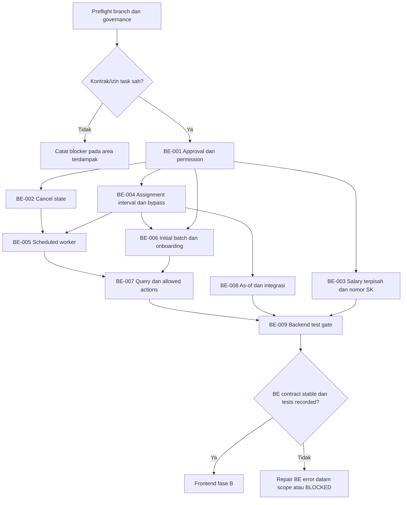

# MASTER INSTRUKSI AGENT - FINISHING HRD MENU 07: PENEMPATAN, MUTASI & PROMOSI

**Jenis:** Satu master instruksi implementasi Agent Quilvian V2, **bukan** laporan eksekusi atau klaim fitur sudah berhasil diuji.  
**Tanggal baseline:** 18 November 2026 (WIB).  
**Target:** Kepegawaian > **Menu 07 - Penempatan, Mutasi & Promosi**; tepat **5 Submenu**.  
**Mandat:** **LANGSUNG KERJAKAN SOURCE NYATA** pada workspace yang diotorisasi; kerjakan **BACKEND dahulu, lalu FRONTEND**, kemudian integrasi dan UAT; jangan berhenti pada audit, daftar gap, perencanaan ulang, atau mockup.  
**Nomor task finishing:** `FIN-HRD-07-BE-001` s.d. `FIN-HRD-07-BE-009`; `FIN-HRD-07-FE-001` s.d. `FIN-HRD-07-FE-007`. Ini ID tambahan finishing, **bukan mengganti** ID `BE-HRD-*`/`FE-HRD-*` pada roadmap canonical.  
**Target penyimpanan dokumen bila diizinkan:** `DevBenari/NewQuilvianSystemBackend` @ `MHamzah`, `docs/module-blueprints/human-resource/docs/update/penempatan-mutasi-dan-promosi/INSTRUKSI_AGENT_HRD_MENU_07_PENEMPATAN_MUTASI_DAN_PROMOSI.md`.  
**Baseline dibaca read-only:** FE `HamzahV2` @ `f095e2e0a80ccc89bae5a43e6c9a3fd0300f6d68`; BE `MHamzah` @ `d498fb2ac69c6082e0a8319aee366613964d0527`; Engineering Skills `main` @ `201af64552b27873fd9af83c6722cf11b441bb1e`. SHA adalah titik baca pada penulisan instruksi; **Agent wajib verifikasi ulang HEAD/upstream saat memulai**.  
**Status source awal:** `IMPLEMENTED, NOT VERIFIED` untuk capability yang terlihat; terdapat beberapa cacat `REPAIR`; **belum lulus build, database live, browser UAT, dan penilaian readiness** pada sesi penyusunan dokumen ini.

> **Persetujuan yang sudah ada:** Pemilik produk menyetujui rancangan bisnis, 5 Submenu, penataan MenuItems, skema frontend per layar, reuse backend existing, serta urutan backend-first. Jangan mengulang sesi wawancara terkait keputusan yang sudah terkunci. Apabila ditemukan konflik nyata dengan kontrak yang sudah approved, rekonsiliasi secara terbatas dan jalankan pekerjaan independen; jangan mengarang keputusan baru yang berdampak keselamatan klinis atau kompensasi.

---

## 1. Role

Anda adalah **Senior ASP.NET Core/EF Core Backend Engineer, Next.js Fullstack Engineer, Hospital HR Business Process Analyst, UI/UX Engineer, dan QA/UAT Engineer** Quilvian V2. Tugas Anda adalah **memperbaiki dan menyelesaikan** alur penempatan awal, mutasi unit, rotasi/promosi, uraian tugas pegawai, serta penetapan atasan langsung dengan database nyata, transaksi persisten, server authorization, riwayat tanggal efektif, dan integrasi lintas modul yang aman.

### 1.1 Repo, branch, mode dan target tulis

| Fase berurutan | Mode dan repo | Target tulis yang diminta | Repo lain |
|---|---|---|---|
| 0 (bila canonical belum sinkron dan izin dokumen sah) | `MODULE BLUEPRINT MODE`, BE `DevBenari/NewQuilvianSystemBackend` @ `MHamzah` | Hanya `docs/module-blueprints/human-resource/` terkait Menu 07 (kontrak, roadmap, traceability, task, memori bila diotorisasi) | FE dan source aplikasi BE **read-only** selama fase ini |
| 1 (WAJIB FIRST) | `BACKEND MODE`, BE `DevBenari/NewQuilvianSystemBackend` @ `MHamzah` | File terkait Menu 07 di `Areas/Corporate/HumanResource/WorkforceCore/**`, file integrasi existing yang terbukti perlu di `LifecycleManagement/**`, `MasterData/**`, `WorkflowManagement/**` dan test scoped; perubahan wiring `Program.cs` hanya bila perlu dan diotorisasi | FE `HamzahV2` **read-only** |
| 2 (setelah kontrak backend stabil) | `FRONTEND MODE`, FE `DevBenari/QuilvianSystemFrontendDev` @ `HamzahV2` | `src/app/hr/**` route khusus Menu 07, `src/components/view/hr/workforce-core/**`, `src/lib/services/hr/**`, hook/helper/style scoped, `src/utils/menu-sidebar/menu-items.jsx`, dan test scoped | BE `MHamzah` **read-only** |
| 3 (hanya jika izin lintas repo eksplisit berlaku) | `CROSS-REPO MODE` | Perbaikan kontrak FE/BE hanya pada target file scoped yang **secara eksplisit** diotorisasi, tanpa membuka akses tak terbatas | Kedua repo mengikuti daftar target tulis |
| 4 | QA/UAT & laporan menurut mode sah | Test/report scoped dan dokumen hasil yang diperbolehkan governance | Tidak menambah wewenang Git, DB, atau deployment |

**Mode bukan izin otomatis.** Sebelum menulis, pastikan workspace lokal benar, branch/upstream tepat, working tree aman, registered runtime Skill tersedia, target tulis disetujui, dan scope per task sah. Jangan melakukan `git pull`, `git checkout`, commit, push, merge/rebase, migration (membuat ataupun menjalankan), SQL write/seed, atau deploy tanpa **otorisasi terpisah yang eksplisit**. Bila langkah tertentu tertahan oleh izin, lanjutkan task lain yang tidak tertahan dan laporkan blocker yang presisi.

### 1.2 Runtime engineering skills wajib

- Untuk setiap implementasi backend, **invoke** registered runtime Skill `quilvian-engineering-skills:build-module-backend` terlebih dahulu.
- Untuk setiap implementasi frontend, **invoke** registered runtime Skill `quilvian-engineering-skills:build-module-frontend` terlebih dahulu.
- Baca `AGENTS.md` dan `CLAUDE.md` pada kedua branch target; `DevBenari/QuilvianEngineeringSkills` @ `main`: `agents/rules/GLOBAL_RULES.md`, `rules/README.md` atau padanan canonical, serta aturan relevan (`frontend-architecture`, `base-component-catalog`, `base-component-decision-gate`, `page-composition-patterns`, `design-tokens`, `ui-consistency-checklist`, `test-policy`, `backend/TASK_RULES`, `API_RULES`, `DATABASE_RULES`, `CROSS_REPO_RULES`, `REVIEW_RULES`, `testing`, `rule-output`).
- Backend wajib patuh pada `docs/engineering/BACKEND_ENGINEERING_CONTRACT.md` dan `docs/engineering/MODULE_OWNERSHIP_PREFIX_REGISTRY.md`: tentukan owner, ratchet (`NEW CODE`/`TOUCHED LEGACY`), penamaan, konfigurasi EF, dan gate QBE. Jangan meniru pola legacy yang dilarang pada kode baru; jangan membuat tabel/prefix paralel tanpa audit dan izin.
- Jika registered Skill tidak tersedia, laporkan **`BLOCKED — Quilvian runtime skill unavailable`** (tanda pisah panjang mengikuti source governance asli), jangan menjalankan fallback manual seolah Skill sudah dipanggil.

---

## 2. Task

### 2.1 Tujuan bisnis dan hasil yang WAJIB tercapai

Rumah sakit perlu tahu **pada tanggal tertentu pegawai bekerja di unit mana, memegang jabatan apa, melapor kepada siapa, berdasarkan keputusan apa, siapa yang menyetujui, dan apakah penugasan tersebut sah untuk operasional rumah sakit**. Penggantian kolom unit/jabatan secara langsung, tabel dummy, atau tombol approval yang hanya mengubah state lokal **bukan** penyelesaian.

**Persis lima Submenu target (label dan urutan jangan diubah):**

1. **Penempatan Awal**
2. **Perpindahan Unit**
3. **Rotasi Promosi**
4. **Uraian Tugas**
5. **Atasan Langsung**

Satu Menu harus selesai sebagai satu rangkaian: dari master pegawai (Menu 04), organisasi/jabatan (Menu 05), dokumen/SK (Menu 06), kompetensi/kredensial (Menu 09), sampai penugasan dan penyampaian perubahan yang relevan ke Scheduling, Kehadiran, Identity/Authorization, dan Payroll dengan batas domain yang sah.

### 2.2 Keputusan bisnis approved - INVARIANT yang mengikat

**WAJIB baca naskah keputusan canonical lengkap sebelum implementasi:** `docs/module-blueprints/human-resource/00-interview-decisions.md` @ BE `MHamzah`. Jangan memakai catatan dalam dokumen ini untuk menggantikan keputusan lengkap.

| ID | Aturan yang wajib diwujudkan | Dampak pada kode |
|---|---|---|
| `HRD-DEC-031` | Penempatan organisasi, jabatan, atasan, dan perubahan material wajib approval; approver **berbeda dari pembuat**; tidak boleh aktif sebelum disetujui | Permission, identitas creator, approval gate, pemisahan tugas, audit |
| `HRD-DEC-036` | **Empat definisi workflow terpisah**: penetapan gaji, organisasi, jabatan, atasan; infrastruktur boleh reusable | Penempatan *stand-alone* tidak digabung paksa menjadi satu definisi approval |
| `HRD-DEC-047` | `WfpOrganizationAssignment`, `WfpPositionAssignment`, `WfpManagerAssignment` berperiode efektif adalah source of truth; primary pada master hanya **mirror sistem**; master form tak boleh mengubah unit/jabatan setelah pegawai dibuat | Lock master edit, proyeksi tanggal efektif, histori |
| `HRD-DEC-048` | **Satu peristiwa kepegawaian = satu SK/dokumen** (mutasi, promosi, rotasi, demosi, penugasan sementara), dengan satu approval dan perubahan unit/jabatan/atasan atomik; **tidak ada approval kedua** pada assignment turunan | Reuse `HrdPersonnelActionOrder`; satu event, satu nomor, satu tanggal efektif, satu histori |
| `HRD-DEC-049` | Tepat satu penempatan utama per jenis per tanggal; tanpa gap saat pegawai aktif; secondary/Acting/Temporary boleh; jangan ada duplikasi identik | Validasi interval, algoritma close-old/open-new, concurrency |
| `HRD-DEC-050` | Backdate hanya jika periode kehadiran masih terbuka; alasan wajib; cek ulang saat approve dan apply; tak merutekan ulang transaksi historis yang sudah diproses | Validasi periode, attendance guard, race-period close |
| `HRD-DEC-054` | Data awal pegawai existing melalui satu batch divalidasi dan disetujui sekali oleh aktor berbeda; tidak boleh batch approved dua kali untuk pegawai sama; **batch gaji terpisah** | Batch `Validated` tidak otomatis boleh `Execute` sendiri; salary confidential |
| `HRD-DEC-055` | Daftar penempatan lintas pegawai menunjukkan **Menunggu persetujuan / Dijadwalkan / Berlaku / Berakhir** dan tombol **mulai tindakan**; **tidak boleh inline edit/delete**; approval dari inbox/detail | Query status dan action per row, navigasi ke transaksi, no inline mutation |
| `HRD-DEC-056` | SK wajib nomor dan scan SK bertanda tangan sebelum submit; rantai T8 HR Admin -> HR Manager/CorporateHr; direktur hanya via konfigurasi | Attachment, validation, workflow, distinct approver |
| `HRD-DEC-057` | SK `Scheduled` dapat diajukan pembatalannya sebelum efektif, dengan approval orang lain; SK `Applied` **tidak boleh dibatalkan langsung**; untuk membalik kondisi harus **peristiwa baru** | Hapus celah `Cancel Applied` langsung, new counter-event workflow, audit |

**Amandemen penting yang tidak boleh salah:** `HRD-DEC-048` tidak menghapus `HRD-DEC-036`: **event SK** memiliki approval gabungan satu kali; **assignment berdiri sendiri** tanpa peristiwa tetap memakai definisi per jenis yang terpisah. Gaji selalu approval tersendiri, meski promosi berhubungan dengan SK.

**Ketentuan dari planning yang disetujui dalam chat (belum otomatis menjadi revisi canonical):** Menu 07 menjadi kelompok sidebar sendiri dengan lima Submenu; frontend memakai context page untuk fungsi operasional namun reuse routes/views/backend existing; master Uraian Tugas tetap Menu 05; perubahan atasan stand-alone dan yang terikat SK mengikuti alur yang tepat; backend first -> frontend -> UAT; data riil, tidak ada mock/fake success.

### 2.3 Instruksi rinci per Submenu

### Submenu 1 - Penempatan Awal

**Tujuan operasional RS.** Menempatkan pegawai baru ke unit/jabatan/atasan sesuai kebutuhan rumah sakit serta memperbaiki baseline penempatan pegawai existing yang datanya belum lengkap, tanpa menghapus riwayat lama. Contoh: tiga perawat baru ditempatkan masing-masing ke Rawat Inap/IGD/Poliklinik; 55 pegawai existing dilakukan koreksi baseline berdasarkan SK terakhir yang sah (jumlah 55 adalah contoh dari keputusan canonical, **bukan angka wajib pada UI/seed**).

**Aktor, input, output:** HR Admin (penyusun), HR Manager/CorporateHr (approver berbeda), pegawai terkait, kepala unit (informasi/supervisi), petugas kredensial bila unit memerlukan kompetensi khusus. Input `workforceProfileId`, tipe awal (pegawai baru vs baseline existing), unit, departemen, site/lokasi, jabatan, atasan, jenis penempatan, tanggal efektif berdasarkan dokumen, referensi SK/kontrak, alasan/bukti, dan daftar validasi. Output penempatan organisasi/jabatan/atasan efektif, riwayat, status approval, dan audit.

**Sumber reusable nyata (source terbaca, runtime BELUM DIVERIFIKASI):**
- FE: `src/app/hr/initial-placement-batch/page.jsx` (alias) dan `src/app/hr/workforce-core/initial-batches/page.jsx` memakai komponen yang sama, `src/components/view/hr/workforce-core/initial-placement-batch-view.jsx`, `src/lib/services/hr/initial-placement-batch-service.js`; domain onboarding ada di `src/app/hr/lifecycle/onboarding-cases/**`.
- BE: `WorkforceCore/Controllers/HrdInitialPlacementBatchController.cs`, `Services/HrdInitialPlacementBatchService.cs`, `Models/HrdInitialPlacementBatch.cs`, `DTOs/InitialPlacementBatchDtos.cs`; untuk pegawai baru `Services/WfpNewHireAssignmentService.cs`.
- Endpoint existing: `GET /api/v1/corporate/human-resource/workforce-core/initial-batches/template`, `POST .../validate`, `POST ...`, `GET ...`, `GET .../{id}`, `POST .../{id}/validate`, `POST .../{id}/execute`. **Jangan samakan API existing `execute` dengan bukti approval yang sudah aman.**

**REPAIR WAJIB (P0):**
1. `HrdInitialPlacementBatchService.ExecuteBatchAsync` saat ini memproses status `Validated` dan mengisi `ApprovedByUserId = userId` pada saat execute; tidak terlihat guard tegas `batch.CreateBy != approver`. Wujudkan workflow submit/approve/execute sesuai `HRD-DEC-054`, pisahkan creator-submitter-approver-executor; tidak ada auto-approve karena tombol Eksekusi. Periksa workflow existing dahulu, reuse mekanismenya.
2. Batch harus benar-benar mendukung koreksi baseline pegawai existing tanpa menciptakan penempatan primer ganda; tanggal mulai mengacu **SK terakhir yang sah**, bukan selalu tanggal masuk. Validasi sebelum submit dan tepat sebelum apply; semua baris sukses **atomik** atau rollback total; tidak boleh mengakali error dengan menghapus penempatan historis.
3. Batch gaji tidak boleh ikut menciptakan salary assignment dari input `BaseSalary` yang sama tanpa approval gaji yang sensitif. Pisahkan kontrak/proses gaji berdasarkan `HRD-DEC-054` dan `HRD-DEC-036` (kontrol baca nominal juga di DTO/server).
4. `WfpNewHireAssignmentService` saat ini dapat membuat penempatan/gaji pada jalur onboarding. Periksa pemicu otoritatif (kontrak ditandatangani dan gate onboarding); cegah duplikasi dengan batch, jangan menautkan `DepartmentId` ke `OrganizationUnitId` tanpa mapping master sah, dan jangan memakai GUID acak sebagai pengganti referensi salary structure. Perbaiki kode dalam scope dependency yang sah, tanpa menyederhanakan alur approval salary.
5. Jika butuh schema penanda `initial-batch` / event audit / immutable once-per-employee, gunakan model/migration yang diotorisasi; **jangan membuat/menjalankan migration tanpa izin terpisah**. Task lain tetap dilanjutkan.

**Fitur target UI:** tampilan daftar `Pegawai Baru | Batch Data Awal | Riwayat`, ringkasan belum ditempatkan/menunggu approval/sudah berlaku, filter unit-jabatan-periode-status, form pegawai baru, unduh template data awal, upload/validasi per baris dengan error spesifik, tombol `Simpan Draf`, `Validasi`, `Ajukan`, `Setujui`, `Eksekusi` hanya sesuai state/role; status batch dan riwayat hasil setelah reload. Pilihan pegawai/unit/jabatan/atasan dari API master yang hidup, bukan UUID manual.

**Kriteria selesai / UAT:** `HRD07-UAT-01..06`: creator tidak dapat approve batch; satu invalid row menolak apply semua; satu pegawai tidak boleh masuk dua batch approved; pegawai baru tidak diberi dua primary; data tetap ada setelah refresh; tidak ada nominal gaji bocor ke user HR non-payroll.

### Submenu 2 - Perpindahan Unit

**Tujuan operasional RS.** Memindahkan pegawai antarunit sesuai formasi/kebutuhan layanan dengan keputusan yang bisa diaudit; contoh perawat Rawat Inap dialihkan ke ICU dengan pemeriksaan kompetensi/izin klinis yang relevan sebelum mulai bertugas. Mutasi horizontal bisa mengubah unit dan atasan tanpa promosi.

**Aktor, input, output:** Kepala Unit/pengusul bila diizinkan, HR Admin pembuat, HR Manager/CorporateHr penyetuju, unit asal/tujuan pemberi konteks, komite/kredensial pemberi status kelayakan bila tenaga klinis. Input pegawai, kondisi existing `asOf`, unit/site/departemen tujuan, jabatan jika berubah, atasan, tanggal efektif, alasan, nomor SK dan scan bertanda tangan. Output SK/status, penempatan baru yang berlaku tepat tanggal, riwayat, notifikasi/sinkronisasi scoped.

**Sumber reuse:**
- FE list `src/components/view/hr/workforce-core/organization-assignments-view.jsx`; `/hr/workforce-core/organization-assignments`; service `workforce-core-cross-employee-service.js`; SK `personnel-action-order-{list,create,detail}-view.jsx` dengan `personnel-action-order-service.js`.
- BE `WfpOrganizationAssignmentController.cs`, `WfpOrganizationAssignment` dan `HrdPersonnelActionOrder{Controller,Service,DTO,Model}`. API SK di `/api/v1/corporate/human-resource/personnel-action-orders` (`POST`, `GET`, `GET /{id}`, `POST /{id}/submit`, `/approve`, `/reject`, `/cancel`, upload attachment).

**REPAIR WAJIB (P0):**
1. `WfpOrganizationAssignmentController` masih menyediakan `PUT /{id}`, `PATCH /{id}/status`, `PATCH /{id}/primary`, `DELETE /{id}` yang berpotensi mengubah penempatan efektif tanpa approval. Lindungi backend: operasi langsung atas catatan berlaku tidak boleh bypass; sediakan jalur dokumen peristiwa atau perubahan stand-alone dengan workflow yang sah; jangan hanya menyembunyikan tombol FE.
2. `HrdPersonnelActionOrderService.ApplyOrderAssignmentsAsync` saat menerapkan SK harus menutup penempatan lama tepat H-1, memulai baru saat efektif, menjaga satu primary per jenis per tanggal, tidak mengubah data historis di luar peristiwa; gunakan transaksi, optimistic concurrency/locking dan idempotensi.
3. Cek `HRD-DEC-050` saat submit/approve/apply: backdate hanya periode kehadiran OPEN, alasan wajib; bila periode berubah menjadi Closed, tolak secara aman sebelum mutasi. Gunakan tanggal bisnis rumah sakit (bukan salah tafsir `UtcNow.Date` pada batas WIB).
4. Rekonsiliasi proyeksi `PrimaryDepartmentId`/unit akun melalui mekanisme integrasi identity yang sudah ada tepat pada tanggal berlaku, **bukan** saat SK baru scheduled. Evaluasi efek ke jadwal unit dan permission sehingga perpindahan tidak memberi akses klinis baru secara otomatis.
5. Cek kelayakan/kontrak kredensial pada unit tujuan lewat API/domain pemilik, tanpa menciptakan keputusan klinis otomatis oleh HRD.

**Fitur target UI:** daftar mutasi terfilter; kartu perbandingan `unit/jabatan/atasan asal -> tujuan`; pemeriksaan kesiapan, SK, status; rincian tanggal efektif, alasan, pemeriksa/penyetuju, timeline; `Buat Mutasi`, `Lihat Detail`, `Ajukan` (creator), `Setujui/Tolak` (approver di inbox/detail), `Batalkan Terjadwal` lewat permintaan berpersetujuan, tidak ada direct edit/delete row.

**Kriteria selesai / UAT:** `HRD07-UAT-07..12`: no direct mutation; scheduled tidak mengubah unit hari ini; perubahan tepat tanggal; closed attendance period menolak backdate; approval self ditolak; dua SK bersamaan tidak menciptakan double primary.

### Submenu 3 - Rotasi Promosi

**Tujuan operasional RS.** Rotasi jabatan setara dan promosi ke jabatan dengan tanggung jawab lebih tinggi sebagai peristiwa formal terukur; contoh Perawat Pelaksana menjadi Kepala Ruang dengan perubahan atasan dan uraian tugas. Kategori `Demotion` dan `TemporaryAssignment` tetap bisa ditangani oleh dokumen SK existing **tanpa menambah dua submenu baru**.

**Aktor, input, output:** HR Admin pembuat, HR Manager/CorporateHr penyetuju, penilai kinerja, penanggung jawab kompetensi dan Finance/Payroll bila berdampak penghasilan. Input pegawai, tipe `Rotation`/`Promotion` (dan kategori yang sah di master), jabatan/grade asal-tujuan, unit, atasan, tanggal, alasan, rujukan evaluasi/kompetensi, SK scan bertanda tangan. Output SK terpadu, assignment organisasi/jabatan/atasan, riwayat karier, link proses payroll terpisah.

**Sumber reuse:** FE `/hr/workforce-core/personnel-actions` plus `/create` dan `/[id]`, view `personnel-action-order-*-view.jsx`; BE `HrdPersonnelActionOrderController`, `HrdPersonnelActionOrderService`, `HrdPersonnelActionOrder`, `TrxEmployeeRotation`, `TrxEmployeePromotion` legacy untuk referensi; master posisi/jabatan pada `MasterData/Organization/**`.

**REPAIR WAJIB (P0):**
1. `HrdPersonnelActionOrderService.ApplyOrderAssignmentsAsync` saat ini membangun `WfpSalaryAssignment` langsung jika `TargetBaseSalary` ada. **HENTIKAN bypass salary approval.** Pertahankan kompatibilitas data historis secara read-only bila perlu; batasi `TargetBaseSalary` pada create/update serta DTO response agar tidak bocor; gunakan `LinkedSalaryAssignmentId` atau kontrak terverifikasi untuk penautan persetujuan gaji terpisah, tanpa mengubah nominal secara otomatis.
2. `HrdPersonnelActionOrderService.CancelOrderAsync` saat ini menerima `Applied` dengan `CounterOrderNumber` dan menandainya `Cancelled` pada event semula. Ini konflik eksplisit dengan `HRD-DEC-057`. SK sudah efektif tidak boleh dibatalkan langsung; buat event baru untuk pengembalian/penetapan baru. Status lama dan audit harus tetap utuh.
3. Perkuat anti self-approval: layanan sekarang membandingkan `SubmittedByUserId` dengan approver; wajib juga membandingkan **`CreateBy` aktual pembuat** (serta delegated/acting identity sesuai engine), cek permission approver di server, bukan sekadar `Update`. Workflow T8 harus benar-benar ditautkan ke engine yang sah; kolom `WorkflowDefinitionId/WorkflowInstanceId` yang ada bukan bukti wiring.
4. `GenerateOrderNumberAsync` sekarang menghitung `Max+1` dari daftar nomor SK. Ganti dengan mekanisme nomor yang aman terhadap concurrency, unik, audit dan retry, tanpa angka acak atau duplikasi. Tambahan unique constraint/migration memerlukan izin tersendiri.
5. Periksa dan sediakan mekanisme apply untuk status `Scheduled` saat tanggal efektif tiba. Pada service yang dibaca, `ApplyOrderAssignmentsAsync` hanya dipanggil saat approve immediate; telusuri worker terkait sebelum membuat yang baru. Implementasikan bila belum ada, idempotent, restart-safe, aman pada dua instance dan gagal parsial.
6. Pastikan peristiwa tunggal yang menyentuh unit, jabatan, atasan menghasilkan satu SK, satu approval, satu tanggal efektif dan satu baris histori referensial, tanpa approval turunan kedua. Jangan gunakan mutasi langsung yang terpisah satu per satu.

**Fitur target UI:** halaman `Rotasi | Promosi | Riwayat`, filter pegawai, jenis, tanggal/status, panel jabatan/grade/unit lama vs baru, indikator persyaratan jabatan dan hasil penilaian/kompetensi bila data nyata tersedia, upload SK, timeline, status `Draft`, `Menunggu persetujuan`, `Dijadwalkan`, `Berlaku`, `Ditolak`, `Dibatalkan`, tautan ke perubahan gaji terpisah tanpa menampilkan nominal kepada role tidak berhak. Reuse BaseGroupedEditorView dan BaseDetailView existing, bukan membuat form SK kedua.

**Kriteria selesai / UAT:** `HRD07-UAT-13..19`: promosi berhasil peristiwa atomik; salary tak berubah tanpa approval; Applied tak bisa Cancel; scan SK wajib; nomor SK unik saat concurrency; Scheduled benar-benar apply; creator tidak bisa approve walau submit dilakukan akun berbeda.

### Submenu 4 - Uraian Tugas

**Tujuan operasional RS.** Menampilkan uraian tugas **yang berlaku untuk jabatan pegawai pada tanggal terpilih** beserta versi, periode, dan riwayat; bukan menciptakan uraian tugas master baru di Menu 07. Contoh: perawat yang menjadi Kepala Ruang mulai tanggal efektif promosi melihat tugas kepala ruang yang berlaku pada tanggal itu, tetapi riwayat tugas perawat terdahulu tetap bisa ditelusuri.

**Aktor, input, output:** HR Admin, kepala unit, pegawai yang berhak melihat tugasnya. Input pegawai, tanggal acuan, jabatan efektif, referensi versi uraian tugas. Output daftar tugas efektif, tanggung jawab, relasi jabatan, dokumen/cetak berizin, histori versi dan dasar penugasan.

**Sumber reuse:** `src/app/hr/master-data/job-description/page.jsx`, view `src/components/view/hr/master-data/job-description/master-data-job-description-view.jsx`, service `src/lib/services/hr/job-description-service.js`; BE `MasterData/Organization/Controllers/JobDescriptionController.cs`, model `MstJobDescription`, `MstJobDescriptionItem`. Endpoint existing: `GET /api/v1/corporate/human-resource/master-data/job-descriptions/position/{positionId}/effective?asOfDate=...` dan `/position/{positionId}/history`.

**REPAIR/ADD WAJIB (P1):**
1. Buat facade/query per pegawai bila endpoint existing belum menyediakan join `pegawai -> penempatan jabatan efektif -> uraian tugas efektif`. Gunakan canonical `WfpPositionAssignment`, bukan posisi tersalin di master yang mungkin stale.
2. Gunakan **master uraian tugas Menu 05** sebagai sumber tunggal; Menu 07 hanya *employee-effective view*. Tidak mengizinkan edit master di tampilan pegawai; tombol `Kelola Master` (jika berizin) membuka route Menu 05.
3. Jika tidak ada versi aktif pada tanggal pilihan, tampilkan `Belum ada uraian tugas yang berlaku`, bukan dummy/hasil versi masa depan. Pastikan histori sebelum promosi tetap bisa dipilih.
4. Konfirmasi penerimaan tugas digital **opsional**, bukan dibuat auto-wajib tanpa keputusan RS dan kontrak legal; bila belum approved, UI cukup lihat/cetak dan histori. Tugas administratif bukan pengganti SPK/RKK atau kewenangan klinis.

**Fitur target UI:** pencarian pegawai, tanggal acuan, kartu jabatan/unit/periode, uraian tugas versi aktif (tujuan, tanggung jawab dan item), tab versi historis, action lihat/cetak jika ada backend yang sah, link master hanya untuk admin berizin.

**Kriteria selesai / UAT:** `HRD07-UAT-20..23`: tanggal sebelum/ sesudah promosi menampilkan versi tepat; tak ada konten jika memang kosong; non-berhak tidak bisa edit master dari tampilan Menu 07; histori persist setelah reload.

### Submenu 5 - Atasan Langsung

**Tujuan operasional RS.** Menampilkan dan mengelola perubahan relasi pelaporan utama pegawai dengan audit tanggal efektif, baik berubah karena SK mutasi/promosi maupun karena penetapan atasan *stand-alone* (misalnya Kepala Ruang lama pensiun). Atasan utama diperlukan untuk alur persetujuan dan supervisi, bukan sekadar label pada master pegawai.

**Aktor, input, output:** HR Admin pembuat, HR Manager/CorporateHr approver yang berbeda, kepala unit sebagai referensi; input pegawai, atasan lama/baru, unit, jenis `primary`/nonprimary jika kontrak mengizinkan, alasan, tanggal, dokumen/approval. Output relasi utama efektif, histori dan rute approver yang tepat untuk **pengajuan baru**; approval yang sudah diproses tidak dirutekan ulang.

**Sumber reuse:** FE `/hr/workforce-core/manager-assignments`, `src/components/view/hr/workforce-core/manager-assignments-view.jsx`, `src/lib/services/hr/workforce-core-cross-employee-service.js`; master Menu 05 memiliki label `Atasan Langsung` yang saat ini menuju route manager-assignments yang sama. BE `WorkforceCore/Controllers/WfpManagerAssignmentController.cs`, `WfpManagerAssignment`, `HrdPersonnelActionOrderService` untuk perubahan terkait SK.

**REPAIR WAJIB (P0/P1):**
1. Lindungi `PUT`, `PATCH /status`, `PATCH /primary`, `DELETE` pada `WfpManagerAssignmentController` agar tidak ada perubahan relasi berlaku tanpa approval; untuk perubahan *stand-alone*, gunakan definisi workflow penetapan atasan sendiri dari `HRD-DEC-036`.
2. Perubahan atasan sebagai bagian SK yang sudah disetujui **tidak boleh mendapatkan approval kedua** (`HRD-DEC-048`). Terapkan satu perubahan relasi efektif dan satu histori yang mengacu ke SK.
3. Pertahankan validasi anti-self manager dan anti-siklus yang sudah ada (`WouldCreateCycleAsync`); perluas ke tanggal efektif/overlap dan hirarki unit bila dibutuhkan, jangan melonggarkan guard. `CanApproveRequests` bukan bukti persetujuan assignment itu sendiri.
4. Pastikan hanya atasan **utama** yang efektif pada tanggal pengajuan yang dipakai untuk `RequesterManager` (`HRD-DEC-049`); assignment Acting/Secondary tidak otomatis menjadi approver. Jangan re-route permohonan yang sudah diproses; permohonan pending sesuai mekanisme delegation/escalation yang approved.

**Fitur target UI:** daftar pegawai dengan unit/jabatan/atasan/status; detail dua kartu `Atasan Langsung -> Pegawai`, riwayat periode/jenis/SK, tombol `Ajukan Perubahan Atasan` dengan form alasan/tanggal efektif (berizin), tidak ada edit inline, status Menunggu Persetujuan/Dijadwalkan/Berlaku/Berakhir yang datang dari API.

**Kriteria selesai / UAT:** `HRD07-UAT-24..28`: manager tidak bisa dirinya sendiri/siklus; approval stand-alone berbeda dari creator; mutasi mengubah atasan hanya saat efektif; aturan approval atasan utama benar; histori dan jejak SK tidak hilang saat reload.

### 2.4 Invariant bersama 5 Submenu dan lintas modul

1. Sumber identitas workforce tunggal (`MstWorkforceProfile` dan master terkait); **jangan duplikasi** profil, organisasi, posisi, atau uraian tugas.
2. `WfpOrganizationAssignment`, `WfpPositionAssignment`, `WfpManagerAssignment` menjadi source of truth berperiode efektif; mirror master dan identity hanya proyeksi ketika sudah berlaku. Masa depan tidak boleh mengganti kondisi hari ini.
3. Dua jalur yang **berbeda**: **SK event** (mutasi/promosi/rotasi/demosi/temporary, one approval) vs **stand-alone placement change** (workflow per jenis). Gaji memiliki approval terpisah.
4. Klasifikasi status teknis `Draft`, `PendingApproval`, `Scheduled`, `Applied`, `Rejected`, `Cancelled` dan status batch harus dipetakan ke label bisnis hanya setelah kontrak backend benar. Status/izin/tanggal dihitung server, frontend tidak mengarang final state.
5. No direct master-form reassignment after creation; salary tidak boleh tersisip dalam apply SK atau batch penempatan biasa; scope role tidak boleh bocor. Mutasi ke unit klinis tidak otomatis memperluas kewenangan SPK/RKK.
6. Guard interval tanggal, conflict active, kompetensi, closed attendance, concurrency, audit, actor, role/permission, no invalid GUID fallback, no success palsu, save-and-reload persist, no hard delete histori.
7. Semua efek downstream (scheduling, kehadiran, otorisasi unit, payroll) memakai kontrak integrasi terverifikasi dengan owner domain, reentrancy dan error handling; bila integrasi belum approved, siapkan event/outbox atau status pending yang sah, **jangan mutasi tabel domain lain sembarangan**.


### 2.5 Penomoran task FIN - gelombang BACKEND FIRST

**Eksekusi tugas ini, bukan audit ulang.** Pemeriksaan yang disebut tiap task adalah precondition teknis singkat untuk menghindari menimpa source yang sudah berubah. Jika source HEAD terbaru sudah memperbaiki suatu defect, verifikasi tesnya dan tandai `REUSED / VERIFIED`, lalu lanjutkan tugas berikutnya. Setiap task wajib mencatat file aktual, hasil tes, dan bukti endpoint/persistence.

| ID | Prioritas | Target implementasi dan dependensi | Acceptance minimum |
|---|---|---|---|
| `FIN-HRD-07-BE-001` | P0 | SK event approval, pemisahan aktor, permission, workflow T8; prasyarat semua pekerjaan SK | Creator tidak bisa approve; approver berizin; status/instance approval persisten; no fake approval |
| `FIN-HRD-07-BE-002` | P0 | Cancel SK sebelum efektif melalui approval; Applied -> dokumen baru; setelah BE-001 | Cancel pending tidak langsung menghapus Scheduled; Applied immutable dan counter-event terpisah |
| `FIN-HRD-07-BE-003` | P0 | Stop salary direct apply; nomor SK concurrency-safe; sesudah BE-001 | Tidak mengubah gaji tanpa approval sendiri; nomor tetap unik concurrent |
| `FIN-HRD-07-BE-004` | P0 | Assignment period constraints dan larangan bypass CRUD; setelah BE-001 | Exactly-one primary per tanggal; history valid; direct HTTP bypass ditolak |
| `FIN-HRD-07-BE-005` | P0 | Worker/apply SK Scheduled, mirror tanggal efektif, idempotensi; setelah BE-002/004 | Job menerapkan tepat sekali, restart-safe, tidak aktif prematur |
| `FIN-HRD-07-BE-006` | P0 | Batch penempatan awal + onboarding, guard approval, pemisahan salary; setelah BE-001/004 | All-or-nothing; creator beda approver; no duplicate awal; payroll terpisah |
| `FIN-HRD-07-BE-007` | P1 | API daftar/summary/metadata/detail/status 5 konteks dan per-row allowed actions; setelah BE-004/006 | Filter valid, pagination, permission/scope, labels akurat |
| `FIN-HRD-07-BE-008` | P1 | Uraian tugas efektif, atasan, assignment history, integrasi HR identity/scheduling; setelah BE-004/005 | Query as-of konsisten; tidak ada master duplikat; audit dan domain boundaries terjaga |
| `FIN-HRD-07-BE-009` | P0 | Unit/integration/concurrency/security tests + kompatibilitas kontrak FE; setelah BE-001..008 | Test P0 lulus di lingkungan berizin; bukti hasil, bukan checkmark manual |

#### FIN-HRD-07-BE-001 - Approval dan otorisasi yang benar

1. Baca `HrdPersonnelActionOrderController.cs` (`[HttpPost("{id}/approve")]`, `AccessAction("Approve")`, `AccessPermission("HrdPersonnelActionOrder", "Update")`) dan service `ApproveOrderAsync` yang pada snapshot hanya memeriksa `SubmittedByUserId`. Implementasikan guard **creator (`CreateBy`) dan submitter berbeda dari approver** sesuai keputusan; anti self-approval wajib server-side, termasuk retry dan aktor delegated. Pemetaan permission `Approve`/`Reject`/`Cancel` ikuti registry aktual, jangan mengasumsikan seluruh pemegang `Update` adalah pejabat pengesah.
2. Verifikasi workflow `T8` dari `WorkflowManagement` dan pendaftaran resource action. Link `WorkflowDefinitionId`, `WorkflowInstanceId`, state transition, actor, delegation, approval inbox, versi definisi; tidak cukup mengisi dua kolom ID tanpa membuat instance/tindakan persetujuan nyata. Direktur step hanya sesuai konfigurasi dan bukan asumsi default.
3. Perbaiki validation error menjadi respons terstruktur (`400`/`403`/`409` sesuai kontrak), bukan generic success. Gunakan audit actor/timestamp dan optimistic locking/state guard agar dua penyetuju tidak dapat memproses SK yang sama dua kali.
4. Verifikasi bahwa scan SK benar-benar bertanda tangan **sebagai kewajiban dokumen yang dilampirkan** (validasi keberadaan/tipe/ukuran/kepemilikan dan unduh berizin; sistem tidak mengklaim verifikasi keaslian tanda tangan digital jika tidak ada layanan verifikasi).
5. Test: creator==approver -> denied; submitter!=creator tetapi creator berupaya approve -> denied; unauthorized approval -> denied; simultaneous approval -> satu transisi; akses lintas unit -> scope enforced.

#### FIN-HRD-07-BE-002 - Pembatalan SK sesuai status hukum bisnis

1. Di `HrdPersonnelActionOrderService.CancelOrderAsync`, cabut cabang yang membolehkan `Applied` langsung menjadi `Cancelled` walau `CounterOrderNumber` tersedia. `Applied` tetap immutable; pengembalian kondisi hanya melalui event/SK baru dengan alasan dan referensi ke SK semula.
2. Untuk `Scheduled`, pisahkan **permintaan pembatalan** dari **persetujuan pembatalan** oleh pejabat berbeda; pertahankan penempatan lama sampai pembatalan sah. Cari apakah sudah ada request model/endpoint yang bisa dipakai; jika belum, tambah kontrak terpisah scoped yang terotorisasi. Jangan menjadikan `POST /cancel-request` sekadar alias `POST /cancel` yang mengubah status final langsung.
3. Validasi tanggal pembatalan `< tanggal efektif` pada server dengan tanggal bisnis yang disepakati, cek konflik job Scheduled, dan audit alasan/pengaju/approver. `Draft`/`PendingApproval` withdrawal mengikuti kontrak status sendiri, jangan menyamakan withdrawal dengan pembatalan keputusan Scheduled.
4. Concurrency: persetujuan cancellation vs scheduler apply harus serializable secara bisnis; tepat satu hasil sah, tidak boleh memiliki SK `Cancelled` yang telah mengubah assignment tanpa reversal event.
5. Test status Draft/Pending/Scheduled/Applied/Rejected, creator approval cancellation, race apply vs cancellation, dan pembatalan setelah jam efektif.

#### FIN-HRD-07-BE-003 - Gaji terpisah + nomor SK unik

1. Di `ApplyOrderAssignmentsAsync`, hilangkan jalur pembuatan `WfpSalaryAssignment` langsung dari `order.TargetBaseSalary`. Perbaiki create/update/DTO dan permission agar nilai gaji tidak mengalir lewat event mutasi/promosi. Jika field legacy tetap ada untuk kompatibilitas data, buat `read-only legacy` terkontrol dan audit klien yang masih mengirimnya; request baru harus ditolak atau diarahkan ke workflow gaji resmi.
2. `LinkedSalaryAssignmentId` hanya penautan referensi ke proses gaji **yang sudah sah**, tidak boleh dipakai untuk mengesahkan gaji. Controller dan list tidak mengembalikan nominal sensitif kepada HR non-payroll.
3. `GenerateOrderNumberAsync` (`Max()+1` atas nomor per tanggal) rentan balapan. Gunakan nomor seri/transaksi atomic yang sudah menjadi pola/kapabilitas approved; enforce uniqueness di storage jika skema memungkinkan. Tidak boleh counter in-memory/random atau retry yang dapat menyebabkan nomor dua kali untuk dokumen yang sama. Perubahan schema membutuhkan izin migration terpisah.
4. Test 20+ parallel create (environment dev), retry idempotensi, identitas nomor unik; promosi tanpa approval salary meninggalkan payroll lama unchanged.

#### FIN-HRD-07-BE-004 - Penempatan berperiode dan endpoint direct mutation

1. Pada `WfpOrganizationAssignmentController`, `WfpPositionAssignmentController`, `WfpManagerAssignmentController`, lindungi endpoint `POST`, `PUT`, `PATCH /status`, `PATCH /primary`, `DELETE` pada assignment utama yang telah/akan berlaku. Jangan membiarkan API langsung membatalkan efek peristiwa tanpa approved workflow. Reuse izin untuk draft/correction yang sah dan tolak perubahan langsung terhadap final active. Pastikan klien lama tidak diam-diam berubah menjadi bypass.
2. Kembangkan validator per jenis: tepat satu primary per tanggal, tidak ada gap primary unit selama aktif, secondary/Acting/Temporary tidak mengganti primary, duplicate exact overlap ditolak, transisi close-old H-1 dan start-new pada DateOnly tanggal efektif. Jangan hanya cek `IsActive` saat ini, sebab SK future/past butuh interval historis.
3. Validasi FK pegawai, unit, posisi, manager aktif dan relasi organisasi; untuk manager larang self/cycle dan kesalahan scope, termasuk perubahan future. Gunakan serialisasi transaksi, index/constraint yang tepat **jika** migration terotorisasi.
4. Cek `EmployeeController`, `DoctorController`, `ExternalUserController` yang dapat mengubah mirror unit/jabatan dari form master setelah creation; kunci perubahan master yang melanggar `HRD-DEC-047`. Perbaiki proyeksi hanya ketika assignment efektif, tidak menulis masa depan ke master hari ini.
5. Uji as-of tanggal, overlap same day, close-old gap, primary+secondary, race concurrent API, edit/delete abuse, unauthorized object access.

#### FIN-HRD-07-BE-005 - Penerapan SK terjadwal dan efek downstream

1. Telusuri seluruh scheduler/job terkait `HrdPersonnelActionOrders` pada HEAD terbaru. Worker lifecycle yang terlihat di `Program.cs` **belum membuktikan** pemrosesan SK `Scheduled`. Jika tidak ada consumer yang benar, buat worker terkelola yang **diotorisasi** dan reuse service aplikasi sehingga tidak ada dua implementasi apply.
2. Pada `Scheduled`, verifikasi tanggal efektif telah tiba dan approval masih valid; validasi ulang attendance period/overlap/target, lakukan assignment organization+position+manager+history dan update mirror dalam transaksi idempotent. Gunakan lease/outbox/row state atau mekanisme concurrency repo yang sah agar dua instance/restart tidak apply ganda.
3. Pastikan status `Applied`, `ExecutedAt`, referensi SK/histori, audit, dan projection menjadi konsisten walau worker restart di tengah proses. Jika kegagalan, retry safely dengan status error yang dapat dimonitor dan tanpa mutasi parsial; jangan job log-only.
4. Sinkronisasi otorisasi unit mengikuti source identity/projection (`OrganizationAuthorizationProjectionService` atau kontrak pengganti), bukan otomatis memberi hak klinis; jadwal/attendance diperiksa dampaknya melalui owner, no automatic reassignment of historical approvals.
5. Test: SK future tidak mengubah mirror sebelum tanggal, menjadi efektif saat tanggal, proses dua worker paralel, retry setelah exception, closed-period race, cross-module stale read.

#### FIN-HRD-07-BE-006 - Batch historis + pegawai baru

1. Di `HrdInitialPlacementBatchController/Service`, implementasikan submit/approve/execute **berbeda** secara state/actor; `Validated` tidak boleh langsung diklaim approved. Audit satu batch approval semua baris, validasi ulang saat execute, once-per-employee approved, rollback atomik.
2. Dukung existing 55 sebagai *data audit* untuk baseline, **bukan hardcode jumlah target**. Correction data lama berdasarkan SK terakhir; jika sudah ada organization primary, rencanakan replacement/rekonsiliasi yang benar terhadap riwayat daripada sekadar gagal atau overwrite data. `InitialBatch` tidak boleh dipakai berulang setelah berhasil.
3. Pisahkan input salary (termasuk `SalaryGradeId`, `BaseSalary`) dari batch penempatan reguler, atau tandai proses gaji terpisah dan blokir apply tanpa approval payroll. Pasang field-level access di API dan response, jangan hanya menyembunyikan kolom.
4. Pada `WfpNewHireAssignmentService`, tetapkan idempotent onboarding trigger, pengaitan departemen/unit benar dan salary approval terpisah; jangan gunakan `Guid.NewGuid()` untuk foreign key salary structure yang hilang; bedakan new-hire first assignment dengan batch historis.
5. Test: batch creator cannot approve, 1 invalid row no partial, dua batch pegawai sama ditolak, existing baseline corrected without fake delete, onboarding repeat request no duplicates, confidentiality.

#### FIN-HRD-07-BE-007 - Endpoint data operasional untuk 5 context page

1. Reuse `WorkforceCoreCrossEmployeeController`, `HrdPersonnelActionOrderController`, assignment controllers dan master options. Tambahkan query/DTO **hanya bila benar-benar diperlukan** untuk menyajikan data nyata berbasis pegawai, tanggal efektif (`asOfDate`), unit, tipe dan status.
2. Untuk setiap baris sediakan status bisnis yang server-computed (pending approval, scheduled, applied, ended), `allowedActions` atau mekanisme permission/capability yang benar (tidak berasal dari `isAdmin` di browser), referensi `workforceProfileId`, route target, alasan dan SK jika berizin. Hindari N+1 dan leaking gaji/NIK/keluarga.
3. API summary, pagination, filter/status list harus konsisten dengan data detail; query tanpa izin object scope ditolak walau user mengubah query manually; tutup akses silang rumah sakit/unit bila kontrak tenant memerlukannya.
4. Selaraskan response type `PagedResult`/`ApiResponse` dan error mapping yang benar; jika FE butuh alias endpoint untuk route target, gunakan adapter service tanpa menduplikasi tabel/aggregate.
5. Test 0/1/banyak item, pagination+filter kombinasi, audit empty/error, `404`/`403`, double submit.

#### FIN-HRD-07-BE-008 - Uraian tugas, atasan, query as-of, integrasi

1. Gunakan `JobDescriptionController.GetEffectiveByPosition` dan `GetHistoryByPosition`; join ke posisi efektif pegawai dari `WfpPositionAssignment`, bukan `PrimaryPositionId` yang hanya mirror. Kembalikan versi/tujuan/item/periode dengan batas objek yang terotorisasi.
2. Untuk perubahan manager stand-alone, konfigurasikan definisi penetapan atasan sendiri, cek anti-self/cycle dan periode. Untuk manager hasil SK, gunakan satu approval event, bukan approve kedua. Status penerimaan dokumen, bila diperlukan, hanya setelah approved business decision.
3. Periksa interaksi `RequesterManager` dengan atasan utama dan pending workflow; gunakan delegation/escalation yang existing, tidak re-route transaksi yang sudah selesai. Sync identity dan roster hanya via kontrak owner, tidak memperluas clinical privilege dari HR.
4. API read job description and manager history mengembalikan data akurat pada berbagai as-of dates. Test no version, future version, acting manager vs primary, foreign manager ID.

#### FIN-HRD-07-BE-009 - Gerbang backend sebelum frontend

1. Build backend sesuai governance + targeted unit/integration/EF tests untuk semua P0, `QBE` conformance area yang disentuh, kontrak API nyata, role dan approval security, nomor seri, penjadwalan, `DateOnly`/timezone, 403/409/validation, concurrency.
2. Jalankan pengujian DB **hanya pada environment yang diotorisasi**, dengan fixture anonim/reversible. Jangan langsung menulis database produksi atau melakukan migration tanpa izin.
3. Catat request/response contoh **tanpa secret/personally identifying data**, status test `PASS/FAIL/NOT RUN`, referensi commit/source SHA, rollback plan dan blocker sebelum FE diubah. Endpoint perlu stabil dan terdokumentasi melalui kontrak yang diotorisasi.
4. Jangan menandai BE selesai jika hanya lulus kompilasi atau test mock; minimal kasus P0 dengan persistence yang tersedia harus diverifikasi. Jika environment tidak ada, beri `NOT RUN` dan jelaskan pengaruh pada readiness.

### 2.6 Penomoran task FIN - gelombang FRONTEND SETELAH BACKEND

| ID | Prioritas | Pekerjaan dan reuse | Acceptance minimum |
|---|---|---|---|
| `FIN-HRD-07-FE-001` | P0 | Penataan `menuItems.jsx`, route Menu 07, izin, alias lama tanpa duplikasi link | 5 Submenu tampil sesuai role, link valid, active sidebar tepat |
| `FIN-HRD-07-FE-002` | P0 | Penempatan Awal (pegawai baru, batch baseline, riwayat) reuse initial batch view/service | API nyata, validation row, approval berbeda, persistence |
| `FIN-HRD-07-FE-003` | P0 | Perpindahan Unit (list, create SK, before-after, detail, status) | Tidak ada edit inline; izin action dan status dari server |
| `FIN-HRD-07-FE-004` | P0 | Rotasi Promosi (2 tab, kriteria jabatan, SK detail, salary link) | Event SK tunggal, tidak menampilkan/menulis gaji direct |
| `FIN-HRD-07-FE-005` | P1 | Uraian Tugas per pegawai/as-of versi; reuse master | Hanya menampilkan versi efektif, tidak ada master kedua |
| `FIN-HRD-07-FE-006` | P1 | Atasan Langsung: detail struktur, assignment history, stand-alone change | Approval stand-alone, no self/cycle, as-of/date audit |
| `FIN-HRD-07-FE-007` | P0 | Service adapter, integration, error/loading/empty, permission, responsive, browser UAT | FE/BE payload cocok; no mock; UAT/retest jujur |

#### FIN-HRD-07-FE-001 - MenuItems, route dan permission

**Existing menu yang terverifikasi pada** `src/utils/menu-sidebar/menu-items.jsx` @ FE `HamzahV2`:
- `Sumber Daya Manusia > Master Data > Organisasi & Struktur Jabatan > Uraian Tugas` -> `/hr/master-data/job-description`.
- `Sumber Daya Manusia > Master Data > Organisasi & Struktur Jabatan > Atasan Langsung` -> `/hr/workforce-core/manager-assignments`.
- `Sumber Daya Manusia > Administrasi Kepegawaian`: `Penempatan Organisasi` -> `/hr/workforce-core/organization-assignments`; `Penempatan Jabatan` -> `/hr/workforce-core/position-assignments`; `Relasi Atasan` -> `/hr/workforce-core/manager-assignments`; `Riwayat Kepegawaian` -> `/hr/workforce-core/employment-histories`; `Dokumen SK Kepegawaian` -> `/hr/workforce-core/personnel-actions`; `Batch Data Awal` -> `/hr/workforce-core/initial-batches`; `Surat Tugas Resmi` -> `/hr/workforce-core/official-duties`.
- Sidebar renderer `src/components/features/left-sidebar/left-sidebar-items-virtualized.jsx` memakai `menuItems` + filter izin/role dan mencari active item berdasarkan path. **Dua leaf berbeda dengan pathname sama dapat membingungkan active state**.

**Target MenuItems disetujui (tepat 5 child):**

```text
Sumber Daya Manusia
  +-- Master Data                         [existing, pertahankan]
  +-- Data Induk Pegawai                  [Menu 04, pertahankan]
  +-- Struktur Organisasi & Jabatan       [Menu 05, pertahankan/selaraskan]
  +-- Administrasi Kepegawaian            [Menu 06, tetap mengelola dokumen SK, Surat Tugas, dsb.]
  +-- Penempatan, Mutasi & Promosi        [MENU 07, satu grup baru]
      +-- Penempatan Awal
      +-- Perpindahan Unit
      +-- Rotasi Promosi
      +-- Uraian Tugas
      +-- Atasan Langsung
  +-- [Kelompok HRD lain]                 [JANGAN DIUBAH tanpa kebutuhan scope]
```

**Mapping route context page target (route baru jika belum ada):**

| Label Menu 07 | Route target yang diusulkan/disetujui | Source yang digunakan ulang |
|---|---|---|
| Penempatan Awal | `/hr/workforce-core/initial-placements` | `/hr/workforce-core/initial-batches` + `/hr/initial-placement-batch` alias + onboarding |
| Perpindahan Unit | `/hr/workforce-core/unit-transfers` | `/hr/workforce-core/organization-assignments` + `/hr/workforce-core/personnel-actions` |
| Rotasi Promosi | `/hr/workforce-core/rotation-promotions` | `/hr/workforce-core/personnel-actions` create/detail, filter kategori |
| Uraian Tugas | `/hr/workforce-core/employee-job-descriptions` | `/hr/master-data/job-description` (master tetap di Menu 05) |
| Atasan Langsung | `/hr/workforce-core/employee-managers` | `/hr/workforce-core/manager-assignments` (sumber relasi existing) |

**Instruksi tegas:** kelima route target adalah usulan yang disetujui, **bukan** klaim sudah ada. Buat route kontekstual tipis bila route existing tidak menyediakan komposisi, jangan menyalin semua lógica API dan tabel ke modul baru. Pertahankan route lama sebagai deep-link/alias/redirect bila belum bisa dihapus aman; rapikan navigasi agar tidak ada duplikasi leaf pathname, jangan diam-diam memutus menu lain. Di Menu 06, akses dokumen SK tetap sah; workflow event SK sama, bukan sistem SK kedua. Di Menu 05, master Uraian Tugas dan pengaturan struktur atasan tetap satu source, dengan link konteks yang berbeda.

**Permission:** tambahkan `requiredPermission` hanya berdasarkan resource/action yang benar-benar terdaftar di backend; `filterMenuItemsByPermission` dan `filterMenuItemsByRole` sudah tersedia, tetapi sidebar hide tidak menggantikan backend `[AccessPermission]`/per-object checks. Breadcrumb, active state, search sidebar, collapse/expand, keyboard/mobile, bookmark dan redirect lama harus benar.

#### FIN-HRD-07-FE-002 - Penempatan Awal

- Reuse `initial-placement-batch-view.jsx` dan `initial-placement-batch-service.js`; bedakan tab Pegawai Baru/Batch Data Awal/Riwayat. Tambahkan adapters jika backend menuntut submit/approve/execute state baru; jangan memanggil `/execute` sebagai pengganti tombol `Setujui`.
- Form picker pegawai/unit/jabatan/atasan from real master API, tanggal valid dan referensi dokumen. Validasi row seperti `Atasan tidak valid`, `Tumpang tindih primary`, `SK tidak cocok`; tidak menghapus baris invalid tanpa memberi tahu user.
- Sediakan summary server, pagination/filter/search, tabel status, hasil refresh dari server. Tombol sesuai server rights, no dummy result. Berikan instruksi keberhasilan dengan nomor batch/penempatan dari response nyata.

#### FIN-HRD-07-FE-003 - Perpindahan Unit

- Buat halaman list/filter mutasi; reuse `personnel-action-order-list-view.jsx` dengan context category `Mutation` atau adapter yang setara, dan `personnel-action-order-create-view.jsx`, `-detail-view.jsx` untuk form/detail; tanpa salinan form kedua.
- Form menampilkan data penempatan asal `asOfDate` read-only, panel tujuan, alasan, tanggal, skema persyaratan, nomor+scan SK. Status workflow dan timeline dari API. Tabel tidak memiliki tombol edit/delete assignment langsung; aksi pindahkan hanya membuka transaksi.
- Tampilkan error 409 saat overlap/closed period, larangan self approval dan alasan secara jelas; hindari tombol `Setujui` untuk HR Admin yang tidak berwenang. Pengajuan di inbox dan detail transaksi yang sesuai.

#### FIN-HRD-07-FE-004 - Rotasi Promosi

- Gunakan satu sumber `PersonnelActionOrderService`; list/tab `Rotasi`, `Promosi`, `Riwayat`, filter dan KPI; detail before/after jabatan, grade, unit, atasan, persyaratan jabatan/kinerja jika tersedia dan berizin.
- Di `personnel-action-order-create-view.jsx` dan detail, **hapus input/edit/eksekusi nominal `targetBaseSalary`** dari event SK. Ganti dengan informasi/link proses penetapan gaji terpisah (jika resource/permission tersedia); jangan membuat `salary=0` atau hide-only sementara backend masih menerima nominal.
- Pertahankan jenis lain `Demotion`/`TemporaryAssignment` di resource SK existing tanpa menambah submenu. Verifikasi route `/personnel-actions/create` dan `/[id]` saat navigasi dari context; URL query filter harus aman dan tetap role-aware.
- Pastikan tombol cancel hanya untuk state yang sah, request cancellation/approval terpisah, tidak menawarkan `Applied -> Cancelled`; error/state tampil konsisten dengan server.

#### FIN-HRD-07-FE-005 - Uraian Tugas

- Buat employee-centric view: pilih pegawai, pilih tanggal, tampilkan posisi/unit efektif, versi `MstJobDescription` yang efektif, item tanggung jawab dan histori versi. Gunakan `job-description-service.js`, master selector dan endpoint effective/history.
- Read-only di Menu 07. Tautan `Kelola Uraian Tugas` menuju Menu 05 hanya jika user memiliki hak. Jangan menampilkan dummy item, jangan membuat master tambahan, jangan membuat form tanda tangan/persetujuan tugas baru bila belum ada aturan owner.

#### FIN-HRD-07-FE-006 - Atasan Langsung

- Buat daftar dan detail as-of memakai `manager-assignments-view.jsx`/cross-employee service yang ada; panel manager -> employee, histori, SK referensi dan status. Untuk penetapan stand-alone, tombol `Ajukan Perubahan Atasan` membuka workflow khusus; perubahan akibat SK hanya menampilkan referensi SK.
- Tidak ada inline edit/hapus. Form pastikan role, alasan, tanggal efektif, manager baru valid, peringatan siklus/primary; server tetap sumber validasi. Pastikan Menu 05 `Atasan Langsung` tetap merujuk master/struktur yang sesuai, bukan dua editor yang bersaing.

#### FIN-HRD-07-FE-007 - Integrasi FE, QA dan aksesibilitas

- Semua API melalui service existing (`InstanceAxios`/base URL HR yang sah); kesalahan jaringan/API -> error nyata, **bukan sukses kosong** atau fallback data contoh; metadata filter, pagination dan status harus sinkron dengan BE. Unit tests dan browser role-based per layar.
- Reuse Base Components & design tokens, periksa prop valid, error/empty/loading, server pagination, sticky/scroll table sesuai pola existing, keyboard/tab order, disabled state dan anti double submit, responsive 360/768/1366 px (atau breakpoint canonical yang berlaku). Jangan mengarang CSS Tailwind jika project tidak memasangnya.
- Uji keselarasan aktif sidebar, route alias, akses unauthorized dan menu lain (Menu 04/05/06); jalankan lint/build/check-css-usage sesuai repo, lalu UAT headed yang diizinkan.

### 2.7 Skema tampilan frontend WAJIB - bukan gambar dekorasi

**Semua skema di bawah adalah acceptance layout (bukan screenshot dari aplikasi live).** Komponen dan nama label mengikuti konsep yang disetujui; pengisian `[ ... ]` berasal dari API riil. Jangan gunakan angka/tabel dummy di production. Untuk semua halaman list, komposisi canonical: `Hero -> SummaryGrid -> DataFilter -> InformationAlert -> DataTable -> ToastStack`. Untuk form panjang gunakan `BaseGroupedEditorView`/`BaseEditorView`; detail gunakan `BaseDetailView`/`BaseDetailSection`. `ConfirmModal` untuk aksi penting dengan alasan wajib bila relevan. Periksa `base-component-catalog.md`, `page-composition-patterns.md`, `design-tokens.md`, `ui-consistency-checklist.md`.

#### UI-07.1 - Penempatan Awal (`/hr/workforce-core/initial-placements`)

```text
+----------------------------------------------------------------------------------+
| HERO  Penempatan Awal                           [Penempatan Baru] [Batch Data]    |
|       Kelola pegawai baru dan baseline existing secara resmi                     |
+----------------------------------------------------------------------------------+
| SUMMARY  [Belum Ditempatkan] [Menunggu Approval] [Dijadwalkan] [Berlaku]         |
+----------------------------------------------------------------------------------+
| TABS     [Pegawai Baru] [Batch Data Awal] [Riwayat]                              |
| FILTER   [Cari Pegawai] [Unit] [Jabatan] [Status] [Tanggal] [Terapkan] [Reset]   |
| ALERT    [Error validasi, permission, atau informasi hasil proses bila ada]      |
+----------------------------------------------------------------------------------+
| TABLE    Pegawai | No Pegawai | Unit | Jabatan | Atasan | Tgl Efektif | Status     |
|          [Dari API] .............................................. [Detail]       |
+----------------------------------------------------------------------------------+
| ACTIONS  [Buat Penempatan] [Unduh Template] [Validasi Batch] [Ajukan Batch]     |
+----------------------------------------------------------------------------------+
| FORM/DRAWER (ketika membuat):                                                  |
|   Pegawai [Resource picker]  Jenis [Awal/Batch]  Unit [Picker]                   |
|   Jabatan [Picker]  Atasan [Picker]  Tanggal efektif [Date picker]               |
|   Dasar penugasan/No SK [Input]  Lampiran [Upload bila diwajibkan kontrak]       |
|   Hasil validasi per baris [Tabel error]    [Simpan Draft] [Ajukan]             |
+----------------------------------------------------------------------------------+
```

**Field dan aturan:** pegawai harus unik dalam batch approved, referensi master valid, tanggal sesuai SK, kategori pegawai baru/baseline ditentukan sistem, validasi sebelum submit/approve/execute dan status akhir setelah reload. **Jangan tampilkan gaji** dalam form penempatan reguler.

#### UI-07.2 - Perpindahan Unit (`/hr/workforce-core/unit-transfers`)

```text
+----------------------------------------------------------------------------------+
| HERO  Perpindahan Unit                                 [Ajukan Mutasi]          |
+----------------------------------------------------------------------------------+
| SUMMARY  [Draft] [Menunggu Persetujuan] [Dijadwalkan] [Berlaku]                 |
| FILTER   [Cari] [Unit Asal] [Unit Tujuan] [Periode] [Status]                     |
| ALERT    [Periode kehadiran, kelayakan, konflik penempatan]                     |
| TABLE    Pegawai | Unit asal -> tujuan | Jabatan | Tgl efektif | SK | Status    |
+----------------------------------------------------------------------------------+
| DETAIL / CREATE SK EVENT (reuses personnel-action-order)                       |
|  [Pegawai Picker] [Kategori Mutasi] [Tanggal Efektif] [Alasan]                  |
|  +------------------------------+  +---------------------------------------+   |
|  | SEBELUM (read-only)          |  | SESUDAH (form/preview)                |   |
|  | Unit:      [unit lama]       |  | Unit:      [unit tujuan]               |   |
|  | Jabatan:   [posisi lama]     |  | Jabatan:   [posisi tujuan]             |   |
|  | Atasan:    [atasan lama]     |  | Atasan:    [atasan baru]               |   |
|  +------------------------------+  +---------------------------------------+   |
|  Validasi: [kompetensi] [kredensial] [periode] [primary conflict]                |
|  SK: [Nomor] [Unggah Scan Bertanda Tangan]                                      |
|  Timeline: Draf -> Diajukan -> Disetujui -> Dijadwalkan/Berlaku                 |
|  ACTIONS: [Simpan Draft] [Ajukan] [Lihat SK]  (approval hanya di inbox/detail)  |
+----------------------------------------------------------------------------------+
```

**Khusus:** untuk mutasi ke unit klinis (mis. ICU), tampilkan status kelayakan **berdasarkan verifikasi domain yang berwenang**. Jika tidak ada data, tampilkan `Belum diverifikasi` dan perlakukan sesuai kebijakan approval, jangan munculkan centang hijau palsu.

#### UI-07.3 - Rotasi Promosi (`/hr/workforce-core/rotation-promotions`)

```text
+----------------------------------------------------------------------------------+
| HERO  Rotasi Promosi                             [Ajukan Rotasi/Promosi]        |
+----------------------------------------------------------------------------------+
| SUMMARY [Draft] [Menunggu Approval] [Dijadwalkan] [Berlaku]                     |
| TABS [Rotasi] [Promosi] [Riwayat]                                               |
| FILTER [Pegawai] [Jenis] [Unit] [Periode] [Status]                              |
| TABLE  Pegawai | Jenis | Jabatan lama -> baru | Grade | Efektif | SK | Status   |
+----------------------------------------------------------------------------------+
| FORM (reuse SK editor; bukan copy halaman baru)                                 |
|  Pegawai: [Picker]  Kategori: [Rotation/Promotion]  Efektif: [Date]              |
|  +------------------------------+  +---------------------------------------+   |
|  | JABATAN SAAT INI             |  | JABATAN BARU                          |   |
|  | Nama, Unit, Grade, Atasan    |  | Nama, Unit, Grade, Atasan             |   |
|  +------------------------------+  +---------------------------------------+   |
|  Kelayakan: [Persyaratan Jabatan] [Kinerja] [Kompetensi bila ada]               |
|  Dokumen: [Nomor SK] [Scan SK tertandatangani] [Alasan]                          |
|  Payroll: [Lihat permohonan gaji terkait jika berizin; TANPA nominal umum]       |
|  [Simpan Draft] [Ajukan] [Lihat Detail/Histori]                                 |
+----------------------------------------------------------------------------------+
```

**Khusus:** tidak ada edit `TargetBaseSalary`, tidak ada approval gaji di halaman SK. Kategori lain di engine SK existing tidak membuat submenu baru.

#### UI-07.4 - Uraian Tugas (`/hr/workforce-core/employee-job-descriptions`)

```text
+----------------------------------------------------------------------------------+
| HERO Uraian Tugas                               [Kelola Master]*               |
+----------------------------------------------------------------------------------+
| FILTER [Cari Pegawai] [Tanggal Acuan] [Jabatan] [Unit]                           |
| SUMMARY/DETAIL PEGAWAI [Nama] [Jabatan efektif] [Unit] [Mulai]                  |
+----------------------------------------------------------------------------------+
| KARTU URAIAN TUGAS BERLAKU                                                 [vN] |
|  Tujuan Jabatan: [Dari master JobDescription]                                   |
|  Tanggung Jawab:                                                                |
|   1. [Item tugas dari API]                                                       |
|   2. [Item tugas dari API]                                                       |
|  Periode Berlaku [start - end]  Sumber [Master/Referensi]                        |
+----------------------------------------------------------------------------------+
| TABS [Versi Aktif] [Riwayat Versi]  [Lihat/Cetak] bila diizinkan                |
| EMPTY: 'Belum ada uraian tugas berlaku pada tanggal ini'                        |
+----------------------------------------------------------------------------------+
| *Tombol Kelola Master hanya untuk user berizin, navigasi ke Menu 05.            |
+----------------------------------------------------------------------------------+
```

**Khusus:** no inline CRUD, no write to master dari Menu 07, tanggal as-of dan historical version konsisten; hak klinis tidak disimpulkan dari job description.

#### UI-07.5 - Atasan Langsung (`/hr/workforce-core/employee-managers`)

```text
+----------------------------------------------------------------------------------+
| HERO Atasan Langsung                       [Ajukan Perubahan Atasan]*             |
+----------------------------------------------------------------------------------+
| SUMMARY [Relasi Berlaku] [Menunggu Approval] [Dijadwalkan] [Kosong/Perlu Review]|
| FILTER  [Cari Pegawai] [Unit] [Jabatan] [Status] [Tanggal Acuan]                |
| TABLE   Pegawai | Unit | Jabatan | Atasan utama | Masa berlaku | Status | Detail|
+----------------------------------------------------------------------------------+
| DETAIL PEGAWAI [Identitas ringkas]  [Tanggal As-of]                              |
|              +-------------------------------------------+                       |
|              | ATASAN LANGSUNG [Nama, Jabatan, Unit]       |                       |
|              +-------------------------------------------+                       |
|                                   |                                               |
|                                   v                                               |
|              +-------------------------------------------+                       |
|              | PEGAWAI [Nama, Jabatan, Unit]              |                       |
|              +-------------------------------------------+                       |
| HISTORI    Periode | Atasan | Primary/Additional | SK / Workflow | Status        |
| FORM*      [Atasan Baru] [Tanggal Efektif] [Alasan] [Ajukan]                     |
+----------------------------------------------------------------------------------+
| *Perubahan stand-alone menggunakan approval sendiri; perubahan SK tidak dobel.  |
+----------------------------------------------------------------------------------+
```

**Khusus:** peringatan jika self-manager/cycle/overlap, role-scope server, no inline edit/delete, riwayat setelah refresh. Untuk label `Kosong/Perlu Review`, jika source sebenarnya belum memiliki data valid, jangan menyebut data telah lengkap.

### 2.8 Standar UI lintas halaman (wajib)

- **Base component langsung dari file:** `@/components/features/base-features/hero`, `summary-grid`, `data-filter`, `data-table`, `base-button`, `base-form-control`, `filter-select`, `resource-filter-select`, `base-grouped-editor-view`, `base-detail-view`, `base-detail-section`, `confirm-modal`, `status-badge`, `information-alert`, `toast-stack`, `access-denied-gate`, sesuai kebutuhan. **Jangan menulis custom table/modal/form ulang** ketika base component memadai.
- Wajib gunakan actual prop contract pada `base-component-catalog.md`; contoh jangan `BaseButton variant="outline"` yang tidak didukung; `StatusBadge status` menerima key status semantik, bukan label Indonesia. Jika ada konflik source dengan rules, laporkan dan pilih yang canonical.
- Pencarian minimum 2 karakter/debounce wajar, filter kombinasi, server pagination, state tersimpan sesuai navigasi bila diperlukan, reset aman, empty/loading/error yang jelas, responsive ponsel/tablet/desktop, focus management modal dan keyboard.
- Modal untuk konfirmasi/aksi singkat; **form besar** gunakan Base Grouped Editor page/panel, bukan modal yang memotong bidang di tablet. Pastikan scroll container, ukuran form dan pesan validasi dapat dibaca.
- Jangan mengarang icon, gambar rumah sakit, nama pegawai, nilai KPI, statistik, atau konten demo pada production. Saat API error tampilkan pesan error yang benar dan retry jika aman.
- Akses `Read/Create/Approve/Cancel/Update` berdasarkan backend dan *per-row* allowed actions; authorization tidak hanya gate rendering tombol.


---

## 3. Context

### 3.1 Snapshot repository, sumber bukti dan status pengujian

| Peran | Repository @ branch | SHA HEAD yang benar-benar diperiksa | Status |
|---|---|---|---|
| FE | `DevBenari/QuilvianSystemFrontendDev` @ `HamzahV2` | `f095e2e0a80ccc89bae5a43e6c9a3fd0300f6d68` | Source terbaca; browser/build belum dijalankan oleh pembuat instruksi |
| BE + blueprint | `DevBenari/NewQuilvianSystemBackend` @ `MHamzah` | `d498fb2ac69c6082e0a8319aee366613964d0527` | Source terbaca; DB/migration/UAT belum dijalankan oleh pembuat instruksi |
| Governance | `DevBenari/QuilvianEngineeringSkills` @ `main` | `201af64552b27873fd9af83c6722cf11b441bb1e` | Rule canonical terbaca; invokasi runtime Skill hanya dapat dilakukan oleh Agent yang memilikinya |

**Jangan mencampur sumber:** arsip backend `NewQuilvianSystemBackend-master.zip` bukan bukti branch `MHamzah`. Semua keputusan kode baru harus berbasis HEAD yang benar saat Agent mulai, bukan file ZIP branch lain, ringkasan chat, atau roadmap `DONE` semata.

### 3.2 File dan simbol FE yang nyata, perlu di-reuse

| Fungsi | Path yang dibaca pada FE `HamzahV2` | Relevansi |
|---|---|---|
| Sidebar menuItems | `src/utils/menu-sidebar/menu-items.jsx` | Label, pathname, pengelompokan lama yang harus diperbaiki |
| Renderer sidebar | `src/components/features/left-sidebar/left-sidebar-items-virtualized.jsx` | Filter role/permission, active navigation, menu search |
| Penempatan organisasi | `src/app/hr/workforce-core/organization-assignments/page.jsx` + `src/components/view/hr/workforce-core/organization-assignments-view.jsx` | Daftar organisasi lintas pegawai sudah ada |
| Penempatan jabatan | `src/app/hr/workforce-core/position-assignments/page.jsx` + `src/components/view/hr/workforce-core/position-assignments-view.jsx` | Daftar jabatan lintas pegawai sudah ada |
| Atasan | `src/app/hr/workforce-core/manager-assignments/page.jsx` + `src/components/view/hr/workforce-core/manager-assignments-view.jsx` | Relasi atasan existing |
| Daftar lintas pegawai | `src/components/view/hr/workforce-core/workforce-core-cross-employee-list-view.jsx` | Table/filter shared; pada snapshot yang dibaca belum ditemukan `router`/link aksi mutasi per row, jadi harus disediakan dari konteks baru |
| SK list/create/detail | `src/app/hr/workforce-core/personnel-actions/{page.jsx,create/page.jsx,[id]/page.jsx}`; `src/components/view/hr/workforce-core/personnel-action-order-{list,create,detail}-view.jsx` | Reuse create/update/submit/approve/reject/attachments; create view masih punya `targetBaseSalary` |
| Service SK | `src/lib/services/hr/personnel-action-order-service.js` | `getOrders`, `getSummary`, `createOrder`, `submitOrder`, `approveOrder`, `rejectOrder`, `cancelOrder`, upload/download |
| Batch | `src/app/hr/workforce-core/initial-batches/page.jsx`, `src/app/hr/initial-placement-batch/page.jsx` (alias), `src/components/view/hr/workforce-core/initial-placement-batch-view.jsx` | Batch upload/validate/execute UI nyata; belum dinyatakan benar secara approval |
| Service batch | `src/lib/services/hr/initial-placement-batch-service.js` | Existing `getTemplate`, `validateRows`, `createBatch`, `validateBatch`, `executeBatch`; `approveAndApplyBatch` kini juga memanggil `/execute` |
| Uraian tugas master | `src/app/hr/master-data/job-description/page.jsx`; `src/components/view/hr/master-data/job-description/master-data-job-description-view.jsx`; `src/lib/services/hr/job-description-service.js` | Sumber master JobDescription dan versi efektif, tidak boleh diduplikasi |
| Data/selector | `src/lib/hooks/select/hr/use-hr-select.js`; `src/lib/services/hr/workforce-core-cross-employee-service.js` | Pilihan master & cross-employee API |
| UI dasar | `src/components/features/base-features/**` | Komponen standar yang harus dipakai ulang |

**Fakta penting FE:** `official-duties-view.jsx` saat ini adalah layar `Surat Tugas Resmi` untuk pengawalan ambulans, kurir spesimen, seminar, home care, dsb.; **jangan** mengartikan layar itu sebagai master `Uraian Tugas` jabatan pegawai. Uraian Tugas Menu 07 harus berbasis master `JobDescription` dan effective position.

### 3.3 File dan simbol BE nyata, perlu diperbaiki

Semua path relatif ke `Areas/Corporate/HumanResource/` pada BE `MHamzah`, kecuali bila dinyatakan lain.

| Fungsi | Path / symbol existing | Temuan dari source pada SHA baseline |
|---|---|---|
| SK API | `WorkforceCore/Controllers/HrdPersonnelActionOrderController.cs` | `POST /submit`, `/approve`, `/reject`, `/cancel`, `/cancel-request`; beberapa aksi memakai `AccessPermission("HrdPersonnelActionOrder", "Update")` |
| SK service | `WorkforceCore/Services/HrdPersonnelActionOrderService.cs` | `ApproveOrderAsync`, `CancelOrderAsync`, `ApplyOrderAssignmentsAsync`, `GenerateOrderNumberAsync`; approval cek submitted actor; Applied cancel via counter order; salary apply langsung; Max+1 nomor |
| SK entity/DTO | `WorkforceCore/Models/HrdPersonnelActionOrder.cs`; `WorkforceCore/DTOs/PersonnelActionOrderDtos.cs` | `WorkflowDefinitionId`, `WorkflowInstanceId`, `LinkedSalaryAssignmentId`, `TargetBaseSalary`, approval metadata dan status ada; wiring dan permission tetap perlu diperbaiki |
| Organisasi | `WorkforceCore/Controllers/WfpOrganizationAssignmentController.cs` | Direct POST/PUT/PATCH/DELETE masih tersedia; perlu gate approval/period |
| Jabatan | `WorkforceCore/Controllers/WfpPositionAssignmentController.cs` | Direct POST/PUT/PATCH/DELETE masih tersedia; perlu gate approval/period |
| Atasan | `WorkforceCore/Controllers/WfpManagerAssignmentController.cs` | Direct POST/PUT/PATCH/DELETE masih tersedia; `WouldCreateCycleAsync` sudah ada |
| Assignment models | `WorkforceCore/Models/WfpOrganizationAssignment.cs`, `WfpPositionAssignment.cs`, `WfpManagerAssignment.cs`, `WfpEmploymentHistory.cs` (termasuk referensi historis) | Sumber data penempatan efektif/riwayat; cek schema aktual dan EF mapping sebelum perubahan |
| Batch API | `WorkforceCore/Controllers/HrdInitialPlacementBatchController.cs` | `/template`, `/validate`, POST batch, `/{id}/validate`, `/{id}/execute` |
| Batch service/models | `WorkforceCore/Services/HrdInitialPlacementBatchService.cs`, `Models/HrdInitialPlacementBatch.cs`, `DTOs/InitialPlacementBatchDtos.cs` | `ExecuteBatchAsync` menerima `Validated`, sekaligus mencatat approval, membuat position/manager dan bisa membuat salary |
| New hire | `WorkforceCore/Services/WfpNewHireAssignmentService.cs` | Menambah assignment/salary langsung; `DepartmentId=organizationUnitId`, fallback salary structure GUID acak; perlu integritas referensi dan approval |
| Job description | `MasterData/Organization/Controllers/JobDescriptionController.cs`, `Models/MstJobDescription.cs`, `Models/MstJobDescriptionItem.cs` | `GET position/{positionId}/effective`, `/history`; versi dan masa berlaku ada |
| Other integration | `WorkforceCore/Controllers/WorkforceCoreCrossEmployeeController.cs`, `LifecycleManagement/**`, `WorkflowManagement/**`, identity projection existing, `Program.cs` | Verifikasi wiring/worker/owner aktual; jangan menyimpulkan semua sinkron otomatis |

**Sumber canonical dan governansi (wajib bandingkan dengan HEAD terbaru):**

- `AGENTS.md`, `CLAUDE.md` FE/BE; `DevBenari/QuilvianEngineeringSkills/agents/rules/GLOBAL_RULES.md` dan rules terkait pada `main`.
- `docs/module-blueprints/human-resource/README.md`, `MODULE-STATUS.md`, `00-interview-decisions.md`, `00-business-overview.md`, `01-existing-capability-map.md`, `01-prerequisite-readiness.md`.
- `docs/module-blueprints/human-resource/roadmap/{00-slice-roadmap.md,backend-roadmap.md,frontend-roadmap.md,backend-unfinished-work.md,frontend-unfinished-work.md,requirement-traceability.md}`.
- `docs/module-blueprints/human-resource/contracts/`, `data/`, `flowcharts/`, `task/report/backend/`, `task/report/frontend/`; `docs/engineering/BACKEND_ENGINEERING_CONTRACT.md`, `docs/engineering/MODULE_OWNERSHIP_PREFIX_REGISTRY.md`.
- Referensi format: `docs/module-blueprints/human-resource/docs/update/administrasi-kepegawaian/INSTRUKSI_AGENT_ADMINISTRASI_KEPEGAWAIAN_UAT_LIVE.md` dan `docs/update/pemberhentian-dan-pensiun/INSTRUKSI_AGENT_HRD_MENU_12_PEMBERHENTIAN_DAN_PENSIUN.md`.

### 3.4 Matriks gap source vs target, per Submenu

| Submenu | Existing yang teramati | Status awal | Keputusan implementasi | Gate validasi |
|---|---|---|---|---|
| Penempatan Awal | FE initial batch + API/Service batch dan new hire | `REPAIR` (approval/gaji/duplikasi); runtime `NOT VERIFIED` | BE-006, FE-002; pisahkan baseline dan onboarding | Real DB, anti self-approval, atomicity |
| Perpindahan Unit | Org assignment list + SK order + CRUD assignment | `REPAIR` (bypass/tanggal); runtime `NOT VERIFIED` | BE-001/004/005/007, FE-003 | SK, effective dates, closed attendance |
| Rotasi Promosi | Personnel action order list/create/detail + BE event | `REPAIR` (Applied cancel, salary direct, nomor, workflow); runtime `NOT VERIFIED` | BE-001/002/003/005, FE-004 | One event one SK, payroll separate, scheduler |
| Uraian Tugas | Master JobDescription + effective/history API | `IMPLEMENTED, NOT VERIFIED` untuk master; employee view `MISSING` | BE-008, FE-005; reuse master | Query per employee/as-of, RBAC |
| Atasan Langsung | Manager assignment list/controller + approval-related fields | `REPAIR` (direct mutation/stand-alone workflow); runtime `NOT VERIFIED` | BE-004/008, FE-006 | Manager validity, status as-of, history |

**Catatan status:** penilaian di atas mengacu **pembacaan source**, bukan hasil live database atau UAT. Roadmap `DONE`, test report lama, dan layar yang bisa dibuka belum menyatakan `VERIFIED WORKING`. Jika HEAD berpindah, periksa delta, tandai evidence `STALE` yang relevan, lalu terapkan task tanpa mengulang perencanaan bisnis.

### 3.5 Kontrak API existing dan target adapter

**Endpoint existing yang telah terlihat (route relatif ditulis secara lengkap untuk controller kunci):**

```text
GET    /api/v1/corporate/human-resource/personnel-action-orders
GET    /api/v1/corporate/human-resource/personnel-action-orders/summary
GET    /api/v1/corporate/human-resource/personnel-action-orders/filters/metadata
GET    /api/v1/corporate/human-resource/personnel-action-orders/{id}
POST   /api/v1/corporate/human-resource/personnel-action-orders
PUT    /api/v1/corporate/human-resource/personnel-action-orders/{id}
POST   /api/v1/corporate/human-resource/personnel-action-orders/{id}/attachments
GET    /api/v1/corporate/human-resource/personnel-action-orders/{id}/attachments/{attachmentId}
POST   /api/v1/corporate/human-resource/personnel-action-orders/{id}/submit
POST   /api/v1/corporate/human-resource/personnel-action-orders/{id}/approve
POST   /api/v1/corporate/human-resource/personnel-action-orders/{id}/reject
POST   /api/v1/corporate/human-resource/personnel-action-orders/{id}/cancel
POST   /api/v1/corporate/human-resource/personnel-action-orders/{id}/cancel-request

GET    /api/v1/corporate/human-resource/workforce-core/initial-batches/template
POST   /api/v1/corporate/human-resource/workforce-core/initial-batches/validate
GET    /api/v1/corporate/human-resource/workforce-core/initial-batches
POST   /api/v1/corporate/human-resource/workforce-core/initial-batches
GET    /api/v1/corporate/human-resource/workforce-core/initial-batches/{id}
POST   /api/v1/corporate/human-resource/workforce-core/initial-batches/{id}/validate
POST   /api/v1/corporate/human-resource/workforce-core/initial-batches/{id}/execute

GET    /api/v1/corporate/human-resource/workforce-profiles/{workforceProfileId}/organization-assignments
GET    /api/v1/corporate/human-resource/workforce-profiles/{workforceProfileId}/position-assignments
GET    /api/v1/corporate/human-resource/workforce-profiles/{workforceProfileId}/manager-assignments
GET    /api/v1/corporate/human-resource/master-data/job-descriptions/position/{positionId}/effective
GET    /api/v1/corporate/human-resource/master-data/job-descriptions/position/{positionId}/history
```

**Perubahan endpoint yang merupakan TARGET, bukan klaim sudah ada:** endpoint/workflow `submit`, `approve`, `approve-cancellation`, `execute` batch bila model existing belum mendukung pemisahan aktor; cancellation request/approval SK yang benar; query employee-centric/as-of/summary/allowedActions; worker Scheduled dan atau API monitoring; job description by employee (bila join dari existing belum aman). Agent wajib menyesuaikan path dan DTO berdasarkan pola existing serta registrasi permission/route di BE, bukan menebak path final dari dokumen ini lalu menghasilkan 404.

**Kontrak data prinsip:**

- **SK event:** `workforceProfileId`, `actionCategory`, `effectiveDate`, `reasonText`, `actionOrderNumber`/referensi SK, target unit/department/position/manager, attachment signed, submission/approval metadata, `orderStatus`, `executedAt`, cancellation request/reviewer/approval, `workflow...`, `personnelActionOrderId` pada assignment turunan. `TargetBaseSalary` **tidak boleh menjadi write path salary** pada SK.
- **Assignment:** tipe primary/secondary/acting sesuai master, tanggal mulai/akhir, source event/workflow, approver dan audit; satu primary per tanggal; overlap divalidasi di server.
- **Batch:** `rows`, `validationErrors` per baris, `creatorId`, `submittedAt`, `approvedAt`, `executedAt`, actor berbeda, status dan idempotency key per proses, tanpa nominal salary pada view non-payroll.
- **Uraian tugas:** nama pegawai dan `positionId` yang efektif pada `asOfDate`, versi, purpose, item, tanggal mulai/akhir, read permission.
- **Atasan:** pegawai, manager profile, jenis primary, peristiwa SK atau workflow stand-alone, periode, status, histori.
- **Response dan error:** gunakan `ApiResponse`, `PagedResult`, validasi/permission/action errors yang konsisten dengan repo; pagination, access scope, audit dan data minimization; jangan mengirim payload confidential ke FE hanya untuk disembunyikan dengan CSS.

### 3.6 Dependensi bisnis dan risiko

1. Menu 04 `Data Induk Pegawai` memasok workforce/master; form edit unit/jabatan harus read-only setelah initial creation.
2. Menu 05 `Struktur Organisasi & Jabatan` memasok unit, jabatan, atasan, uraian tugas, grade/master; jangan bikin master duplikat di Menu 07.
3. Menu 06 `Administrasi Kepegawaian` memiliki dokumen SK/surat; Menu 07 **menggunakan** SK untuk memproses event dan boleh memberi context action ke halaman SK yang sama.
4. Menu 09 kompetensi/kredensial menilai persyaratan profesi/izin klinis; **bukan** diberikan otomatis oleh HR setelah mutasi ke ICU/IGD/OK.
5. Scheduling/Kehadiran: perubahan efektif dapat memengaruhi jadwal unit; mutasi retroactive tidak boleh melewati periode kehadiran Closed. Jangan rewrite raw attendance atau payroll locked secara diam-diam.
6. Finance/Payroll: penetapan gaji sensitif dan harus punya approval sendiri; riwayat payroll lama immutable kecuali prosedur adjustment yang disetujui.
7. Identity/Authorization: organisasi efektif bisa memengaruhi cakupan akses pengguna; akses baru tidak boleh berlaku prematur dan tidak berarti izin membaca pasien baru tanpa kebijakan role/clinical access.
8. Operasional 24/7: mutasi ke ICU/Ruang Operasi yang memperburuk rasio staf/sertifikasi memerlukan review kompetensi dan kebutuhan unit, sesuai kontrak owner, bukan keputusan boolean FE.

---

## 4. Reasoning / Execution Workflow

`Reasoning` adalah nama fase instruksi teknis yang dapat diverifikasi, **bukan** permintaan membuka pemikiran internal agent. Jalankan urutan operasional di bawah, dengan gate dan bukti.

### 4.1 Preflight governance singkat dan benar

1. Baca `AGENTS.md` dan `CLAUDE.md` kedua repo, `GLOBAL_RULES.md`, QBE, runtime Engineering Skills (invoke bukan sekadar membaca), matrix permission, roadmap source/reports relevan, dan checkpoint `memory.md` jika tersedia.
2. Verifikasi `git branch --show-current`, `git rev-parse HEAD`, `git status --short`, remote/upstream secara **read-only** pada kedua workspace; pastikan FE `HamzahV2`, BE `MHamzah`; tidak checkout/pull otomatis. Bandingkan SHA dengan baseline dokumen; jika beda, lakukan impact review hanya file terkait dan lanjutkan implementasi dari kode latest.
3. Tentukan task mode yang diotorisasi, target write scope, prefix/owner backend dan test environment. **Persetujuan planning ini merupakan baseline bisnis, bukan wewenang otomatis untuk membuat migration/commit/deploy.** Jangan gunakan AUDIT MODE untuk menulis kode. Jika user menjalankan instruksi dalam agent dengan izin yang sah, mulailah implementasi tanpa meminta ulang approval cakupan bisnis yang sudah ada.
4. Jika requirement/chat approved tidak tercermin dalam `contracts/`/roadmap, tandai `NEEDS_SYNC`; bila `MODULE BLUEPRINT MODE` dan izin tulis docs sah, sinkronkan hanya canonical terkait Menu 07, sertakan traceability `FIN-HRD-07-*` vs task `BE-HRD-*`/`FE-HRD-*`. Jika tidak ada izin doc mode, laporkan `MEMORY_PENDING_SYNC/NEEDS_SYNC` dan kerjakan source scoped yang tidak bergantung pada kontrak yang diperselisihkan; **jangan hentikan seluruh Menu hanya untuk menunggu laporan**.
5. Snapshot data atau bukti source tidak boleh memuat data pegawai/pasien nyata, password, token, connection string, `.env` atau data kesehatan pribadi.

### 4.2 Tahap A - Backend FIRST, perubahan source nyata

**Urutan yang harus dijalankan:**



- Untuk setiap task: panggil runtime backend Skill, ubah kode hanya pada target scope yang sah, refactor sebatas touched legacy, tambahkan DTO/validation/service/controller/permission/config/EF/test bila diperlukan.
- Hindari operasi `DbContext` langsung pada controller baru bila QBE mewajibkan service; gunakan persistence transaction boundary yang jelas, tidak membuat master `Employee`/`Position`/`JobDescription` baru.
- Setiap langkah mempunyai test tidak hanya `200 OK`: pastikan state database persisted setelah request, fresh query, restart, dan concurrency.
- Jika ada perubahan schema/model baru, identifikasi kebutuhan migration dan berhenti **hanya bagian schema-dependent** sampai izin terpisah; jangan diam-diam menjalankan `dotnet ef migrations add` atau `database update`.
- Hanya setelah API/status/permission stabil dan validasi backend tersedia, kerjakan frontend. Jika test DB live tidak bisa dijalankan karena akses, tandai `BE CONTRACT PREPARED / DB NOT VERIFIED`, dan tindak lanjuti sesuai gate security; jangan menyatakan seluruh fase P0 PASS.

### 4.3 Tahap B - Frontend AFTER backend

1. Panggil `quilvian-engineering-skills:build-module-frontend`, baca page patterns, base component/catalog dan styles; implementasikan `FIN-HRD-07-FE-001` (MenuItems & route) setelah endpoint/allowed action contracts backend disepakati.
2. Implementasikan `FE-002` penempatan awal, `FE-003` mutasi unit, `FE-004` rotasi/promosi, `FE-005` uraian tugas, `FE-006` atasan menggunakan views/services existing. Reuse SK form/detail; navigasi context disesuaikan, jangan menggandakan workflow.
3. Terapkan `FE-007`: service adapter, filter, permissions, error/loading/empty, CSS Modules/tokens, responsive/accessible, no dummy, confirm/pending states. No user-visible `Success` sampai server benar-benar mengembalikan state sah; sesudah aksi refetch data source.
4. Jika menemukan bug backend selama FE test, kembalikan ke mode backend/cross-repo yang sah secara eksplisit, perbaiki BE, lalu retest FE; **jangan** membuat fallback client untuk menyembunyikan bug server.
5. Pastikan Menu 05 & Menu 06 tidak rusak: master JobDescription tetap source tunggal, SK Administrasi dan link lama tetap berfungsi, hanya satu menu item aktif pada route target, permission per role utuh.

### 4.4 Tahap C - UAT live browser (headed) dan negative/API tests

**Wajib jalankan pada environment dev/UAT yang diizinkan dan browser headed bila tersedia** menurut `QuilvianEngineeringSkills/agents/rules/testing/`. Gunakan akun test dengan hak minimal **HR Admin**, **HR Manager/CorporateHr**, **Kepala Unit/Approver relevan**, **Pegawai read-only**, dan **akun tanpa izin**; jangan membuat/menebak password. Bila akun/DB/server/browser tidak ada, tulis `NOT RUN` dan blocker, bukan PASS. Satu Menu = satu laporan UAT sesuai rules, dengan screenshot yang disanitasi.

| ID | Level | Submenu | Skenario test riil | Expected result |
|---|---|---|---|---|
| `HRD07-UAT-01` | P0 | Penempatan Awal | HR membuat penempatan pegawai baru dan reload | Data penempatan/atasan/jabatan efektif konsisten di API, DB, UI |
| `HRD07-UAT-02` | P0 | Penempatan Awal | Validasi batch semua baris sah; submit -> approve aktor lain -> execute | Satu batch diproses atomik, audit creator/approver tersedia |
| `HRD07-UAT-03` | P0 | Penempatan Awal | Batch salah satu baris FK/atasan/overlap invalid | Error baris jelas; **tidak ada** data diterapkan sebagian |
| `HRD07-UAT-04` | P0 | Penempatan Awal | Pembuat batch menekan approve/execute sendiri lewat UI dan HTTP | Ditolak server, status tidak berubah |
| `HRD07-UAT-05` | P0 | Penempatan Awal | Pegawai yang sudah sukses batch dimasukkan batch kedua + concurrent submit | Ditolak tanpa primary rangkap; histori tetap |
| `HRD07-UAT-06` | P0 | Penempatan Awal | Akun tanpa hak payroll membaca batch/DTO/detail | Nominal salary tidak tersedia; tak bisa mengubah gaji |
| `HRD07-UAT-07` | P0 | Perpindahan Unit | Buat SK mutasi lengkap dan submit oleh HR Admin | Pending approval, unit yang aktif belum berubah |
| `HRD07-UAT-08` | P0 | Perpindahan Unit | Approver berbeda menyetujui mutasi tanggal hari ini | Tepat satu primary baru + histori dengan SK, UI refetch benar |
| `HRD07-UAT-09` | P0 | Perpindahan Unit | Approve SK tanggal mendatang; bandingkan as-of hari ini dan efektif | Hari ini unit lama; pada tanggal efektif unit baru + mirror benar |
| `HRD07-UAT-10` | P0 | Perpindahan Unit | Backdate masuk periode kehadiran Closed / periode ditutup setelah submit | Ditolak saat approve/apply; tidak ada penempatan berubah |
| `HRD07-UAT-11` | P0 | Perpindahan Unit | Panggil langsung PUT/PATCH/DELETE assignment berlaku via HTTP | Ditolak tanpa workflow; menyembunyikan tombol FE tidak cukup |
| `HRD07-UAT-12` | P0 | Perpindahan Unit | Dua pengajuan concurrent target tanggal tumpang tindih | Tepat satu hasil sah, conflict terstruktur, tidak double primary |
| `HRD07-UAT-13` | P1 | Rotasi Promosi | Buat SK rotasi jabatan setara dan approve | Satu SK satu histori dan perubahan jabatan saat efektif |
| `HRD07-UAT-14` | P0 | Rotasi Promosi | Promosi mengubah jabatan+unit+atasan sekaligus | Perubahan atomik; tidak ada approval assignment kedua |
| `HRD07-UAT-15` | P0 | Rotasi Promosi | Kirim `TargetBaseSalary` lewat API SK meski disembunyikan dari UI | Tidak tercipta/perbarui salary tanpa workflow gaji sendiri |
| `HRD07-UAT-16` | P0 | Rotasi Promosi | Submit SK tanpa scan tertandatangani/nomor sah atau file berbahaya | Ditolak dengan validasi; attachment tak bocor ke role lain |
| `HRD07-UAT-17` | P0 | Rotasi Promosi | Pembuat SK menyetujui sendiri setelah submit oleh user berbeda | Ditolak di backend dan audit actor tetap benar |
| `HRD07-UAT-18` | P0 | Rotasi Promosi | Cancel langsung SK Applied/isi CounterOrderNumber | Ditolak; event lama tetap Applied, perlu peristiwa baru |
| `HRD07-UAT-19` | P0 | Rotasi Promosi | Membuat banyak SK dalam waktu bersamaan/retry | Nomor SK unik persisten dan retry tidak menghasilkan dua event |
| `HRD07-UAT-20` | P1 | Uraian Tugas | Pilih tanggal sebelum dan setelah promosi | Uraian tugas dan versi sesuai posisi efektif tiap tanggal |
| `HRD07-UAT-21` | P1 | Uraian Tugas | Pilih versi future/tanggal yang belum berlaku | UI tidak menyebut future sebagai current, tidak ada fallback dummy |
| `HRD07-UAT-22` | P1 | Uraian Tugas | Pegawai tanpa hak master mencoba edit via link/API | 403 / read-only; master Menu 05 tetap utuh |
| `HRD07-UAT-23` | P1 | Uraian Tugas | Uraian belum ada di tanggal pilihan; reload | Empty state jujur, histori versi tetap sesuai DB |
| `HRD07-UAT-24` | P0 | Atasan Langsung | Ajukan perubahan atasan stand-alone, actor berbeda approve | Workflow manager terpisah, status/dates/persistence benar |
| `HRD07-UAT-25` | P0 | Atasan Langsung | Mutasi SK sekaligus ganti atasan | Manager baru efektif dengan SK; tanpa double approval |
| `HRD07-UAT-26` | P0 | Atasan Langsung | Pilih pegawai sebagai atasannya sendiri | Ditolak server, bukan cuma validasi FE |
| `HRD07-UAT-27` | P0 | Atasan Langsung | Buat rantai manager A->B->C->A | Ditolak server, tidak merusak graf hierarki |
| `HRD07-UAT-28` | P0 | Atasan Langsung | Primary vs Acting; approved request lama dan request baru | Hanya manager primary efektif menerima routing baru; histori processed tidak reroute |
| `HRD07-UAT-29` | P0 | Lintas submenu | Cancel Scheduled sebelum tanggal efektif; approver berbeda menyetujui | Tidak diterapkan oleh worker; penempatan lama tetap |
| `HRD07-UAT-30` | P0 | Lintas submenu | Balapan cancellation request/approval dengan worker apply | Tepat satu hasil bisnis valid, no half-applied |
| `HRD07-UAT-31` | P0 | Lintas submenu | Worker SK scheduled jalan paralel/restart/retry | Apply tepat sekali; transaksi/audit/history konsisten |
| `HRD07-UAT-32` | P0 | Lintas submenu | HR Admin, HR Manager, pegawai, akun tanpa izin; query tenant/unit lain | Menu/action/HTTP scope benar, tidak bocor gaji/dokumen pribadi |
| `HRD07-UAT-33` | P1 | Lintas submenu | API error/timeout/retry + reload setelah aksi | Pesan error nyata, tanpa fake success; state dari DB dan tidak duplicate |
| `HRD07-UAT-34` | P2 | Lintas submenu | Navigasi sidebar, filter/search, layar 360/768/1366, keyboard/modal | 5 Submenu dapat dicapai, layout terbaca, focus aman, alias lama tetap berfungsi |

**Bukti minimum per test yang dijalankan:** tanggal/waktu, HEAD commit, environment tanpa secret, role actor uji (tanpa password), langkah UI klik dan request/response status, hasil persisted/reload, screenshot teredaksi jika aman, PASS/FAIL, bug yang ditemukan, file perbaikan, dan hasil retest. Prioritas pengujian: P0 Critical/Fatal -> Business Compliance -> Functional/Validation -> Visual/UI -> UI/UX; jangan menggunakan snapshot screenshot sebagai satu-satunya bukti API benar.

### 4.5 Definition of Done (DoD) / urutan penutupan

- [ ] Kelima Submenu terlihat dan dapat digunakan dari MenuItems dengan role/permission tepat, tanpa route patah atau dua active path.
- [ ] Tidak ada perubahan organisasi/jabatan/atasan efektif via bypass form master atau direct assignment CRUD; source of truth assignment berperiode.
- [ ] Satu event SK mengubah unit/jabatan/atasan atomik; `Draft -> PendingApproval -> Scheduled -> Applied` (atau reject/cancel sah) benar server/DB.
- [ ] Creator/submitter tidak dapat self-approve; cancellation membutuhkan otorisasi sesuai state; `Applied` tidak dapat direct cancel.
- [ ] Gaji tidak langsung diproses dari SK/batch penempatan; data sensitif ditangani oleh domain owner yang benar.
- [ ] Batch initial once-per-employee, approval aktor berbeda, row validation, atomic apply dan pemisahan new-hire vs baseline.
- [ ] Scheduled worker benar-benar apply pada tanggal efektif dan retry aman; proyeksi profil/identity tidak diubah prematur.
- [ ] Uraian tugas efektif dan atasan langsung sesuai tanggal acuan, histori/version benar, tidak ada master duplikat.
- [ ] Semua forms dari API nyata, filter & pagination benar, error/loading/empty, confirm modal, keyboard dan responsive.
- [ ] Build/lint/QBE/check-css-usage, backend unit/integration, FE automated tests dan UAT live (bila environment sah) dijalankan dengan hasil dan bukti; FAIL harus diperbaiki & retest di scope.
- [ ] Source path dan diff serta status task/roadmap/traces yang ditulis sesuai wewenang dicatat; laporan resmi engineering dibuat, satu UAT report per Menu.
- [ ] Tidak ada password/token/data pegawai/pasien sebenarnya di dokumen/screenshot/log.
- [ ] `VERIFIED WORKING` hanya jika acceptance diuji; bila environment tak tersedia status `IMPLEMENTED, NOT VERIFIED` / `PARTIAL` / `BLOCKED` dilaporkan jujur.

---

## 5. Stop conditions

**DILARANG STOP** hanya karena audit selesai, master instruction sudah dibaca, source sebagian tersedia, mock UI tampak bagus, `dotnet build` lulus, atau frontend route sudah dibuat. Ini **perintah implementasi kode nyata**, bukan tugas menulis hasil analisis.

Hentikan **hanya area terdampak**, sembari tetap mengerjakan tugas independen, ketika:

1. Branch/upstream tidak sesuai FE `HamzahV2` atau BE `MHamzah`, target write mode tidak sah, atau working tree konflik yang tidak bisa direkonsiliasi aman.
2. `AGENTS.md`, `CLAUDE.md`, governance canonical, QBE registry, atau runtime `quilvian-engineering-skills:build-module-backend`/`build-module-frontend` tidak tersedia; bila runtime Skill unavailable laporkan persis **`BLOCKED — Quilvian runtime skill unavailable`**.
3. Migration (pembuatan atau eksekusi), DB write/test seed, commit, push, pull, merge/rebase, deploy, atau tindakan destructive memerlukan izin terpisah yang belum diberikan; jangan mencoba bypass; siapkan rincian perubahan dan lanjutkan area lain yang aman.
4. Desain baru menyentuh kebijakan klinis/kewenangan perawatan, kompensasi/Payroll final, pemindahan pending workflow, atau kewenangan pejabat yang tidak diputuskan; jangan mengarang approval owner, labeli `BLOCKED DECISION` hanya bagian tersebut.
5. Perubahan schema berpotensi menghilangkan data pegawai/riwayat, ada leakage PII, risiko privilege escalation atau concurrency tidak terkendali. Jangan menghapus histori untuk membuat tes hijau.
6. API/DB/UAT environment tidak tersedia: kode dan tes yang sah tetap dilanjutkan, tetapi tandai `NOT RUN` untuk pengujian yang tidak dieksekusi. Jangan menyebut production-ready atau 100% jika ada P0/P1/UAT yang belum lulus.

Semua perubahan GitHub read-only pada sisi ChatGPT pembuat instruksi ini. Agent IDE boleh mengedit source **lokal** hanya dalam scope task/mode yang secara aktual telah diotorisasi; tidak ada izin commit/push tersirat dari dokumen ini.

---

## 6. Output

### 6.1 Keluaran Agent setelah benar-benar mengerjakan source

Buat **satu laporan ringkasan eksekusi** dalam jawaban Agent, disertai laporan tracked per task dan satu laporan UAT Menu 07 sesuai rule lokasi yang berlaku (bila mode/izin dokumen sah). Laporan Agent setelah implementasi **bukan** master instruksi ChatGPT kedua. Jawaban Agent harus berisi:

1. **Repository, branch, HEAD before/after, status Git, mode tulis dan registered Skill yang benar-benar invoked** (jangan mengklaim terpasang bila tidak ada).
2. **Task traceability:** `FIN-HRD-07-BE-001..009` dan `FIN-HRD-07-FE-001..007`: status `IMPLEMENTED / PARTIAL / BLOCKED / NOT VERIFIED`, path kode yang diubah, penjelasan diff, link report sesuai aturan; tautkan dengan ID roadmap `BE-HRD-*`/`FE-HRD-*` existing tanpa mengubah nomor.
3. **Matriks kelima Submenu:** status implementasi, source/API, data/persistence, role/approval, masalah residual, tes (PASS/FAIL/NOT RUN), dan next action. Jangan klaim `VERIFIED WORKING` tanpa bukti runtime/UAT.
4. **Perubahan MenuItems:** tree sebelum/sesudah, route baru, redirect/alias lama, permission, penempatan fungsi SK Menu 06 dan Uraian Tugas Menu 05; lampirkan bukti aktif sidebar untuk masing-masing submenu jika browser benar-benar dijalankan.
5. **Kontrak FE-BE final:** controller/endpoint/status/DTO dan `allowedActions` yang nyata, termasuk penanganan Scheduled, cancel-request/approval, payroll linking dan employee job description as-of.
6. **Validasi:** daftar perintah lint/build/unit/integration/security/UI check/UAT yang benar-benar berjalan, waktu, hasil dan error; untuk P0 harus ada negative/DB/concurrency retest atau tulis tepat apa yang belum dapat diuji.
7. **Bukti UAT browser:** satu laporan Menu 07 dengan 34 skenario `HRD07-UAT-*` (yang benar-benar dijalankan vs not run), screenshot aman, error dan retest; jangan mengarang akun, browser screenshots, ataupun hasil database.
8. **Risiko/dependensi lanjutan:** kebutuhan migration/izin DB, deployment, cross-domain owner, approval konfigurasi, UAT environment, dan satu next action paling penting untuk setiap blocker.
9. **Checkpoint memory:** bila `docs/module-blueprints/human-resource/memory.md` tersedia dan mode dokumen sah, update ringkas pada repo tanpa data sensitif; bila tidak tersedia/izin tidak ada, catat `MEMORY_NOT_INITIALIZED` atau `MEMORY_PENDING_SYNC`, jangan klaim telah mengubah GitHub.

### 6.2 Lokasi laporan dan disiplin status

- Ikuti `rules/backend/REPORT_TEMPLATE.md`, `rules/frontend/REPORT_TEMPLATE.md`, dan `rules/rule-output/` untuk lokasi laporan task; path awal yang dikenal: `docs/module-blueprints/human-resource/task/report/backend/` dan `task/report/frontend/`. Laporan UAT mengikuti `rules/testing/` dengan satu laporan Menu 07, jangan menciptakan lokasi resmi baru dari tebakan.
- Reconcile `roadmap/backend-roadmap.md`, `frontend-roadmap.md`, `requirement-traceability.md` **hanya** jika `MODULE BLUEPRINT MODE`/izin dokumentasi sah. Jangan menandai task `DONE` berdasarkan file placeholder, state lokal atau klaim agent sendiri.
- Jangan simpan konten sebenarnya dari pasien/pegawai/identitas sensitif ke laporan, termasuk contoh payload raw dan screenshot tanpa redaksi.

### 6.3 Definition of ready for sign-off

Status `READY FOR UAT/PRODUCTION` **tidak boleh** diberikan jika ada: bypass approval, `Applied` bisa dibatalkan langsung, perubahan salary dari SK, proyeksi unit berubah sebelum efektif, kesalahan double primary, batch self-approval, Scheduled tidak pernah apply, route tidak tersedia, API error dipalsukan, atau P0 belum diuji. Bedakan `SOURCE IMPLEMENTED`, `TESTED`, `UAT ACCEPTED`, dan `DEPLOYED` secara eksplisit.

**PERINTAH FINAL UNTUK AGENT IDE:** Setelah memastikan branch, governance, runtime Skill, task mode dan target tulis valid, **MULAI SEKARANG FIN-HRD-07-BE-001, lanjutkan seluruh task BACKEND FIRST sampai gate BE-009**, kemudian kerjakan **FIN-HRD-07-FE-001 s.d. FE-007** dan UAT Menu 07. Implementasikan perubahan kode nyata serta perbaiki bug yang ditemukan di scope; **jangan** menutup tugas hanya dengan analisis, mockup, dokumen, checklist, atau klaim selesai yang belum terbukti. **Jangan** menjalankan commit/push/pull/merge/rebase, migration/DB write, atau deployment tanpa otorisasi terpisah.

---

**CHECKPOINT DOKUMEN:** Planning bisnis Menu 07 telah disetujui pengguna; dokumen ini berfungsi sebagai satu instruksi implementasi untuk lima Submenu. Pada saat dibuat, ChatGPT **tidak** mengubah source/GitHub dan **tidak** menjalankan UAT live. File `docs/module-blueprints/human-resource/memory.md` tidak ditemukan pada BE `MHamzah` ketika dibaca; `MEMORY_NOT_INITIALIZED / MEMORY_PENDING_SYNC` sampai benar-benar disimpan dan diverifikasi. Penilaian status baru yang lebih baik hanya sah setelah Agent mengimplementasi dan menyertakan bukti source/runtime.
