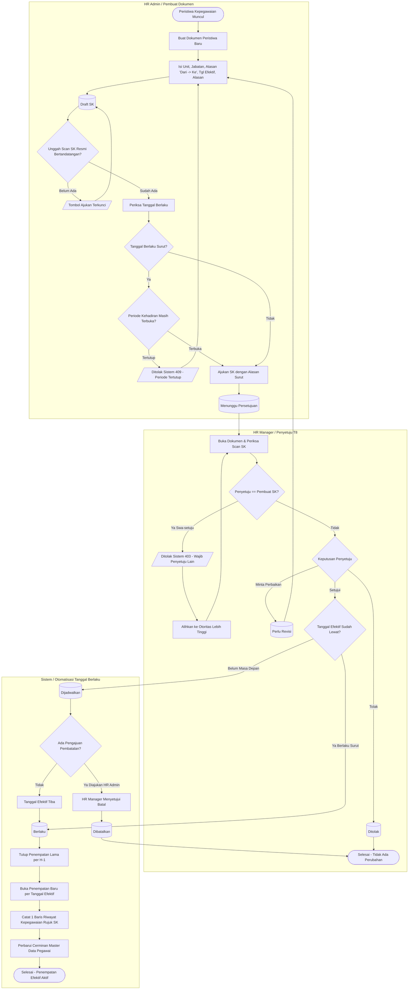
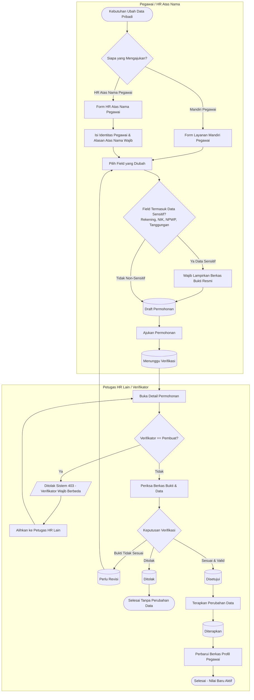
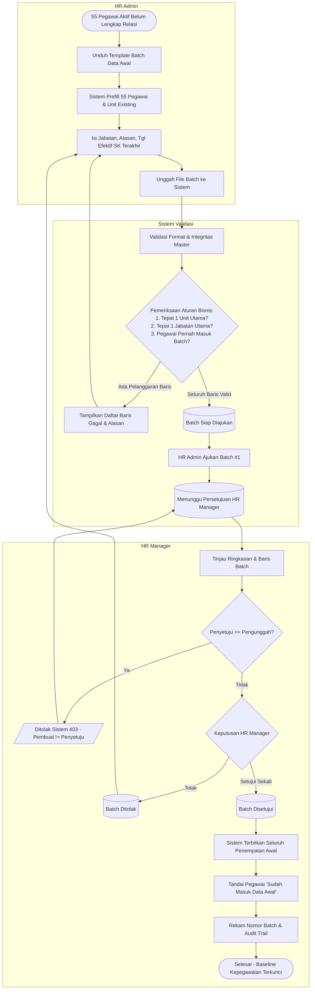

# Administrasi Kepegawaian & Dokumen Peristiwa Kepegawaian

| Field | Value |
| --- | --- |
| Blueprint ID | `HRD-BP-001` |
| Jenis | Flowchart proses bisnis |
| Slice | `S-A1` Workforce Core & Employee 360 |
| Status | `draft` |
| Kesiapan | `READY FOR DESIGN` |
| Referensi Keputusan | `HRD-DEC-046` s.d. `HRD-DEC-057`, `HRD-DEC-012`, `HRD-DEC-031`, `HRD-DEC-033` |

---

## 1. Apa yang dijawab berkas ini

Berkas ini memodelkan tiga alur operasional utama pada sub-modul Workforce Core & Administrasi Kepegawaian:
1. **Alur Dokumen Peristiwa Kepegawaian (SK Mutasi, Promosi, Rotasi, Demosi, Penugasan Sementara)**: bagaimana peristiwa kepegawaian dicatat sebagai satu SK utuh, diverifikasi terhadap periode terbuka, disetujui tanpa swa-setuju, dijadwalkan, dieksekusi pada tanggal berlaku, serta aturan pembatalannya.
2. **Alur Permohonan Perubahan Data Karyawan (Layanan Mandiri & HR Atas Nama)**: bagaimana perubahan data pribadi diproses dengan pemisahan tegas antara data non-sensitif dan data sensitif (rekening bank, NIK, tanggungan), kewajiban berkas bukti, dan pemisahan verifikator.
3. **Alur Batch Data Awal Penempatan Kepegawaian**: bagaimana 55 pegawai existing tanpa catatan jabatan/atasan/gaji dilengkapi datanya melalui satu batch tervalidasi yang disetujui sekali.

---

## 2. Diagram 1 — Dokumen Peristiwa Kepegawaian (SK Mutasi/Promosi/Rotasi/Demosi)

Merujuk pada `HRD-DEC-048`, `HRD-DEC-049`, `HRD-DEC-050`, `HRD-DEC-056`, dan `HRD-DEC-057`.

### Tabel Langkah Alur SK Kepegawaian

| Langkah | Pelaku | Masukan yang dibutuhkan | Keluaran | Bila gagal / ditolak |
| --- | --- | --- | --- | --- |
| Buat Dokumen SK | HR Admin | Pegawai, kategori peristiwa, unit/jabatan/atasan tujuan, tanggal efektif, nomor SK, alasan | Dokumen berstatus `Draft` | Isian wajib kosong -> validasi form 400 |
| Unggah Scan SK | HR Admin | Berkas PDF scan SK asli bertandatangan pejabat | Lampiran SK tersimpan | Gagal simpan berkas -> tombol Ajukan tidak aktif (`HRD-DEC-056`) |
| Ajukan SK | HR Admin | Dokumen `Draft` lengkap scan SK | Status `Menunggu persetujuan` | Ditolak jika tanggal efektif jatuh pada periode kehadiran tertutup (`HRD-DEC-050`) |
| Verifikasi & Approval | HR Manager / CorporateHr | Pratinjau SK dan berkas scan | Status `Dijadwalkan` atau `Berlaku` (jika retroaktif) | Ditolak sistem 403 bila penyetuju sama dengan pembuat (`HRD-DEC-031`) |
| Pembatalan SK | HR Admin & HR Manager | Alasan pembatalan resmi | Dokumen berstatus `Dibatalkan` | Ditolak bila SK sudah berstatus `Berlaku` (`HRD-DEC-057`) |
| Eksekusi Efektif | Sistem | SK berstatus `Dijadwalkan` yang mencapai tanggal efektif | Status `Berlaku`, penempatan lama ditutup H-1, penempatan baru dibuka, riwayat dicatat | Notifikasi log audit sistem |

---

## 3. Diagram 2 — Permohonan Perubahan Data Karyawan & Pengajuan HR Atas Nama

Merujuk pada `HRD-DEC-052`, `HRD-DEC-055`, dan `AC-WFC-07`.

### Tabel Langkah Alur Perubahan Data Karyawan

| Langkah | Pelaku | Masukan yang dibutuhkan | Keluaran | Bila gagal / ditolak |
| --- | --- | --- | --- | --- |
| Pengajuan Mandiri | Pegawai | Field yang diubah, alasan, berkas bukti jika sensitif | Permohonan `Submitted` | Bukti kosong untuk field sensitif -> tolak simpan |
| Pengajuan Atas Nama | HR Admin | Pegawai target, alasan atas nama, bukti dokumen | Permohonan `Submitted` (bertanda `IsOnBehalf`) | Alasan atas nama kosong -> tolak 400 |
| Pemeriksaan Bukti | HR Verifikator | Dokumen bukti vs nilai yang diminta | Evaluasi verifikasi | Verifikator sama dengan pembuat -> tolak 403 (`HRD-DEC-052`) |
| Penerapan Data | HR Verifikator | Permohonan `Approved` | Status `Applied`, berkas profil terupdate | Data lama tetap berlaku sampai tombol Terapkan berhasil |

---

## 4. Diagram 3 — Batch Data Awal Penempatan Kepegawaian (Baseline Migration)

Merujuk pada `HRD-DEC-054` dan `AC-WFC-09`.

---

## 5. Batas yang Tidak Boleh Dilanggar

| Larangan | Dasar Keputusan | Sebab & Dampak |
| --- | --- | --- |
| Dilarang menyediakan tombol Edit atau Hapus inline di tabel penempatan lintas-pegawai | `HRD-DEC-047`, `HRD-DEC-055` | Penempatan adalah catatan historis resmi. Perubahan sembarangan merusak riwayat mutasi dan hak akses unit (`HRD-TF-021`) |
| Dilarang menyetujui SK atau perubahan penempatan oleh pembuatnya sendiri | `HRD-DEC-031`, `HRD-DEC-056` | Pelanggaran fatal pemisahan peran (`APPROVER_MUST_DIFFER_FROM_CREATOR`) |
| Dilarang mengajukan SK tanpa lampiran scan SK resmi bertandatangan | `HRD-DEC-056` | Bukti fisik legalitas mutasi/promosi rumah sakit wajib terarsip |
| Dilarang membatalkan SK yang sudah berstatus `Berlaku` | `HRD-DEC-057` | Mengaburkan riwayat kepegawaian. Jika batal setelah berlaku, wajib terbitkan SK pemindahan baru |
| Dilarang mengubah data sensitif (rekening, NIK, tanggungan) langsung di form master pegawai | `HRD-DEC-052` | Data sensitif berdampak langsung pada pajak, BPJS, dan payroll; wajib lewat verifikasi berbukti |
| Dilarang memasukkan pegawai yang sama ke dalam Batch Data Awal lebih dari satu kali | `HRD-DEC-054` | Data awal hanya untuk baseline. Perubahan selanjutnya wajib lewat SK atau alur resmi |

---

## 6. Traceability

| Alur Proses Bisnis | Decision ID | Kontrak Terkait | Acceptance Test ID |
| --- | --- | --- | --- |
| Dokumen SK Peristiwa Kepegawaian | `HRD-DEC-048`, `HRD-DEC-056`, `HRD-DEC-057` | `contracts/state-transition-matrix.md` §6.0, `api-contract.md` | `AC-WFC-11`, `AC-WFC-12`, `AC-WFC-13` |
| Aturan 1 Penempatan Utama & Tumpang Tindih | `HRD-DEC-049` | `contracts/validation-matrix.md` §7.0 | `AC-WFC-04` |
| Batasan Berlaku Surut ke Periode Terbuka | `HRD-DEC-050` | `contracts/validation-matrix.md` §7.0 | `AC-WFC-05` |
| Perubahan Data Sensitif & Pengajuan Atas Nama | `HRD-DEC-052` | `contracts/state-transition-matrix.md` §6.1, `validation-matrix.md` | `AC-WFC-07` |
| Batch Data Awal Penempatan Baseline | `HRD-DEC-054` | `contracts/state-transition-matrix.md` §6.4 | `AC-WFC-09` |
