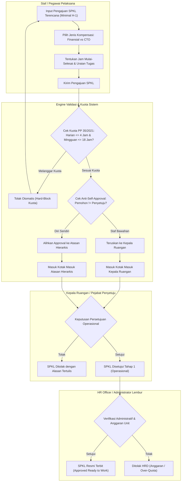
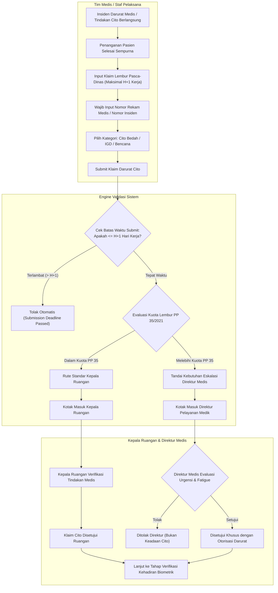
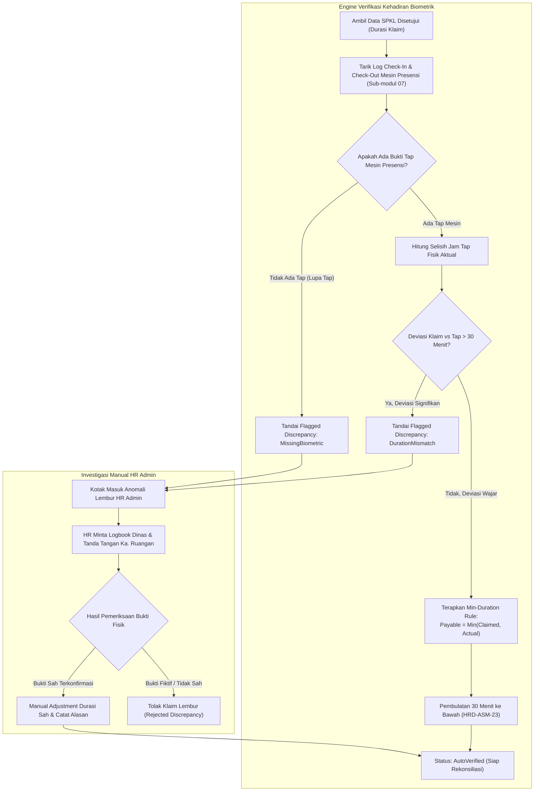
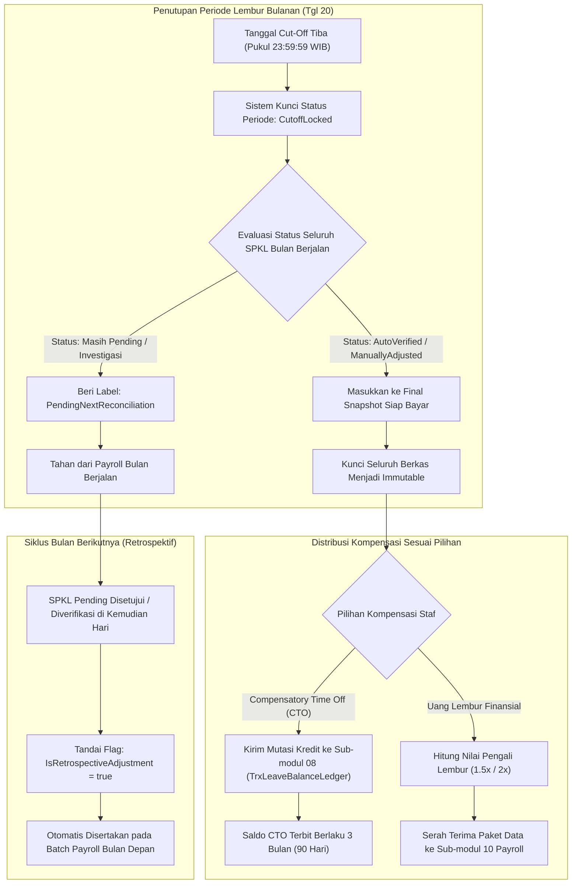

# Flowchart Alur Proses Bisnis — Administrasi Lembur Pegawai Rumah Sakit (Slice `S-B3`)

Dokumen ini memodelkan diagram alur proses bisnis (*business process workflow*) untuk **Sub-modul 09. Overtime Management (Slice `S-B3`)**, menyerap keputusan interview `HRD-DEC-116` s.d. `HRD-DEC-121` serta asumsi `HRD-ASM-23` s.d. `HRD-ASM-26`.

---

## 1. Alur Pengajuan Surat Perintah Kerja Lembur (SPKL) Pra-Dinas Terencana

Diagram ini memvisualisasikan pengajuan lembur terencana minimal H-1 oleh staf atau Kepala Ruangan, pengecekan kuota maksimal ketenagakerjaan PP 35/2021 (maksimal 4 jam/hari dan 18 jam/minggu), persetujuan Kepala Ruangan, serta verifikasi administratif kuota oleh HR Officer sebelum dinas lembur dikerjakan (`HRD-DEC-116`, `HRD-DEC-117`, `HRD-DEC-120`).

### Tabel Rincian Langkah SPKL Pra-Dinas

| No | Tahap / Peristiwa | Pelaku | Masukan | Keluaran | Penanganan Pengecualian / Gagal |
| :---: | --- | --- | --- | --- | --- |
| 1 | Input Form SPKL | Staf / Ka. Ruangan | Tanggal dinas, jam mulai-selesai, uraian tugas, opsi kompensasi | Draf pengajuan SPKL | Validasi `VR-OT-01`: Jam mulai lembur harus di masa depan (> waktu submit) |
| 2 | Guard Kuota PP 35/2021 | Sistem | Akumulasi lembur harian & mingguan berjalan | Status kelayakan kuota regulasi | Ditolak `VR-OT-04` bila akumulasi harian > 4 jam atau mingguan > 18 jam |
| 3 | Evaluasi Self-Approval | Sistem | User ID pemohon & User ID penilai | Rute approver sah | `VR-OT-03`: Jika pemohon adalah Kepala Ruangan, rute otomatis dialihkan ke Kepala Instalasi / Wadir |
| 4 | Persetujuan Operasional | Kepala Ruangan | Draf SPKL staf | Persetujuan Tahap 1 (`WaitingHrVerification`) | Jika ditolak, notifikasi alasan dikirim ke portal ESS pemohon |
| 5 | Verifikasi Administratif | HR Officer | Dokumen SPKL & ketersediaan alokasi anggaran unit | Dokumen SPKL Sah (`ApprovedForWork`) | Ditolak bila melanggar plafon jam kerja rumah sakit |

---

## 2. Alur Pelaporan Klaim Lembur Darurat Medis Pasca-Dinas (*Post-Claim Cito*)

Diagram ini memvisualisasikan penanganan lembur darurat tindakan cito medis (operasi bedah darurat OK, resusitasi IGD, lonjakan kritis ICU, atau respon bencana). Pelayanan pasien diselesaikan terlebih dahulu tanpa hambatan administrasi, kemudian klaim dilaporkan maksimal H+1 kerja dengan nomor rekam medis wajib, evaluasi eskalasi Direktur Pelayanan Medik jika melebihi kuota regulasi, dan mitigasi kelelahan nakes (`HRD-DEC-116`, `HRD-DEC-117`).

### Tabel Rincian Langkah Klaim Darurat Medis Cito

| No | Tahap / Peristiwa | Pelaku | Masukan | Keluaran | Penanganan Pengecualian / Gagal |
| :---: | --- | --- | --- | --- | --- |
| 1 | Tindakan Medis Darurat | Tim Nakes | Pasien kritis / operasi cito | Penyelamatan nyawa pasien tuntas | Tidak ada formulir yang menghambat tindakan medis darurat |
| 2 | Pengajuan Klaim H+1 | Nakes / Ka. Tim | No RM pasien, uraian tindakan, jam mulai-selesai fisik | Berkas klaim darurat cito | `VR-OT-02`: Ditolak jika nomor RM kosong atau diajukan > H+1 kerja |
| 3 | Evaluasi Batas Kuota | Sistem | Akumulasi jam kerja harian/mingguan staf | Klasifikasi jalur approval | Jika melebihi 4 jam/hari atau 18 jam/minggu, eskalasi ke Direktur Medis diwajibkan |
| 4 | Otorisasi Khusus Direktur | Direktur Pelayanan | Berkas cito & riwayat jam kerja nakes | Rekomendasi istirahat & persetujuan dispensasi | Menolak jika tindakan dinilai elektif dan dapat ditunda |
| 5 | Lanjut ke Verifikasi | Sistem | Klaim disetujui | Status klaim `PendingBiometricVerification` | Diselaraskan dengan data mesin presensi biometrik |

---

## 3. Alur Verifikasi Silang Biometrik & Penanganan Discrepancy Flagging

Diagram ini memvisualisasikan bagaimana durasi lembur diverifikasi secara otomatis terhadap catatan tap fisik mesin presensi (Sub-modul 07 Attendance), penerapan aturan nilai terkecil (*min-duration rule*), serta alur investigasi manual HR Admin atas anomali lupa tap atau deviasi jam lembur (`HRD-DEC-119`, `HRD-ASM-23`).

### Tabel Rincian Langkah Verifikasi Biometrik

| No | Tahap / Peristiwa | Pelaku | Masukan | Keluaran | Penanganan Pengecualian / Gagal |
| :---: | --- | --- | --- | --- | --- |
| 1 | Query Presensi Aktual | Service | ID Pegawai & Tanggal Lembur | Jam tap masuk & keluar dari Sub-modul 07 | Jika service presensi offline, masuk antrean retry background |
| 2 | Evaluasi Deviasi | Engine | Durasi SPKL vs durasi fisik mesin | Status kelayakan verifikasi | Deviasi > 30 menit otomatis ditandai *Flagged Discrepancy* |
| 3 | Perhitungan Min-Duration | Engine | `ClaimedMinutes` & `ActualPhysicalMinutes` | `VerifiedPayableMinutes` | Nilai terkecil diambil untuk mencegah pembengkakan biaya |
| 4 | Pembulatan 30 Menit | Engine | Menit terverifikasi | Kelipatan 30 menit ke bawah | Durasi < 30 menit otomatis bernilai 0 jam kompensasi (`HRD-ASM-23`) |
| 5 | Investigasi Discrepancy | HR Admin | Logbook dinas fisik unit & konfirmasi atasan | Keputusan penyesuaian manual / tolak | Klaim ditahan dari payroll hingga ada bukti logbook resmi |

---

## 4. Alur Penutupan Periode, Kompensasi CTO, dan Serah Terima Payroll

Diagram ini memvisualisasikan penguncian berkas lembur pada tanggal cut-off bulanan, pemisahan distribusi kompensasi (kredit otomatis ke saldo cuti CTO Sub-modul 08 vs uang tunai payroll Sub-modul 10), serta mekanisme penanganan SPKL menggantung melalui penyesuaian retrospektif pada bulan berikutnya (`HRD-DEC-118`, `HRD-DEC-121`, `HRD-ASM-25`).

### Tabel Rincian Langkah Penutupan Periode & Payroll Handoff

| No | Tahap / Peristiwa | Pelaku | Masukan | Keluaran | Penanganan Pengecualian / Gagal |
| :---: | --- | --- | --- | --- | --- |
| 1 | Lock Periode Cut-off | Scheduler / HR | Tanggal cut-off bulanan (tgl 20) | Periode berstatus `CutoffLocked` | SPKL baru setelah cut-off dialokasikan ke periode bulan berikutnya |
| 2 | Penanganan SPKL Pending | Sistem | SPKL belum selesai verifikasi | Status `PendingNextReconciliation` | Gaji reguler staf tetap cair tepat waktu tanpa hambatan lembur pending |
| 3 | Eksekusi Kredit CTO | Service | SPKL terverifikasi opsi CTO | Mutasi kredit saldo di Sub-modul 08 (`INT-HR-49`) | Berlaku 90 hari kalender; hangus otomatis jika tidak dipakai (`HRD-ASM-25`) |
| 4 | Payroll Handoff | Service | SPKL terverifikasi opsi Finansial | Berkas data serah terima Sub-modul 10 (`INT-HR-52`) | Data dikunci mutlak *read-only* untuk mencegah perbedaan angka slip gaji |
| 5 | Rekonsiliasi Retrospektif | Sistem | SPKL pending periode lalu yang baru tuntas | Rapel lembur pada payroll bulan berjalan | Mencegah hilangnya hak staf yang telat diproses atasan (`HRD-DEC-121`) |
