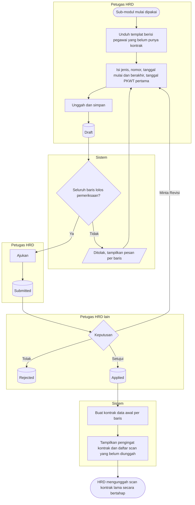

# Batch Data Awal Kontrak

| Field | Value |
| --- | --- |
| Blueprint ID | `HRD-BP-001` |
| Jenis | Flowchart proses |
| Slice | `S-C4-ONB` onboarding dan kontrak kerja (sub-modul 05) |
| Status | `approved` — Pengguna (pemilik teknis dan produk, `HRD-DEC-015`), 2026-11-04, beserta kelima pilihan desain (`HRD-DEC-096`). Jawaban pemilik: "setujui semua ya dan kerjakan" |
| Kesiapan | `READY FOR DESIGN` |
| Keputusan | `HRD-DEC-090` |

---

## 1. Apa yang digambar

Pengisian kontrak yang sedang berjalan bagi pegawai yang sudah bekerja sebelum sub-modul 05 dipakai,
dalam satu batch yang disetujui sekali. Status pada node keadaan sama persis dengan
`contracts/state-transition-matrix.md` bagian 13.8.

## 2. Diagram

## 3. Tabel langkah

| Langkah | Pelaku | Masukan yang dibutuhkan | Keluaran | Bila gagal |
| --- | --- | --- | --- | --- |
| Isi templat | Petugas HRD | Dokumen kontrak lama tiap pegawai | Baris batch | — |
| Pemeriksaan baris | Sistem | Baris batch | Baris sah atau pesan per baris | HRD memperbaiki baris: PKWT tanpa tanggal berakhir, total PKWT lewat 5 tahun, pegawai sudah pernah masuk batch |
| Ajukan | Petugas HRD | Tidak ada baris gagal | Batch `Submitted` | Ditolak bila masih ada baris gagal |
| Putuskan | Petugas HRD lain | Batch di kotak masuk | `Applied`, kembali, atau `Rejected` | Pembuat batch tidak dapat menyetujui batchnya sendiri |
| Unggah scan kontrak lama | Petugas HRD | Scan dokumen lama | Kontrak data awal punya scan | Ditolak bila kontrak bukan data awal atau sudah punya scan |

## 4. Contoh

Sari mengunduh templat berisi 55 pegawai. Untuk Budi ia mengisi PKWT 045/PKWT/2026, 1 April 2026 s.d.
31 Maret 2027, PKWT pertama 1 April 2024. Satu baris lain tidak punya tanggal berakhir sehingga batch
belum dapat diajukan. Setelah diperbaiki, Dodi menyetujui batch. Pengingat kontrak Budi muncul pada
30 Januari 2027 walaupun scan kontraknya masih menyusul.

## 5. Yang sengaja tidak ada di diagram ini

| Yang tidak digambar | Alasan |
| --- | --- |
| Kasus onboarding untuk pegawai lama | Tidak dibuat (`HRD-DEC-090` butir 6) |
| Masa percobaan mundur | Tidak dibuat (`HRD-DEC-090` butir 6) |

## 6. Traceability

| Bagian alur | Decision | Acceptance test |
| --- | --- | --- |
| Pemeriksaan dan sekali per pegawai | `HRD-DEC-090` butir 2–4, 7 | `AT-HRD-ONB-35` |
| Penerapan | `HRD-DEC-090` butir 5, 8, 9 | `AT-HRD-ONB-36` |
