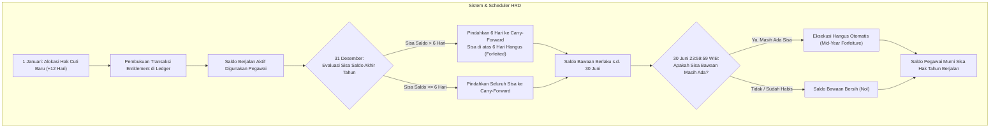
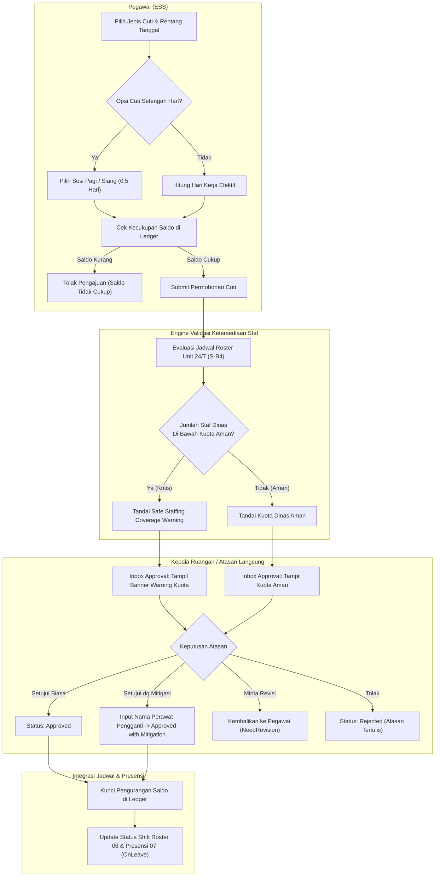
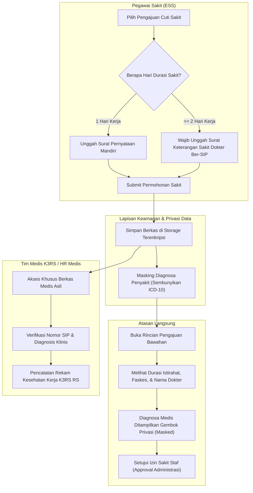
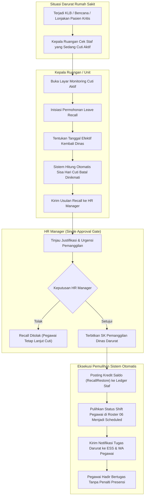

# Flowchart Alur Proses Bisnis — Cuti dan Perizinan Staf Rumah Sakit (Slice `S-B2`)

Dokumen ini memodelkan diagram alur proses bisnis (*business process workflow*) untuk **Sub-modul 08. Leave & Permission Management (Slice `S-B2`)**, menyerap keputusan interview `HRD-DEC-110` s.d. `HRD-DEC-115` serta asumsi `HRD-ASM-19` s.d. `HRD-ASM-22`.

---

## 1. Siklus Saldo Cuti Tahunan, Carry-Forward Max 6 Hari & Kedaluwarsa 30 Juni

Diagram ini memvisualisasikan bagaimana hak cuti tahunan diberikan (12 hari kerja), pembatasan pemindahan sisa saldo akhir tahun maksimal 6 hari kerja, dan eksekusi hangus saldo bawaan secara otomatis tepat pada 30 Juni (`HRD-DEC-110`).

### Tabel Rincian Langkah Tata Kelola Saldo Cuti

| No | Tahap / Peristiwa | Pelaku | Masukan | Keluaran | Penanganan Pengecualian / Gagal |
| :---: | --- | --- | --- | --- | --- |
| 1 | Hak Baru Awal Tahun | Scheduler | Data pegawai aktif | +12 hari kerja tercatat di `TrxLeaveBalanceLedger` | Jika pegawai baru masuk tengah tahun, hak dihitung prorata bulan berjalan |
| 2 | Cut-Off Akhir Tahun (31 Des) | Scheduler | Sisa saldo 31 Des | Transaksi `CarryForward` (max 6 hari) & `Forfeiture` (>6 hari) | Notifikasi rincian saldo dikirimkan ke portal ESS pegawai |
| 3 | Eksekusi Tengah Tahun (30 Jun) | Scheduler | Sisa kuota carry-forward | Transaksi `CarryForwardForfeiture` pemotongan sisa kuota bawaan | Pengingat dini dikirim H-30 dan H-7 sebelum kedaluwarsa 30 Juni |

---

## 2. Pengajuan Cuti ESS, Validasi Kuota Layanan (*Safe Staffing Coverage Warning*), dan Keputusan Atasan

Diagram ini memvisualisasikan pengajuan cuti mandiri pegawai, validasi saldo, evaluasi ketersediaan staf shift unit 24/7 di modul penjadwalan 06, serta opsi atasan menyetujui dengan mitigasi perawat pengganti (`HRD-DEC-111`).

### Tabel Rincian Langkah Pengajuan Cuti & Evaluasi Kuota

| No | Langkah | Pelaku | Masukan | Keluaran | Jalur Alternatif / Mitigasi |
| :---: | --- | --- | --- | --- | --- |
| 1 | Input Pengajuan | Pegawai | Tanggal, jenis cuti, kontak darurat | Estimasi durasi hari kerja & pemotongan saldo | Pegawai dapat membatalkan form sebelum submit |
| 2 | Evaluasi Kuota Shift | Sistem | Roster terbit unit target | Rasio staf bertugas vs batas minimal aman | Jika engine jadwal offline, warning fallback manual diaktifkan |
| 3 | Tinjauan & Mitigasi | Kepala Unit | Form cuti + Banner Warning | Keputusan (Approve, Mitigasi, Revisi, Tolak) | Wajib mencatat nama staf pengganti bila menyetujui permohonan kritis |
| 4 | Pembaruan Kalender | Sistem | ID permohonan approved | Rekaman absensi `OnLeave` & debit ledger | Menghindari pencatatan mangkir pada modul presensi harian |

---

## 3. Alur Cuti Sakit Mandiri vs Wajib Surat Dokter Ber-SIP (Privasi Medis Staf K3RS)

Diagram ini memvisualisasikan pembedaan cuti sakit 1 hari (surat pernyataan mandiri) vs $\ge 2$ hari (wajib surat dokter ber-SIP), serta pemisahan hak akses antara atasan langsung dan dokter K3RS (`HRD-DEC-112`).

### Tabel Rincian Langkah Cuti Sakit & Privasi

| No | Langkah | Pelaku | Masukan | Keluaran | Jalur Penolakan |
| :---: | --- | --- | --- | --- | --- |
| 1 | Pengajuan Sakit | Pegawai | Tanggal sakit & lampiran berkas | Tiket permohonan cuti sakit | Ditolak submit bila $\ge 2$ hari tanpa melampirkan berkas dokter |
| 2 | Enkripsi & Masking | Sistem | Berkas & metadata surat | Payload atasan termaskir tanpa diagnosa ICD-10 | Menjamin kepatuhan UU PDP dan privasi staf RS |
| 3 | Persetujuan Operasional | Atasan | Tiket sakit (durasi & faskes) | Persetujuan izin tidak dinas bawahan | Atasan dapat meminta konfirmasi ke HRD bila meragukan |
| 4 | Verifikasi K3RS | Dokter K3RS | Dokumen medis lengkap | Rekam kesehatan staf & verifikasi valid | Berkas palsu/tidak sah dapat ditolak oleh K3RS |

---

## 4. Alur Pemanggilan Kembali Pegawai Cuti Darurat (*Leave Recall*) & Pemulihan Saldo

Diagram ini memvisualisasikan prosedur resmi saat rumah sakit menghadapi situasi darurat (KLB, bencana alam, lonjakan pasien kritis ICU) sehingga pegawai yang sedang cuti dipanggil dinas kembali dengan persetujuan HR Manager dan pemulihan saldo otomatis (`HRD-DEC-113`).

### Tabel Rincian Langkah Pemanggilan Darurat (Leave Recall)

| No | Langkah | Pelaku | Masukan | Keluaran | Jalur Pembatalan / Pengecualian |
| :---: | --- | --- | --- | --- | --- |
| 1 | Deteksi Kebutuhan | Kepala Unit | Kondisi darurat unit (BOR > 100%, KLB) | Daftar nama staf cuti yang kompeten | Memprioritaskan staf terdekat yang dapat dihubungi |
| 2 | Inisiasi Recall | Kepala Unit | ID cuti, tanggal efektif recall, alasan | Tiket recall berstatus `RequestedByHeadUnit` | Ditolak jika cuti staf sudah berakhir |
| 3 | Verifikasi HR Manager | HR Manager | Justifikasi operasional darurat | SK resmi atau penolakan tiket recall | HR Manager dapat menolak jika ada alternatif perawat cadangan |
| 4 | Pemulihan Saldo & Shift | Sistem | Tiket recall approved | Mutasi `RecallRestore` di ledger & shift aktif di Roster 06 | Pegawai menerima hak sisa cutinya kembali 100% utuh |
