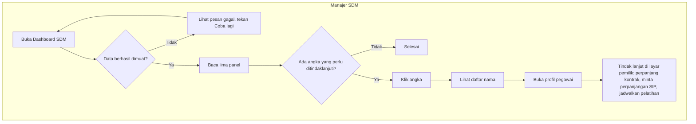
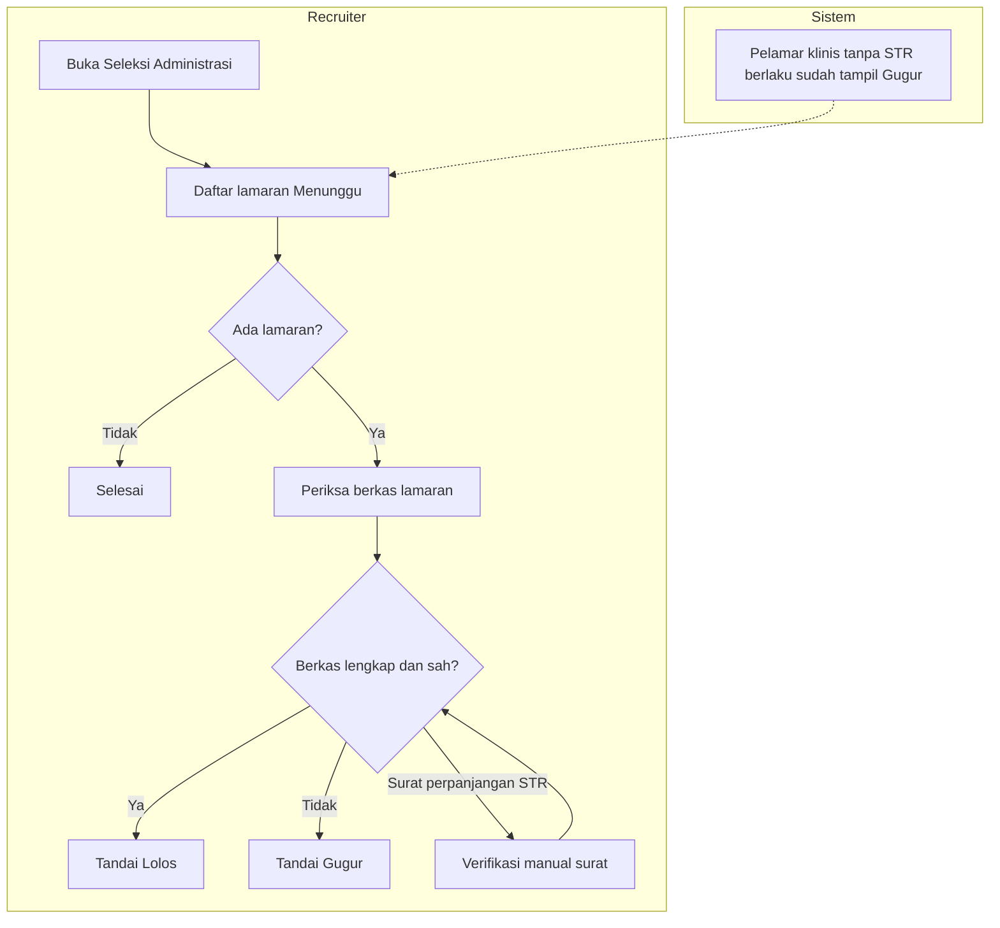
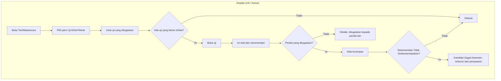
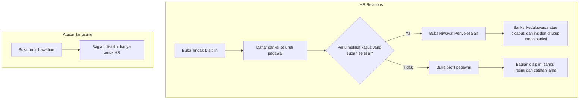

# Alur Paket B — Dashboard SDM dan Worklist

| Field | Nilai |
| --- | --- |
| Dasar | Decision log bagian 57 (`HRD-DEC-237` s.d. `HRD-DEC-246`); backend 38; frontend 35; kontrak `v30`; `HRD-DEC-247` |
| Status | `approved` — pengguna, 23 November 2026 ("1. ya setujui 2. A"; `HRD-DEC-247`) |
| `last_changed_in` | `v30` — 22 November 2026 |

Dokumen ini menggambar urutan kerja petugas pada lima pintu masuk Paket B. Aturan internal penapisan, evaluasi, dan disiplin tetap pada flowchart `rekrutmen-dan-seleksi.md` dan `hubungan-karyawan-dan-disiplin.md`.

## 1. Manajer SDM memantau dan menindaklanjuti

| Langkah | Pelaku | Masukan | Keluaran | Bila gagal |
| --- | --- | --- | --- | --- |
| Buka dashboard | Manajer SDM | — | Lima panel per tanggal operasional | Pesan gagal + Coba lagi; tidak ada angka nol palsu |
| Klik angka | Manajer SDM | Panel dan kelompok | Daftar nama | Pesan "Daftar gagal dimuat." + Coba lagi |
| Tindak lanjut | Manajer SDM / petugas terkait | Profil pegawai | Pekerjaan di layar Kontrak, Kredensial, atau Diklat | Mengikuti alur layar pemilik |

## 2. Recruiter menapis lamaran

| Langkah | Pelaku | Masukan | Keluaran | Bila gagal |
| --- | --- | --- | --- | --- |
| Buka daftar | Recruiter | Filter lowongan/status | Satu baris per lamaran | Pesan gagal + Coba lagi |
| Tandai Lolos/Gugur | Recruiter | Hasil pemeriksaan | Status penapisan berubah | Simpan gagal → status tidak berubah, petugas mengulang; tombol dikunci selama menyimpan |

## 3. Asesor mengisi uji klinis/teknis

| Langkah | Pelaku | Masukan | Keluaran | Bila gagal |
| --- | --- | --- | --- | --- |
| Lihat uji | Asesor | Jalur | Hanya uji miliknya | Kosong → "Belum ada uji yang ditugaskan kepada Anda." |
| Kirim nilai | Asesor | Nilai, rekomendasi | Evaluasi tersimpan | Bukan penilainya → ditolak; minta HR menugaskan ulang |

## 4. HR Relations meninjau kasus disiplin

| Langkah | Pelaku | Masukan | Keluaran | Bila gagal |
| --- | --- | --- | --- | --- |
| Buka Tindak Disiplin | HR Relations | — | Daftar sanksi | Pesan gagal + Coba lagi |
| Riwayat Penyelesaian | HR Relations | — | Kasus selesai, baca-saja | Tanpa hak insiden → bagian insiden tidak tampil |
| Profil pegawai | HR Relations / atasan | — | HR melihat riwayat; atasan melihat pemberitahuan | — |
