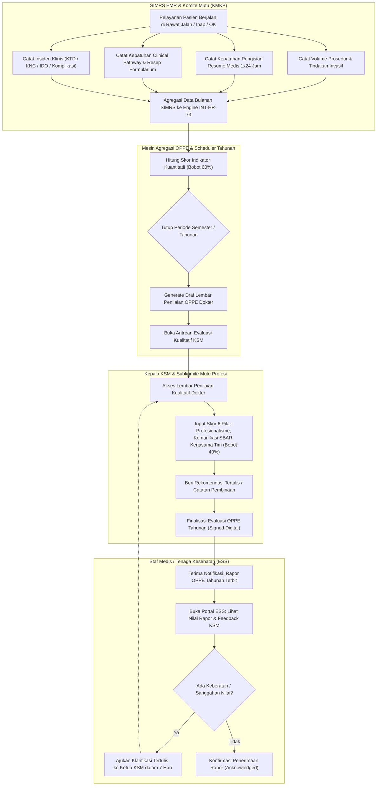
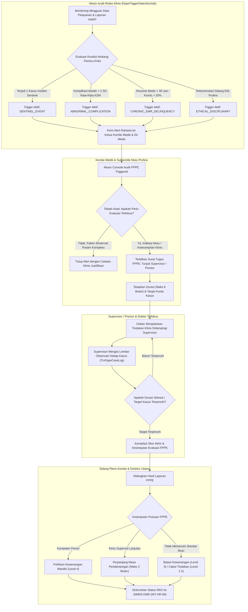
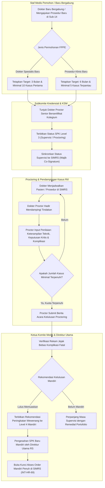
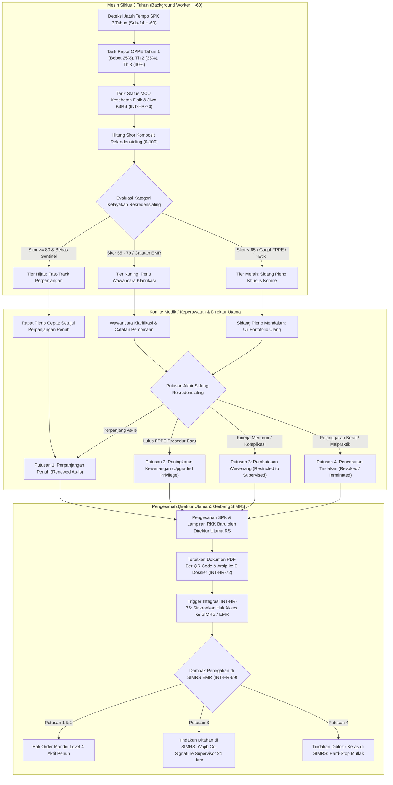

# Alur Proses Bisnis Sub-Modul 15: OPPE, FPPE & Recredentialing (Evaluasi Praktik Profesional & Rekredensialing Staf Medis RS)

Dokumen ini mendefinisikan seluruh diagram alur proses bisnis (*flowchart*) untuk **Sub-Modul 15 (Slice `S-C1-OPPE`)** yang mengatur evaluasi praktik profesional berkelanjutan (*Ongoing Professional Practice Evaluation* - OPPE), evaluasi terfokus intensif (*Focused Professional Practice Evaluation* - FPPE), kerahasiaan telaah sejawat (*Peer Review Privilege*), agregasi rapor 3 tahunan, serta persidangan komite profesi sebelum perpanjangan SPK/RKK disahkan Direktur Utama RS.

---

## 15.1 Alur Pengumpulan Indikator Mutu Klinis OPPE Tahunan Terintegrasi SIMRS / KMKP

Diagram ini menggambarkan siklus pengumpulan data indikator kuantitatif dari SIMRS EMR & Komite Mutu (KMKP) yang dipadukan dengan penilaian kualitatif peer review Kelompok Staf Medis (KSM) dalam siklus tahunan/semesteran berbobot 60% kuantitatif + 40% kualitatif sesuai [`HRD-DEC-152`](../00-interview-decisions.md#L7290-L7310).

### Tabel Langkah 15.1

| Langkah | Pelaku | Masukan | Keluaran | Penanganan Bila Gagal / Hambatan |
| :--- | :--- | :--- | :--- | :--- |
| **1. Agregasi Indikator Klinis** | Background Integration Bus (`INT-HR-73`) | Data episode SIMRS & log insiden KMKP | Dataset kuantitatif tersimpan di `TrxOppeStaffEvaluationDetail` | Jika koneksi SIMRS gagal, worker mengulang otomatis via event bus dengan retry ber-backoff (`HRD-ASM-47`). |
| **2. Penghitungan Skor Kuantitatif** | Engine Kalkulator OPPE | Nilai capaian vs target metrik katalog | Skor kuantitatif (maksimal 60 poin) | Metrik yang tidak memiliki denominator kasus pada periode bersangkutan dikecualikan dari pembagi (*normalized score*). |
| **3. Penilaian Kualitatif KSM** | Kepala KSM / Subkomite Mutu | Observasi perilaku, kepatuhan etika, komunikasi | Skor kualitatif (maksimal 40 poin) | Kepala KSM dilarang menilai berkas dirinya sendiri (*Anti-Self-Review* `VR-OPP-05`). |
| **4. Finalisasi Rapor OPPE** | Subkomite Mutu Profesi | Skor kuantitatif + kualitatif | Rapor final tersimpan status `Finalized`, skor 0–100 | Rapor yang telah difinalisasi dikunci abadi (*immutable*) dan tidak dapat diubah tanpa persetujuan Direktur Medis. |
| **5. Transparansi ESS & Klarifikasi** | Staf Medis Pemilik Akun | Rapor OPPE tahunan | Konfirmasi penerimaan (*Acknowledged*) | Dokter diberikan hak sanggah maksimal 7 hari kerja jika terdapat ketidaksesuaian data SIMRS (`VR-OPP-07`). |

---

## 15.2 Alur Pemicu Alarm Insiden & Pelaksanaan Evaluasi Terfokus (FPPE)

Diagram ini menggambarkan deteksi otomatis ambang batas pemicu kritis (*red flag triggers*: sentinel, komplikasi > 2SD, resume EMR > 48 jam > 20%), penerbitan alert rahasia, serta penetapan rencana audit terfokus intensif sesuai [`HRD-DEC-153`](../00-interview-decisions.md#L7311-L7330).

### Tabel Langkah 15.2

| Langkah | Pelaku | Masukan | Keluaran | Penanganan Bila Gagal / Hambatan |
| :--- | :--- | :--- | :--- | :--- |
| **1. Deteksi Ambang Pemicu** | Background Job Scheduler | Data SIMRS, KMKP, dan log etik | Alert insiden klinis terkirim rahasia | Ambang deviasi komplikasi dihitung otomatis menggunakan formula statistik 2 standar deviasi (`VR-OPP-03`). |
| **2. Telaah Disposisi FPPE** | Ketua Komite Medik & Dir Medis | Laporan pemicu & kronologi klinis | Surat Keputusan Penugasan FPPE | Evaluasi awal wajib diselesaikan dalam tempo maksimal 7 hari kerja sejak alert terpicu (`HRD-DEC-153`). |
| **3. Pelaksanaan Supervisi** | Dokter Supervisor Penanggung Jawab | Pendampingan tindakan klinis nakes | Lembar observasi per kasus tersimpan di `TrxFppeCaseLog` | Supervisor wajib mengisi logbook pendampingan maksimal 1x24 jam pasca-tindakan bedah (`VR-OPP-09`). |
| **4. Sidang Evaluasi FPPE** | Pleno Komite Profesi | Rekapitulasi log kasus proctoring | Berita acara rekomendasi putusan FPPE | Jika dalam 6 bulan kuota kasus belum tercapai, komite wajib mengevaluasi kelanjutan proctoring (`HRD-ASM-49`). |
| **5. Penegakan Status SIMRS** | Clinical Gate Service (`INT-HR-69`) | Putusan sidang komite & pengesahan Dirut | Pembaruan status wewenang di SIMRS seketika | Jika wewenang dibatasi/dicabut, SIMRS seketika menerapkan *Hard-Stop* atau mewajibkan co-signature supervisor. |

---

## 15.3 Alur FPPE Adaptasi Staf Medis Baru & Proctoring Prosedur Klinis Baru

Diagram ini menggambarkan alur pembinaan klinis awal bagi dokter spesialis baru bergabung (3 bulan / 10 kasus) dan dokter yang mengajukan penambahan wewenang prosedur baru (6 bulan / 5 kasus) sesuai [`HRD-DEC-154`](../00-interview-decisions.md#L7331-L7350).

### Tabel Langkah 15.3

| Langkah | Pelaku | Masukan | Keluaran | Penanganan Bila Gagal / Hambatan |
| :--- | :--- | :--- | :--- | :--- |
| **1. Inisiasi Target Kasus** | Subkomite Kredensial | Jenis pengajuan (Dokter Baru / Prosedur Baru) | Ketetapan masa pemantauan & kuota kasus minimal | Dokter baru wajib menyelesaikan 10 kasus; prosedur baru wajib minimal 5 kasus mandiri terdampingi (`HRD-DEC-154`). |
| **2. Penunjukan Proctor** | Kepala KSM | KSM spesialisasi terkait | Nama dokter proctor senior ber-SPK Level 4 | Proctor wajib memiliki keahlian sebidang dan tidak memiliki konflik kepentingan pribadi (`VR-OPP-11`). |
| **3. Pendampingan & Input Log** | Dokter Proctor | Pelaksanaan tindakan operasi / prosedur klinis | Evaluasi per kasus di `TrxFppeCaseLog` | Bila terjadi komplikasi serius selama proctoring, tindakan langsung dihentikan dan dievaluasi komite mutu. |
| **4. Rekomendasi Mandiri** | Dokter Proctor & Ketua Komite | Rekapitulasi logbook kasus lengkap | Berita acara kelulusan proctoring | Tindakan yang direkomendasikan mandiri wajib bebas dari insiden kesalahan prosedur berat. |
| **5. Promosi Level 4 di SIMRS** | Direktur Utama RS & Gate Service | Berita acara kelulusan sah | SPK/RKK Level 4 Mandiri aktif di SIMRS | Sistem seketika membuka blokir order mandiri dan menonaktifkan kewajiban co-signature supervisor (`INT-HR-69`). |

---

## 15.4 Alur Sidang Rekredensialing 3 Tahunan & Sinkronisasi Putusan RKK ke SIMRS EMR

Diagram ini menggambarkan agregasi rapor OPPE 3 tahun berturut-turut (bobot 25%-35%-40%), penilaian kelayakan kesehatan (*Medical Fitness*), pengelompokan tier Hijau/Kuning/Merah, dan eksekusi 4 putusan akhir ke SIMRS EMR sesuai [`HRD-DEC-155`] & [`HRD-DEC-157`].

### Tabel Langkah 15.4

| Langkah | Pelaku | Masukan | Keluaran | Penanganan Bila Gagal / Hambatan |
| :--- | :--- | :--- | :--- | :--- |
| **1. Agregasi Rapor 3 Tahun** | Background Engine Rekredensialing | Nilai OPPE Th 1, Th 2, Th 3 dan MCU K3RS | Skor komposit terbobot & penetapan tier Hijau/Kuning/Merah | Bobot progresif 25%-35%-40% mencerminkan kompetensi terkini (`HRD-DEC-155`). |
| **2. Verifikasi Kelayakan Medis** | K3RS Service (`INT-HR-76`) | Hasil Medical Check-Up fisik & jiwa berkala | Surat Keterangan *Medical Fitness* | Jika dokter belum MCU, berkas rekredensialing berstatus `PendingMCU` (`HRD-ASM-50`). |
| **3. Persidangan Rekredensial** | Pengurus Komite Profesi | Berkas komposit & portofolio 3 tahun | Risalah putusan sidang rekredensialing | Berkas tier Hijau diproses fast-track; tier Kuning/Merah wajib wawancara tatap muka. |
| **4. Pengesahan SPK Baru** | Direktur Utama RS | Usulan resmi Ketua Komite | Dokumen SPK/RKK sah masa berlaku 3 tahun | Dokumen resmi terbit ber-QR Code dan langsung terarsip abadi di e-Dossier Sub-02. |
| **5. Penyelarasan Otomatis SIMRS** | Clinical Gate Service (`INT-HR-75`, `INT-HR-69`) | Dataset RKK disahkan Direktur Utama | Hak akses wewenang SIMRS terbarui seketika | Invalidasi cache Redis gate < 50ms seketika; tidak memerlukan instruksi memo manual (`HRD-DEC-157`). |
