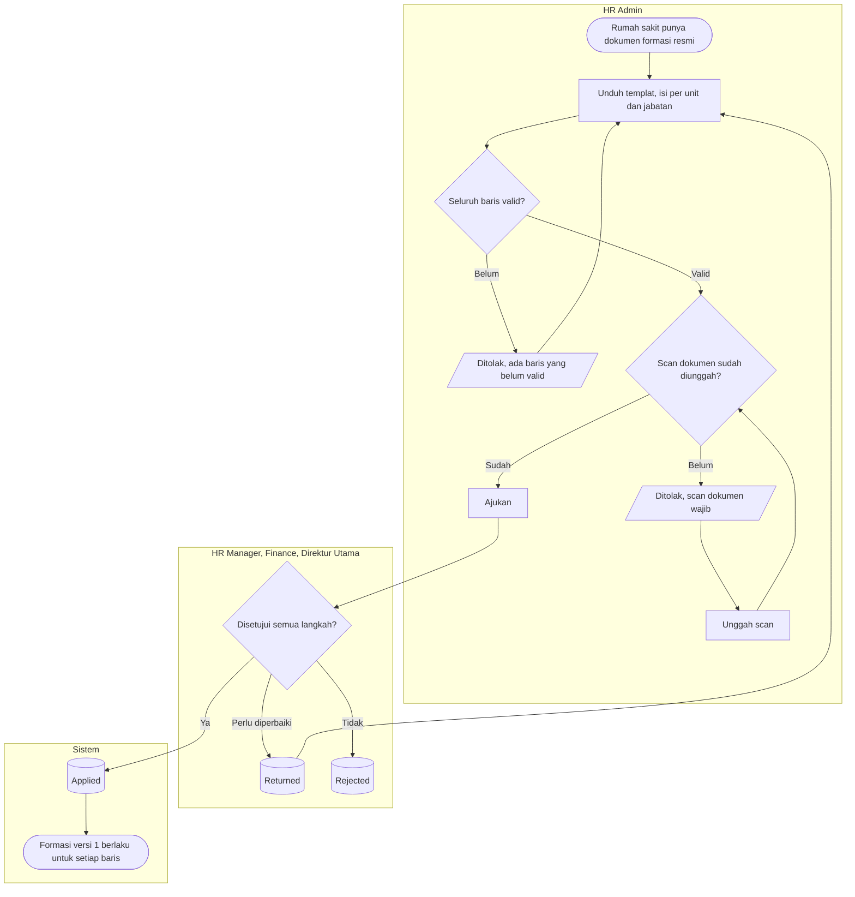
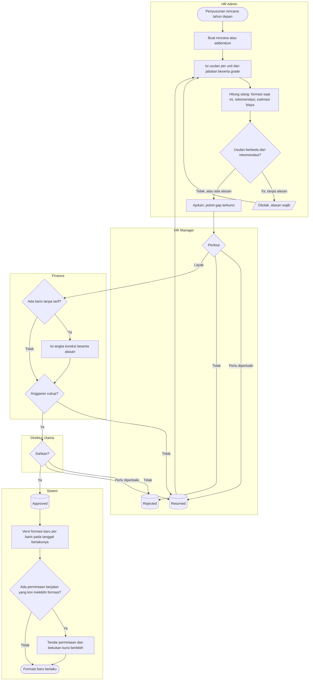

# Formasi dan Rencana Tahunan

| Field | Value |
| --- | --- |
| Blueprint ID | `HRD-BP-001` |
| Jenis | Flowchart proses |
| Slice | `S-D1` perencanaan tenaga kerja |
| Status | `approved` — Pengguna, 2026-11-03, bersama desain `S-D1` |
| Kesiapan | `READY FOR DESIGN` |
| Keputusan | `HRD-DEC-062`, `HRD-DEC-064`, `HRD-DEC-065`, `HRD-DEC-068`, `HRD-DEC-069`, `HRD-DEC-070` |

---

## 1. Apa yang digambar

Dua jalan yang melahirkan formasi: **batch formasi awal** untuk rumah sakit yang belum punya formasi
di sistem, dan **rencana tahunan beserta addendumnya**. Formasi sendiri tidak pernah disunting
langsung; ia hanya lahir dari dokumen yang disetujui. Status pada node keadaan sama persis dengan
`contracts/state-transition-matrix.md` bagian 11.2 dan 11.3.

## 2. Diagram — batch formasi awal

## 3. Diagram — rencana tahunan dan addendum

## 4. Tabel langkah

| Langkah | Pelaku | Masukan yang dibutuhkan | Keluaran | Bila gagal |
| --- | --- | --- | --- | --- |
| Isi batch formasi awal | HR Admin | Dokumen formasi resmi, misalnya SK Direktur; unit, jabatan, jumlah, tanggal berlaku | Batch `Draft` | Unit × jabatan sudah punya formasi → koreksi lewat addendum |
| Ajukan batch | HR Admin | Seluruh baris valid; scan dokumen | Batch `Submitted` | Masih ada baris tidak valid atau scan belum ada → perbaiki dulu |
| Setujui batch | HR Manager, Finance, Direktur Utama | Batch | `Applied`; formasi versi 1 | Dikembalikan → HR Admin memperbaiki |
| Buat rencana | HR Admin | Tahun; tanggal acuan | Rencana `Draft` | Sudah ada rencana tahun itu → pakai addendum |
| Buat addendum | HR Admin | Rencana induk yang sudah disetujui | Addendum `Draft` memuat baris yang berubah saja | Induk belum disetujui → tunggu persetujuan induk |
| Hitung ulang | HR Admin | Usulan per baris | Formasi saat ini, rekomendasi, estimasi biaya terisi | Grade tanpa tarif → biaya tampil "tarif belum tersedia" |
| Ajukan rencana | HR Admin | Alasan; setiap baris bergrade; alasan bila berbeda dari rekomendasi | `Submitted`; potret gap terkunci | Isian kurang → layar menyebut baris yang kurang |
| Periksa anggaran | Finance | Rencana | Diteruskan atau dikembalikan; angka koreksi bila perlu | Baris tanpa tarif belum dikoreksi → Finance wajib mengisi angka koreksi |
| Sahkan | Direktur Utama | Rencana | `Approved`; versi formasi baru | Dikembalikan → HR Admin memperbaiki |
| Terapkan | Sistem | Rencana `Approved` | Formasi baru; permintaan berlebih ditandai | Gagal pada satu baris → seluruh penerapan batal; rencana tetap di langkah terakhir |

## 5. Contoh

Formasi ICU Perawat Pelaksana: 28 (batch awal, SK Direktur 12/2026) → 30 (Rencana 2027) → 32
(permintaan di luar formasi, April 2027) → 30 (Addendum 01/2027, 2 bed dialihkan ke HCU, Agustus
2027). Pada 1 Agustus ICU masih terisi 32, sehingga tampil kelebihan 2 sampai SK mutasi ke HCU
berlaku.

## 6. Yang sengaja tidak ada di diagram ini

| Yang tidak digambar | Di mana |
| --- | --- |
| Permintaan headcount | `permintaan-headcount.md` |
| Perpindahan orang karena formasi turun | SK di Workforce Core — formasi tidak memindahkan orang |
| Rumus biaya dan lapisan gap | `02-backend-architecture.md` bagian 16.9 |

## 7. Traceability

| Bagian alur | Decision | Acceptance test |
| --- | --- | --- |
| Batch formasi awal | `HRD-DEC-070` | `AT-HRD-D1-17` |
| Formasi hanya dari dokumen | `HRD-DEC-062` | `AT-HRD-D1-06`, `AT-HRD-D1-07` |
| Rencana terkunci dan addendum | `HRD-DEC-068` | `AT-HRD-D1-15` |
| Biaya dan koreksi Finance | `HRD-DEC-065` | `AT-HRD-D1-11`, `AT-HRD-D1-21` |
| Potret saat pengajuan | `HRD-DEC-069` | `AT-HRD-D1-16` |
