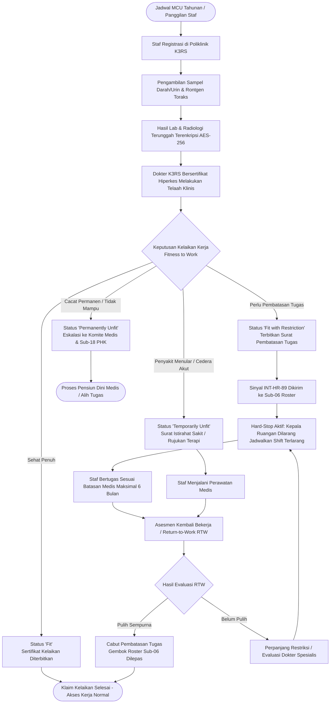
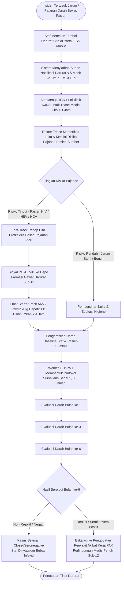
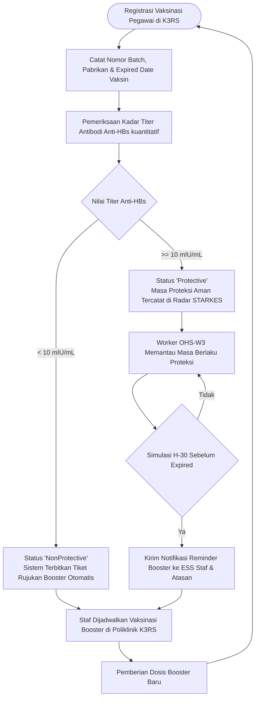
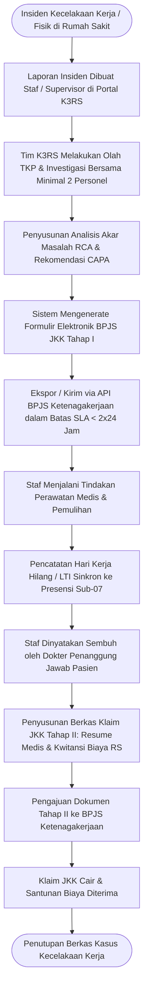

# Alur Proses Bisnis: Kesehatan & Keselamatan Kerja Rumah Sakit (K3RS & MCU)

Dokumen ini mendefinisikan alur proses bisnis ujung-ke-ujung untuk **Sub-Modul 19: Occupational Health & Staff Safety (K3RS & Medical Check-Up) — Slice `S-C6`**, mencakup 4 pilar utama operasional perlindungan nakes di rumah sakit.

---

## 1. Alur Utama Medical Check-Up (MCU) Berkala, Kelaikan Kerja & Pembatasan Tugas Medis

---

## 2. Alur Tanggap Darurat Tertusuk Jarum & Pajanan Darah Pasien (Needle-Stick Emergency)

---

## 3. Alur Radar Imunisasi Nakes & Peringatan Dini Booster Otomatis

---

## 4. Alur Pelaporan Kecelakaan Kerja (KAK) & Klaim BPJS Ketenagakerjaan JKK

