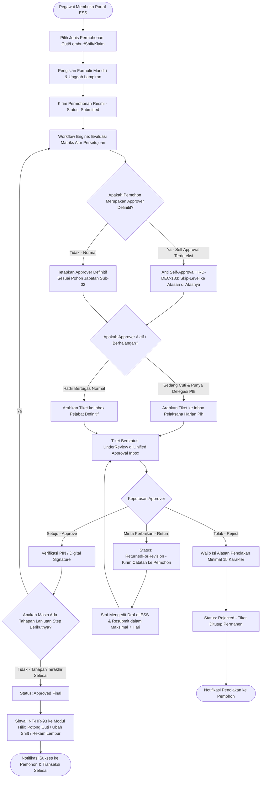
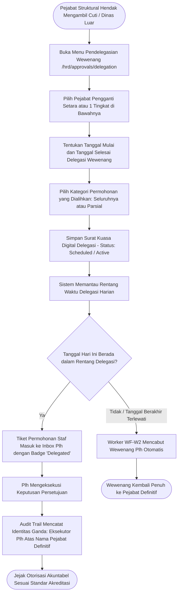
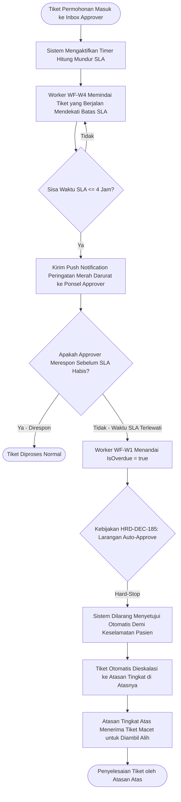
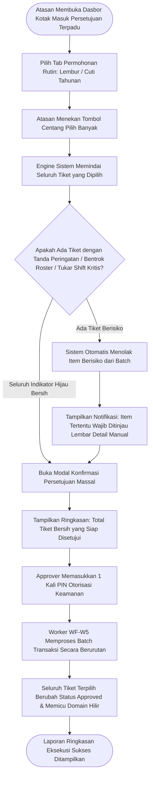

# Alur Proses Bisnis: Kotak Masuk Persetujuan Terpadu & Layanan Mandiri Karyawan (ESS & Unified Approval V2)

Dokumen ini mendefinisikan alur proses bisnis ujung-ke-ujung untuk **Sub-Modul 21: Employee Self-Service (ESS) & Unified Approval Inbox (V2 Hardening) — Slice `S-A7-V2`**.

---

## 1. Alur Utama Pengajuan Permohonan ESS, Penugasan Tiket & Eksekusi Hilir

---

## 2. Alur Pendelegasian Wewenang Digital Berbatas Waktu (Plh / Acting Approver)

---

## 3. Alur Penegakan SLA, Peringatan Dini H-4 Jam & Auto-Eskalasi Tanpa Auto-Approve

---

## 4. Alur Persetujuan Massal Bersyarat (Conditional Bulk Approval)

