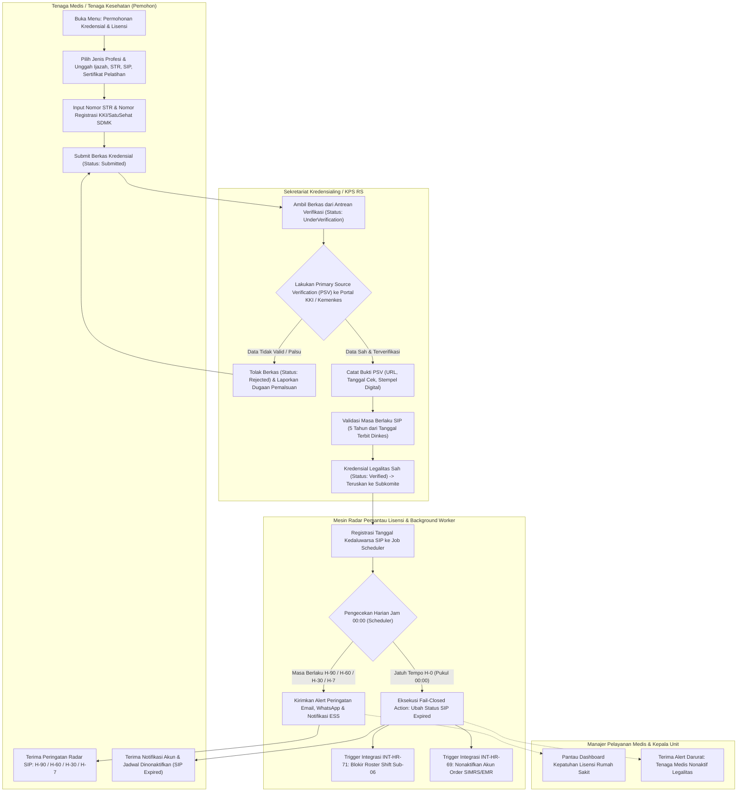
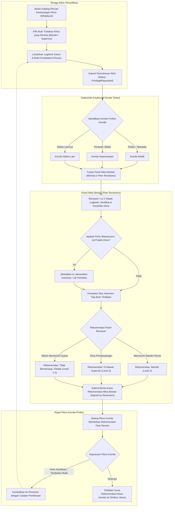
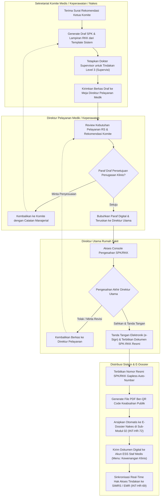
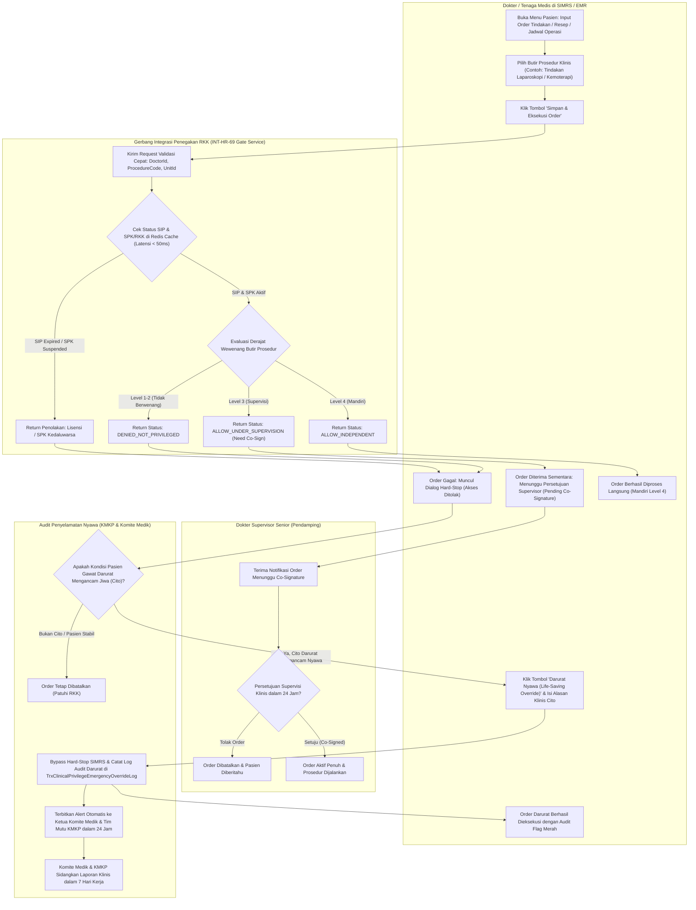

# Alur Proses Bisnis Sub-Modul 14: Credentialing, License & Clinical Privilege (Kredensial, Lisensi Praktik STR/SIP & Rincian Kewenangan Klinis RS)

Dokumen ini mendefinisikan seluruh diagram alur proses bisnis (*flowchart*) untuk **Sub-Modul 14 (Slice `S-C1`)** yang mengatur tata kelola kredensialing 3 komite mandiri (Medik, Keperawatan, Nakes Lain), verifikasi keabsahan dokumen primer (*Primary Source Verification* - PSV) STR seumur hidup dan SIP 5 tahunan, penilaian panel Mitra Bestari (*Peer Review*), pengesahan Surat Penugasan Klinis (SPK) dan Rincian Kewenangan Klinis (RKK) oleh Direktur Utama, serta penegakan gerbang wewenang klinis SIMRS/EMR (`INT-HR-69`) dengan mekanisme *Hard-Stop* bertingkat dan bypass darurat keselamatan pasien.

---

## 14.1 Alur Pengajuan Kredensial, Verifikasi PSV STR Seumur Hidup & Pemantauan Masa Berlaku SIP 5 Tahun

Diagram ini menggambarkan alur pendaftaran berkas kualifikasi klinis nakes, verifikasi sumber primer (PSV) ke Konsil Kedokteran Indonesia (KKI) / SatuSehat SDMK Kemenkes, serta radar otomatis pemantau SIP 5 tahunan berjenjang (H-90, H-60, H-30, H-7) hingga pemblokiran otomatis (*fail-closed*) saat jatuh tempo H-0 sesuai [`HRD-DEC-146`](../00-interview-decisions.md#L7165-L7185).

### Tabel Langkah 14.1

| Langkah | Pelaku | Masukan | Keluaran | Penanganan Bila Gagal / Hambatan |
| :--- | :--- | :--- | :--- | :--- |
| **1. Pengajuan Berkas** | Nakes Pemohon | Ijazah, STR, SIP, sertifikat kompetensi terkini | Berkas tersimpan status `Submitted` | Sistem memvalidasi kelengkapan format PDF/JPG dan keharusan input nomor STR (`VR-CRD-01`). |
| **2. Pelaksanaan PSV** | Sekretariat Kredensialing | Nomor STR & portal SatuSehat SDMK / KKI | Status `Verified`, URL verifikasi & tangkapan layar bukti PSV | Bila portal KKI/Kemenkes sedang down, berkas berstatus `PendingPSV` dan diulang maksimal 3x24 jam (`VR-CRD-02`). |
| **3. Pendaftaran Radar SIP** | Background Job Scheduler | Tanggal akhir berlaku SIP nakes | Jadwal notifikasi H-90, H-60, H-30, H-7 terdaftar | Tanggal akhir SIP wajib divalidasi tidak boleh melebihi 5 tahun sejak tanggal terbit izin (`VR-CRD-03`). |
| **4. Peringatan Dini** | Background Engine | Status sisa hari SIP | Email & notifikasi multi-kanal ke nakes dan atasan | Jika nakes belum mengunggah perpanjangan SIP pada H-30, notifikasi eskalasi dikirimkan ke Direktur Medis. |
| **5. Penonaktifan Otomatis** | Fail-Closed Gateway | Event `OnSipExpired` pada H-0 | SIP `Expired`, akun SIMRS nonaktif, jadwal dinas terblokir | Dilakukan tepat pukul 00:00 WIB untuk mencegah risiko malpraktik faskes tanpa izin operasional (`INT-HR-69`, `INT-HR-71`). |

---

## 14.2 Alur Sidang Kredensial 3 Komite Profesi & Penilaian Panel Mitra Bestari (*Peer Review*)

Diagram ini menggambarkan tata kelola telaah klinis terpisah untuk Komite Medik, Komite Keperawatan, dan Komite Tenaga Kesehatan Lainnya, penilaian mandiri buku putih (*whitebook*), dan rekomendasi independen minimal 2 anggota panel Mitra Bestari (*Peer Review*) sesuai [`HRD-DEC-147`](../00-interview-decisions.md#L7186-L7207).

### Tabel Langkah 14.2

| Langkah | Pelaku | Masukan | Keluaran | Penanganan Bila Gagal / Hambatan |
| :--- | :--- | :--- | :--- | :--- |
| **1. Pengajuan RKK** | Staf Klinis Pemohon | Checklist buku putih, logbook kasus minimal, bukti pelatihan | Berkas `PrivilegeRequested` | Butir tindakan invasif wajib melampirkan logbook minimal yang disyaratkan dalam whitebook (`VR-CRD-04`). |
| **2. Pembentukan Peer Review** | Subkomite Kredensial | Komite profesi & rumpun spesialisasi | Panel Mitra Bestari (minimal 2 reviewer sebidang) | Jika RS tidak memiliki dokter spesialis sebidang kedua, ditunjuk pakar kolegium dari luar RS (`HRD-ASM-44`). |
| **3. Asesmen Portofolio** | Panel Mitra Bestari | Berkas nakes, checklist tindakan, uji wawancara | Berita acara rekomendasi per butir tindakan | Jika terdapat perbedaan penilaian antara Reviewer 1 dan 2, diadakan konsensus dipimpin Ketua Subkomite. |
| **4. Rekomendasi Derajat** | Panel Mitra Bestari | Standar kompetensi tindakan klinis | Rekomendasi Level 4 (Mandiri), Level 3 (Supervisi), Level 1-2 (Ditolak) | Tindakan baru/canggih yang belum pernah dilakukan wajib direkomendasikan berstatus supervisi terlebih dahulu. |
| **5. Rapat Pleno Komite** | Pengurus Komite Profesi | Rekomendasi panel mitra bestari | Surat Rekomendasi Ketua Komite bertanda tangan elektronik | Jika ada penolakan hak klinis tertentu, wajib disertakan alasan klinis objektif dan saran remedial kompetensi. |

---

## 14.3 Alur Penerbitan dan Pengesahan SPK & RKK oleh Direktur Utama serta Klasifikasi Derajat Supervisi

Diagram ini menggambarkan alur penyerahan rekomendasi komite, penyusunan draf Surat Penugasan Klinis (SPK) dan Rincian Kewenangan Klinis (RKK), pengesahan tunggal Direktur Utama rumah sakit, serta pembagian kewenangan mandiri versus supervisi sesuai [`HRD-DEC-148`](../00-interview-decisions.md#L7208-L7228).

### Tabel Langkah 14.3

| Langkah | Pelaku | Masukan | Keluaran | Penanganan Bila Gagal / Hambatan |
| :--- | :--- | :--- | :--- | :--- |
| **1. Penyusunan Draf SPK/RKK** | Sekretariat Komite | Rekomendasi komite & katalog tindakan | Draf SPK dan lampiran RKK sistem | Setiap tindakan berstatus Level 3 wajib ditetapkan nama dokter supervisor pendampingnya (`VR-CRD-05`). |
| **2. Paraf Direktur Pelayanan** | Direktur Pelayanan | Draf SPK/RKK sistem | Paraf persetujuan manajerial | Direktur Pelayanan memvalidasi kesesuaian penugasan dengan peta kebutuhan layanan rumah sakit. |
| **3. Pengesahan Dirut** | Direktur Utama RS | Draf SPK/RKK terparaf | SPK/RKK sah bertanda tangan digital Direktur Utama | Pengesahan SPK/RKK tidak dapat didelegasikan ke pihak lain sesuai *Hospital Bylaws* (`HRD-DEC-148`). |
| **4. Penerbitan Dokumen** | Document Auto-Number Engine | Data pengesahan Dirut | Berkas PDF resmi ber-QR Code & nomor registrasi SPK gapless | Sistem mengunci status dokumen menjadi `Active` dan mencatat masa berlaku efektif 3 tahun. |
| **5. Distribusi & Integrasi** | Background Integration Bus | File PDF SPK/RKK sah & dataset RKK | Tersimpan di e-Dossier Sub-02, rilis ke ESS nakes, sinkron ke SIMRS EMR | Jika sinkronisasi SIMRS gagal, worker mengulang otomatis via event bus dengan retry ber-backoff (`INT-HR-69`). |

---

## 14.4 Alur Penegakan Batas Kewenangan Klinis SIMRS/EMR Gate (`INT-HR-69`), Hard-Stop & Life-Saving Override

Diagram ini menggambarkan arsitektur penegakan wewenang klinis secara real-time saat dokter/nakes menjalankan order tindakan di SIMRS/EMR, resolusi final [`HRD-DEC-005`] & [`HRD-DEC-149`] (Hard-Stop bertingkat), penanganan order supervisi (*Pending Co-Signature*), dan jalur khusus penyelamatan nyawa (*Life-Saving Emergency Override*) ber-audit komite.

### Tabel Langkah 14.4

| Langkah | Pelaku | Masukan | Keluaran | Penanganan Bila Gagal / Hambatan |
| :--- | :--- | :--- | :--- | :--- |
| **1. Request Validasi RKK** | SIMRS/EMR Service | `DoctorId`, `ProcedureCode`, `UnitId` | Panggilan API `POST /api/v1/corporate/hrd/clinical-privileges/validate-gate` | Layanan merespons dari cache terdistribusi (Redis) dengan target latensi < 50ms (`HRD-ASM-45`). |
| **2. Pengecekan SIP & SPK** | Gate Service | Tanggal hari ini vs masa berlaku SIP & SPK | Status validasi lisensi aktif | Jika SIP kedaluwarsa atau SPK suspended, transaksi seketika ditolak dengan pesan jelas (`VR-CRD-06`). |
| **3. Evaluasi Derajat Wewenang** | Gate Service | Kode prosedur vs daftar tindakan sah RKK | Keputusan: `ALLOW_INDEPENDENT`, `ALLOW_UNDER_SUPERVISION`, atau `DENIED` | Resolusi final `HRD-DEC-005` & `HRD-DEC-149`: Hard-Stop tegas untuk tindakan tidak berwenang. |
| **4. Alur Co-Signature Supervisi** | Dokter Supervisor | Notifikasi order tindakan di bawah supervisi | Tanda tangan digital persetujuan supervisor | Batas waktu persetujuan maksimal 24 jam; jika melebihi batas waktu, order tindakan otomatis kedaluwarsa (`VR-CRD-07`). |
| **5. Life-Saving Override** | Staf Klinis Cito | Justifikasi klinis darurat penyelamatan jiwa | Tindakan darurat tereksekusi, log audit terbit | Penyalahgunaan tombol darurat untuk kasus elektif dikenakan sanksi disiplin etik Komite Medik (`VR-CRD-08`). |
