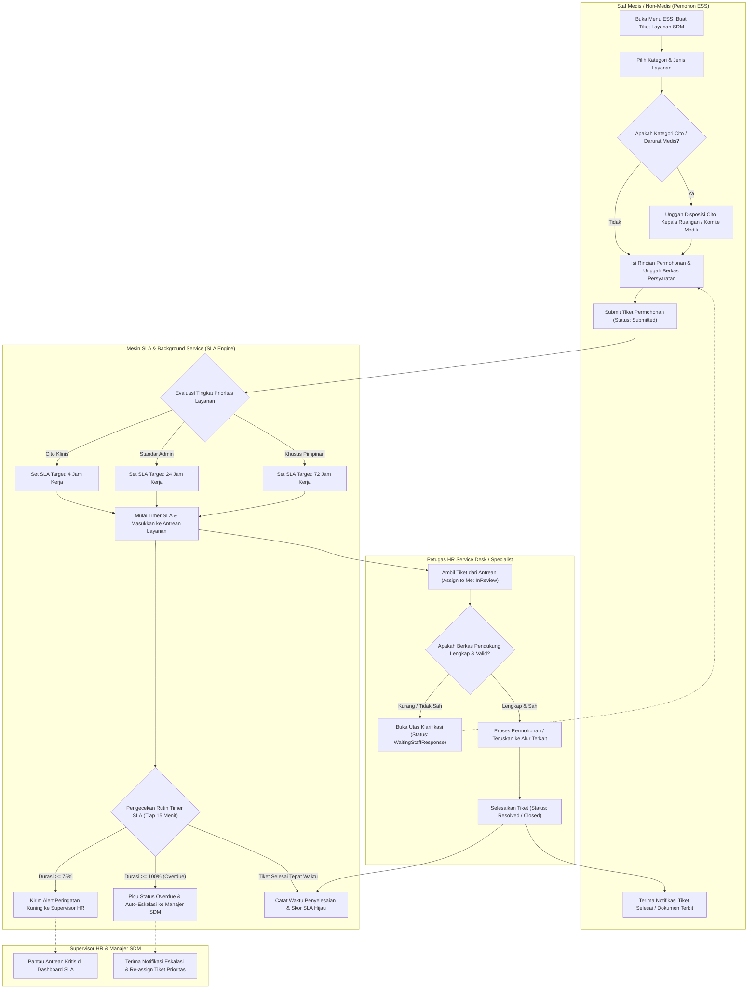
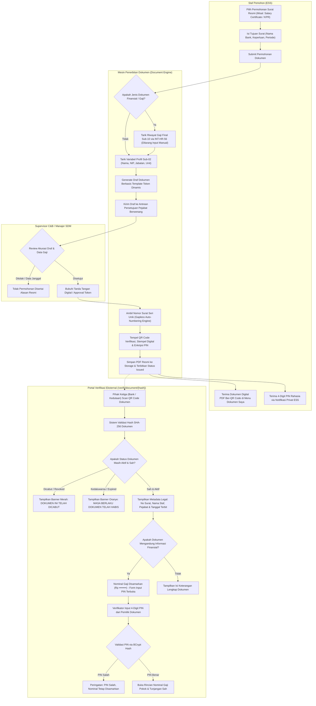
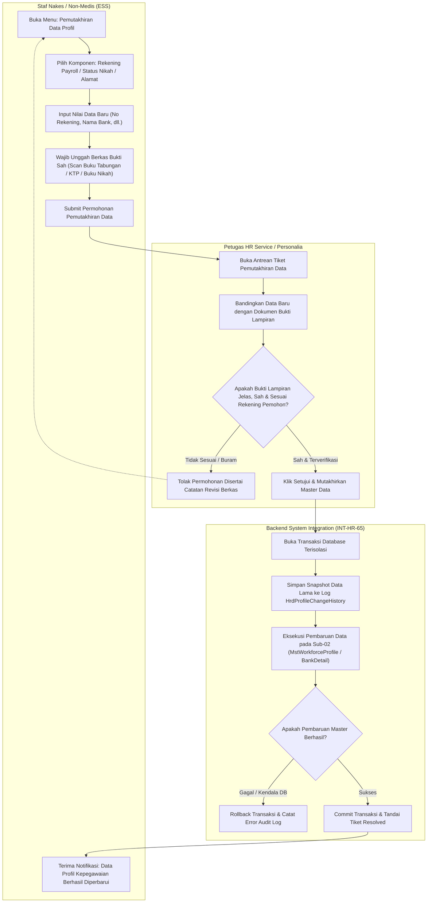
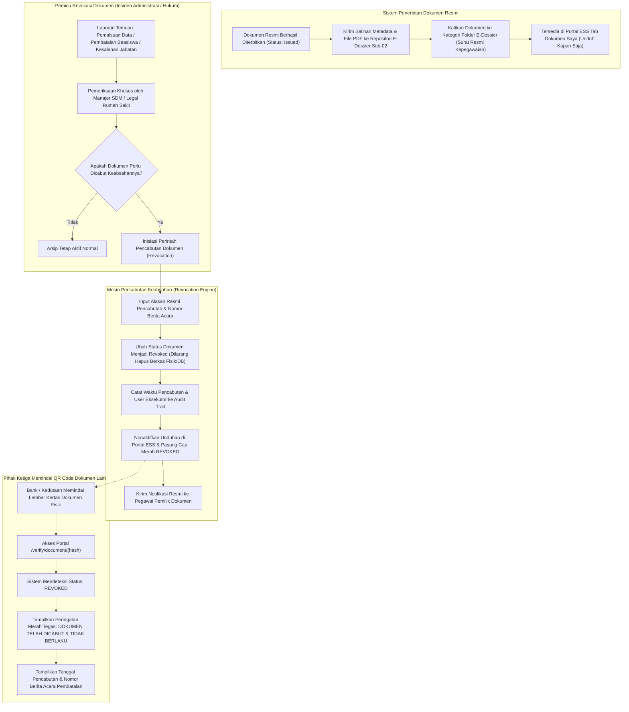

# Alur Proses Bisnis Sub-Modul 13: HR Service Management & Request (Layanan Administrasi, Helpdesk SDM & Penerbitan Dokumen Kepegawaian RS)

Dokumen ini mendefinisikan seluruh diagram alur proses bisnis (*flowchart*) untuk **Sub-Modul 13 (Slice `S-D4`)** yang mengatur otomasi layanan helpdesk SDM, manajemen SLA berjenjang kebutuhan rumah sakit, penerbitan dokumen resmi ber-QR Code publik dan ber-PIN finansial, pemutakhiran data master kepegawaian otomatis, serta pengarsipan abadi *e-Dossier*.

---

## 13.1 Alur Pengajuan Tiket Helpdesk SDM, Penugasan Antrean & Monitoring SLA 3-Tier

Diagram ini menggambarkan siklus pengajuan tiket layanan SDM oleh staf medis/non-medis via ESS, validasi kelengkapan berkas, penentuan tier SLA (Cito 4 jam, Standar 24 jam, Khusus 72 jam), peringatan dini 75% durasi, dan eskalasi otomatis ke Manajer SDM jika *overdue* sesuai [`HRD-DEC-141`](../00-interview-decisions.md#L91-L103).

### Tabel Langkah 13.1

| Langkah | Pelaku | Masukan | Keluaran | Penanganan Bila Gagal / Hambatan |
| :--- | :--- | :--- | :--- | :--- |
| **1. Pengajuan Tiket** | Staf Pemohon (ESS) | Kategori layanan, deskripsi kebutuhan, berkas lampiran pendukung | Tiket tersimpan status `Submitted` | Sistem memvalidasi kelengkapan berkas wajib; jika belum ada, tombol submit terkunci (`VR-HRS-01`). |
| **2. Inisiasi SLA** | Background SLA Engine | Jenis layanan & tingkat urgensi | `sla_target_hours`, `sla_deadline`, timer aktif | Menggunakan jam operasional resmi rumah sakit (mengecualikan hari libur untuk layanan non-cito). |
| **3. Monitoring & Alert** | Background SLA Engine | Status tiket & sisa waktu SLA | Notifikasi peringatan 75% & eskalasi 100% | Jika supervisor tidak merespons peringatan 75%, tiket otomatis naik tingkat ke dashboard Manajer SDM (`VR-HRS-02`). |
| **4. Klarifikasi Berkas** | Petugas HR Desk | Catatan klarifikasi pada tiket | Status `WaitingStaffResponse`, timer SLA ditangguhkan (*pause*) | Pemohon menerima notifikasi ESS & email; timer kembali berjalan saat staf mengunggah berkas perbaikan. |
| **5. Resolusi & Penutupan** | Petugas HR Desk | Hasil pemrosesan & tautan output | Status `Resolved` / `Closed` | Pemohon memberikan rating kepuasan layanan bintang 1-5 di portal ESS. |

---

## 13.2 Alur Penerbitan Surat Resmi Ber-QR Code Publik & Proteksi PIN 4-Digit Gaji

Diagram ini menggambarkan penerbitan dokumen resmi rumah sakit (Surat Keterangan Kerja, Visa, Salary Certificate KPR) menggunakan penomoran otomatis anti-lompat, penarikan gaji otomatis dari Sub-10, proteksi PIN finansial, dan verifikasi portal publik sesuai [`HRD-DEC-140`](../00-interview-decisions.md#L78-L90), [`HRD-DEC-142`](../00-interview-decisions.md#L104-L116), dan [`HRD-DEC-144`](../00-interview-decisions.md#L130-L142).

### Tabel Langkah 13.2

| Langkah | Pelaku | Masukan | Keluaran | Penanganan Bila Gagal / Hambatan |
| :--- | :--- | :--- | :--- | :--- |
| **1. Permohonan Surat** | Staf Pemohon (ESS) | Jenis dokumen, tujuan penggunaan, nama institusi penerima | Draf permohonan tersimpan | Sistem memvalidasi kelayakan penerbitan (misal: nakes minimal telah melewati masa orientasi 1 bulan). |
| **2. Tarik Data Otomatis** | Document Engine | ID Pegawai & ID Jenis Dokumen | Variabel token dinamis terisi (`{{NamaLengkap}}`, `{{GajiNetto}}`, dll.) | Jika data gaji Sub-10 belum *finalized*, sistem menolak pembuatan draf dengan pesan instruksi (`VR-HRS-05`). |
| **3. Otorisasi Finansial** | Supervisor C&B / Manajer SDM | Draf surat berparameter gaji | Persetujuan digital ber-timestamp | Pemohon dilarang menyetujui suratnya sendiri (*Separation of Duties*). |
| **4. Penomoran & Stempel QR** | Gapless Auto-Numbering Engine | Kode naskah dinas, bulan Romawi, tahun | Nomor surat sah (misal: `042/RSQ-SDM/XI/2026/0128`), file PDF ber-QR | Transaksi database atomik mencegah duplikasi nomor atau nomor lompat (*gapless sequence*). |
| **5. Verifikasi Publik & PIN** | Pihak Ketiga (Bank/Kedutaan) | Scan kamera QR code, 4-digit PIN rahasia | Tampilan validitas metadata & pembukaan nominal gaji | Salah input PIN dibatasi 3 kali per jam untuk menangkal brute force (`VR-HRS-12`). |

---

## 13.3 Alur Permohonan Pemutakhiran Data Profil Master Kepegawaian Otomatis

Diagram ini menggambarkan alur permohonan staf untuk memperbarui rekening bank payroll, perubahan status pernikahan, atau kontak darurat yang diverifikasi keabsahan berkasnya oleh tim SDM, lalu sistem secara otomatis memperbarui master data kepegawaian Sub-02 tanpa ketik ulang sesuai [`HRD-DEC-143`](../00-interview-decisions.md#L117-L129).

### Tabel Langkah 13.3

| Langkah | Pelaku | Masukan | Keluaran | Penanganan Bila Gagal / Hambatan |
| :--- | :--- | :--- | :--- | :--- |
| **1. Input Perubahan Data** | Staf Pemohon (ESS) | Field yang ingin diubah (misal rekening payroll BCA ke Mandiri) | Form perubahan & lampiran buku tabungan | Nama pada buku tabungan wajib diverifikasi kecocokannya dengan nama pegawai pada KTP. |
| **2. Verifikasi Dokumen** | Petugas HR Service | Scan berkas & data pemohon | Catatan approval verifikasi | Petugas memeriksa keaslian cap/buku rekening untuk mencegah rekening pihak ketiga fiktif. |
| **3. Audit Snapshot** | Backend Integration | Data lama sebelum perubahan | Baris riwayat perubahan tercatat abadi | Memastikan data lampau dapat direkonstruksi bila terjadi sengketa transfer payroll bulanan. |
| **4. Pembaruan Otomatis** | `IWorkforceProfileSyncService` | ID Pegawai & Payload data baru | `MstWorkforceProfile` dan tabel bank detail ter-update | Eksekusi atomik; kegagalan menulis database langsung memicu rollback tanpa merusak status tiket. |

---

## 13.4 Alur Pengarsipan Digital Abadi E-Dossier & Protokol Pencabutan Dokumen Sah (Revokasi)

Diagram ini menggambarkan penyimpanan otomatis seluruh dokumen yang diterbitkan ke repositori berkas kepegawaian (*Employee E-Dossier* Sub-02) serta tata cara pencabutan keabsahan dokumen (*revocation*) bila ditemukan kesalahan administratif atau manipulasi data sesuai [`HRD-DEC-145`](../00-interview-decisions.md#L143-L155).

### Tabel Langkah 13.4

| Langkah | Pelaku | Masukan | Keluaran | Penanganan Bila Gagal / Hambatan |
| :--- | :--- | :--- | :--- | :--- |
| **1. Pengarsipan E-Dossier** | Background Archiver | Dokumen status `Issued` & path PDF | Rekam berkas digital pada `MstWorkforceProfileDocument` Sub-02 | Berkas PDF dienkripsi dan diberi watermark hak cipta resmi RS Quilvian (`VR-HRS-15`). |
| **2. Pengambilan Mandiri** | Staf Pegawai (ESS) | Login ESS & Menu Dokumen Saya | File PDF bertanda tangan digital | Menghilangkan antrean fisik nakes di loket HR untuk meminta salinan ulang surat. |
| **3. Perintah Revokasi** | Manajer SDM / Direksi | ID Dokumen terbit, alasan pembatalan, nomor BAP | Status dokumen berubah menjadi `Revoked` | Dokumen asli tidak dihapus dari harddisk/database guna mempertahankan rekam jejak forensik (`HRD-DEC-145`). |
| **4. Peringatan Publik** | Portal Verifikasi Publik | Hash URL QR Code dokumen tercabut | Tampilan peringatan merah penolakan keabsahan | Pihak bank/luar langsung mengetahui bahwa dokumen fisik tersebut sudah tidak berlaku lagi secara hukum. |
