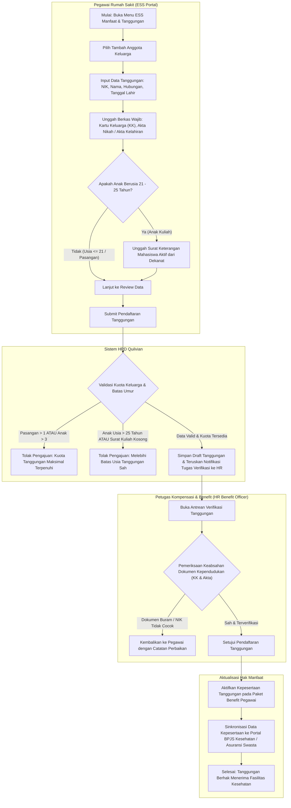
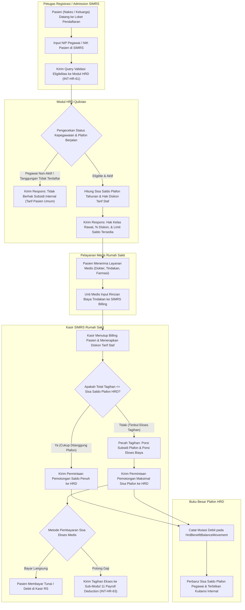
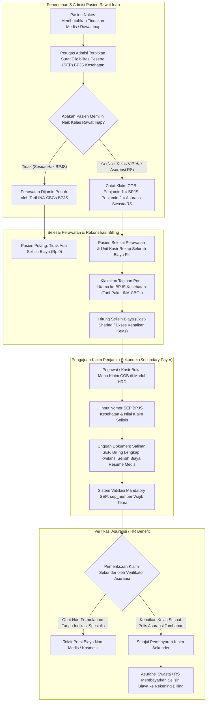
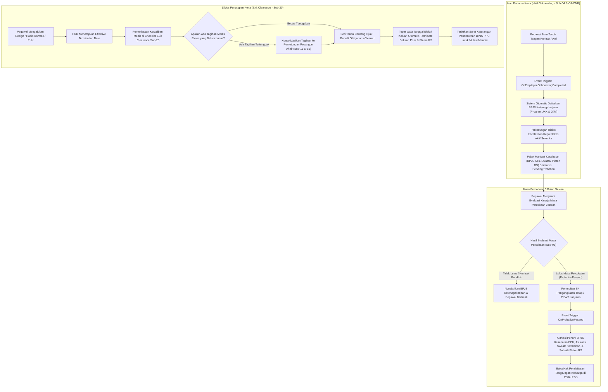

# Alur Proses Bisnis — Manajemen Manfaat, Asuransi BPJS & Tanggungan Pegawai Rumah Sakit (Benefit Management)

Dokumen ini memetakan seluruh alur proses bisnis operasional untuk **Sub-Modul 12 (Benefit Management — Slice `S-D3`)**. Alur proses dirancang untuk menjamin kepatuhan paket manfaat berjenjang 3-lapisan (Regulasi BPJS wajib, Asuransi Swasta Tambahan per grade, dan Subsidi Berobat Internal RS sesuai `HRD-DEC-134`), penegakan batas tanggungan keluarga inti sah (maksimal 1 pasangan + 3 anak hingga usia 21/25 tahun kuliah via verifikasi KK/Akta sesuai `HRD-DEC-135`), integrasi real-time loket registrasi dan kasir SIMRS untuk layanan berobat internal nakes di RS sendiri (`INT-HR-61` sesuai `HRD-DEC-136`), penegakan aturan Koordinasi Manfaat (*Coordination of Benefits* - COB) BPJS Kesehatan sebagai *Primary Payer* ber-SEP dan asuransi swasta sebagai *Secondary Payer* (`HRD-DEC-137`), perlindungan keselamatan kerja nakes sejak H+0 Onboarding dan aktivasi bertahap pasca-lulus masa percobaan 3 bulan (`HRD-DEC-138`), serta penonaktifan hak benefit otomatis pada tanggal efektif pemutusan hubungan kerja melalui gerbang Exit Clearance Sub-Modul 20 (`HRD-DEC-139`).

---

## 1. Alur Pendaftaran, Validasi Kelayakan & Verifikasi Tanggungan Keluarga di Portal ESS

Diagram ini memetakan alur pendaftaran data pasangan sah dan anak oleh pegawai rumah sakit melalui portal Employee Self-Service (ESS), pengecekan batasan kuota otomatis, verifikasi lampiran dokumen kependudukan oleh HR Benefit Officer, hingga status kepesertaan tanggungan aktif.

### Tabel Rincian Langkah 12.1

| No | Langkah Kerja | Pelaku | Masukan (Input) | Keluaran (Output) | Jalur Pengecualian / Mitigasi Gagal |
| :---: | :--- | :--- | :--- | :--- | :--- |
| 1 | Input Data Tanggungan | Pegawai RS | NIK, Hubungan Keluarga, Tanggal Lahir | Data mentah formulir tanggungan | Validasi format NIK 16 digit angka; blokir submit jika tanggal lahir tidak logis. |
| 2 | Unggah Berkas Kependudukan | Pegawai RS | Scan KK, Akta Nikah, Akta Lahir, Surat Kuliah | Berkas lampiran terunggah | Validasi format PDF/JPG/PNG maks 5 MB; wajib ada surat dekanat jika anak berusia > 21 tahun. |
| 3 | Validasi Kuota Otomatis | Sistem HRD | Data keluarga terdaftar | Keputusan eligibilitas kuota | Tolak otomatis jika pasangan sah sudah terdaftar 1 orang atau anak sah sudah mencapai 3 orang. |
| 4 | Verifikasi Fisik Dokumen | HR Benefit Officer | Berkas pendaftaran & scan dokumen | Keputusan verifikasi (Approve/Reject) | Kembalikan permohonan ke ESS jika nomor KK berbeda atau NIK terindikasi salah ketik. |
| 5 | Aktivasi & Handoff BPJS | Sistem HRD | Data tanggungan disetujui | Record `Active` pada enrollment | Kirim data pendaftaran ke antrean sinkronisasi BPJS/Asuransi (`INT-HR-62`). |

---

## 2. Alur Berobat Internal Nakes di RS Sendiri & Billing SIMRS Real-Time (`INT-HR-61`)

Diagram ini memetakan integrasi antara modul HRD dengan sistem billing SIMRS rumah sakit ketika seorang tenaga medis atau keluarganya berobat di fasilitas rumah sakit sendiri, mencakup pemotongan buku besar plafon tahunan dan penanganan ekses tagihan.

### Tabel Rincian Langkah 12.2

| No | Langkah Kerja | Pelaku | Masukan (Input) | Keluaran (Output) | Jalur Pengecualian / Mitigasi Gagal |
| :---: | :--- | :--- | :--- | :--- | :--- |
| 1 | Query Eligibilitas Pasien | Admission SIMRS | NIP Staf atau NIK Pasien | Payload query ke API HRD | Bila koneksi API HRD *timeout*, gunakan fallback verifikasi manual Kartu Pegawai. |
| 2 | Cek Status & Plafon | Sistem HRD | NIP/NIK & Tanggal Kunjungan | Kuota plafon & diskon nakes | Blokir subsidi jika nakes sedang menjalani masa cuti di luar tanggungan atau skorsing disiplin berat. |
| 3 | Perhitungan Billing Medis | Kasir SIMRS | Rincian tindakan & obat | Rekap tagihan netto diskon | Menerapkan diskon tarif staf terpusat (contoh: 30% jasa medis, 20% farmasi sesuai `HRD-ASM-35`). |
| 4 | Pemotongan Saldo Plafon | Kasir & HRD | Nomor Registrasi & Nilai Klaim | Rekaman mutasi ledger plafon | Saldo tidak boleh negatif; pemotongan otomatis dipatok maksimal sebesar sisa saldo berjalan. |
| 5 | Penyelesaian Ekses Biaya | Kasir SIMRS | Tagihan ekses pasien | Struk lunas atau voucher potongan | Ekses dialihkan ke payroll deduction Sub-11 dengan penandatanganan surat kuasa pemotongan upah. |

---

## 3. Alur Koordinasi Manfaat (*Coordination of Benefits* - COB) BPJS Kesehatan vs Asuransi Swasta

Diagram ini memetakan alur klaim biaya perawatan kesehatan dengan mekanisme koordinasi penjaminan berganda, di mana BPJS Kesehatan wajib difungsikan sebagai Penjamin Primer (*Primary Payer*) dan asuransi komersial/fasilitas subsidi RS sebagai Penjamin Sekunder (*Secondary Payer*).

### Tabel Rincian Langkah 12.3

| No | Langkah Kerja | Pelaku | Masukan (Input) | Keluaran (Output) | Jalur Pengecualian / Mitigasi Gagal |
| :---: | :--- | :--- | :--- | :--- | :--- |
| 1 | Penerbitan SEP BPJS | Loket BPJS / Admission | Kartu BPJS & Rujukan Faskes | Nomor SEP BPJS Kesehatan | Wajib terbit pada saat admisi; tanpa nomor SEP, klaim COB sekunder tidak dapat diajukan. |
| 2 | Verifikasi Naik Kelas | Pasien & Admisi | Surat persetujuan naik kelas | Form penetapan selisih tarif | Petugas wajib menginformasikan konsekuensi selisih biaya naik kelas kamar kepada nakes/keluarga. |
| 3 | Perhitungan Porsi Klaim | Kasir RS | Rincian INA-CBGs & tagihan riil | Breakdown tagihan primer vs sekunder | Pisahkan biaya yang di-cover BPJS dari tagihan selisih kamar dan obat non-formularium. |
| 4 | Input Klaim COB Sekunder | Pegawai / HRD | Form klaim, lampiran SEP & kuitansi | Pengajuan klaim `TrxBenefitClaim` | Sistem otomatis memblokir submit jika kolom `sep_number` kosong (`VR-BEN-16`). |
| 5 | Settlement Penjamin 2 | Asuransi / Keuangan | Persetujuan klaim sekunder | Pelunasan tagihan ke RS | Sisa ekses di luar limit polis asuransi swasta menjadi tanggung jawab pribadi pegawai. |

---

## 4. Alur Masa Tunggu Aktivasi Bertahap & Penonaktifan via Exit Clearance

Diagram ini memetakan masa tunggu aktivasi paket benefit dari hari pertama masuk kerja (H+0) hingga lulus probation, serta alur penonaktifan otomatis dan penerbitan surat portabilitas BPJS Mandiri saat pegawai mengakhiri hubungan kerja.

### Tabel Rincian Langkah 12.4

| No | Langkah Kerja | Pelaku | Masukan (Input) | Keluaran (Output) | Jalur Pengecualian / Mitigasi Gagal |
| :---: | :--- | :--- | :--- | :--- | :--- |
| 1 | Pendaftaran Cepat BPJS TK | Sistem HRD | Data pegawai onboarding baru | Pendaftaran JKK & JKM aktif | Langsung aktif H+0 tanpa menunggu masa percobaan guna melindungi nakes dari risiko pajanan kerja. |
| 2 | Penahanan Benefit Kesehatan | Sistem HRD | Masa kerja < 3 bulan | Status paket `PendingProbation` | Fasilitas rawat jalan nakes selama 3 bulan pertama difasilitasi melalui poli internal K3RS. |
| 3 | Aktivasi Pasca-Probation | Sistem HRD | SK Kelulusan Percobaan | Paket benefit aktif penuh & saldo plafon | Otomatis generate saldo awal plafon tahunan prorata sesuai sisa bulan kalender berjalan. |
| 4 | Cek Tagihan Medis Ekses | Sistem HRD & SIMRS | NIP pegawai yang akan keluar | Status bebas tunggakan medis | Blokir approval Exit Clearance jika pegawai masih memiliki piutang rawat inap di kasir RS. |
| 5 | Terminasi & Portabilitas | Sistem HRD | Tanggal efektif keluar | Status polis `Terminated` & surat mutasi | Berikan PDF Surat Keterangan Berhenti Bekerja bagi BPJS Kesehatan agar nakes dapat bayar mandiri. |
