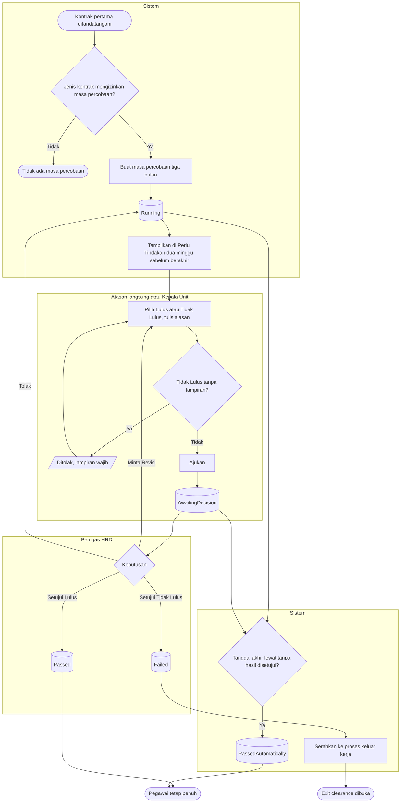

# Masa Percobaan

| Field | Value |
| --- | --- |
| Blueprint ID | `HRD-BP-001` |
| Jenis | Flowchart proses |
| Slice | `S-C4-ONB` onboarding dan kontrak kerja (sub-modul 05) |
| Status | `approved` — Pengguna (pemilik teknis dan produk, `HRD-DEC-015`), 2026-11-04, beserta kelima pilihan desain (`HRD-DEC-096`). Jawaban pemilik: "setujui semua ya dan kerjakan" |
| Kesiapan | `READY FOR DESIGN` |
| Keputusan | `HRD-DEC-081`, `HRD-DEC-082`, `HRD-DEC-085`, `HRD-DEC-089` butir 6 |

---

## 1. Apa yang digambar

Masa percobaan pegawai yang **sejak awal** bergabung sebagai PKWTT, dari dibuat sampai lulus, lulus
otomatis, atau tidak lulus. Status pada node keadaan sama persis dengan
`contracts/state-transition-matrix.md` bagian 13.4 dan 13.5.

## 2. Diagram

## 3. Tabel langkah

| Langkah | Pelaku | Masukan yang dibutuhkan | Keluaran | Bila gagal |
| --- | --- | --- | --- | --- |
| Buat masa percobaan | Sistem | Kontrak PKWTT pertama sejak bergabung | Masa percobaan `Running`, tanggal akhir = tanggal mulai + 3 bulan − 1 hari | Tidak dibuat untuk PKWT maupun pengangkatan PKWT ke PKWTT; tidak ada yang perlu dilakukan petugas |
| Ajukan hasil | Atasan langsung atau Kepala Unit | Hasil, alasan, lampiran bila Tidak Lulus; sebelum tanggal akhir | Penilaian diajukan; masa percobaan `AwaitingDecision` | Ditolak; atasan melengkapi isian. Bila tanggal akhir sudah lewat, pegawai sudah lulus otomatis |
| Putuskan | Petugas HRD bukan pengaju | Penilaian di kotak masuk | `Passed`, `Failed`, atau kembali `Running` | Persetujuan sesudah tanggal akhir ditolak; tidak ada tindakan lanjutan |
| Lulus otomatis | Sistem | Tanggal akhir lewat tanpa hasil disetujui | `PassedAutomatically`; HRD dan atasan melihatnya di daftar | — |
| Serahkan ke proses keluar | Sistem | Tidak Lulus disetujui | Catatan pemisahan dan exit clearance di 20 | Penerapan batal; HRD mengulang dari kotak masuk |

## 4. Contoh

Andi, apoteker PKWTT, mulai 1 Februari 2027. Masa percobaannya berakhir 30 April 2027 dan muncul di
daftar Perlu Tindakan Kepala Instalasi Farmasi sejak 16 April. Kepala Instalasi mengajukan Lulus;
Dodi menyetujuinya pada 20 April. Bila tidak ada yang menilai, pada 1 Mei 2027 Andi tercatat lulus
otomatis.

## 5. Yang sengaja tidak ada di diagram ini

| Yang tidak digambar | Alasan |
| --- | --- |
| Perpanjangan masa percobaan | Tidak ada jalurnya (`HRD-DEC-085` `THREE_MONTHS_FIXED`) |
| Skor berbobot | Tidak dipakai (`HRD-DEC-085` `SIMPLE_RESULT`) |
| Pendampingan klinis | Terpisah, `pendampingan-klinis.md` |

## 6. Traceability

| Bagian alur | Decision | Acceptance test |
| --- | --- | --- |
| Berlaku hanya PKWTT sejak bergabung | `HRD-DEC-085`, `HRD-DEC-089` butir 6 | `AT-HRD-ONB-09`, `AT-HRD-ONB-10`, `AT-HRD-ONB-15` |
| Pengajuan dan keputusan | `HRD-DEC-081`, `HRD-DEC-085` | `AT-HRD-ONB-11`, `AT-HRD-ONB-12` |
| Lulus otomatis | `HRD-DEC-085` `AUTO_PASS_ON_EXPIRY` | `AT-HRD-ONB-13` |
| Tidak lulus ke 20 | `HRD-DEC-082` | `AT-HRD-ONB-14` |
