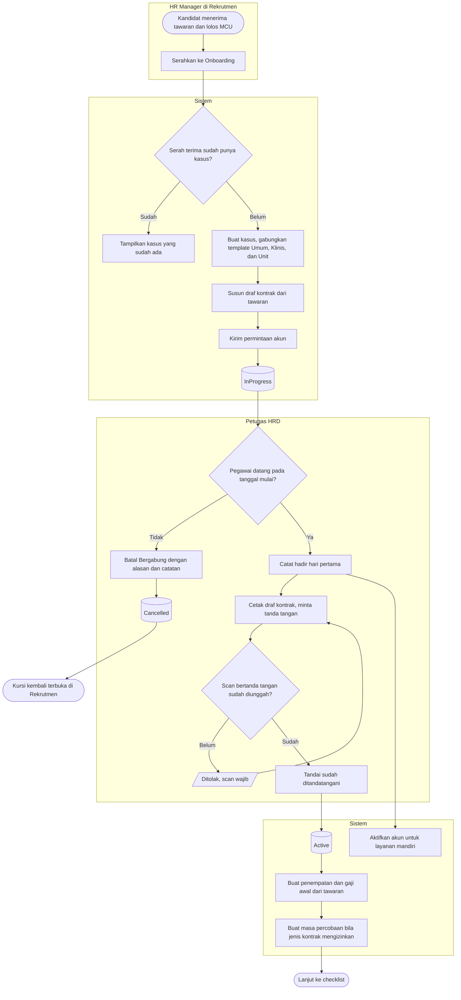
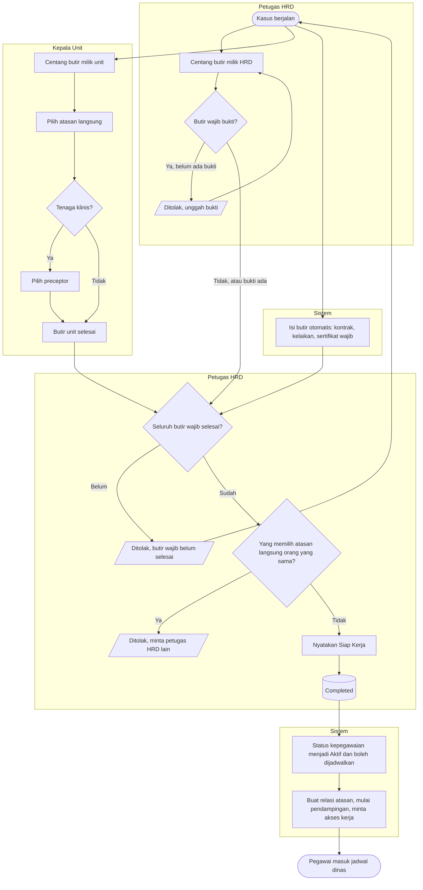

# Onboarding dan Siap Kerja

| Field | Value |
| --- | --- |
| Blueprint ID | `HRD-BP-001` |
| Jenis | Flowchart proses |
| Slice | `S-C4-ONB` onboarding dan kontrak kerja (sub-modul 05) |
| Status | `approved` — Pengguna (pemilik teknis dan produk, `HRD-DEC-015`), 2026-11-04, beserta kelima pilihan desain (`HRD-DEC-096`). Jawaban pemilik: "setujui semua ya dan kerjakan" |
| Kesiapan | `READY FOR DESIGN` |
| Keputusan | `HRD-DEC-081`, `HRD-DEC-083`, `HRD-DEC-084`, `HRD-DEC-086`, `HRD-DEC-088`, `HRD-DEC-095` |

---

## 1. Apa yang digambar

Perjalanan pegawai baru dari serah terima rekrutmen sampai dinyatakan siap kerja, atau sampai batal
bergabung. Status pada node keadaan sama persis dengan `contracts/state-transition-matrix.md`
bagian 13.1 s.d. 13.3 dan 13.9.

## 2. Diagram — dari serah terima sampai kontrak ditandatangani

## 3. Diagram — checklist sampai siap kerja

## 4. Tabel langkah

| Langkah | Pelaku | Masukan yang dibutuhkan | Keluaran | Bila gagal |
| --- | --- | --- | --- | --- |
| Serahkan ke Onboarding | HR Manager | Tawaran final diterima, kelaikan layak, jenis dan lama kontrak pada tawaran | Kasus `InProgress`, draf kontrak `Draft`, permintaan akun | Serah terima tidak berpindah; HR Manager melengkapi syarat yang ditampilkan lalu mengulang |
| Batal Bergabung | Petugas HRD | Pegawai belum tercatat hadir; alasan dan catatan | Kasus `Cancelled`, profil nonaktif, kursi terbuka lagi | Ditolak bila pegawai sudah hadir; keluarnya diproses sebagai pengunduran diri |
| Catat hadir hari pertama | Petugas HRD | Tanggal hari ini tidak sebelum tanggal mulai rencana | Butir hadir selesai; akun aktif untuk layanan mandiri | Ditolak bila sebelum tanggal mulai; bila akun gagal dibuat, HRD melengkapi email lalu menekan ulang di layar permintaan akses |
| Tandai kontrak sudah ditandatangani | Petugas HRD | Scan kontrak bertanda tangan | Kontrak `Active`; penempatan dan gaji awal; masa percobaan bila PKWTT | Ditolak tanpa scan; bila isi kontrak harus berubah, minta Recruiter merevisi tawaran |
| Centang butir HRD dan unit | Petugas HRD, Kepala Unit | Bukti untuk butir wajib bukti; orang terpilih untuk butir pemilihan | Butir `Completed` | Ditolak; petugas mengunggah bukti atau memilih orang lain yang sah |
| Nyatakan Siap Kerja | Petugas HRD | Seluruh butir wajib selesai; pemilih atasan langsung orang lain | Kasus `Completed`; status Aktif; relasi atasan; pendampingan berjalan; permintaan akses kerja | Ditolak; HRD menyelesaikan butir yang tersisa atau meminta rekan HRD menyatakan |

## 5. Contoh

Rina, perawat ICU, diserahkan ke onboarding pada 15 Januari 2027 dengan tawaran PKWT 12 bulan mulai
1 Februari 2027. Kasus terbentuk dengan 10 butir. Pada 1 Februari Dodi mencatat Rina hadir, akun Rina
aktif untuk layanan mandiri, dan kontrak ditandatangani lalu scan-nya diunggah. Sari memilih dirinya
sendiri sebagai atasan langsung dan Tono sebagai preceptor. Sertifikat BTCLS Rina terbaca otomatis.
Pada 4 Februari Dodi menekan Nyatakan Siap Kerja; Rina dapat dijadwalkan mulai 5 Februari dengan
penanda Didampingi.

## 6. Yang sengaja tidak ada di diagram ini

| Yang tidak digambar | Di mana ia digambar |
| --- | --- |
| Seleksi, tawaran, MCU | `rekrutmen-dan-seleksi.md` |
| Pendampingan sampai siap mandiri | `pendampingan-klinis.md` |
| Masa percobaan | `masa-percobaan.md` |
| Pemberian peran kerja oleh IT | Layar permintaan akses; bukan alur onboarding |

## 7. Traceability

| Bagian alur | Decision | Acceptance test |
| --- | --- | --- |
| Kasus otomatis dan batal bergabung | `HRD-DEC-083` | `AT-HRD-ONB-01` s.d. `AT-HRD-ONB-05` |
| Kontrak pertama | `HRD-DEC-084`, `HRD-DEC-095` | `AT-HRD-ONB-06` s.d. `AT-HRD-ONB-08` |
| Checklist | `HRD-DEC-086` | `AT-HRD-ONB-16` s.d. `AT-HRD-ONB-20` |
| Siap kerja dan akun | `HRD-DEC-088` | `AT-HRD-ONB-21` s.d. `AT-HRD-ONB-26` |
