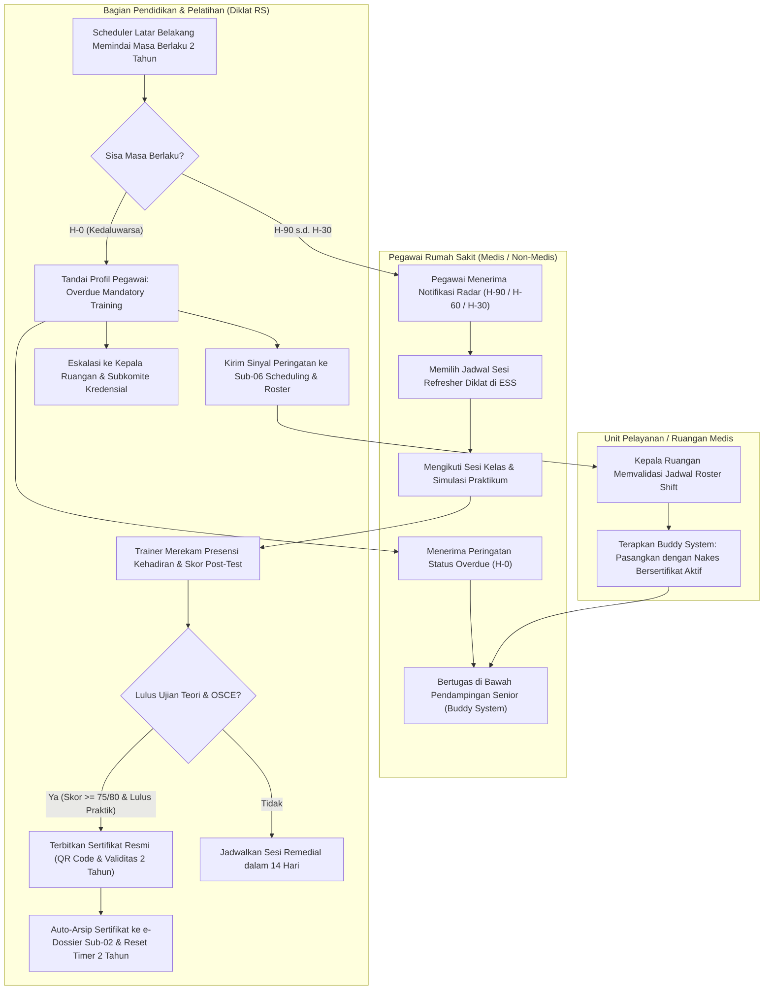
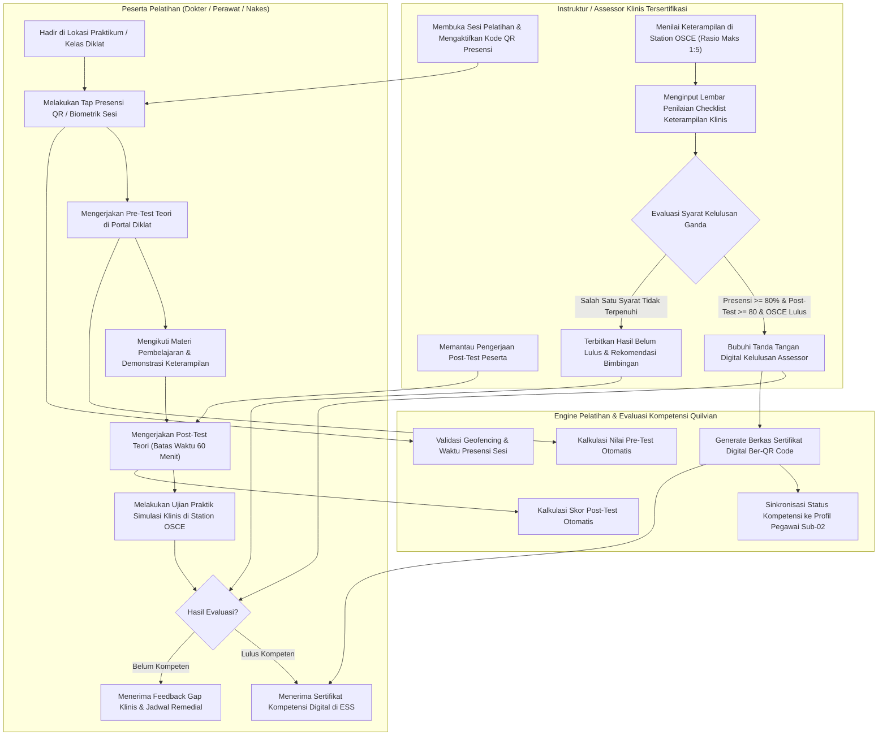
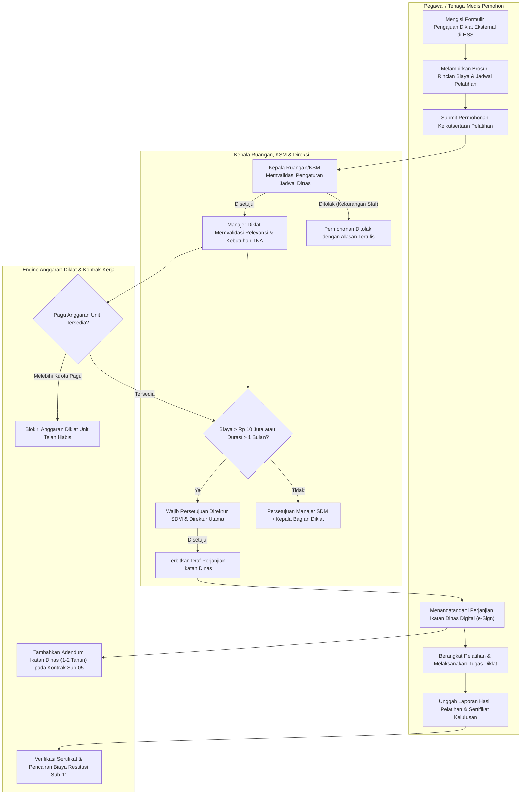
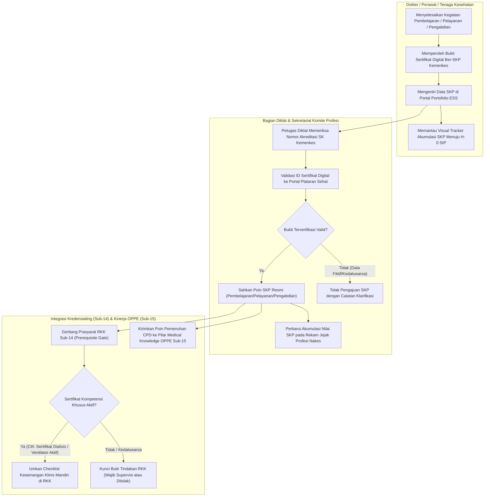

# Alur Proses Bisnis Sub-Modul 16: Learning, Training & Competency (`S-C2`)

Dokumen ini memodelkan diagram alur proses bisnis (*business flowcharts*) berbasis standar akreditasi KARS / STARKES 2024 (KPS 8 & KPS 8.1), Permenkes 13/2025, dan UU Kesehatan 17/2023 untuk **Sub-Modul 16: Learning, Training & Competency (Slice `S-C2`)**.

---

## 16.1 Siklus Pelatihan Wajib Akreditasi RS (2 Tahunan) & Radar Kedaluwarsa

Diagram ini memodelkan tata laksana 5 materi pelatihan wajib (BHD/BLS, PPI, Patient Safety/SKP, K3RS & Code Red, Komunikasi Efektif SBAR) untuk 100% pegawai rumah sakit dengan masa berlaku 2 tahun serta eskalasi status kerja saat kedaluwarsa.

### Tabel Langkah Proses 16.1

| No | Aktivitas / Langkah | Pelaku | Masukan (Input) | Keluaran (Output) | Penanganan Kendala / Jalur Gagal |
| :-: | :--- | :--- | :--- | :--- | :--- |
| 1 | Pemindaian Radar Kedaluwarsa H-90 s.d. H-30 | Background Worker | Tanggal berlaku sertifikat pelatihan wajib | Notifikasi reservasi sesi refresher diklat di portal ESS | Jika email gagal kirim, notifikasi dikirim via WhatsApp Gateway dan peringatan login ESS. |
| 2 | Pendaftaran Sesi Penyegaran (Refresher) | Pegawai RS | Pilihan jadwal sesi kelas Diklat internal | Konfirmasi pendaftaran peserta (*Enrollment Confirmed*) | Jika kuota kelas penuh, sistem otomatis merekomendasikan sesi kelas gelombang berikutnya. |
| 3 | Pengamanan Operasional H-0 Kedaluwarsa | Sistem & Diklat | Status sertifikat mencapai batas H-0 | Flag *Overdue Mandatory Training* aktif; alert ke Sub-06 & Kredensial | Nakes dilarang dinas mandiri, wajib didampingi nakes senior (*buddy system*) hingga remedial tuntas. |
| 4 | Pelaksanaan Ujian & Simulasi Praktik | Trainer Diklat | Lembar ujian post-test dan rubrik OSCE | Skor post-test dan penilaian keterampilan klinis | Jika peserta gagal ujian teori/praktik, wajib mengikuti remedial maksimal 2 kali dalam 14 hari kerja. |
| 5 | Penerbitan Sertifikat & Reset Timer | Sistem Diklat | Hasil asesmen lulus (skor >= 75/80) | Sertifikat digital ber-QR Code aktif 2 tahun, terarsip ke Sub-02 | Jika gagal arsip ke e-Dossier, instruksi sinkronisasi disimpan ke outbox retry bus. |

---

## 16.2 Pelaksanaan Sesi Diklat, Presensi & Evaluasi Kompetensi Klinis (OSCE)

Diagram ini memodelkan pemisahan tegas antara pencatatan kehadiran fisik/virtual dengan asesmen kelulusan keterampilan klinis langsung (*Objective Structured Clinical Examination* - OSCE).

### Tabel Langkah Proses 16.2

| No | Aktivitas / Langkah | Pelaku | Masukan (Input) | Keluaran (Output) | Penanganan Kendala / Jalur Gagal |
| :-: | :--- | :--- | :--- | :--- | :--- |
| 1 | Presensi Kehadiran Sesi Pelatihan | Peserta & Instruktur | Pemindaian QR Code sesi atau tap RFID biometrik | Catatan presensi valid di `TrxTrainingAttendance` | Jika kendala jaringan, instruktur dapat melakukan verifikasi presensi manual via portal admin. |
| 2 | Evaluasi Teori Post-Test | Peserta & Sistem | Jawaban post-test pilihan ganda / studi kasus | Skor post-test (skala 0-100) di `TrxTrainingAssessment` | Jika skor < 80 (klinis) atau < 75 (non-klinis), sistem membuka bank soal remedial 1 kali. |
| 3 | Ujian Simulasi Klinis OSCE | Assessor Klinis | Observasi simulasi tindakan (cth: RJP, pasang CVC) | Lembar rubrik penilaian checklist OSCE bertanda tangan | Assessor wajib tersertifikasi; rasio penguji terhadap peserta dibatasi maksimal 1:5 peserta. |
| 4 | Validasi Kelulusan Ganda | Sistem Engine Diklat | Data presensi + skor post-test + status kelulusan OSCE | Status kelulusan terverifikasi (`Passed` / `Failed`) | Jika presensi < 80% meskipun tes lulus, sertifikat ditahan hingga peserta menuntaskan jam pengganti. |
| 5 | Penerbitan Sertifikat & Integrasi Profil | Sistem Engine Diklat | Tanda tangan digital assessor & data peserta | Sertifikat digital PDF ber-QR Code publik | Data kompetensi aktif langsung memperbarui direktori keahlian pegawai di Sub-02. |

---

## 16.3 Pengajuan Pelatihan Eksternal, Kontrol Anggaran Diklat & Ikatan Dinas

Diagram ini memodelkan tata laksana permohonan pelatihan/fellowship eksternal berbayar, verifikasi pagu anggaran Diklat, dan penerbitan adendum ikatan dinas retensi kerja di Sub-05.

### Tabel Langkah Proses 16.3

| No | Aktivitas / Langkah | Pelaku | Masukan (Input) | Keluaran (Output) | Penanganan Kendala / Jalur Gagal |
| :-: | :--- | :--- | :--- | :--- | :--- |
| 1 | Pengajuan Pelatihan Eksternal via ESS | Pegawai Pemohon | Formulir permohonan, kurikulum diklat, dan RAB biaya | Berkas permohonan `TrxTrainingEnrollmentRequest` draf | Pengajuan wajib diajukan minimal H-14 sebelum tanggal mulai pelatihan eksternal. |
| 2 | Verifikasi Kesiapan Shift Ruangan | Kepala Ruangan / SMF | Data jadwal rotasi dinas dan ketersediaan nakes pengganti | Persetujuan izin dinas belajar atasan langsung | Jika ruangan kekurangan tenaga kritis, atasan dapat menolak atau meminta penggeseran gelombang. |
| 3 | Validasi Pagu Anggaran Diklat | Bagian Diklat & Keuangan | Estimasi biaya pendaftaran, transportasi, akomodasi | Pengecekan saldo anggaran di `TrxTrainingBudget` | Jika pagu habis, permohonan ditolak kecuali ada memo persetujuan penambahan anggaran dari Direksi. |
| 4 | Penerbitan Perjanjian Ikatan Dinas | Sistem & HR Legal | Biaya > Rp 10 Juta atau durasi meninggalkan dinas > 1 bulan | Surat Perjanjian Ikatan Dinas ber-eSign (retensi 1-2 tahun) | Pegawai wajib menandatangani perjanjian sebelum surat tugas resmi diterbitkan. |
| 5 | Pelaporan Hasil & Reimbursement | Pegawai & Bagian Diklat | Laporan resume pelatihan, kuitansi biaya, dan sertifikat | Verifikasi kelulusan & instruksi transfer pencairan | Jika pegawai tidak lulus atau tidak menyerahkan laporan, klaim biaya dibatalkan. |

---

## 16.4 Pelacakan Akumulasi SKP Plataran Sehat Kemenkes & Prasyarat Kredensialing RKK

Diagram ini memodelkan pencatatan perolehan Satuan Kredit Profesi (SKP) Kemenkes terintegrasi platform Plataran Sehat dan validasi prasyarat kompetensi pada kredensialing Sub-14.

### Tabel Langkah Proses 16.4

| No | Aktivitas / Langkah | Pelaku | Masukan (Input) | Keluaran (Output) | Penanganan Kendala / Jalur Gagal |
| :-: | :--- | :--- | :--- | :--- | :--- |
| 1 | Entri Data SKP Kegiatan Profesi | Tenaga Medis | Nomor SK Kemenkes, tanggal kegiatan, perolehan SKP | Draf klaim perolehan SKP di portal tenaga medis | Data pendukung sertifikat digital wajib diunggah dalam format PDF/JPG resolusi jelas. |
| 2 | Verifikasi Sertifikat Plataran Sehat | Staf Diklat | ID verifikasi sertifikat portal Plataran Sehat Kemenkes | Status sertifikat terverifikasi sah (*Verified*) | Jika nomor akreditasi tidak terdaftar di Kemenkes, verifikator mengembalikan berkas ke nakes. |
| 3 | Pemutakhiran Tracker Akumulasi SKP | Sistem Diklat | Poin SKP terverifikasi berdasarkan 3 ranah resmi | Visual progress bar pemenuhan target SKP 5 tahun | Memberikan alert peringatan pada H-180 dan H-90 perpanjangan SIP jika akumulasi SKP masih kurang. |
| 4 | Validasi Prasyarat RKK Sub-14 | Service Gate `INT-HR-77`| Permohonan butir tindakan klinis spesifik di Sub-14 | Keputusan validasi prasyarat kompetensi (`Eligible` / `Locked`) | Jika sertifikat prasyarat tidak ditemukan atau expired, butir RKK otomatis terkunci pada opsi supervisi. |
| 5 | Sinkronisasi Mutu Klinis OPPE Sub-15 | Service Query `INT-HR-78`| Data kelulusan diklat dan jam pembelajaran nakes | Pemenuhan skor pilar *Medical Knowledge* OPPE | Berkontribusi langsung pada komponen kualitatif penilaian kinerja profesional dokter dan perawat. |
