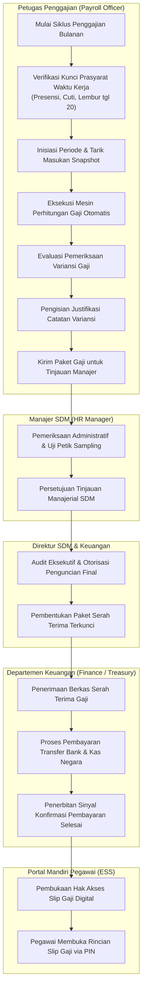
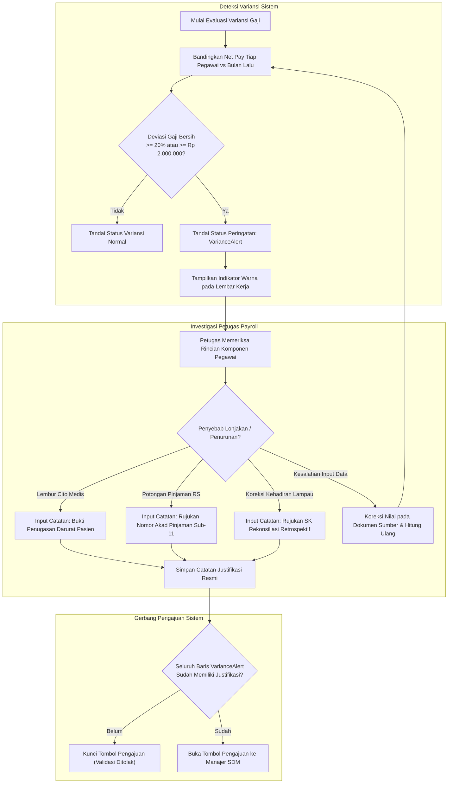
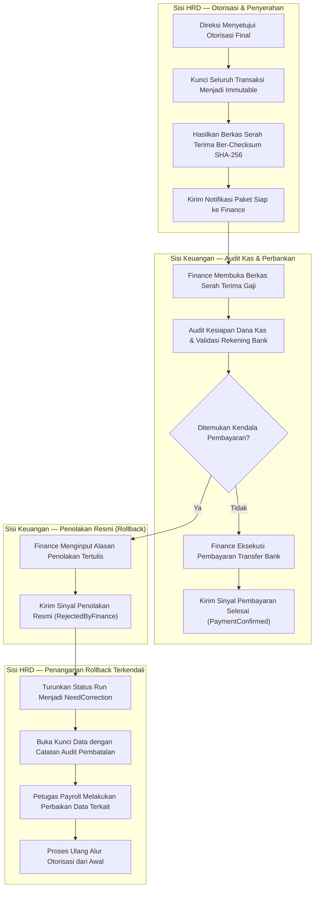
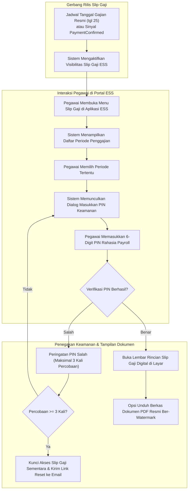

# Alur Proses Bisnis — Pemrosesan & Serah Terima Penggajian (Payroll Processing & Finance Handoff)

Dokumen ini memetakan alur kerja operasional siklus penggajian bulanan staf rumah sakit pada **Sub-Modul 10 (Payroll Management — Slice `S-B5`)**. Alur proses dirancang untuk menjamin akurasi mutlak perhitungan finansial, pemisahan wewenang bertingkat (*3-Tier Segregation of Duties*), deteksi proaktif variansi gaji anomali, kepatuhan perpajakan PMK 168/2023 dan BPJS, perlindungan batas wewenang serah terima ke Departemen Keuangan (*Finance Handoff* sesuai `HRD-DEC-009` & `HRD-DEC-126`), serta kerahasiaan slip gaji digital mandiri pegawai (*ESS Payslip Security* sesuai `HRD-DEC-127`).

---

## 1. Alur Pokok Siklus Penggajian Bulanan Rumah Sakit (Happy Path)

Diagram ini menggambarkan alur kerja standar penggajian dari inisiasi periode hingga penyerahan berkas final ke Keuangan dan penerbitan slip gaji.

### Tabel Langkah: Alur Pokok Penggajian Bulanan

| No | Langkah Kerja | Pelaku (Aktor) | Masukan (Input) | Keluaran (Output) | Penanganan Bila Gagal / Terkendala |
| :---: | :--- | :--- | :--- | :--- | :--- |
| **1** | Verifikasi Kunci Prasyarat | Petugas Payroll | Parameter periode bulan berjalan | Konfirmasi status penutupan Sub-07, 08, 09 | Jika masih ada SPKL lembur atau cuti berstatus *Pending*, proses kalkulasi diblokir (`HRD-DEC-122`); petugas menghubungi kepala unit terkait |
| **2** | Inisiasi & Snapshot Masukan | Petugas Payroll | Daftar master pegawai aktif & penugasan gaji | Snapshot masukan kehadiran, lembur, dan cuti | Jika data master pegawai tidak valid (misal PTKP belum terdaftar), sistem menandai baris pegawai untuk dilengkapi |
| **3** | Eksekusi Mesin Perhitungan | Sistem Payroll | Snapshot masukan & formula tarif | Draf rincian pendapatan, potongan pajak, BPJS & gaji bersih | Jika terjadi kegagalan kalkulasi formula, proses di-rollback ke status Draf dan mencatat log teknis |
| **4** | Tinjauan Variansi Anomali | Petugas Payroll | Draf gaji vs riwayat bulan sebelumnya | Daftar pegawai bertanda *VarianceAlert* ($\ge 20\%$) | Petugas wajib menelusuri sumber lonjakan/penurunan gaji dan mengisi catatan justifikasi resmi |
| **5** | Pengajuan Tinjauan Manajer | Petugas Payroll | Draf gaji lengkap berjustifikasi | Status paket berubah menjadi Menunggu Tinjauan HR | Ditolak oleh sistem jika masih ada baris variansi anomali tanpa catatan penjelasan |
| **6** | Persetujuan Manajerial SDM | Manajer SDM | Draf gaji, catatan variansi, laporan rekap | Persetujuan administratif manajer | Manajer dapat mengembalikan paket ke Petugas Payroll dengan catatan perbaikan (*Request Revision*) |
| **7** | Otorisasi Final Direksi | Direktur SDM / Keuangan | Ringkasan eksekutif beban gaji rumah sakit | Otorisasi penguncian permanen (*Final Lock*) | Dilarang merangkap persetujuan (*anti-self-approval*); jika Direktur berhalangan, dialihkan ke pejabat wewenang pengganti |
| **8** | Pembentukan Serah Terima | Sistem Payroll | Draf gaji final terkunci | Paket berkas serah terima ber-checksum SHA-256 | Berkas tersimpan immutable dan notifikasi otomatis dikirimkan ke Departemen Keuangan |
| **9** | Transfer Bank & Konfirmasi | Finance / Kasir | Paket serah terima gaji HR | Bukti transfer bank & sinyal konfirmasi selesai | Jika ada kendala likuiditas kas, Finance menjalankan protokol penolakan batch resmi (`HRD-DEC-126`) |
| **10** | Pembukaan Slip Gaji ESS | Portal Pegawai ESS | Sinyal konfirmasi bayar / tgl gajian | Tampilan slip gaji digital berproteksi PIN | Slip gaji tetap terkunci hingga status pembayaran terkonfirmasi atau jadwal rilis tercapai |

---

## 2. Alur Pemeriksaan & Justifikasi Variansi Anomali Gaji

Diagram ini menggambarkan alur pengendalian kualitas otomatis untuk memitigasi risiko kesalahan bayar (*overpayment/underpayment*) sebelum diajukan ke atasan.

### Tabel Langkah: Pemeriksaan & Justifikasi Variansi

| No | Langkah Kerja | Pelaku (Aktor) | Masukan (Input) | Keluaran (Output) | Tindakan Bila Gagal / Terkendala |
| :---: | :--- | :--- | :--- | :--- | :--- |
| **1** | Deteksi Variansi Komparatif | Sistem Payroll | Nilai gaji bersih periode ini & bulan lalu | Persentase selisih & selisih nominal | Jika pegawai baru (belum ada riwayat bulan lalu), sistem menggunakan batas komparasi terhadap standar gaji penugasan |
| **2** | Pemberian Label Peringatan | Sistem Payroll | Nilai deviasi $\ge 20\%$ atau $\ge$ Rp 2 jt | Label `VarianceAlert` & penanda visual kuning/merah | Pegawai bersangkutan masuk dalam filter antrean prioritas investigasi |
| **3** | Pemeriksaan Akar Masalah | Petugas Payroll | Rincian lembar kerja komponen gaji | Identifikasi penyebab lonjakan/penurunan | Petugas mencocokkan riwayat lembur cito, mutasi cuti, atau pemotongan kasbon |
| **4** | Pengisian Catatan Formal | Petugas Payroll | Alasan operasional & nomor dokumen bukti | Catatan justifikasi tersimpan pada riwayat audit | Karakter catatan minimal 15 karakter dan dilarang mengisi teks tidak bermakna (*generic text*) |
| **5** | Validasi Gerbang Pengajuan | Sistem Payroll | Status justifikasi seluruh baris anomali | Status kelayakan kirim paket gaji | Jika masih ada baris variansi tanpa justifikasi, pengajuan diblokir dengan pesan error eksplisit |

---

## 3. Alur Serah Terima ke Keuangan & Penolakan/Rollback Terkendali

Diagram ini mengatur interaksi resmi antara sistem HR dan Departemen Keuangan (*Finance*) sesuai batas tanggung jawab `HRD-DEC-009` dan `HRD-DEC-126`.

### Tabel Langkah: Serah Terima & Rollback Keuangan

| No | Langkah Kerja | Pelaku (Aktor) | Masukan (Input) | Keluaran (Output) | Tindakan Bila Gagal / Terkendala |
| :---: | :--- | :--- | :--- | :--- | :--- |
| **1** | Pembekuan Berkas Serah Terima | Sistem HR | Draf gaji final disetujui Direksi | Paket serah terima terenkripsi ber-checksum SHA-256 | Kegagalan pembuatan berkas memicu peringatan sistem dan data tetap terkunci di status Final |
| **2** | Audit Rekening & Likuiditas | Petugas Finance | Paket data transfer bank pegawai | Hasil verifikasi kliring & ketersediaan dana kas | Petugas Finance memvalidasi format nomor rekening tujuan bank mitra RS |
| **3** | Eksekusi Transfer Pembayaran | Departemen Finance | Berkas pembayaran gaji | Bukti transfer bank & pembayaran pajak kas negara | Menjadi tanggung jawab penuh Departemen Keuangan di luar sistem HR (`HRD-DEC-009`) |
| **4** | Konfirmasi Selesai Bayar | Departemen Finance | Nomor referensi transaksi perbankan | Status `PaymentConfirmed` pada sistem HR | Sistem HR membuka izin rilis slip gaji digital mandiri pegawai |
| **5** | Penolakan Batch Terkendali | Petugas Finance | Pilihan alasan & catatan tertulis kendala | Sinyal penolakan resmi `RejectedByFinance` | Wajib menyertakan alasan tertulis spesifik (misal: "Rekening 5 perawat tidak aktif" atau "Likuiditas dibagi 2 termin") |
| **6** | Pembukaan Kunci & Perbaikan | Petugas Payroll | Catatan penolakan dari Finance | Pembukaan status data & pencatatan jejak audit | Petugas memperbaiki nomor rekening atau mengalihkan pembayaran ke kasbon sementara |

---

## 4. Alur Akses Aman Slip Gaji Digital Mandiri (ESS) Ber-PIN

Diagram ini menggambarkan alur pegawai mengakses dokumen slip gaji pribadi dengan proteksi kerahasiaan berlapis (`HRD-DEC-127`).

### Tabel Langkah: Akses Aman Slip Gaji Digital ESS

| No | Langkah Kerja | Pelaku (Aktor) | Masukan (Input) | Keluaran (Output) | Tindakan Bila Gagal / Terkendala |
| :---: | :--- | :--- | :--- | :--- | :--- |
| **1** | Evaluasi Gerbang Rilis | Sistem HR ESS | Tanggal sistem & status pembayaran run | Status ketersediaan dokumen (*Available/Locked*) | Jika Finance belum konfirmasi dan belum tanggal 25, tombol rincian slip gaji berstatus *Terkunci Sementara* |
| **2** | Pemilihan Periode Penggajian | Pegawai RS | Akun login aktif & daftar riwayat bulan | Permintaan buka dokumen slip gaji periode terpilih | Pegawai hanya dapat melihat data penggajian atas NIK miliknya sendiri |
| **3** | Permintaan Verifikasi PIN | Sistem HR ESS | Dialog modal sekunder | Input 6-digit angka PIN rahasia | Jika pegawai belum pernah membuat PIN, sistem mengarahkan ke formulir aktivasi PIN perdana |
| **4** | Validasi Autentikasi Sekunder | Sistem Keamanan ESS | Hash PIN tersimpan & PIN yang diinput | Status otorisasi pembacaan dokumen | Percobaan salah 3 kali berturut-turut memicu penguncian akun slip gaji selama 30 menit demi keamanan |
| **5** | Tampilan Rincian Gaji | Layar ESS Pegawai | Data terenkripsi komponen gaji | Tampilan visual pendapatan tetap, variabel, dan potongan | Layar dilengkapi tombol sembunyikan nominal (*toggle visibility*) untuk privasi di nurse station |
| **6** | Unduh Dokumen PDF Resmi | Pegawai RS | Tombol aksi cetak / unduh PDF | File PDF slip gaji ber-password & watermark resmi | PDF dilindungi kata sandi kombinasi tanggal lahir pegawai dan NIK |
