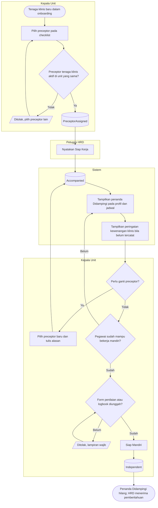

# Pendampingan Klinis

| Field | Value |
| --- | --- |
| Blueprint ID | `HRD-BP-001` |
| Jenis | Flowchart proses |
| Slice | `S-C4-ONB` onboarding dan kontrak kerja (sub-modul 05) |
| Status | `approved` — Pengguna (pemilik teknis dan produk, `HRD-DEC-015`), 2026-11-04, beserta kelima pilihan desain (`HRD-DEC-096`). Jawaban pemilik: "setujui semua ya dan kerjakan" |
| Kesiapan | `READY FOR DESIGN` |
| Keputusan | `HRD-DEC-087`; batas kredensial mengikuti `HRD-DEC-005` (`draft`) |

---

## 1. Apa yang digambar

Pendampingan tenaga klinis baru oleh preceptor, dari preceptor ditetapkan sampai Kepala Unit
menyatakan siap mandiri. Pendampingan **bukan** masa percobaan dan berlaku apa pun jenis kontraknya.
Status pada node keadaan sama persis dengan `contracts/state-transition-matrix.md` bagian 13.7.

## 2. Diagram

## 3. Tabel langkah

| Langkah | Pelaku | Masukan yang dibutuhkan | Keluaran | Bila gagal |
| --- | --- | --- | --- | --- |
| Pilih preceptor | Kepala Unit | Tenaga klinis aktif di unit yang sama yang sudah bekerja mandiri | Pendampingan `PreceptorAssigned` | Ditolak; Kepala Unit memilih orang lain |
| Pendampingan dimulai | Sistem | Pegawai dinyatakan siap kerja | `Accompanied`; penanda Didampingi pada jadwal | — |
| Ganti preceptor | Kepala Unit | Preceptor baru yang sah dan alasan | Riwayat preceptor bertambah satu baris | Ditolak; Kepala Unit melengkapi alasan atau memilih orang lain |
| Siap Mandiri | Kepala Unit | Form penilaian kompetensi atau logbook | `Independent` | Ditolak tanpa lampiran; Kepala Unit mengunggahnya lalu mengulang |

## 4. Contoh

Sari, Kepala Ruangan ICU, memilih Tono sebagai preceptor Rina. Sejak 5 Februari 2027 jadwal ICU
menampilkan "Rina — Didampingi Tono". Karena data SPK/RKK belum tersedia, profil Rina juga menampilkan
peringatan kewenangan klinis, tetapi Rina tetap dapat dijadwalkan. Pada 15 Maret 2027 Sari
mengunggah logbook dan menekan Siap Mandiri.

## 5. Yang sengaja tidak ada di diagram ini

| Yang tidak digambar | Alasan |
| --- | --- |
| Persetujuan HRD atas Siap Mandiri | Bukan wewenang HRD (`HRD-DEC-087` `CLINICAL_DECISION_NOT_HRD`) |
| Aturan menjadwalkan pegawai bersama preceptornya | Milik Penjadwalan 06 |
| Blokir karena kewenangan klinis | Menunggu Komite Medik/Keperawatan (`HRD-DEC-005`) |

## 6. Traceability

| Bagian alur | Decision | Acceptance test |
| --- | --- | --- |
| Preceptor sebelum siap kerja | `HRD-DEC-087` butir 2 | `AT-HRD-ONB-21` |
| Penanda dan peringatan | `HRD-DEC-087` butir 4 dan 7 | `AT-HRD-ONB-28` |
| Siap Mandiri | `HRD-DEC-087` butir 5 dan 6 | `AT-HRD-ONB-27`, `AT-HRD-ONB-28` |
