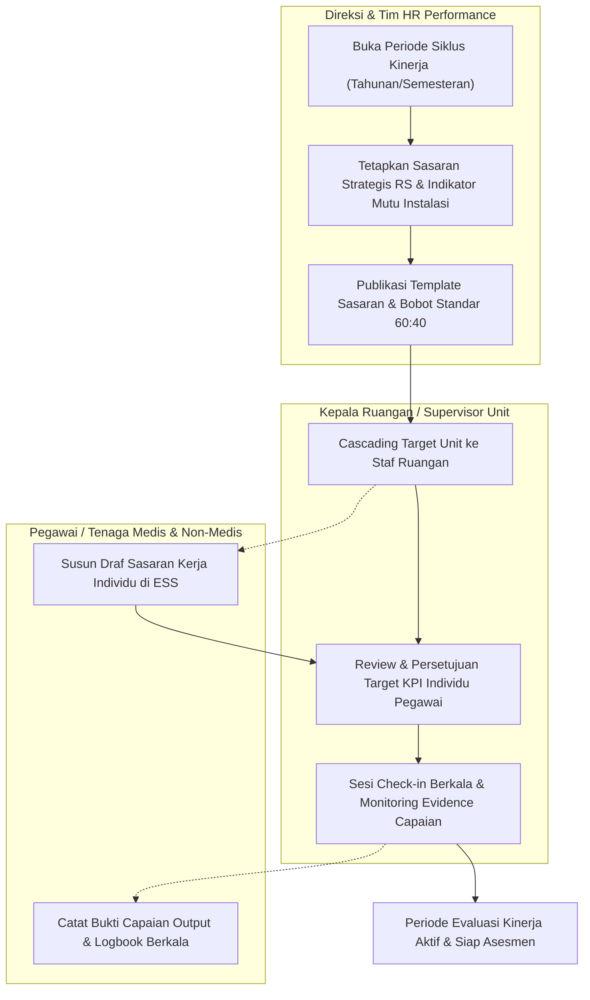
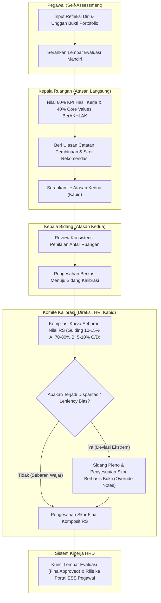
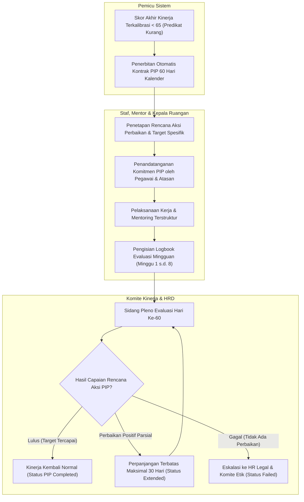
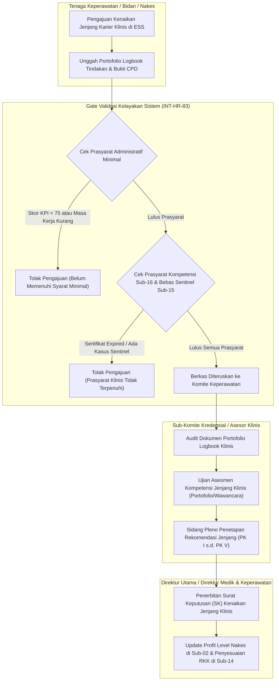
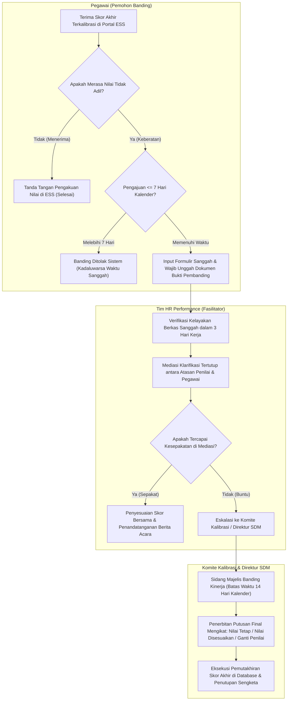

# Alur Proses Bisnis Sub-Modul 17: Performance Management & Clinical Career (`S-C3`)

Dokumen ini memodelkan diagram alur proses bisnis (*business flowcharts*) berbasis standar tata kelola kinerja rumah sakit, PermenPAN-RB 6/2022, Permenkes 40/2017 (Jenjang Karir Profesional Perawat Klinis), dan regulasi KARS untuk **Sub-Modul 17: Performance Management & Clinical Career (Slice `S-C3`)**.

---

## 17.1 Siklus Evaluasi Kinerja & Cascading KPI Tahunan Rumah Sakit

Diagram ini menggambarkan alur pembukaan siklus evaluasi kerja tahunan/semesteran, cascading target sasaran strategis rumah sakit dan instalasi ke sasaran kerja individu, serta pencatatan check-in berkala.

### Tabel Langkah 17.1: Penetapan Sasaran Kerja & Cascading KPI
| No | Langkah Kegiatan | Pelaku | Masukan (Input) | Keluaran (Output) | Penanganan Kendala / Gagal |
| :---: | :--- | :--- | :--- | :--- | :--- |
| 1 | Buka Periode Siklus Kinerja | HR Performance | Kalender kerja RS, parameter tahun evaluasi | Siklus berstatus `Active` | Jika periode tahun sebelumnya belum ditutup, sistem menolak pembukaan siklus baru (`VR-PRF-01`). |
| 2 | Cascading Target Unit ke Staf | Kepala Ruangan | Sasaran mutu unit, uraian tugas jabatan | Draf target KPI per pegawai | Jika target tidak selaras dengan KPI instalasi, sistem menandai peringatan inkonsistensi. |
| 3 | Penyusunan Sasaran Individu | Pegawai | Template target jabatan di ESS | Draf sasaran kerja individu | Pegawai wajib mengentri minimal 3 dan maksimal 8 butir target KPI spesifik (`VR-PRF-02`). |
| 4 | Persetujuan Target KPI | Kepala Ruangan | Draf sasaran kerja staf | Sasaran kerja status `Locked` | Atasan dapat mengembalikan draf jika target terlalu rendah atau tidak terukur. |
| 5 | Check-in Berkala & Evidence | Pegawai & Karu | Logbook harian, laporan bulanan unit | Catatan pembinaan berkala | Check-in dicatat minimal 1 kali per semester guna mencegah kejutan penilaian di akhir tahun. |

---

## 17.2 Penilaian Berjenjang & Sidang Pleno Kalibrasi Manajemen

Diagram ini memodelkan alur evaluasi akhir komposit 60% KPI + 40% Perilaku Core Values BerAKHLAK, penilaian berjenjang (Self-assessment -> Karu -> Kabid), dan sidang pleno kalibrasi manajemen dengan pedoman distribusi fleksibel.

### Tabel Langkah 17.2: Penilaian Berjenjang & Sidang Kalibrasi
| No | Langkah Kegiatan | Pelaku | Masukan (Input) | Keluaran (Output) | Penanganan Kendala / Gagal |
| :---: | :--- | :--- | :--- | :--- | :--- |
| 1 | Pengisian Self-Assessment | Pegawai | Lembar evaluasi di ESS, evidence capaian | Berkas status `SelfSubmitted` | Pegawai wajib mengisi refleksi diri sebelum tanggal batas waktu siklus mandiri berakhir. |
| 2 | Penilaian Atasan Langsung | Kepala Ruangan | Nilai self-assessment, log kehadiran, SOP | Lembar evaluasi status `ManagerAssessed` | Karu wajib memberi skor pada seluruh butir KPI dan perilaku Core Values (`VR-PRF-03`). |
| 3 | Review Atasan Kedua | Kepala Bidang | Rapor seluruh ruangan di bawah bidangnya | Berkas status `SecondLineReviewed` | Kabid dapat mengembalikan berkas ke Karu jika ditemukan ketidaksesuaian objektif. |
| 4 | Sidang Pleno Kalibrasi | Komite Kalibrasi | Matriks sebaran nilai seluruh instalasi | Risalah kalibrasi & skor disahkan | Penyesuaian skor wajib mencantumkan alasan tertulis resmi (*override notes*, `VR-PRF-05`). |
| 5 | Publikasi Skor Akhir | HR Performance | Berkas terkalibrasi | Skor rilis ke ESS pegawai | Pengumuman nilai membuka jendela masa sanggah banding selama 7 hari kalender (`VR-PRF-12`). |

---

## 17.3 Alur Program Peningkatan Kinerja (*Performance Improvement Plan* - PIP) 60 Hari

Diagram ini memodelkan pembinaan terstruktur bagi staf yang memperoleh skor kinerja berpredikat "Kurang" (skor < 65) selama 60 hari kalender, pendampingan mentor, evaluasi mingguan, dan 3 keputusan akhir.

### Tabel Langkah 17.3: Tata Kelola Program Peningkatan Kinerja (PIP)
| No | Langkah Kegiatan | Pelaku | Masukan (Input) | Keluaran (Output) | Penanganan Kendala / Gagal |
| :---: | :--- | :--- | :--- | :--- | :--- |
| 1 | Pemicu Otomatis PIP | Sistem HRD | Skor komposit akhir < 65.00 | Draf kontrak PIP terbit otomatis | Sistem membekukan hak pengajuan mutasi/promosi selama staf berstatus PIP aktif (`VR-PRF-08`). |
| 2 | Penandatanganan Kontrak PIP | Staf & Karu | Form sasaran perbaikan, penunjukan mentor | Kontrak PIP status `Active` | Staf menolak tanda tangan: atasan mencatat berita acara pembangkangan ke HR Legal. |
| 3 | Logbook Mentoring Mingguan | Mentor & Karu | Laporan observasi harian kinerja staf | 8 Catatan mingguan terverifikasi | Peringatan otomatis dikirimkan jika catatan mingguan tidak diisi dalam 7 hari (`VR-PRF-09`). |
| 4 | Sidang Putusan PIP | Komite Kinerja | Rekapitulasi 8 logbook mingguan | Putusan: Lulus, Perpanjang, atau Gagal | Perpanjangan hanya diizinkan tepat 1 kali maksimal 30 hari kalender (`VR-PRF-10`). |
| 5 | Tindak Lanjut Gagal PIP | HR Legal | Putusan sidang berstatus `Failed` | Rekomendasi mutasi, demosi, atau evaluasi kontrak | Penanganan dialihkan ke prosedur hubungan industrial Sub-Modul 19 sesuai UU Ketenagakerjaan. |

---

## 17.4 Evaluasi Kenaikan Jenjang Karier Klinis Nakes (*Clinical Ladder* PK I - PK V)

Diagram ini menggambarkan pemisahan skor kinerja umum dengan kelayakan kenaikan jenjang karier klinis perawat/nakes, verifikasi logbook tindakan klinis, kompetensi Sub-16, dan rekomendasi Komite Keperawatan.

### Tabel Langkah 17.4: Evaluasi Kenaikan Jenjang Karier Klinis
| No | Langkah Kegiatan | Pelaku | Masukan (Input) | Keluaran (Output) | Penanganan Kendala / Gagal |
| :---: | :--- | :--- | :--- | :--- | :--- |
| 1 | Pengajuan Kenaikan Jenjang | Nakes | Formulir ESS, logbook kasus mandiri | Draf permohonan jenjang klinis | Pengajuan terkunci jika masa kerja pada jenjang berjalan belum mencukupi standar regulasi. |
| 2 | Verifikasi Prasyarat Sistem | Service Gate | Skor kinerja tahunan, data Sub-15/16 | Status `EligibilityVerified` | Sistem menolak jika skor kinerja tahunan < 75 atau sertifikat kompetensi mati (`VR-PRF-14`). |
| 3 | Asesmen Portofolio Komite | Asesor Klinis | Logbook tindakan klinis, bukti kredensial | Skor rubrik kompetensi jenjang | Jika logbook tindakan mandiri kurang dari kuota minimal, nakes diminta melengkapi kasus. |
| 4 | Sidang Rekomendasi Komite | Komite Nakes | Berita acara asesmen klinis | Surat rekomendasi kenaikan jenjang | Komite berwenang merekomendasikan kenaikan, penundaan 6 bulan, atau retensi jenjang. |
| 5 | Penetapan SK & Sinkronisasi | Direktur Utama | Rekomendasi komite | SK Penetapan Jenjang Klinis Baru | Sistem otomatis menyinkronkan jenjang baru ke profil Sub-02 dan kewenangan RKK di Sub-14 (`INT-HR-83`). |

---

## 17.5 Alur Pengajuan Banding / Sanggah Nilai Kinerja Pegawai (*Appraisal Dispute*)

Diagram ini memodelkan prosedur hak sanggah bagi pegawai yang tidak menyetujui hasil evaluasi kinerja pasca kalibrasi, batas waktu pengajuan 7 hari, mediasi HR Performance, dan putusan final Komite dalam 14 hari kalender.

### Tabel Langkah 17.5: Prosedur Banding Sanggah Nilai Kinerja
| No | Langkah Kegiatan | Pelaku | Masukan (Input) | Keluaran (Output) | Penanganan Kendala / Gagal |
| :---: | :--- | :--- | :--- | :--- | :--- |
| 1 | Pengajuan Sanggah Banding | Pegawai | Form sanggah di ESS, berkas bukti capaian | Berkas sanggah status `DisputeSubmitted` | Pengajuan ditolak seketika oleh sistem jika diajukan > 7 hari kalender pasca rilis nilai (`VR-PRF-12`). |
| 2 | Verifikasi Dokumen Bukti | HR Performance | Bukti logbook / dokumen pembanding | Status `DisputeUnderReview` | Sanggahan ditolak jika pemohon tidak melampirkan berkas bukti pembanding konkret. |
| 3 | Mediasi Tertutup | HR, Karu, Staf | Berita acara klarifikasi | Notulen kesepakatan mediasi | Jika penilai mengakui kekhilafan data, skor langsung direvisi dengan persetujuan HRD. |
| 4 | Sidang Majelis Banding | Komite Kalibrasi | Berkas sengketa yang belum selesai | Putusan final banding terbit | Komite wajib memutus perkara maksimal dalam 14 hari kalender sejak eskalasi (`VR-PRF-13`). |
| 5 | Eksekusi Pemutakhiran | Sistem HRD | Putusan final Direktur SDM | Skor final terkoreksi & log audit permanen | Putusan final bersifat mengikat dan menutup kesempatan banding lanjutan pada siklus yang sama. |
