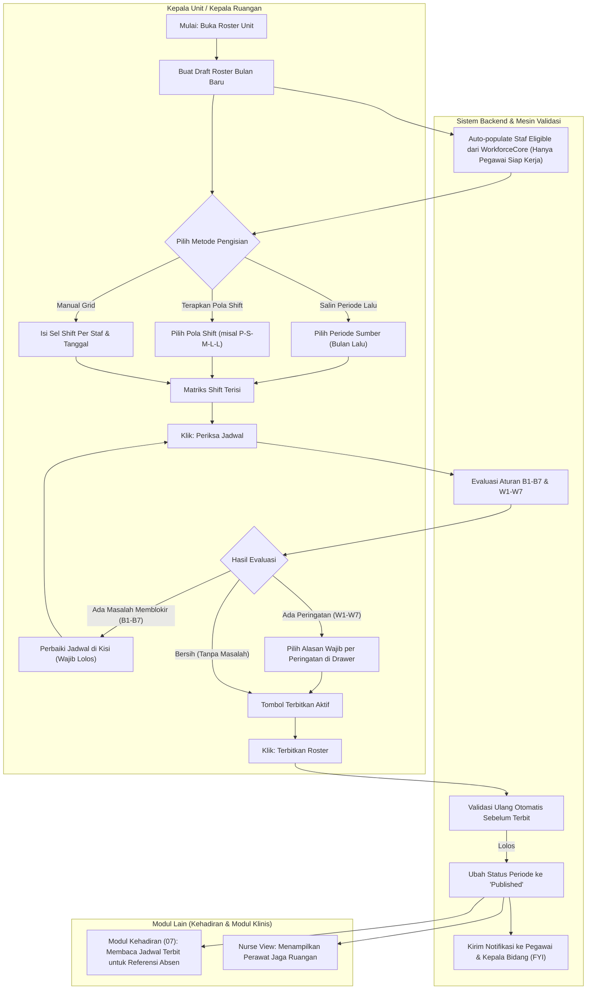
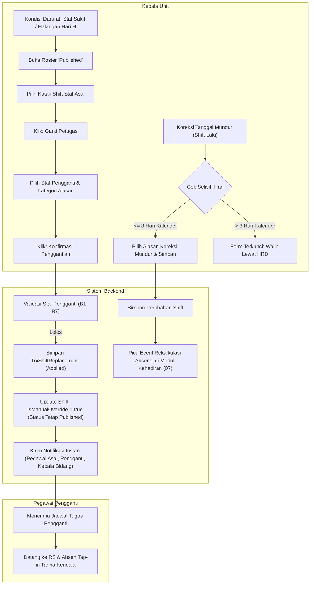
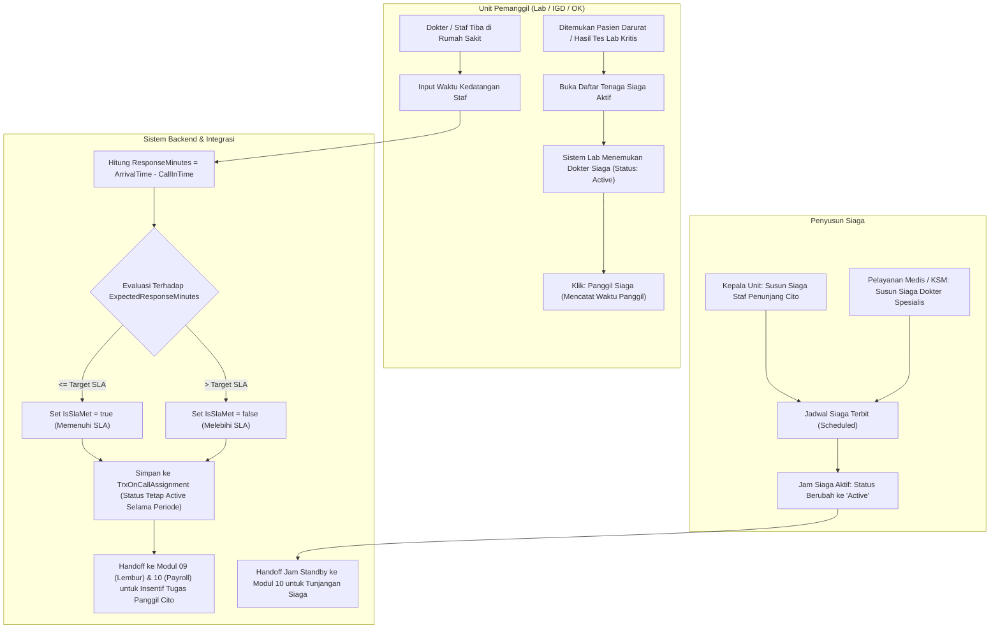
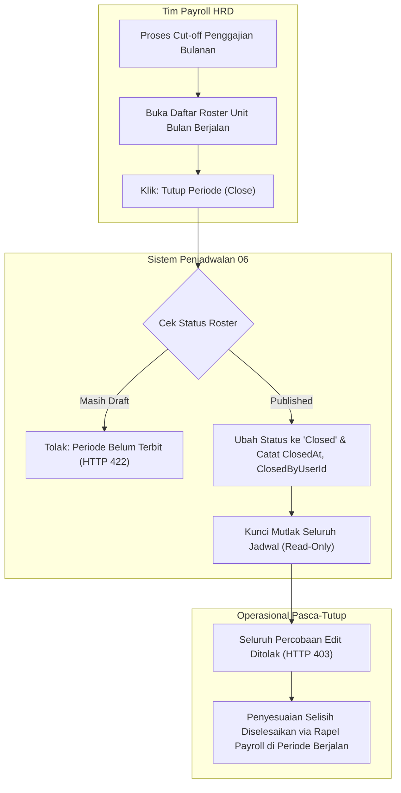

# Penjadwalan Kerja, Roster, dan On-Call

| Field | Value |
| --- | --- |
| Blueprint ID | `HRD-BP-001` |
| Jenis | Flowchart proses bisnis |
| Slice | `S-B4` — Penjadwalan, Roster, dan On-Call |
| Status | `draft` — Sesuai keputusan `HRD-DEC-097` s.d. `HRD-DEC-103` |
| Tanggal | 2026-11-04 |

---

## 1. Alur 1: Penyusunan & Penerbitan Roster Bulanan Unit (`HRD-DEC-097`, `HRD-DEC-098`, `HRD-DEC-099`, `HRD-DEC-100`)

### Tabel Langkah Proses 1: Penyusunan & Penerbitan Roster

| No | Pelaku | Tindakan / Langkah | Masukan | Keluaran | Bila Gagal / Terjadi Masalah |
| :---: | --- | --- | --- | --- | --- |
| 1 | Kepala Unit | Membuat draft periode roster unit | Unit kerja dan bulan target | Draft roster berstatus `Draft`, staf terisi otomatis | Ditolak bila unit bukan unit kerja bergiliran (`HRD-DEC-097`) |
| 2 | Kepala Unit | Memilih metode pengisian cepat | Pilihan salin periode atau terapkan pola | Ratusan sel shift terisi otomatis dalam hitungan detik | Kepala unit dapat mengedit sel individual bila ada pengecualian |
| 3 | Kepala Unit | Menekan **Periksa Jadwal** | Matriks shift draft | Daftar error memblokir (`B1`–`B7`) dan peringatan (`W1`–`W7`) | Error memblokir (merah) wajib diperbaiki di kisi tabel |
| 4 | Kepala Unit | Memilih alasan peringatan | Dropdown alasan di drawer | Seluruh peringatan memiliki alasan terkonfirmasi | Tombol Terbitkan tetap terkunci bila ada alasan belum dipilih |
| 5 | Kepala Unit | Menekan **Terbitkan Roster** | Konfirmasi penerbitan | Status periode berubah menjadi `Published` | Sistem validasi ulang otomatis; ditolak bila ada bentrok baru |
| 6 | Sistem | Mengirimkan notifikasi | Event `RosterPublishedEvent` | Notifikasi in-app ke staf dinas dan Kepala Bidang | Notifikasi di-retry otomatis via queue |

---

## 2. Alur 2: Penggantian Petugas Darurat & Koreksi Mundur (`HRD-DEC-101`, `HRD-DEC-102`)

### Tabel Langkah Proses 2: Penggantian Staf & Koreksi Mundur

| No | Pelaku | Tindakan | Masukan | Keluaran | Bila Gagal |
| :---: | --- | --- | --- | --- | --- |
| 1 | Kepala Unit | Membuka modal Ganti Petugas pada shift terbit | Klik sel shift staf yang berhalangan | Form penunjukan staf pengganti | Ditolak bila periode sudah `Closed` |
| 2 | Kepala Unit | Memilih staf pengganti dan alasan | Nama staf pengganti & kategori alasan | Form terisi | Ditolak bila pengganti sedang cuti atau bentrok (`B1`–`B7`) |
| 3 | Sistem | Menerapkan penggantian langsung | Data mutasi penggantian | Status shift terbarui seketika (`IsManualOverride = true`), status roster tetap `Published` | Tidak perlu menunggu persetujuan Kepala Bidang (`HRD-DEC-101`) |
| 4 | Kepala Unit | Melakukan koreksi mundur jadwal | Tanggal dinas <= 3 hari lalu & alasan | Jadwal historis terkoreksi | Ditolak bila tanggal shift > 3 hari ke belakang (`HRD-DEC-102`) |
| 5 | Sistem | Menjalankan rekalkulasi absensi | Event koreksi mundur | Modul Kehadiran (07) menghitung ulang status hadir/mangkir | Rekalkulasi berjalan otomatis di latar belakang |

---

## 3. Alur 3: Tata Kelola Siaga (On-Call), Pemanggilan Cito & Integrasi Lab/Payroll (`HRD-DEC-103`, `LAB-DEC-111`)

### Tabel Langkah Proses 3: Siaga & Pemanggilan Cito

| No | Pelaku | Tindakan | Masukan | Keluaran | Bila Gagal |
| :---: | --- | --- | --- | --- | --- |
| 1 | Penyusun Siaga | Membuat jadwal siaga dokter/staf | Periode tanggal, jam mulai, jam selesai, tipe siaga | Penugasan siaga `Scheduled` | Jam mulai wajib sebelum jam selesai |
| 2 | Sistem | Mengaktifkan periode siaga | Jam sekarang mencapai jam mulai | Status siaga menjadi `Active` | Status terbaca oleh `LabConfirmingDoctorResolver` |
| 3 | Analis Lab / Perawat | Mencatat pemanggilan darurat cito | Klik tombol Panggil Siaga | Waktu telepon panggil tercatat (`CallInTime`) | Dokter menerima notifikasi panggilan cito |
| 4 | Analis Lab / Perawat | Mencatat kedatangan dokter/staf di RS | Input waktu tiba fisik staf | Waktu tiba tercatat (`ArrivalTime`) | Waktu kedatangan tidak boleh mendahului waktu panggil |
| 5 | Sistem | Mengevaluasi SLA respon menit | `ResponseMinutes` vs `ExpectedResponseMinutes` | Indikator kepatuhan SLA mutu rumah sakit tercatat | Status terekam untuk laporan akreditasi Kemenkes |
| 6 | Sistem | Menghubungkan ke kompensasi | Rekap standby & transaksi call-in | Data masuk ke modul Payroll (10) dan Lembur (09) | Hak jasa medis dibayarkan transparan |

---

## 4. Alur 4: Penutupan Periode Roster oleh Payroll (`HRD-DEC-102`)

