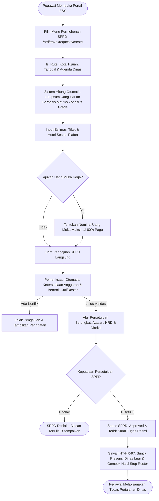
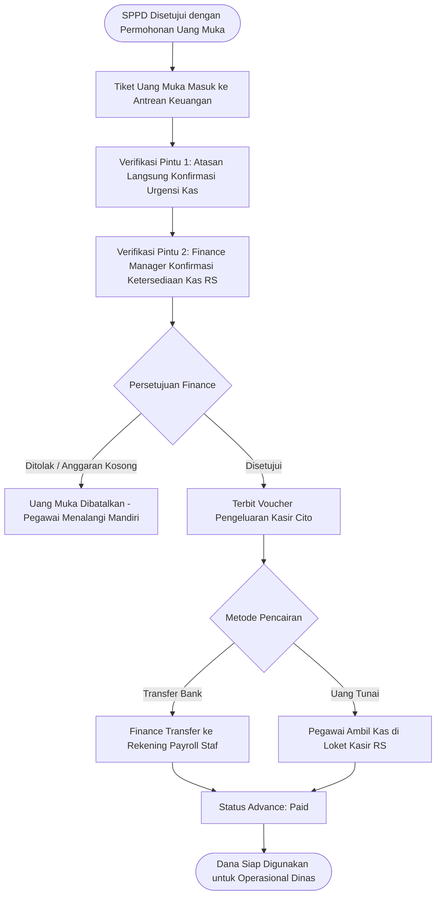
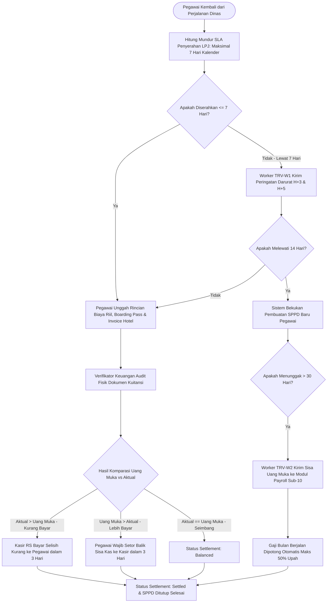
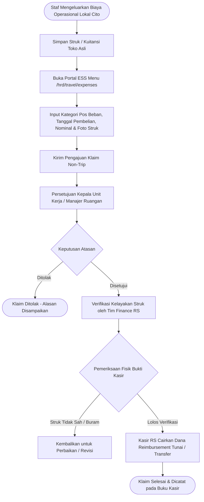
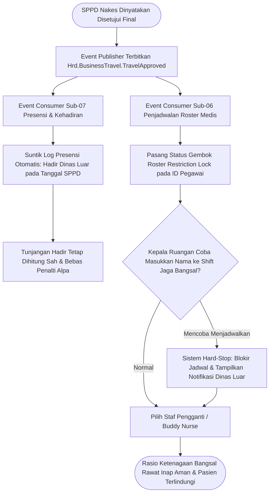

# Alur Proses Bisnis: Perjalanan Dinas & Manajemen Biaya Operasional (Business Travel & Expense Management — Slice `S-D5`)

Dokumen ini mendefinisikan alur proses bisnis ujung-ke-ujung untuk **Sub-Modul 13: Perjalanan Dinas & Manajemen Biaya Operasional — Slice `S-D5`**.

---

## 1. Alur Utama Pengajuan, Persetujuan SPPD & Eksekusi Perjalanan Dinas

---

## 2. Alur Pengajuan, Verifikasi 2-Pintu & Pencairan Uang Muka Kerja (*Travel Advance*)

---

## 3. Alur Rekonsiliasi Settlement, Pengembalian Kas & Eskalasi Pemotongan Payroll

---

## 4. Alur Klaim Pengeluaran Operasional Non-Trip (*Direct Expense Claim*)

---

## 5. Alur Integrasi Presensi Dinas Luar & Gembok Hard-Stop Roster Medis

