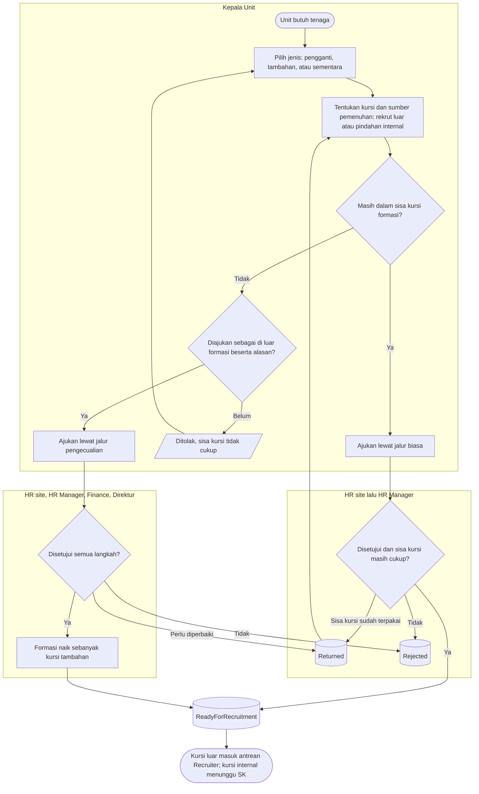
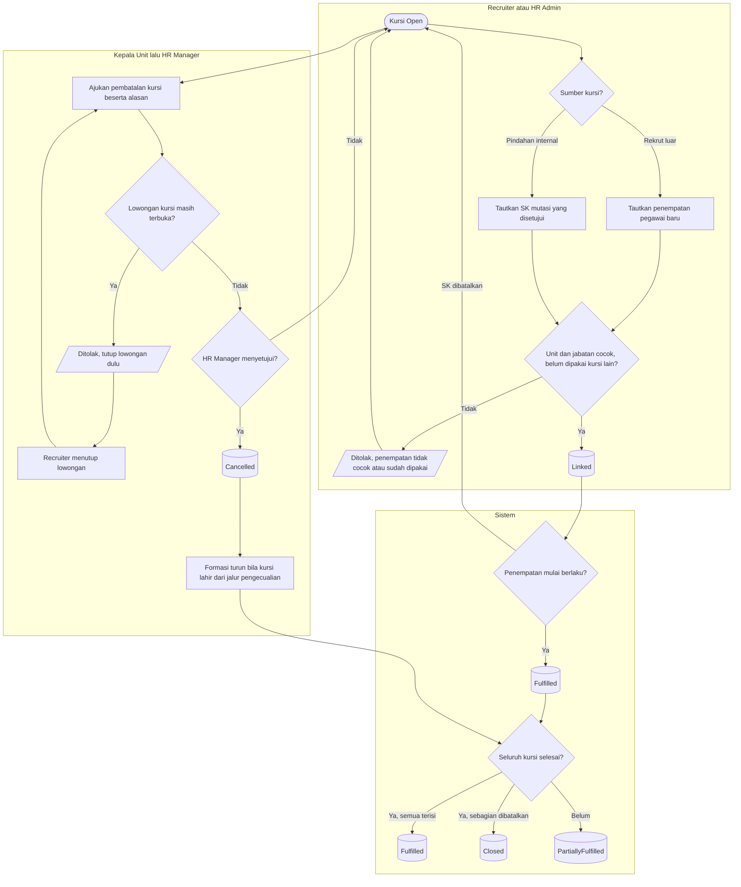

# Permintaan Headcount

| Field | Value |
| --- | --- |
| Blueprint ID | `HRD-BP-001` |
| Jenis | Flowchart proses |
| Slice | `S-D1` perencanaan tenaga kerja |
| Status | `approved` — Pengguna, 2026-11-03, bersama desain `S-D1` |
| Kesiapan | `READY FOR DESIGN` |
| Keputusan | `HRD-DEC-063`, `HRD-DEC-064`, `HRD-DEC-066`, `HRD-DEC-067`, `HRD-DEC-071` |

---

## 1. Apa yang digambar

Permintaan tambahan atau pengganti tenaga, dari pengajuan sampai setiap kursinya terisi atau
dibatalkan. Status pada node keadaan sama persis dengan `contracts/state-transition-matrix.md`
bagian 11.4 s.d. 11.6.

## 2. Diagram — pengajuan dan persetujuan

## 3. Diagram — pemenuhan dan pembatalan kursi

## 4. Tabel langkah

| Langkah | Pelaku | Masukan yang dibutuhkan | Keluaran | Bila gagal |
| --- | --- | --- | --- | --- |
| Tentukan jenis dan kursi | Kepala Unit | Jabatan, grade, tanggal dibutuhkan; untuk pengganti: pegawai yang digantikan; untuk sementara: pegawai yang tidak tersedia dan tanggal akhir | Permintaan `Draft` dengan kursi | Pegawai yang digantikan belum tercatat akan keluar → selesaikan pengunduran dirinya lebih dulu |
| Ajukan | Kepala Unit | Sisa kursi cukup, atau alasan di luar formasi | `Submitted`; potret gap terkunci | Sisa kursi tidak cukup → kurangi jumlah atau ajukan sebagai di luar formasi |
| Setujui jalur biasa | HR site, HR Manager | Permintaan | `ReadyForRecruitment` | Sisa kursi habis dipakai permintaan lain → permintaan dikembalikan untuk disesuaikan |
| Setujui jalur pengecualian | HR site, HR Manager, Finance, Direktur yang membawahi unit | Permintaan; angka koreksi Finance bila perlu | `ReadyForRecruitment`; formasi naik | Dikembalikan → Kepala Unit memperbaiki |
| Tarik kembali | Kepala Unit | Permintaan yang belum disetujui terakhir | `Withdrawn` | Sudah disetujui → pakai pembatalan kursi |
| Tautkan pemenuhan | Recruiter atau HR Admin | Penempatan pegawai baru, atau SK mutasi | Kursi `Linked` | Unit atau jabatan tidak cocok, atau sudah dipakai → pilih penempatan yang benar |
| Kursi terisi | Sistem | Tanggal mulai penempatan tiba | Kursi `Fulfilled`; status permintaan diperbarui | SK dibatalkan sebelum berlaku → kursi kembali `Open` |
| Ubah sumber kursi | HR Manager bukan pembuat | Kursi yang belum terisi; alasan | Sumber kursi berubah; jumlah total tetap | Kursi sudah terisi → tidak dapat diubah |
| Batalkan kursi | Kepala Unit atau HR, disetujui HR Manager | Kursi `Open` atau `Frozen`; alasan; lowongan sudah ditutup | Kursi `Cancelled`; formasi turun bila dari jalur pengecualian | Lowongan masih terbuka → Recruiter menutupnya dulu |

## 5. Contoh

Permintaan ICU +6 di luar formasi, rencana 4 rekrut luar + 2 pindahan internal. Antrean Recruiter
menampilkan 4 kursi. SK mutasi Maya dibatalkan sebelum berlaku, sehingga HR Manager mengubah satu
kursi internal menjadi rekrut luar dan antrean menjadi 5. Andi pindah ke ICU per 1 Mei, dan satu
kursi internal terisi. Rawat Inap kehilangan satu orang terisi; gapnya terlihat, tetapi sistem
tidak membuat permintaan pengganti otomatis untuk Rawat Inap.

## 6. Yang sengaja tidak ada di diagram ini

| Yang tidak digambar | Di mana |
| --- | --- |
| Lowongan, kandidat, seleksi | Rekrutmen (`S-D2`), `BLOCKED` |
| Persetujuan SK mutasi | `administrasi-kepegawaian.md` dan Workforce Core |
| Pembekuan kursi sesudah addendum | `formasi-dan-rencana-tahunan.md` |
| Tanda "lewat batas" | Hanya penanda di layar HR Manager; tidak mengubah status (`NO_AUTO_EXPIRY`) |

## 7. Traceability

| Bagian alur | Decision | Acceptance test |
| --- | --- | --- |
| Sisa kursi dan dua jalur | `HRD-DEC-063` | `AT-HRD-D1-08`, `AT-HRD-D1-09` |
| Rantai `T11` dan `T12` | `HRD-DEC-064` | `AT-HRD-D1-10` |
| Terpenuhi saat penempatan berlaku | `HRD-DEC-066` | `AT-HRD-D1-12`, `AT-HRD-D1-13` |
| Rencana pemenuhan luar dan internal | `HRD-DEC-067` | `AT-HRD-D1-14` |
| Pembatalan kursi | `HRD-DEC-071` | `AT-HRD-D1-18` |
