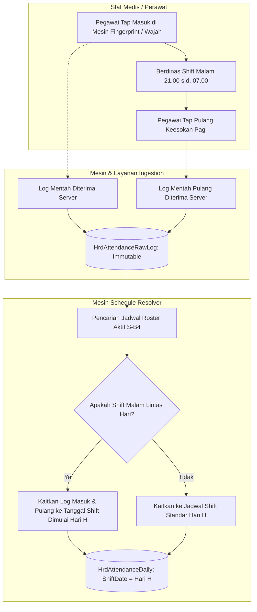
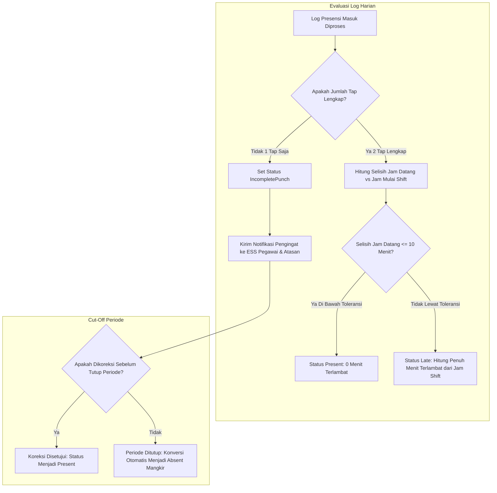
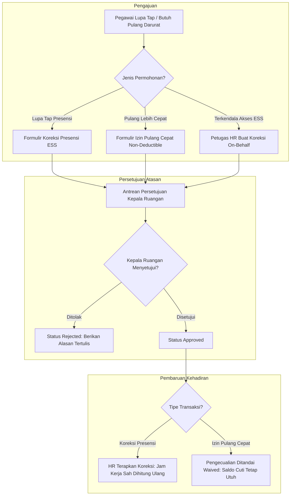
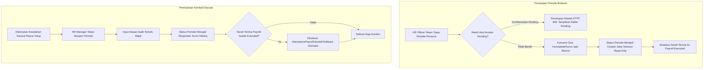

# Alur Proses Bisnis Presensi dan Kehadiran Staf Rumah Sakit 24/7 (Slice `S-B1`)

Dokumen ini memodelkan alur proses bisnis operasional presensi staf rumah sakit untuk **Sub-modul 07 Attendance Management (Slice `S-B1`)**, menyerap keputusan interview `HRD-DEC-028`, `HRD-DEC-029`, `HRD-DEC-104` s.d. `HRD-DEC-109`.

---

## 1. Alur 1: Penyerapan Log Mentah Biometrik & Pencocokan Shift Malam Lintas Hari (`HRD-DEC-104`)

Diagram ini menggambarkan bagaimana log tap mesin biometrik diserap secara *immutable* dan dipasangkan ke penugasan shift malam yang melintasi tengah malam.

### Tabel Langkah Alur 1

| Langkah | Aktor Pelaku | Masukan | Keluaran | Tindakan Bila Gagal |
| :---: | --- | --- | --- | --- |
| 1 | Staf Medis | Jari / Wajah pada sensor mesin | Log mentah biometrik | Coba ulang sensor biometrik atau gunakan tap cadangan |
| 2 | Layanan Ingestion | Payload log biometrik | `HrdAttendanceRawLog` tersimpan | Antrean lokal mesin menyimpan offline hingga jaringan pulih |
| 3 | Schedule Resolver | Log mentah & penugasan shift roster | `HrdAttendanceDaily` terisi | Log ditandai pending bila roster belum terbit |

---

## 2. Alur 2: Evaluasi Toleransi Keterlambatan Grace Period & Penanganan Lupa Tap (`HRD-DEC-105`, `HRD-DEC-106`)

Diagram ini memodelkan penentuan status terlambat berdasarkan toleransi 10 menit dan penanganan catatan absensi 1 tap.

### Tabel Langkah Alur 2

| Langkah | Aktor Pelaku | Masukan | Keluaran | Tindakan Bila Gagal |
| :---: | --- | --- | --- | --- |
| 1 | Calculation Engine | Waktu tap masuk & jadwal shift | Evaluasi keterlambatan | Gunakan toleransi default 10 menit bila konfigurasi kosong |
| 2 | Calculation Engine | Jumlah tap pada hari tersebut | Status `Present`/`Late`/`IncompletePunch` | Memicu notifikasi pengingat ke ESS staf |
| 3 | Guard Penutupan | Sisa incomplete punch saat cut-off | Status terkonversi menjadi `Absent` | Staf wajib mengajukan sanggahan via HR Manager |

---

## 3. Alur 3: Koreksi Kehadiran Mandiri vs On-Behalf & Izin Pulang Cepat (`HRD-DEC-028`, `HRD-DEC-107`)

Diagram ini menggambarkan pengajuan koreksi presensi dan permohonan izin pulang cepat administratif.

### Tabel Langkah Alur 3

| Langkah | Aktor Pelaku | Masukan | Keluaran | Tindakan Bila Gagal |
| :---: | --- | --- | --- | --- |
| 1 | Pegawai / HR Admin | Formulir koreksi / izin pulang | Permohonan berstatus `Submitted` | Lengkapi alasan dan berkas lampiran |
| 2 | Kepala Ruangan | Tinjauan alasan darurat | Permohonan disetujui / ditolak | Diskusikan secara klinis bila ada keraguan jadwal |
| 3 | Attendance Engine | Status approval atasan | Jam kerja dihitung ulang / waived | Hubungi HR Officer bila hitung ulang gagal |

---

## 4. Alur 4: Penutupan Periode, Guard Koreksi & Buka Kembali Darurat (`HRD-DEC-108`)

Diagram ini memodelkan proses tutup buku absensi bulanan, penolakan bila ada transaksi pending, serta pembatalan serah terima payroll saat periode dibuka kembali.

### Tabel Langkah Alur 4

| Langkah | Aktor Pelaku | Masukan | Keluaran | Tindakan Bila Gagal |
| :---: | --- | --- | --- | --- |
| 1 | HR Attendance Officer | Tombol Close Period | Periode terkunci `Closed` | Selesaikan seluruh koreksi pending yang terdaftar |
| 2 | Guard Penutupan | Query koreksi pending | Lolos atau Ditolak HTTP 409 | Tampilkan pesan peringatan kepada operator |
| 3 | HR Manager | Tombol Reopen & Alasan audit | Periode `Reopened` & Rollback Payroll | Batalkan aksi bila alasan audit tidak memadai |
