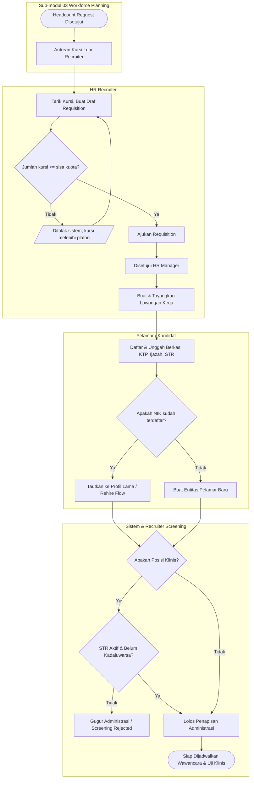
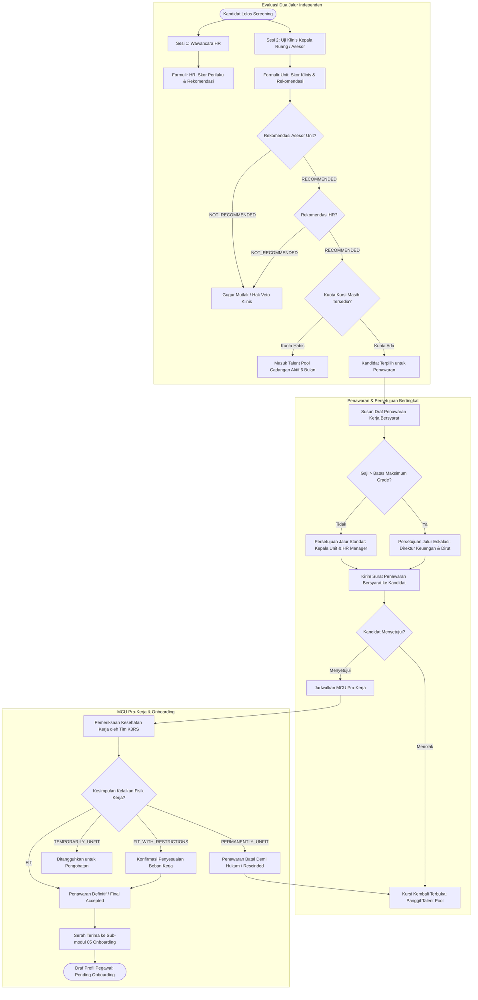
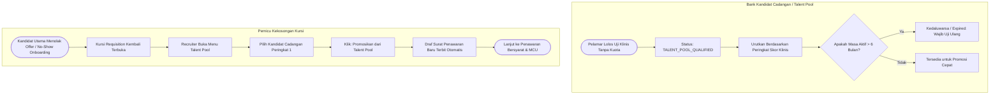

# Rekrutmen dan Seleksi Tenaga Kerja Rumah Sakit

| Field | Value |
| --- | --- |
| Blueprint ID | `HRD-BP-001` |
| Jenis | Flowchart proses bisnis |
| Slice | `S-D2` Rekrutmen dan Hiring |
| Status | `draft` — mengikuti keputusan `HRD-DEC-073` s.d. `HRD-DEC-080` |
| Kesiapan | `READY FOR DESIGN` |
| Keputusan | `HRD-DEC-073`, `HRD-DEC-074`, `HRD-DEC-075`, `HRD-DEC-076`, `HRD-DEC-077`, `HRD-DEC-078`, `HRD-DEC-079`, `HRD-DEC-080` |

---

## 1. Apa yang digambar

Alur proses bisnis pengadaan tenaga kerja rumah sakit dari penarikan kursi formasi yang disetujui, penayangan lowongan,
pendaftaran pelamar dan penapisan STR klinis, evaluasi wawancara dan uji klinis dengan hak veto mutlak, penawaran kerja
bersyarat, MCU pra-kerja dengan masking rahasia medis, persetujuan penawaran bertingkat, pengelolaan talent pool cadangan,
hingga serah terima kandidat ke tahap onboarding tanpa membuat identitas ganda.

---

## 2. Diagram 1 — Dari Requisition Formasi hingga Penapisan STR Klinis

---

## 3. Diagram 2 — Evaluasi Wawancara, Uji Klinis (Hak Veto), MCU, dan Onboarding

---

## 4. Diagram 3 — Talent Pool dan Promosi Cepat Saat Kandidat Batal

---

## 5. Tabel Langkah Kerja Petugas

| No | Tahap | Pelaku | Masukan | Keluaran | Bila Gagal / Ditolak |
| --- | --- | --- | --- | --- | --- |
| 1 | Buka Requisition | HR Recruiter | Nomor Headcount Request yang disetujui | Requisition berstatus `APPROVED` | Ditolak sistem bila kuota kursi habis |
| 2 | Buat Lowongan | HR Recruiter | Data Requisition dan persyaratan profesi | Lowongan tayang (*Published*) | Ditolak bila tanggal penutupan lampau |
| 3 | Pendaftaran & Upload | Pelamar | NIK KTP, biodata, dokumen STR & ijazah | Berkas lamaran terdaftar | Validasi format NIK 16 digit |
| 4 | Penapisan Berkas | Sistem & Recruiter | Dokumen STR dan ijazah | Lolos atau Gugur Administrasi | Jika STR kadaluwarsa, otomatis auto-reject |
| 5 | Evaluasi Wawancara | HR Recruiter | Rubrik penilaian perilaku | Nilai HR dan rekomendasi | Pelamar gugur bila HR menolak |
| 6 | Uji Klinis Unit | Kepala Ruang / Dokter | SOP klinis & uji tindakan | Nilai klinis dan rekomendasi | Jika Unit menolak, berlaku hak veto mutlak |
| 7 | Buat Draf Offer | HR Recruiter | Data kandidat terpilih & grade gaji | Draf Surat Penawaran Bersyarat | Ditolak bila gaji di bawah minimum grade |
| 8 | Persetujuan Offer | HR Manager / Dirut | Nominal gaji dan batas grade | Penawaran berstatus disetujui | Dikembalikan untuk revisi angka gaji |
| 9 | Pemeriksaan MCU | Dokter K3RS | Kandidat yang menerima penawaran | Status kelaikan k3 (Fit / Unfit) | Jika Unfit permanen, penawaran otomatis batal |
| 10 | Serah Terima | HR Manager | Kandidat kelaikan Fit | Draf profil `Pending Onboarding` | Kursi requisition bertambah terpenuhi |
| 11 | Promosi Cadangan | HR Recruiter | Kursi batal & kandidat Talent Pool | Penawaran baru tanpa seleksi ulang | Kandidat kadaluwarsa (>6 bln) ditolak promosi |
