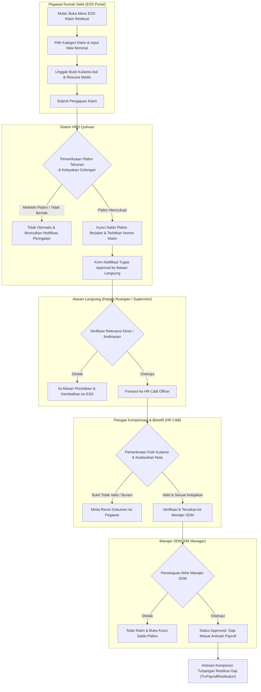
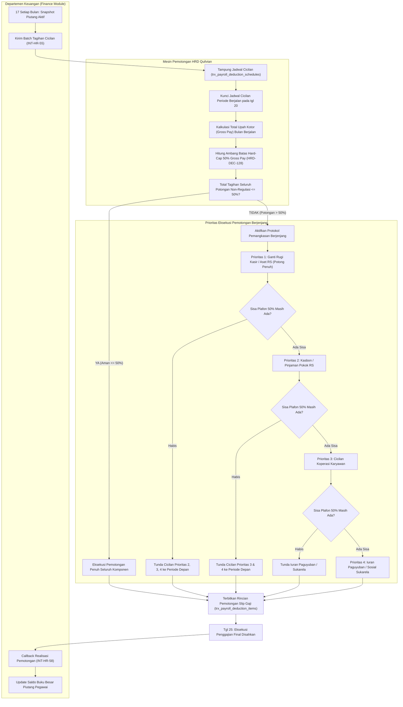
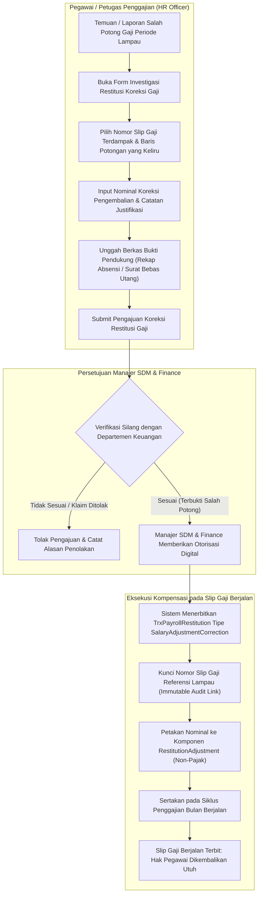

# Alur Proses Bisnis — Restitusi & Pemotongan Penggajian (Restitution & Deduction Integration)

Dokumen ini memetakan seluruh alur proses bisnis operasional untuk **Sub-Modul 11 (Restitution & Payroll Deduction Integration — Slice `S-B6`)**. Alur proses dirancang untuk menjamin kepatuhan batas maksimal pemotongan upah tenaga kerja sesuai Pasal 65 PP 36/2021 jo PP 49/2025 (*Hard-Cap 50%*), sinkronisasi dua arah saldo piutang pegawai dengan Departemen Keuangan (*Finance Handoff* sesuai `HRD-DEC-129`), transparansi pengajuan klaim mandiri pegawai di portal ESS (*ESS Self-Service* sesuai `HRD-DEC-130`), koreksi salah potong periode lampau tanpa merusak integritas slip gaji final (*Traceable Adjustment* sesuai `HRD-DEC-131`), penyelesaian sisa piutang saat mutasi keluar/resign/PHK (*Exit Clearance Integration* sesuai `HRD-DEC-132`), serta perlindungan jalur cepat kasir darurat bagi tenaga medis yang mengalami kecelakaan okupasional (*Urgent Disbursement Cito* sesuai `HRD-DEC-133`).

---

## 1. Alur Pengajuan, Verifikasi Plafon & Persetujuan Klaim Restitusi Mandiri di ESS

Diagram ini memetakan siklus hidup pengajuan klaim restitusi mandiri (kacamata kerja, faskes luar, biaya dinas cito) oleh pegawai rumah sakit dari portal ESS hingga siap masuk kalkulasi slip gaji.

### Tabel Rincian Langkah Operasional Klaim Restitusi ESS

| Langkah | Pelaku | Masukan (Input) | Keluaran (Output) | Tindakan Bila Gagal / Ditolak |
| :--- | :--- | :--- | :--- | :--- |
| **1. Pengajuan Klaim** | Pegawai (Nakes/Non-Nakes) | Kategori klaim, tanggal kuitansi, nominal klaim, file scan kuitansi asli & resume | Draf pengajuan klaim berlampiran file digital | Pegawai mengulang input atau memperbaiki format file kuitansi (PDF/JPEG maks 5MB). |
| **2. Pengecekan Plafon** | Mesin Sistem HRD | Master golongan/grade, riwayat klaim tahun berjalan, nominal pengajuan | Status `Validated` atau `Rejected_Exceeds_Limit` | Sistem menolak submit jika sisa kuota kacamata/medis habis; pegawai dapat menyesuaikan nominal klaim ke sisa kuota. |
| **3. Persetujuan Atasan** | Kepala Ruangan / Ka. Instalasi | Notifikasi ESS, rincian klaim pegawai, justifikasi kedinasan | Approval digital tahap 1 | Jika ditolak, status klaim `Rejected_Supervisor` disertai alasan tertulis; pegawai menerima notifikasi transparan. |
| **4. Verifikasi HR C&B** | Petugas HR C&B | Fisik kuitansi asli / scan legalisir kasir eksternal, resume medis | Lembar verifikasi kelayakan administrasi | Jika nota fiktif atau tidak berkop sah, klaim ditolak atau dikembalikan untuk revisi (*Request Revision*). |
| **5. Persetujuan Manajer** | Manajer SDM | Paket verifikasi lengkap berseri audit | Surat persetujuan klaim restitusi sah (`Approved`) | Jika anggaran departemen terkunci, manajer menangguhkan (*Hold*) pengajuan hingga siklus berikutnya. |
| **6. Antrean Penggajian** | Sistem Payroll | Data klaim `Approved` per periode cut-off tgl 20 | Record `TrxPayrollRestitution` berstatus `QueuedForPayroll` | Jika tgl klaim melewati tgl 20, otomatis dijadwalkan pada penggajian bulan berikutnya. |

---

## 2. Alur Sinkronisasi Jadwal Cicilan Piutang Finance & Penegakan Hard-Cap 50% PP 36/2021

Diagram ini memetakan mekanisme sinkronisasi data piutang dengan Departemen Keuangan (Finance) serta eksekusi aturan batasan maksimal pemotongan upah secara berjenjang.

### Tabel Rincian Langkah Operasional Sinkronisasi & Guard Plafon 50%

| Langkah | Pelaku | Masukan (Input) | Keluaran (Output) | Tindakan Bila Gagal / Ditolak |
| :--- | :--- | :--- | :--- | :--- |
| **1. Snapshot Piutang** | API Service Finance | Database buku besar piutang pegawai per tgl 17 | Batch data payload `ActivePayrollDeductionResponse` | Jika koneksi timeout, sistem HR mencoba retry 3x (jeda 5 menit); alert ke Admin jika tetap gagal. |
| **2. Penguncian Jadwal** | Sistem HRD | Data cicilan aktif Finance + cicilan internal HRD | Status jadwal `Locked` per tgl 20 pukul 23:59:59 | Perubahan piutang di Finance setelah tgl 20 ditolak dan masuk siklus bulan depan. |
| **3. Hitung Plafon 50%** | Payroll Calculation Engine | Nilai `GrossPay` (Gaji Pokok + Tunjangan Tetap + Lembur) | Angka batas absolut `MaxNonRegulatoryDeduction = GrossPay * 50%` | Nilai dihitung perorangan; jika Gross Pay minus/nol (mangkir sebulan penuh), plafon Rp 0. |
| **4. Prioritas Berjenjang** | Mesin Eksekusi Potongan | Tagihan prioritas 1 (Ganti Rugi), 2 (Kasbon), 3 (Koperasi), 4 (Paguyuban) | Item terpotong penuh, terpotong parsial, dan item ditunda (*Deferred*) | Sistem mencatat tagihan yang tertunda dengan alasan `DeferredDueToSalaryCap` untuk diajukan ulang bulan depan. |
| **5. Feedback ke Keuangan** | Webhook Dispatcher HRD | Slip gaji berstatus disahkan (*Approved*) tgl 25 | Payload `PayrollDeductionExecutionCallback` ke Finance | Finance menerima detail pemotongan aktual; jika ditolak Finance, tim rekonsiliasi HR-Finance membuka ticket audit. |

---

## 3. Alur Restitusi Koreksi Salah Potong Periode Lampau (Traceable Adjustment)

Diagram ini memetakan mekanisme penanganan keluhan pegawai atas kesalahan pemotongan gaji pada bulan-bulan sebelumnya tanpa mengedit atau merevisi slip gaji final periode lampau (`PAY-B6`).

### Tabel Rincian Langkah Operasional Koreksi Salah Potong

| Langkah | Pelaku | Masukan (Input) | Keluaran (Output) | Tindakan Bila Gagal / Ditolak |
| :--- | :--- | :--- | :--- | :--- |
| **1. Identifikasi Selisih** | Pegawai / HR Payroll | Slip gaji masa lalu, bukti mutasi rekening, bukti setoran cicilan | Tiket keluhan salah potong gaji | Jika klaim tidak memiliki bukti valid, tiket ditutup dengan penjelasan tertulis. |
| **2. Pengecekan Sistem** | Petugas HR C&B | Record `TrxPayrollItemDetail` pada slip gaji terdampak | Data histori pemotongan dan nominal selisih terverifikasi | Sistem mencegah koreksi ganda: satu baris pemotongan hanya boleh dikoreksi sekali hingga lunas. |
| **3. Otorisasi Bersama** | Manajer SDM & Manajer Keuangan | Berkas investigasi, bukti setor, permohonan restitusi | Status koreksi `Approved_For_Adjustment` | Jika nominal koreksi > Rp 5.000.000, wajib menyertakan otorisasi Direktur Keuangan. |
| **4. Injeksi Penggajian** | Payroll Engine | Rekomendasi koreksi disetujui | Komponen `RestitutionAdjustment` pada slip gaji berjalan | Komponen dispesifikasikan bebas pajak (PPh 21 Gross Up = 0) agar karyawan tidak dirugikan pajak ganda. |
| **5. Penerbitan Slip** | Sistem ESS | Slip gaji bulan berjalan | Tampilan baris khusus pengembalian salah potong lengkap nomor referensi | Karyawan dapat memverifikasi nomor slip asal pada detail slip gaji baru di ESS. |

---

## 4. Alur Pelunasan Piutang Resign/PHK (Exit Clearance) & Pencairan Kasir Darurat Cito

Diagram ini memetakan dua jalur khusus non-standar: (1) Pelunasan sisa seluruh pinjaman pegawai saat pemutusan hubungan kerja via formulir Exit Clearance Sub-Modul 20, dan (2) Pencairan restitusi darurat medis nakes secara tunai di Kasir RS 24/7.

```mermaid
flowchart TD
  subgraph CLEARANCE["Jalur Pelunasan Resign / PHK (Exit Clearance Sub-20)"]
    A1["Pegawai Mengajukan Resign / SK PHK Terbit"] --> A2["Sistem Tarik Seluruh Sisa Pokok Pinjaman RS & Koperasi"]
    A2 --> A3["Hitung Total Hak Finansial Akhir (Gaji + Sisa Cuti + Pesangon/PMK)"]
    A3 --> A4{"Hak Finansial Akhir >= Total Sisa Piutang?"}
    
    A4 -- "Mencukupi (Hak >= Utang)" --> A5["Potong Penuh dari Hak Finansial pada Final Payslip"]
    A5 --> A6["Sisa Piutang Rp 0: Form Exit Clearance Sub-20 Lolos Verifikasi Finansial"]
    
    A4 -- "Kurang (Utang > Hak Finansial)" --> A7["Potong Seluruh Hak Finansial hingga Take-Home Pay Rp 0"]
    A7 --> A8["Terbitkan Tagihan Sisa Piutang (Outstanding Receivable Statement)"]
    A8 --> A9["Pegawai Wajib Menyetor Tunai / Transfer ke Kasir RS"]
    A9 --> A10["Kasir Konfirmasi Pelunasan: Exit Clearance Disahkan"]
  end

  subgraph CITO["Jalur Pencairan Cito Kasir RS 24/7 (Urgent Disbursement Cito)"]
    B1["Insiden Pajanan Medis Nakes di IGD/Kamar Operasi (Needlestick Cito)"] --> B2["Input Klaim Restitusi Darurat Ber-flag UrgentDisbursementCito"]
    B2 --> B3["Persetujuan Cepat Digital Direktur Medis / SDM via Mobile App"]
    B3 --> B4["Sistem Terbitkan Voucher Pencairan Kasir Elektronik (CashDisbursementVoucher)"]
    B4 --> B5["Pegawai Bawa QR Code Voucher ke Loket Kasir RS 24/7"]
    B5 --> B6["Kasir Validasi Voucher di Sistem & Menyerahkan Uang Tunai"]
    B6 --> B7["Status Klaim Ditandai DisbursedViaCashier (Dikunci dari Penggajian Bulanan)"]
  end
```

### Tabel Rincian Langkah Operasional Clearance & Jalur Cito

| Langkah | Pelaku | Masukan (Input) | Keluaran (Output) | Tindakan Bila Gagal / Ditolak |
| :--- | :--- | :--- | :--- | :--- |
| **1. Kunci Utang PHK** | Sub-Modul 20 & HR Sub-11 | SK Direksi Pemutusan Hubungan Kerja / Surat Resign | Rekapitulasi kewajiban finansial tersisa | Sistem mengunci seluruh jadwal cicilan agar tidak berjalan normal dan dikonsolidasi ke pemotongan penutupan. |
| **2. Final Payslip** | Payroll Engine | Hak pesangon, kompensasi cuti, sisa cicilan utang | Slip gaji penutupan (*Final Clearance Payslip*) | Batas 50% PP 36/2021 dikesampingkan khusus terminasi akhir kerja untuk melindungi aset rumah sakit (`HRD-DEC-132`). |
| **3. Tagihan Piutang Residu** | Petugas Finance | Selisih utang pegawai yang melebihi pesangon | Surat tagihan resmi berkode bayar kasir | Pegawai tidak dapat menerima surat keterangan kerja (*Paklaring*) sebelum kasir menerbitkan bukti lunas. |
| **4. Pengajuan Cito** | Dokter / Nakes IGD | Laporan insiden kecelakaan kerja okupasional, resep obat profilaksis | Pengajuan darurat ber-tag `UrgentDisbursementCito` | Jika bukan kategori darurat medis (misal kacamata rutin), jalur cito ditolak dan diarahkan ke jalur normal. |
| **5. Penerbitan Voucher** | Direktur Medis / SDM | Notifikasi prioritas darurat | Voucher elektronik ber-barcode dan PIN kasir satu kali pakai | Voucher kedaluwarsa dalam 48 jam jika tidak dicairkan di kasir RS. |
| **6. Pencairan Kasir** | Petugas Kasir RS 24/7 | Scan QR voucher elektronik, verifikasi KTP/ID badge nakes | Dana tunai diserahkan, bukti kuitansi kasir tercetak | Sistem otomatis mengunci klaim ke status `DisbursedViaCashier` sehingga payroll tgl 25 tidak mentransfer ulang dana tersebut. |

---

## 5. Matriks Integrasi Peran & Tanggung Jawab Operasional

| Peran Staf Rumah Sakit | Kewenangan pada Restitusi | Kewenangan pada Pemotongan Gaji | Batas Larangan Keras |
| :--- | :--- | :--- | :--- |
| **Staf Pegawai (Nakes/Umum)** | Mengajukan klaim restitusi di ESS, mengunggah bukti nota, memonitor sisa plafon. | Melihat jadwal cicilan aktif & riwayat pemotongan pada slip gaji ESS. | Dilarang mengubah data cicilan sendiri atau mencairkan klaim tanpa persetujuan. |
| **Kepala Ruangan / Supervisor** | Menyetujui relevansi kedinasan klaim staf unit kerjanya. | Menerima laporan staf terkait masalah cicilan dan meneruskan ke HRD. | Dilarang menyetujui klaim restitusi atas dirinya sendiri (*No Self-Approval*). |
| **HR C&B Officer** | Memvalidasi keabsahan kuitansi fisik, memeriksa aturan plafon, investigasi salah potong. | Menarik snapshot cicilan Finance, mengawasi kepatuhan batas 50%, menjadwalkan penundaan. | Dilarang menghapus jadwal cicilan pinjaman tanpa memo resmi tertulis dari Finance. |
| **Manajer SDM (HR Manager)** | Memberikan persetujuan akhir klaim restitusi dan klaim koreksi gaji masa lalu. | Menyetujui lembar kerja pemotongan gaji sebelum payroll run dieksekusi. | Dilarang mengesahkan pemotongan non-regulasi yang melanggar batas 50% tanpa dasar PHK. |
| **Petugas Kasir RS (24/7)** | Memverifikasi voucher pencairan cito dan menyerahkan uang tunai darurat. | Menerima setoran pelunasan tunai dari pegawai yang memiliki sisa piutang PHK. | Dilarang menyerahkan uang tunai tanpa validasi status voucher `Issued` di sistem. |
| **Departemen Keuangan (Finance)** | Menerima laporan rekapitulasi restitusi yang dicairkan via payroll maupun kasir. | Mengelola master pinjaman, mengirim snapshot jadwal, menerima callback realisasi tgl 25. | Finance adalah *source of truth* piutang; HRD tidak mengelola bunga pinjaman atau buku besar. |
