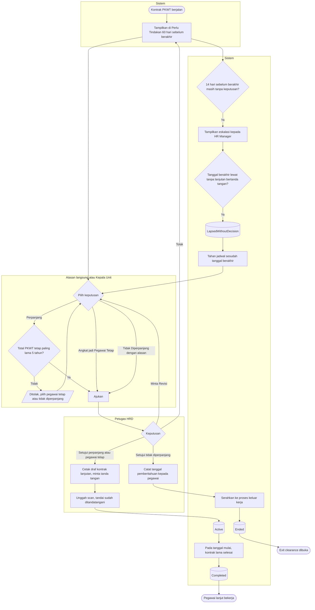
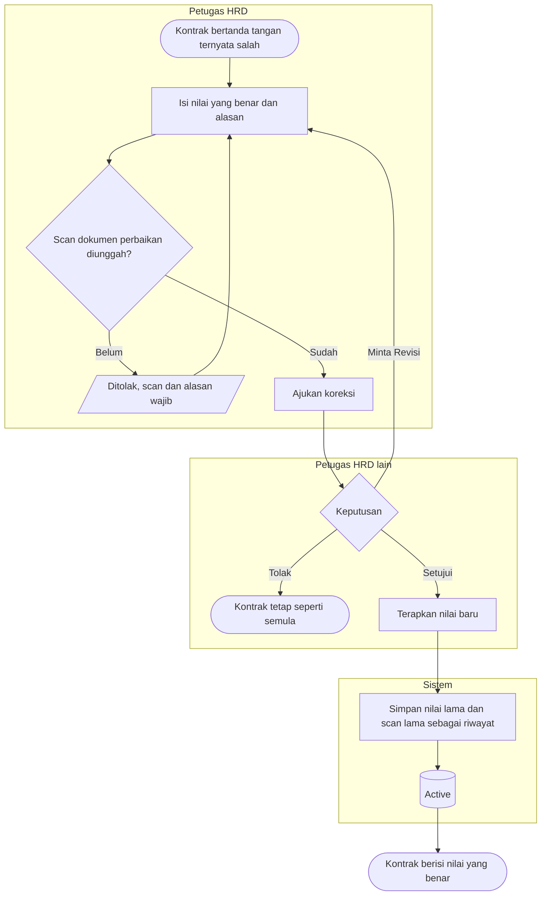

# Siklus Kontrak Kerja

| Field | Value |
| --- | --- |
| Blueprint ID | `HRD-BP-001` |
| Jenis | Flowchart proses |
| Slice | `S-C4-ONB` onboarding dan kontrak kerja (sub-modul 05) |
| Status | `approved` — Pengguna (pemilik teknis dan produk, `HRD-DEC-015`), 2026-11-04, beserta kelima pilihan desain (`HRD-DEC-096`). Jawaban pemilik: "setujui semua ya dan kerjakan" |
| Kesiapan | `READY FOR DESIGN` |
| Keputusan | `HRD-DEC-081`, `HRD-DEC-082`, `HRD-DEC-089` |

---

## 1. Apa yang digambar

Kontrak PKWT yang mendekati akhir: pengingat, satu dari tiga keputusan, kontrak lanjutan atau
serah terima ke proses keluar, penahan jadwal bila tidak ada keputusan, dan koreksi kontrak yang
salah. Status pada node keadaan sama persis dengan `contracts/state-transition-matrix.md` bagian 13.3
dan 13.6.

## 2. Diagram — keputusan menjelang akhir kontrak

## 3. Diagram — koreksi kontrak yang salah

## 4. Tabel langkah

| Langkah | Pelaku | Masukan yang dibutuhkan | Keluaran | Bila gagal |
| --- | --- | --- | --- | --- |
| Ajukan keputusan | Atasan langsung atau Kepala Unit | Kontrak PKWT berjalan atau baru berakhir; lama perpanjangan atau alasan | Keputusan diajukan | Ditolak bila melewati 5 tahun atau sudah ada keputusan lain; atasan memilih jalur lain |
| Putuskan | Petugas HRD bukan pengaju | Keputusan di kotak masuk | Disetujui, dikembalikan, atau ditolak | Langkah tanpa penyetuju ditolak sistem; HR Manager memeriksa pemetaan peran |
| Tandatangani kontrak lanjutan | Petugas HRD | Scan bertanda tangan | Kontrak lanjutan `Active`; kontrak lama `Completed` pada tanggal mulai | Ditolak tanpa scan |
| Catat pemberitahuan | Petugas HRD | Tanggal pegawai diberi tahu | Kasus diserahkan ke 20; kontrak `Ended` sesudah tanggal berakhir | Ditolak bila tanggal di luar rentang; HRD memperbaiki tanggal |
| Kontrak lewat tanpa keputusan | Sistem | Tidak ada lanjutan bertanda tangan maupun Tidak Diperpanjang | `LapsedWithoutDecision`; jadwal sesudah tanggal berakhir ditahan | HRD dan atasan menyelesaikan keputusan; penahan lepas saat kontrak lanjutan ditandatangani |
| Koreksi kontrak | Petugas HRD, lalu petugas HRD lain | Nilai benar, alasan, scan perbaikan | Kontrak berisi nilai baru; nilai lama tersimpan | Ditolak bila jenis kontrak tidak boleh dikoreksi atau nilai baru tidak sah |

## 5. Contoh

Kontrak PKWT Rina berakhir 31 Januari 2028. Pada 2 Desember 2027 Sari melihatnya di Perlu Tindakan,
memilih Angkat jadi Pegawai Tetap, dan Dodi menyetujuinya. Kontrak PKWTT ditandatangani 20 Januari
2028 dan berlaku 1 Februari 2028, tanpa masa percobaan. Untuk Budi yang kontraknya berakhir 31 Maret
2027 tidak ada yang mengajukan; pada 17 Maret HR Manager melihat eskalasi, dan pada 1 April jadwal
Budi sesudah 31 Maret tidak dapat dibuat sampai kontrak lanjutannya ditandatangani.

## 6. Yang sengaja tidak ada di diagram ini

| Yang tidak digambar | Alasan |
| --- | --- |
| Perpanjangan otomatis | Tidak ada jalurnya (`HRD-DEC-089` `NO_AUTOMATIC_OUTCOME`) |
| Perubahan gaji saat perpanjangan | Lewat jalur gaji atau SK di 02 |
| Perhitungan uang kompensasi PKWT | Milik 10 Payroll |
| Exit clearance | `offboarding.md` |

## 7. Traceability

| Bagian alur | Decision | Acceptance test |
| --- | --- | --- |
| Tiga keputusan dan batas 5 tahun | `HRD-DEC-089` butir 2–3 | `AT-HRD-ONB-29`, `AT-HRD-ONB-30` |
| Tidak diperpanjang ke 20 | `HRD-DEC-082`, `HRD-DEC-089` butir 7 | `AT-HRD-ONB-31` |
| Penahan jadwal | `HRD-DEC-089` butir 9 | `AT-HRD-ONB-32` |
| Koreksi | `HRD-DEC-089` butir 11 | `AT-HRD-ONB-33`, `AT-HRD-ONB-34` |
