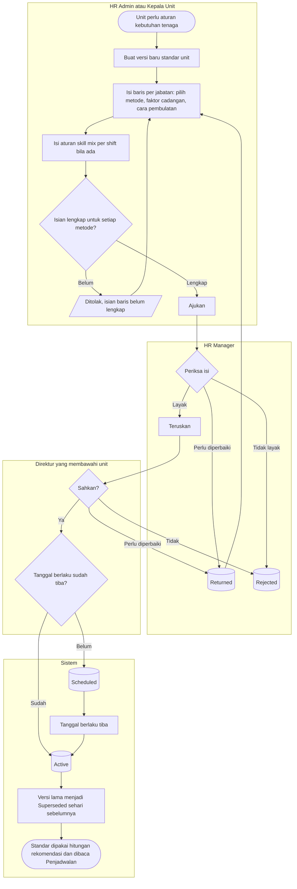

# Standar Kebutuhan Tenaga

| Field | Value |
| --- | --- |
| Blueprint ID | `HRD-BP-001` |
| Jenis | Flowchart proses |
| Slice | `S-D1` perencanaan tenaga kerja |
| Status | `approved` — Pengguna, 2026-11-03, bersama desain `S-D1` |
| Kesiapan | `READY FOR DESIGN` |
| Keputusan | `HRD-DEC-058`, `HRD-DEC-060`, `HRD-DEC-064`, `HRD-DEC-072` |

---

## 1. Apa yang digambar

Bagaimana satu unit mendapatkan aturan "berapa tenaga yang dibutuhkan", dari draf sampai berlaku,
lalu dipakai untuk menghitung angka rekomendasi. Status pada node keadaan sama persis dengan
`contracts/state-transition-matrix.md` bagian 11.1.

## 2. Diagram

## 3. Tabel langkah

| Langkah | Pelaku | Masukan yang dibutuhkan | Keluaran | Bila gagal |
| --- | --- | --- | --- | --- |
| Buat versi baru | HR Admin atau Kepala Unit | Unit; tanggal mulai berlaku | Standar `Draft`; isi versi aktif sebelumnya disalin sebagai titik awal | Unit masih punya draf terbuka → lanjutkan draf itu |
| Isi baris jabatan | Penyusun | Untuk setiap jabatan: metode jumlah tetap, rasio, atau cakupan layanan; faktor cadangan; cara pembulatan | Baris standar | Isian kurang → layar menyebut isian yang kurang per baris |
| Isi skill mix | Penyusun | Shift, kompetensi wajib, jumlah minimal | Aturan skill mix | — |
| Ajukan | Penyusun | Alasan perubahan | Standar `Submitted` | Penyetuju langkah berikutnya tidak ditemukan → hubungi administrator untuk mengisi matriks persetujuan |
| Periksa | HR Manager | Standar yang diajukan | Diteruskan, dikembalikan, atau ditolak | Dikembalikan → penyusun memperbaiki lalu mengajukan ulang |
| Sahkan | Direktur yang membawahi unit, ditemukan lewat matriks persetujuan | Standar yang sudah diperiksa | `Scheduled` atau `Active` | Jabatan direktur kosong → naik ke Direktur Utama |
| Berlaku | Sistem | Tanggal berlaku | `Active`; versi lama `Superseded` | — |

## 4. Angka beban dan angka rekomendasi

Angka beban **tidak** melewati persetujuan, karena hanya memengaruhi angka rekomendasi.

| Langkah | Pelaku | Masukan | Keluaran | Bila gagal |
| --- | --- | --- | --- | --- |
| Isi angka beban | HR Admin atau Kepala Unit | Unit, jabatan, periode, angka, sumbernya | Angka beban periode itu | Sudah ada isian periode yang sama → ubah isian yang ada |
| Lihat rekomendasi | Siapa pun yang boleh membaca standar | Standar `Active` dan angka beban periode | Angka per jabatan beserta rincian hitungnya | Angka beban belum diisi → baris rasio tampil "angka beban belum diisi" |

## 5. Yang sengaja tidak ada di diagram ini

| Yang tidak digambar | Di mana |
| --- | --- |
| Pemeriksaan roster terhadap standar | Desain Penjadwalan (`HRD-DEC-058`) |
| Metode Analisis Beban Kerja | Ditunda (`HRD-DEC-060`) |
| Daftar lengkap transisi tidak sah | `contracts/state-transition-matrix.md` bagian 11.1 |

## 6. Traceability

| Bagian alur | Decision | Acceptance test |
| --- | --- | --- |
| Tiga metode, faktor cadangan, pembulatan | `HRD-DEC-060` | `AT-HRD-D1-02`, `AT-HRD-D1-03` |
| Pengesahan `T9` dan direktur dari matriks | `HRD-DEC-064`, `HRD-DEC-072` | `AT-HRD-D1-04`, `AT-HRD-D1-20` |
| Standar milik sub-modul 03 | `HRD-DEC-058` | `AT-HRD-D1-19` |
