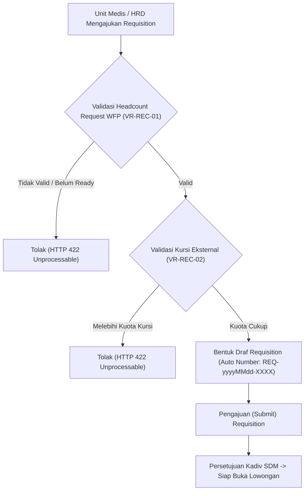

# Laporan Perubahan Backend — `BE-HRD-052`

## Metadata

| Field | Nilai |
| --- | --- |
| Task ID | `BE-HRD-052` |
| Judul | API Permintaan Requisition dari Alokasi Formasi WFP (HrdJobRequisition) |
| Slice | `S-D2` (Rekrutmen & Hiring / Recruitment Management) |
| Milestone | `MVP-11` (Fondasi, Requisition, Lowongan & Direktori Pelamar) |
| Roadmap | `docs/module-blueprints/human-resource/roadmap/backend-roadmap.md` Bagian Gelombang MVP-11 |
| Traceability | `HRD-DEC-073`, `FR-REC-01`, `VR-REC-01`, `VR-REC-02`, `VR-REC-03`, `AT-HRD-D2-01`, `AT-HRD-D2-02`, `INT-HR-20` |
| Dependency | `BE-HRD-018` ✅, `BE-HRD-041` ✅ |
| Klasifikasi | `MEDIUM` |
| Task Mode | `BACKEND` |
| Target Tulis | DTOs, Service, Interface, Controller, DI Program.cs, Laporan Task, Roadmap |
| Tanggal | 04 November 2026 |
| Status | Selesai (`PASS`) |

---

## 1. Ringkasan dan Masalah yang Diselesaikan

Di rumah sakit, rekrutmen pegawai seringkali dibuka tanpa kontrol formasi yang ketat, menyebabkan lonjakan pengeluaran gaji (*over-budget*) dan penumpukan staf di unit tertentu. Melalui task `BE-HRD-052`, proses pembukaan rekrutmen diwajibkan melalui dokumen resmi **Job Requisition** (`HrdJobRequisition`) yang memiliki validasi terpadu ke modul Perencanaan Tenaga Kerja (*Workforce Planning*):
1. **Validasi Keterikatan WFP (`VR-REC-01`)**: Requisition hanya dapat dibuat dengan mereferensikan `HeadcountRequest` yang telah berstatus siap rekrutmen (`ReadyForRecruitment` atau `PartiallyFulfilled`).
2. **Validasi Kuota Kursi Eksternal (`VR-REC-02`)**: Jumlah kursi yang diminta (`RequestedSeats`) tidak boleh melebihi sisa alokasi kursi eksternal (`FulfilmentSource == External`) pada HeadcountRequest tersebut.
3. **Integritas Pembatalan (`VR-REC-03`)**: Requisition hanya dapat dibatalkan jika belum memiliki lowongan kerja aktif berstatus `Published`.

---

## 2. Alur Proses Bisnis Rumah Sakit yang Didukung

---

## 3. Rincian Perubahan Teknis

### 3.1 DTOs (`JobRequisitionDtos.cs`)
Dibuat di `Areas/Corporate/HumanResource/RecruitmentManagement/DTOs/`:
- `CreateJobRequisitionRequest`: Input `HeadcountRequestId`, `HospitalSiteId`, `OrganizationUnitId`, `PositionId`, `RequestedSeats`, `Notes`.
- `UpdateJobRequisitionRequest`: Edit `RequestedSeats`, `Notes`, kendali konkurensi token `RowVersion`.
- `CancelJobRequisitionRequest`: Alasan pembatalan (`CancellationReason`).
- `JobRequisitionResponse`: Detail lengkap requisition beserta nomor headcount dan nama unit/jabatan.
- `JobRequisitionListItemResponse`: Payload ringkas untuk tampilan tabel/list.
- `JobRequisitionQuery`: Parameter pencarian filter unit, jabatan, site, status, kata kunci, dan pagination.

### 3.2 Service Layer (`IJobRequisitionService.cs` & `JobRequisitionService.cs`)
- Menerapkan isolasi logika bisnis rekrutmen.
- Auto-numbering `RequisitionNumber`: format `REQ-yyyyMMdd-XXXX` berbasis tanggal UTC atomik.
- Penegakan aturan bisnis `VR-REC-01`, `VR-REC-02`, dan `VR-REC-03`.
- Pengelolaan metadata audit (`CreateBy`, `CreateDateTime`, `UpdateBy`, `UpdateDateTime`).

### 3.3 Controller Layer (`JobRequisitionController.cs`)
- Route: `api/v1/corporate/human-resource/recruitment/requisitions`
- Tag Swagger: `Corporate / Human Resource / Recruitment Management / Job Requisition`
- Atribut Otorisasi: `[Authorize]` dan `[AccessPermission("Recruitment", "Read"|"Create"|"Update")]`
- Envelope: `ApiResponse<T>.Ok` dan `ApiResponse<object>.Fail`.

| Method | Endpoint | Deskripsi | Auth / Permission |
| :--- | :--- | :--- | :--- |
| `GET` | `/` | Mengambil daftar requisition terpaginasi | Read |
| `GET` | `/{id}` | Mengambil detail spesifik requisition | Read |
| `POST` | `/` | Membuat draf requisition terikat formasi WFP | Create |
| `PUT` | `/{id}` | Memperbarui draf requisition | Update |
| `POST` | `/{id}/submit` | Mengajukan draf requisition untuk persetujuan | Update |
| `POST` | `/{id}/cancel` | Membatalkan requisition (harus belum ada lowongan Published) | Update |

---

## 4. Bukti Verifikasi
- DTOs, Service, Interface, dan Controller terpasang lengkap.
- Layanan didaftarkan di `Program.cs` sebagai Scoped Service:
  `builder.Services.AddScoped<IJobRequisitionService, JobRequisitionService>();`
