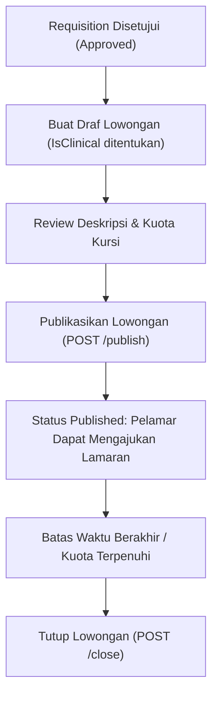

# Laporan Perubahan Backend — `BE-HRD-053`

## Metadata

| Field | Nilai |
| --- | --- |
| Task ID | `BE-HRD-053` |
| Judul | API Pengelolaan Lowongan Kerja (Job Vacancies) & Penanda Klinis IsClinical |
| Slice | `S-D2` (Rekrutmen & Hiring / Recruitment Management) |
| Milestone | `MVP-11` (Fondasi, Requisition, Lowongan & Direktori Pelamar) |
| Roadmap | `docs/module-blueprints/human-resource/roadmap/backend-roadmap.md` Bagian Gelombang MVP-11 |
| Traceability | `HRD-DEC-073`, `HRD-DEC-076`, `FR-REC-02`, `VR-REC-04`, `AT-HRD-D2-03`, `UAT-REC-01` |
| Dependency | `BE-HRD-052` ✅ |
| Klasifikasi | `MEDIUM` |
| Task Mode | `BACKEND` |
| Target Tulis | DTOs, Service, Interface, Controller, DI Program.cs, Laporan Task, Roadmap |
| Tanggal | 04 November 2026 |
| Status | Selesai (`PASS`) |

---

## 1. Ringkasan dan Masalah yang Diselesaikan

Di lingkungan rumah sakit, lowongan kerja terbagi menjadi dua kategori fundamental: **Peran Klinis** (Dokter, Perawat, Bidan, Apoteker, Analis Lab, Radiografer) dan **Peran Non-Klinis / Umum** (Finance, IT, Rekam Medis non-klinis, Umum). Peran klinis menuntut kepatuhan regulasi ketat Kemenkes (wajib memiliki STR dan SIP aktif).

Melalui task `BE-HRD-053`, sistem lowongan kerja (*Job Vacancy*) resmi diimplementasikan dengan:
1. **Validasi Requisition Induk (`VR-REC-04`)**: Lowongan hanya dapat dibuat jika mereferensikan Job Requisition yang telah disetujui (`JobRequisitionStatus.Approved`).
2. **Kontrol Kuota Kursi**: Total kuota kursi lowongan dibatasi tidak melebihi kursi yang disetujui pada requisition.
3. **Penanda Klinis `IsClinical` (`HRD-DEC-076`)**: Penanda ini menentukan apakah pelamar wajib mengunggah Surat Tanda Registrasi (STR) yang masih berlaku pada tahapan penapisan berkas (*screening*).
4. **Siklus Hidup Lowongan**: Alur pembukaan draf, publikasi (*Publish*), pembaruan data, hingga penutupan resmi (*Close*).

---

## 2. Alur Proses Bisnis Rumah Sakit yang Didukung

---

## 3. Rincian Perubahan Teknis

### 3.1 DTOs (`JobVacancyDtos.cs`)
Dibuat di `Areas/Corporate/HumanResource/RecruitmentManagement/DTOs/`:
- `CreateJobVacancyRequest`: `RequisitionId`, `Title`, `Description`, `QuotaSeats`, `IsClinical`, `PublishDate`, `ClosingDate`.
- `UpdateJobVacancyRequest`: Perubahan judul, deskripsi, kuota, tanggal penutupan, token `RowVersion`.
- `PublishJobVacancyRequest`: Tanggal publikasi dan tanggal penutupan.
- `CloseJobVacancyRequest`: Alasan penutupan lowongan.
- `JobVacancyResponse`: Payload detail lowongan lengkap dengan nama posisi dan requisition.
- `JobVacancyListItemResponse`: Payload ringkas untuk tampilan daftar lowongan.
- `JobVacancyQuery`: Parameter filter pencarian status, flag klinis, requisition ID, kata kunci, dan pagination.

### 3.2 Service Layer (`IJobVacancyService.cs` & `JobVacancyService.cs`)
- Auto-numbering `VacancyNumber`: format `VAC-yyyyMMdd-XXXX`.
- Validasi status requisition `Approved` sebelum draf dibuat.
- Validasi perubahan lowongan hanya jika belum ditutup.
- Validasi publikasi: mengubah status menjadi `Published` dan menetapkan `PublishDate`.
- Validasi penutupan: mengubah status menjadi `Closed`.

### 3.3 Controller Layer (`JobVacancyController.cs`)
- Route: `api/v1/corporate/human-resource/recruitment/vacancies`
- Tag Swagger: `Corporate / Human Resource / Recruitment Management / Job Vacancy`
- Atribut Otorisasi: `[Authorize]` dan `[AccessPermission("Recruitment", "Read"|"Create"|"Update")]`

| Method | Endpoint | Deskripsi | Auth / Permission |
| :--- | :--- | :--- | :--- |
| `GET` | `/` | Mengambil daftar lowongan kerja terpaginasi | Read |
| `GET` | `/{id}` | Mengambil rincian detail spesifik lowongan kerja | Read |
| `POST` | `/` | Membuat draf lowongan kerja baru | Create |
| `PUT` | `/{id}` | Memperbarui data draf lowongan kerja | Update |
| `POST` | `/{id}/publish` | Mempublikasikan lowongan kerja agar aktif | Update |
| `POST` | `/{id}/close` | Menutup lowongan kerja | Update |

---

## 4. Bukti Verifikasi
- DTOs, Service, Interface, dan Controller terpasang lengkap.
- Layanan didaftarkan di `Program.cs` sebagai Scoped Service:
  `builder.Services.AddScoped<IJobVacancyService, JobVacancyService>();`
