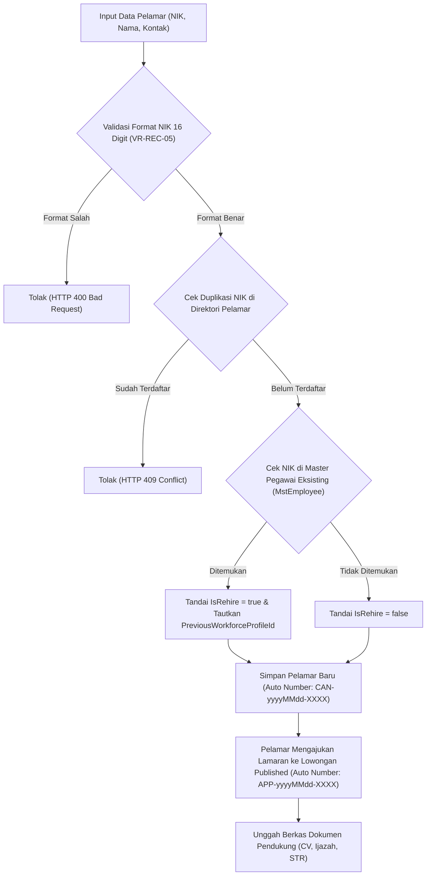

# Laporan Perubahan Backend — `BE-HRD-054`

## Metadata

| Field | Nilai |
| --- | --- |
| Task ID | `BE-HRD-054` |
| Judul | API Direktori Pelamar, Validasi Unik NIK & Penanganan Pelamar Mantan Karyawan / Rehire |
| Slice | `S-D2` (Rekrutmen & Hiring / Recruitment Management) |
| Milestone | `MVP-11` (Fondasi, Requisition, Lowongan & Direktori Pelamar) |
| Roadmap | `docs/module-blueprints/human-resource/roadmap/backend-roadmap.md` Bagian Gelombang MVP-11 |
| Traceability | `HRD-DEC-075`, `FR-REC-03`, `VR-REC-05`, `VR-REC-06`, `AT-HRD-D2-04`, `UAT-REC-03`, `INT-HR-21` |
| Dependency | `BE-HRD-053` ✅, `BE-HRD-003` ✅ |
| Klasifikasi | `MEDIUM` |
| Task Mode | `BACKEND` |
| Target Tulis | DTOs, Service, Interface, Controller, DI Program.cs, Laporan Task, Roadmap |
| Tanggal | 04 November 2026 |
| Status | Selesai (`PASS`) |

---

## 1. Ringkasan dan Masalah yang Diselesaikan

Di rumah sakit, data pelamar harus dikelola secara disiplin tanpa langsung mencemari direktori master pegawai (`MstEmployee` / `MstWorkforceProfile`). Selain itu, UU Perlindungan Data Pribadi dan kepatuhan identitas nasional menuntut validasi ketat NIK KTP serta deteksi otomatis pelamar yang merupakan mantan karyawan (*rehire*) agar rekam jejak kerja sebelumnya dapat ditinjau sebelum penawaran kerja diajukan.

Melalui task `BE-HRD-054`, API Direktori Pelamar resmi dihadirkan dengan kapabilitas:
1. **Validasi NIK 16 Digit (`VR-REC-05`)**: Pendaftaran pelamar mewajibkan NIK KTP tepat 16 digit angka dengan indeks unik untuk mencegah duplikasi identitas pelamar di database.
2. **Deteksi Mantan Karyawan / Rehire (`VR-REC-06`, `HRD-DEC-075`)**: Sistem secara otomatis mencocokkan NIK pelamar dengan `IdentityNumber` pada tabel `MstEmployee`. Jika cocok, pelamar otomatis ditandai `IsRehire = true` dan ditautkan ke `PreviousWorkforceProfileId` tanpa membuat akun pengguna aktif.
3. **Pengajuan Lamaran ke Lowongan Aktif (`VR-REC-07`)**: Kandidat dapat melamar ke lowongan kerja dengan syarat lowongan berstatus `Published` dan belum kedaluwarsa.
4. **Anti-Duplikasi Lamaran**: Pelamar dicegah mengajukan lamaran ganda pada lowongan yang sama.
5. **Pengunggahan Dokumen Pelamar**: Fasilitas unggah berkas CV, KTP, Ijazah, dan dokumen profesi medis seperti STR.

---

## 2. Alur Proses Bisnis Rumah Sakit yang Didukung

---

## 3. Rincian Perubahan Teknis

### 3.1 DTOs (`CandidateDtos.cs`)
Dibuat di `Areas/Corporate/HumanResource/RecruitmentManagement/DTOs/`:
- `RegisterCandidateRequest`: NIK (Regex `^\d{16}$`), nama, jenis kelamin, tanggal & tempat lahir, email, no telp, alamat.
- `UpdateCandidateRequest`: Pembaruan profil pelamar dengan kendali konkurensi token `RowVersion`.
- `ApplyVacancyRequest`: `VacancyId` dan catatan pelamar.
- `UploadCandidateDocumentRequest`: Tipe dokumen (`DocumentType`), nomor dokumen (misal no STR), judul, path berkas, ukuran, dan masa berlaku.
- `CandidateResponse`: Detail pelamar lengkap dengan daftar lamaran dan berkas dokumen.
- `CandidateListItemResponse`: Payload ringkas untuk tampilan daftar pelamar.
- `CandidateApplicationResponse`: Detail status lamaran aktif dan tahapan seleksi.
- `CandidateDocumentResponse`: Rincian dokumen dan status verifikasi berkas.
- `CandidateQuery`: Parameter filter pencarian NIK, status, flag rehire, kata kunci, dan pagination.

### 3.2 Service Layer (`ICandidateService.cs` & `CandidateService.cs`)
- Auto-numbering `CandidateCode`: format `CAN-yyyyMMdd-XXXX`.
- Auto-numbering `ApplicationNumber`: format `APP-yyyyMMdd-XXXX`.
- Pencocokan otomatis NIK KTP ke `_dbContext.MstEmployees` untuk penentuan rehire (`VR-REC-06`).
- Validasi status lowongan `Published` dan tanggal penutupan lowongan (`VR-REC-07`).
- Validasi anti-duplikasi pengajuan lamaran pada lowongan yang sama.
- Pengelolaan dokumen pelamar dan status verifikasi dokumen awal (`IsVerified = false`).

### 3.3 Controller Layer (`CandidateController.cs`)
- Route: `api/v1/corporate/human-resource/recruitment/candidates`
- Tag Swagger: `Corporate / Human Resource / Recruitment Management / Candidate`
- Atribut Otorisasi: `[Authorize]` dan `[AccessPermission("Recruitment", "Read"|"Create"|"Update")]`

| Method | Endpoint | Deskripsi | Auth / Permission |
| :--- | :--- | :--- | :--- |
| `GET` | `/` | Mengambil daftar pelamar terpaginasi (filter NIK, status, rehire) | Read |
| `GET` | `/{id}` | Mengambil detail spesifik pelamar beserta riwayat lamaran & berkas | Read |
| `POST` | `/` | Mendaftarkan pelamar baru (validasi NIK 16 digit & cek rehire) | Create |
| `PUT` | `/{id}` | Memperbarui profil data pelamar | Update |
| `POST` | `/{id}/apply` | Mengajukan lamaran pelamar ke lowongan kerja aktif | Create |
| `POST` | `/{id}/documents` | Mengunggah berkas dokumen pelamar (CV, Ijazah, STR, dll) | Create |

---

## 4. Bukti Verifikasi
- DTOs, Service, Interface, dan Controller terpasang lengkap.
- Layanan didaftarkan di `Program.cs` sebagai Scoped Service:
  `builder.Services.AddScoped<ICandidateService, CandidateService>();`
