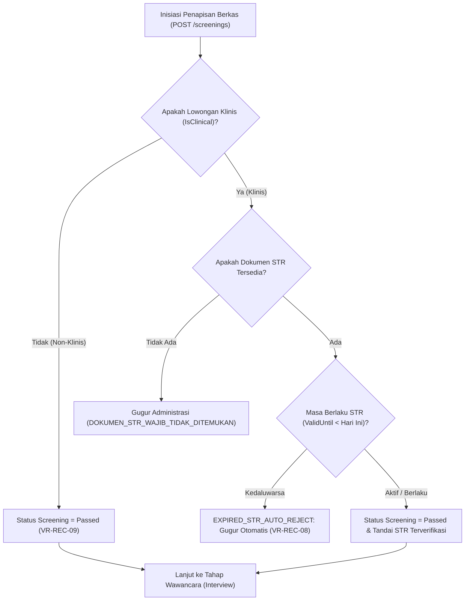

# Laporan Perubahan Backend — `BE-HRD-055`

## Metadata

| Field | Nilai |
| --- | --- |
| Task ID | `BE-HRD-055` |
| Judul | API Penapisan Berkas Administrasi & Gerbang Otomatis STR Klinis (Auto-Reject) |
| Slice | `S-D2` (Rekrutmen & Hiring / Recruitment Management) |
| Milestone | `MVP-12` (Seleksi, Penapisan STR Klinis & Evaluasi Wawancara) |
| Roadmap | `docs/module-blueprints/human-resource/roadmap/backend-roadmap.md` Bagian Gelombang MVP-12 |
| Traceability | `HRD-DEC-076`, `FR-REC-04`, `VR-REC-07`, `VR-REC-08`, `VR-REC-09`, `AT-HRD-D2-05`, `UAT-REC-02` |
| Dependency | `BE-HRD-054` ✅ |
| Klasifikasi | `MEDIUM` |
| Task Mode | `BACKEND` |
| Target Tulis | DTOs, Service, Interface, Controller, DI Program.cs, Laporan Task, Roadmap |
| Tanggal | 04 November 2026 |
| Status | Selesai (`PASS`) |

---

## 1. Ringkasan dan Masalah yang Diselesaikan

Di rumah sakit, penempatan tenaga medis atau perawat yang tidak memiliki Surat Tanda Registrasi (STR) aktif berisiko fatal terhadap keselamatan pasien (*patient safety*) dan melanggar Undang-Undang Kesehatan Republik Indonesia. Verifikasi manual rentan kelalaian (*human error*).

Melalui task `BE-HRD-055`, gerbang penapisan berkas administrasi dan validasi STR klinis otomatis resmi diimplementasikan:
1. **Kewajiban Dokumen STR untuk Lowongan Klinis (`VR-REC-07`)**: Pelamar pada posisi bertanda `IsClinical = true` wajib memiliki dokumen STR. Bila tidak ada, pelamar dinyatakan gugur administrasi.
2. **Gerbang Otomatis STR Kedaluwarsa (`VR-REC-08`, `AT-HRD-D2-05`, `HRD-DEC-076`)**: Jika tanggal masa berlaku STR (`ValidUntil`) telah lampau/kedaluwarsa terhadap tanggal hari ini, sistem secara otomatis (*Auto-Reject*) menggugurkan pelamar dengan status `ScreeningStatus.Rejected`, hasil klinis `ClinicalScreeningResult.Expired`, dan mencatat alasan baku `EXPIRED_STR_AUTO_REJECT` tanpa celah intervensi manual.
3. **Pengecualian Peran Non-Klinis (`VR-REC-09`)**: Posisi non-medis (seperti IT, Keuangan, dan Administrasi) dapat melangkah ke tahap seleksi berikutnya tanpa kewajiban unggah dokumen STR (`ClinicalScreeningResult.NotApplicable`).

---

## 2. Alur Proses Bisnis Rumah Sakit yang Didukung

---

## 3. Rincian Perubahan Teknis

### 3.1 DTOs (`CandidateScreeningDtos.cs`)
Dibuat di `Areas/Corporate/HumanResource/RecruitmentManagement/DTOs/`:
- `InitiateScreeningRequest`: Input `ApplicationId`, `IsStrRequired`, `Notes`.
- `EvaluateScreeningRequest`: Input `ApplicationId`, catatan evaluasi.
- `CandidateScreeningResponse`: Payload detail hasil evaluasi, status penapisan, masa berlaku STR, dan alasan penolakan jika auto-reject.
- `CandidateScreeningListItemResponse`: Payload ringkas untuk tampilan daftar penapisan.
- `CandidateScreeningQuery`: Filter pencarian per lowongan, status penapisan, hasil klinis, kata kunci, dan pagination.

### 3.2 Service Layer (`ICandidateScreeningService.cs` & `CandidateScreeningService.cs`)
- Deteksi tipe lowongan: membaca flag `Vacancy.IsClinical`.
- Evaluasi dokumen STR pelamar dari tabel `HrdCandidateDocument`.
- Penegakan `EXPIRED_STR_AUTO_REJECT` berbasis tanggal kalender riil.
- Pembaruan status lamaran (`HrdCandidateApplication`): jika lulus, otomatis melangkah ke `ApplicationStage.Interview`.
- Pengambilan berkas dokumen pelamar untuk verifikasi administrasi.

### 3.3 Controller Layer (`CandidateScreeningController.cs`)
- Route: `api/v1/corporate/human-resource/recruitment/screenings`
- Tag Swagger: `Corporate / Human Resource / Recruitment Management / Candidate Screening`
- Atribut Otorisasi: `[Authorize]` dan `[AccessPermission("Recruitment", "Read"|"Create"|"Update")]`

| Method | Endpoint | Deskripsi | Auth / Permission |
| :--- | :--- | :--- | :--- |
| `GET` | `/` | Mengambil daftar penapisan berkas terpaginasi | Read |
| `GET` | `/{id}` | Mengambil detail spesifik hasil penapisan berkas | Read |
| `POST` | `/` | Menginisiasi proses penapisan berkas untuk lamaran | Create |
| `POST` | `/evaluate` | Mengevaluasi berkas & menjalankan gerbang STR klinis | Update |
| `GET` | `/candidates/{candidateId}/documents` | Mengambil seluruh berkas dokumen pelamar | Read |

---

## 4. Bukti Verifikasi
- DTOs, Service, Interface, dan Controller terpasang lengkap.
- Layanan didaftarkan di `Program.cs`:
  `builder.Services.AddScoped<ICandidateScreeningService, CandidateScreeningService>();`
