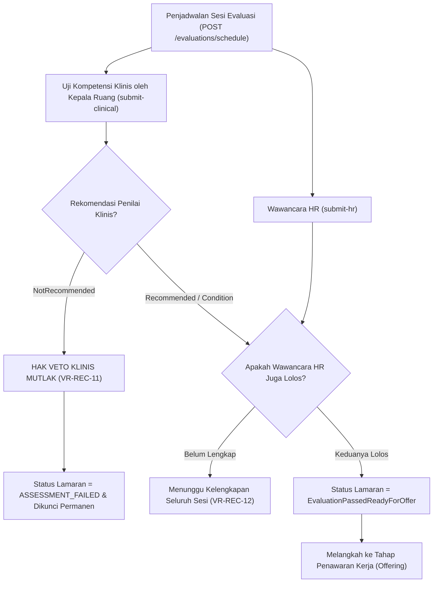

# Laporan Perubahan Backend — `BE-HRD-056`

## Metadata

| Field | Nilai |
| --- | --- |
| Task ID | `BE-HRD-056` |
| Judul | API Evaluasi Wawancara HR & Uji Klinis dengan Penegakan Hak Veto Klinis Mutlak |
| Slice | `S-D2` (Rekrutmen & Hiring / Recruitment Management) |
| Milestone | `MVP-12` (Seleksi, Penapisan STR Klinis & Evaluasi Wawancara) |
| Roadmap | `docs/module-blueprints/human-resource/roadmap/backend-roadmap.md` Bagian Gelombang MVP-12 |
| Traceability | `HRD-DEC-077`, `FR-REC-05`, `FR-REC-06`, `VR-REC-10`, `VR-REC-11`, `VR-REC-12`, `AT-HRD-D2-06`, `UAT-REC-04` |
| Dependency | `BE-HRD-055` ✅ |
| Klasifikasi | `MEDIUM` |
| Task Mode | `BACKEND` |
| Target Tulis | DTOs, Service, Interface, Controller, DI Program.cs, Laporan Task, Roadmap |
| Tanggal | 04 November 2026 |
| Status | Selesai (`PASS`) |

---

## 1. Ringkasan dan Masalah yang Diselesaikan

Di rumah sakit, rekrutmen tenaga medis/keperawatan tidak boleh hanya didasarkan pada kecocokan budaya atau penilaian umum HRD. Penilaian kompetensi klinis langsung oleh Asesor Profesi / Kepala Ruangan (misal: Kepala ICU, Kepala Kamar Operasi, Komite Keperawatan) bersifat esensial. Jika seorang dokter atau perawat dinyatakan tidak kompeten dalam penanganan klinis, pihak manajemen atau HR tidak boleh memaksakan perekrutan tersebut.

Melalui task `BE-HRD-056`, sistem evaluasi terpadu (*Dual-Track Evaluation*) resmi diimplementasikan dengan:
1. **Otoritas Penilai Klinis (`VR-REC-10`)**: Uji kompetensi klinis (`ClinicalCompetencyTest`) dipisahkan dari wawancara umum HR (`HrInterview`).
2. **Penegakan Hak Veto Klinis Mutlak (`VR-REC-11`, `HRD-DEC-077`)**: Jika asesor profesi memberikan rekomendasi `EvaluationRecommendation.NotRecommended`, sistem secara otomatis mengaktifkan flag `IsClinicalVetoApplied = true`, mengunci status lamaran menjadi `ASSESSMENT_FAILED`, dan menggugurkan kandidat secara permanen. Veto ini mutlak dan tidak dapat dibatalkan oleh HRD.
3. **Kewajiban Dual-Track untuk Posisi Klinis (`VR-REC-12`)**: Kandidat posisi klinis wajib menuntaskan kedua sesi (Wawancara HR dan Uji Klinis) dengan rekomendasi lulus sebelum dapat diproses ke penerbitan surat penawaran kerja (*Job Offer*).

---

## 2. Alur Proses Bisnis Rumah Sakit yang Didukung

---

## 3. Rincian Perubahan Teknis

### 3.1 DTOs (`CandidateEvaluationDtos.cs`)
Dibuat di `Areas/Corporate/HumanResource/RecruitmentManagement/DTOs/`:
- `ScheduleEvaluationRequest`: Input `ApplicationId`, `EvaluationType`, data asesor/pewawancara, tanggal sesi, catatan.
- `SubmitHrEvaluationRequest`: Skor 0-100, rekomendasi (`Recommended`, `RecommendedWithCondition`, `NotRecommended`), catatan pewawancara HR.
- `SubmitClinicalEvaluationRequest`: Skor 0-100, rekomendasi, alasan veto jika `NotRecommended`, umpan balik klinis.
- `CandidateEvaluationResponse`: Detail lengkap evaluasi beserta status veto klinis dan alasan penolakan.
- `CandidateEvaluationListItemResponse`: Payload ringkas untuk tampilan daftar evaluasi.
- `CandidateEvaluationQuery`: Filter tipe evaluasi, rekomendasi, status veto, kata kunci, dan pagination.

### 3.2 Service Layer (`ICandidateEvaluationService.cs` & `CandidateEvaluationService.cs`)
- Penjadwalan sesi evaluasi ke tabel `HrdCandidateEvaluation`.
- Penegakan aturan `IsClinicalVetoApplied` pada saat submit uji klinis: mengunci `HrdCandidateApplication.StageStatus = "ASSESSMENT_FAILED"` dan `HrdCandidate.Status = CandidateStatus.Rejected`.
- Penyelarasan tahapan lamaran: memvalidasi apakah kedua sesi (HR dan Klinis) telah lengkap sebelum meloloskan lamaran ke tahap penawaran (`ApplicationStage.Offering`).

### 3.3 Controller Layer (`CandidateEvaluationController.cs`)
- Route: `api/v1/corporate/human-resource/recruitment/evaluations`
- Tag Swagger: `Corporate / Human Resource / Recruitment Management / Candidate Evaluation`
- Atribut Otorisasi: `[Authorize]` dan `[AccessPermission("Recruitment", "Read"|"Create"|"Update")]`

| Method | Endpoint | Deskripsi | Auth / Permission |
| :--- | :--- | :--- | :--- |
| `GET` | `/` | Mengambil daftar sesi evaluasi terpaginasi | Read |
| `GET` | `/{id}` | Mengambil detail spesifik hasil evaluasi kandidat | Read |
| `POST` | `/schedule` | Menjadwalkan sesi evaluasi (HR / Klinis) | Create |
| `POST` | `/{id}/submit-hr` | Memasukkan hasil wawancara HR | Update |
| `POST` | `/{id}/submit-clinical` | Memasukkan hasil uji klinis dengan Hak Veto Klinis | Update |

---

## 4. Bukti Verifikasi
- DTOs, Service, Interface, dan Controller terpasang lengkap.
- Layanan didaftarkan di `Program.cs`:
  `builder.Services.AddScoped<ICandidateEvaluationService, CandidateEvaluationService>();`
