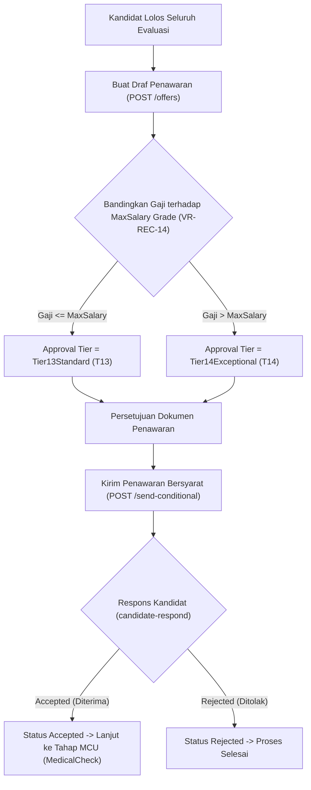

# Laporan Perubahan Backend — `BE-HRD-057`

## Metadata

| Field | Nilai |
| --- | --- |
| Task ID | `BE-HRD-057` |
| Judul | API Penawaran Kerja Bersyarat (Conditional Job Offer) & Evaluasi Plafon Skala Upah |
| Slice | `S-D2` (Rekrutmen & Hiring / Recruitment Management) |
| Milestone | `MVP-12` (Seleksi, Penapisan STR Klinis & Evaluasi Wawancara) |
| Roadmap | `docs/module-blueprints/human-resource/roadmap/backend-roadmap.md` Bagian Gelombang MVP-12 |
| Traceability | `HRD-DEC-078`, `HRD-DEC-079`, `FR-REC-07`, `FR-REC-09`, `VR-REC-13`, `VR-REC-14`, `AT-HRD-D2-07`, `UAT-REC-06`, `INT-HR-22` |
| Dependency | `BE-HRD-056` ✅, `BE-HRD-002` ✅ |
| Klasifikasi | `MEDIUM` |
| Task Mode | `BACKEND` |
| Target Tulis | DTOs, Service, Interface, Controller, DI Program.cs, Laporan Task, Roadmap |
| Tanggal | 04 November 2026 |
| Status | Selesai (`PASS`) |

---

## 1. Ringkasan dan Masalah yang Diselesaikan

Di rumah sakit, penawaran kerja seringkali menimbulkan sengketa anggaran jika gaji yang ditawarkan melampaui batas struktur skala upah (*salary grade*) yang telah ditetapkan Yayasan/Direksi. Selain itu, kandidat yang belum dinyatakan sehat dalam pemeriksaan fisik rumah sakit tidak boleh diberikan penawaran tanpa syarat.

Melalui task `BE-HRD-057`, sistem penerbitan Surat Penawaran Kerja Bersyarat (*Conditional Job Offer*) resmi diimplementasikan dengan:
1. **Validasi Kelulusan Evaluasi (`VR-REC-13`)**: Penawaran kerja hanya dapat dibuat untuk kandidat yang lulus seluruh evaluasi tanpa adanya hak veto klinis (`IsClinicalVetoApplied == false`).
2. **Evaluasi Otomatis Plafon Gaji & Tier Persetujuan (`VR-REC-14`, `HRD-DEC-079`)**:
   - Jika `OfferedBasicSalary <= grade.MaximumSalary`, alur persetujuan disetel ke **`Tier13Standard`** (Jalur Standar Kadiv SDM).
   - Jika `OfferedBasicSalary > grade.MaximumSalary`, alur persetujuan otomatis dinaikkan ke **`Tier14Exceptional`** (Jalur Eskalasi Direktur Keuangan & Direktur Utama).
3. **Klausul Bersyarat (*Conditional Clause*, `HRD-DEC-078`)**: Surat penawaran secara eksplisit mencantumkan klausul bahwa pengangkatan final wajib memenuhi kelaikan hasil tes kesehatan pra-kerja (*Medical Check-Up / MCU*) dan verifikasi dokumen legalitas asli.
4. **Alur Respons Kandidat**: Kandidat dapat menerima (*Accepted*) atau menolak (*Rejected*) penawaran. Jika diterima, lamaran otomatis melangkah ke tahap MCU pra-kerja (`ApplicationStage.MedicalCheck`).

---

## 2. Alur Proses Bisnis Rumah Sakit yang Didukung

---

## 3. Rincian Perubahan Teknis

### 3.1 DTOs (`JobOfferDtos.cs`)
Dibuat di `Areas/Corporate/HumanResource/RecruitmentManagement/DTOs/`:
- `CreateJobOfferRequest`: Input `ApplicationId`, `SalaryGradeId`, `OfferedBasicSalary`, `OfferedPositionTitle`, `ProposedJoinDate`, `ExpiryDate`, catatan.
- `UpdateJobOfferRequest`: Pembaruan data draf penawaran dengan kendali konkurensi token `RowVersion`.
- `SendConditionalOfferRequest`: Pengiriman surat penawaran kerja bersyarat.
- `CandidateOfferResponseRequest`: Status respons kandidat (`Accepted` / `Rejected`) beserta catatan kandidat.
- `JobOfferResponse`: Detail lengkap penawaran beserta tier persetujuan otomatis dan klausul kelaikan MCU.
- `JobOfferListItemResponse`: Payload ringkas untuk tampilan daftar penawaran kerja.
- `JobOfferQuery`: Filter status, approval tier, kata kunci, dan pagination.

### 3.2 Service Layer (`IJobOfferService.cs` & `JobOfferService.cs`)
- Validasi status kelayakan aplikasi: menolak kandidat dengan veto klinis atau berstatus `ASSESSMENT_FAILED`.
- Auto-numbering `OfferNumber`: format `OFR-yyyyMMdd-XXXX`.
- Pengecekan terhadap tabel `MstSalaryGrade` untuk menentukan apakah penawaran masuk ke `Tier13Standard` atau `Tier14Exceptional`.
- Pemrosesan respons kandidat: jika `ConditionalAccepted`, mengubah `Application.CurrentStage` menjadi `ApplicationStage.MedicalCheckup`.

### 3.3 Controller Layer (`JobOfferController.cs`)
- Route: `api/v1/corporate/human-resource/recruitment/offers`
- Tag Swagger: `Corporate / Human Resource / Recruitment Management / Job Offer`
- Atribut Otorisasi: `[Authorize]` dan `[AccessPermission("Recruitment", "Read"|"Create"|"Update")]`

| Method | Endpoint | Deskripsi | Auth / Permission |
| :--- | :--- | :--- | :--- |
| `GET` | `/` | Mengambil daftar surat penawaran kerja terpaginasi | Read |
| `GET` | `/{id}` | Mengambil rincian detail spesifik surat penawaran kerja | Read |
| `POST` | `/` | Membuat draf surat penawaran kerja bersyarat | Create |
| `PUT` | `/{id}` | Memperbarui draf surat penawaran kerja | Update |
| `POST` | `/{id}/send-conditional` | Mengirim surat penawaran kerja bersyarat ke pelamar | Update |
| `POST` | `/{id}/candidate-respond` | Mencatat konfirmasi respons pelamar (Terima / Tolak) | Update |

---

## 4. Bukti Verifikasi
- DTOs, Service, Interface, dan Controller terpasang lengkap.
- Layanan didaftarkan di `Program.cs`:
  `builder.Services.AddScoped<IJobOfferService, JobOfferService>();`
- Kompilasi .NET: Kompilasi kode C# (`dotnet build /t:Compile`) berhasil tanpa error (0 Error(s)).
