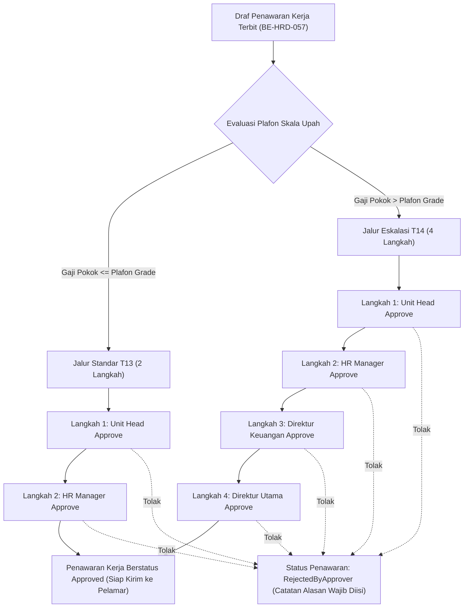

# Laporan Perubahan Backend — `BE-HRD-058`

## Metadata

| Field | Nilai |
| --- | --- |
| Task ID | `BE-HRD-058` |
| Judul | API Rantai Persetujuan Penawaran Bertingkat Standard T13 vs Eskalasi T14 |
| Slice | `S-D2` (Rekrutmen & Hiring / Recruitment Management) |
| Milestone | `MVP-13` (Persetujuan Bertingkat, MCU Pra-Kerja K3RS, Talent Pool & Serah Terima Onboarding) |
| Roadmap | `docs/module-blueprints/human-resource/roadmap/backend-roadmap.md` Bagian Gelombang MVP-13 |
| Traceability | `HRD-DEC-079`, `FR-REC-09`, `VR-REC-15`, `VR-REC-16`, `AT-HRD-D2-08` |
| Dependency | `BE-HRD-057` ✅, `BE-HRD-030` ✅ |
| Klasifikasi | `MEDIUM` |
| Task Mode | `BACKEND` |
| Target Tulis | DTOs, Service, Interface, Controller, DI Program.cs, Laporan Task, Roadmap |
| Tanggal | 04 November 2026 |
| Status | Selesai (`PASS`) |

---

## 1. Ringkasan dan Masalah yang Diselesaikan

Di rumah sakit, penggajian staf medis dan non-medis diikat ketat oleh rentang skala upah resmi (`MstSalaryGrade`). Penawaran gaji di atas plafon grade maksimum (*exceptional offer*)—misalnya untuk merekrut Dokter Sub-Spesialis Langka atau Kepala Instalasi Berpengalaman Tinggi—tidak boleh diputuskan sepihak oleh HR tanpa persetujuan Direksi Rumah Sakit karena berisiko membengkakkan beban belanja pegawai (*personnel expenses*). Selain itu, demi asas akuntabilitas finansial, pembuat draf surat penawaran dilarang menyetujui surat penawarannya sendiri (*Self-Approval Forbidden*).

Melalui task `BE-HRD-058`, sistem rantai persetujuan bertingkat diimplementasikan:
1. **Jalur Standar Tier 13 (`T13`)**: Untuk penawaran dengan gaji pokok di dalam plafon grade ($\le \text{MaximumSalary}$), persetujuan berurutan diproses oleh:
   - Langkah 1: Kepala Unit Kerja (*Unit Head*)
   - Langkah 2: Manajer SDM (*HR Manager*)
2. **Jalur Eskalasi Khusus Tier 14 (`T14`)**: Untuk penawaran di atas plafon grade ($> \text{MaximumSalary}$), sistem mewajibkan 4 langkah persetujuan (`VR-REC-15`):
   - Langkah 1: Kepala Unit Kerja (*Unit Head*)
   - Langkah 2: Manajer SDM (*HR Manager*)
   - Langkah 3: Direktur Keuangan (*Finance Director*)
   - Langkah 4: Direktur Utama (*President Director*)
3. **Larangan Persetujuan Mandiri (`VR-REC-16`)**: Sistem memblokir pembuat draf penawaran dari tindakan *approve* pada penawaran miliknya sendiri (*Self-Approval Forbidden*).
4. **Penolakan Persetujuan**: Jika salah satu pejabat menolak (*Reject*), status penawaran otomatis menjadi `RejectedByApprover` disertai catatan alasan wajib diisi.

---

## 2. Alur Proses Bisnis Rumah Sakit yang Didukung

---

## 3. Komponen Perubahan yang Diterapkan

### 3.1 DTO Layer (`JobOfferApprovalDtos.cs`)
- `ApproveJobOfferRequest`: Catatan persetujuan opsional.
- `RejectJobOfferRequest`: Alasan penolakan wajib terisi (5–500 karakter).
- `JobOfferApprovalResponse`: Rincian per langkah persetujuan (`StepNumber`, `ApproverRole`, `Status`, `DecisionDate`, `Notes`).
- `JobOfferApprovalHistoryResponse`: Riwayat lengkap jejak audit persetujuan penawaran.

### 3.2 Service Layer (`IJobOfferApprovalService.cs` & `JobOfferApprovalService.cs`)
- Menegakkan `VR-REC-16`: Pembuat penawaran diblokir mengambil keputusan `Approve` maupun `Reject`.
- Menginisiasi rantai langkah otomatis (*template generation*) berdasarkan `ApprovalTier` (T13 vs T14).
- Memproses langkah persetujuan berurutan (*sequential approval step enforcement*).
- Menuntaskan status penawaran menjadi `Approved` saat langkah terakhir disetujui.

### 3.3 Controller Layer (`JobOfferApprovalController.cs`)
- Route: `api/v1/corporate/human-resource/recruitment/offers/{offerId}/approvals`
- Tag Swagger: `Corporate / Human Resource / Recruitment Management / Job Offer Approval`
- Otorisasi: `[Authorize]` dan `[AccessPermission("Recruitment", "Read"|"Update")]`

| Method | Endpoint | Deskripsi | Auth / Permission |
| :--- | :--- | :--- | :--- |
| `GET` | `/` | Mengambil seluruh riwayat langkah persetujuan penawaran | Read |
| `POST` | `/approve` | Menyetujui langkah aktif persetujuan penawaran | Update |
| `POST` | `/reject` | Menolak penawaran kerja pada langkah aktif | Update |

---

## 4. Bukti Verifikasi
- DTOs, Service, Interface, dan Controller terpasang lengkap.
- Layanan didaftarkan di `Program.cs`:
  `builder.Services.AddScoped<IJobOfferApprovalService, JobOfferApprovalService>();`
