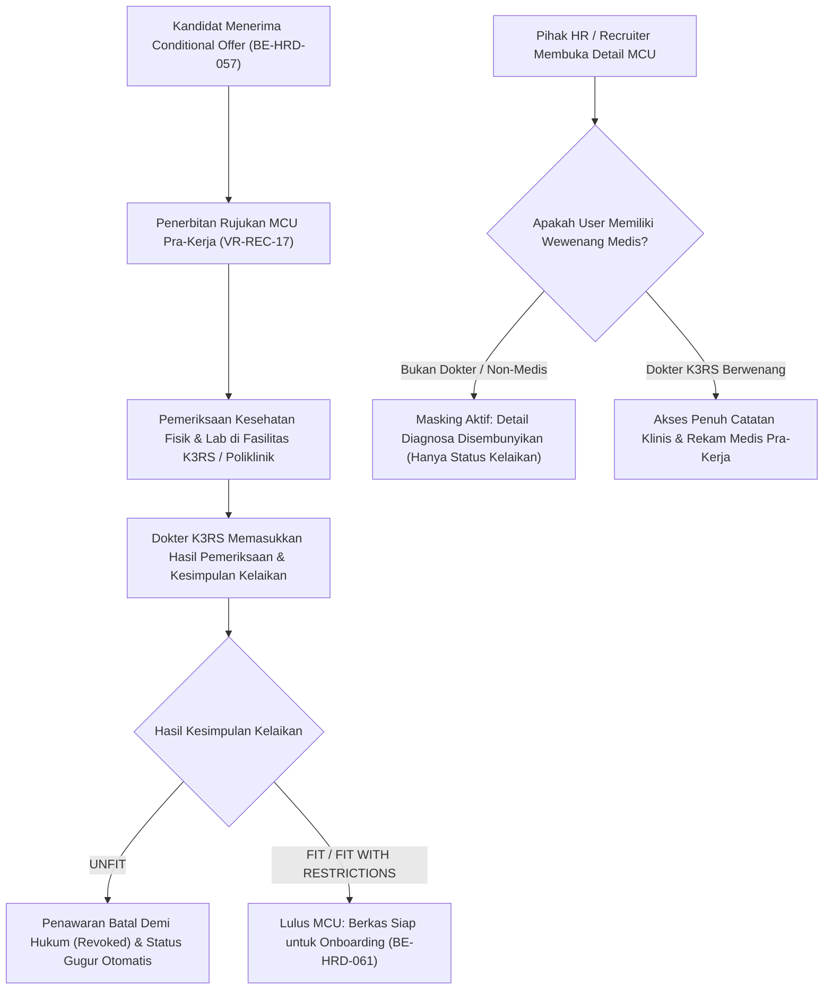

# Laporan Perubahan Backend — `BE-HRD-059`

## Metadata

| Field | Nilai |
| --- | --- |
| Task ID | `BE-HRD-059` |
| Judul | API Pemeriksaan Kesehatan Pra-Kerja (MCU) & Masking Diagnosa Medis K3RS |
| Slice | `S-D2` (Rekrutmen & Hiring / Recruitment Management) |
| Milestone | `MVP-13` (Persetujuan Bertingkat, MCU Pra-Kerja K3RS, Talent Pool & Serah Terima Onboarding) |
| Roadmap | `docs/module-blueprints/human-resource/roadmap/backend-roadmap.md` Bagian Gelombang MVP-13 |
| Traceability | `HRD-DEC-078`, `HRD-DEC-010`, `FR-REC-08`, `VR-REC-17`, `AT-HRD-D2-09`, `UAT-REC-05` |
| Dependency | `BE-HRD-057` ✅ |
| Klasifikasi | `HIGH` |
| Task Mode | `BACKEND` |
| Target Tulis | DTOs, Service, Interface, Controller, DI Program.cs, Laporan Task, Roadmap |
| Tanggal | 04 November 2026 |
| Status | Selesai (`PASS`) |

---

## 1. Ringkasan dan Masalah yang Diselesaikan

Pemeriksaan kesehatan kerja (*Medical Check-Up* / MCU pra-kerja) di rumah sakit memiliki dua tuntutan kritis yang saling bertentangan bila tidak dirancang dengan arsitektur privasi data yang tepat:
1. **Keselamatan Pasien & Kelayakan Fisik Staf**: Rumah sakit wajib memastikan pegawai baru bebas dari penyakit menular aktif atau kondisi fisik yang membahayakan operasional layanan medis intensif (misal epilepsi pada perawat ICU/IGD).
2. **Kerahasiaan Medis Pasien/Staf Sesuai Regulasi UU Kesehatan & Permenkes (`HRD-DEC-010`, `AT-HRD-D2-09`)**: Staf HR, rekruter, maupun manajer non-medis **dilarang keras** membaca detail rekam medis, diagnosa penyakit kronis, riwayat serologi, atau hasil rontgen kandidat. Pihak HR hanya berhak mengetahui **status kesimpulan kelaikan kerja** (`FIT`, `FIT_WITH_RESTRICTIONS`, atau `UNFIT`).

Melalui task `BE-HRD-059`, modul rekrutmen mengimplementasikan:
- **Penerbitan Rujukan MCU Pra-Kerja (`VR-REC-17`)**: Hanya dapat diterbitkan bagi kandidat yang telah menyetujui penawaran kerja bersyarat (`ConditionalAccepted` / `SentConditional`). Nomor rujukan terformat otomatis `MCU-yyyyMMdd-XXXX`.
- **Masking Diagnosa Medis K3RS (`HRD-DEC-010`)**: Deteksi peran pemanggil API. Jika bukan dokter/petugas K3RS berwenang, sistem secara otomatis menyamarkan narasi diagnosa (`DoctorNotes`) menjadi `"[DIAGNOSA MEDIS DIISOLASI - HANYA KESIMPULAN KELAIKAN KERJA DAPAT DIAKSES PIHAK HR/NON-MEDIS]"` dan menandai `IsDoctorNotesMasked = true`.
- **Pembatalan Penawaran Otomatis Bila UNFIT**: Jika hasil MCU dinyatakan `Unfit`, sistem secara otomatis mencabut penawaran (`Offer.Status = JobOfferStatus.Revoked`), menggugurkan lamaran (`ApplicationStage.Rejected`), dan mengunci status `"MCU_UNFIT_OFFER_REVOKED"`.

---

## 2. Alur Proses Bisnis Rumah Sakit yang Didukung

---

## 3. Komponen Perubahan yang Diterapkan

### 3.1 DTO Layer (`McuClearanceDtos.cs`)
- `RegisterMcuRequest`: Input ID penawaran, klinik rujukan, dan tanggal rencana tes.
- `RecordMcuResultRequest`: Input hasil kelaikan kerja (`Fit`, `FitWithRestrictions`, `Unfit`), nama dokter pemeriksa, tanggal periksa, catatan diagnosa klinis, dan tautan sertifikat kesehatan.
- `McuClearanceResponse`: Payload terisolasi dengan proteksi masking diagnosa klinis bagi user non-medis.
- `McuClearanceListItemResponse` & `McuClearanceQuery`: Filter dan pagination terstruktur.

### 3.2 Service Layer (`IMcuClearanceService.cs` & `McuClearanceService.cs`)
- Validasi status penerimaan penawaran kerja sebelum menerbitkan rujukan MCU.
- Auto-numbering kode rujukan `MCU-yyyyMMdd-XXXX`.
- Pengecekan otorisasi medis via `IsAuthorizedMedicalStaff` untuk masking diagnosa.
- Trigger otomatis pembatalan tawaran (*Offer Revoked*) jika hasil MCU `Unfit`.

### 3.3 Controller Layer (`McuClearanceController.cs`)
- Route: `api/v1/corporate/human-resource/recruitment/mcu-clearance`
- Tag Swagger: `Corporate / Human Resource / Recruitment Management / MCU Clearance`
- Otorisasi: `[Authorize]` dan `[AccessPermission("Recruitment", "Read"|"Create"|"Update")]`

| Method | Endpoint | Deskripsi | Auth / Permission |
| :--- | :--- | :--- | :--- |
| `GET` | `/` | Mengambil daftar rujukan MCU terpaginasi | Read |
| `GET` | `/{id}` | Mengambil detail hasil MCU (dengan isolasi masking rekam medis) | Read |
| `POST` | `/register` | Menerbitkan rujukan pemeriksaan MCU pra-kerja | Create |
| `POST` | `/{id}/record-result` | Mencatat hasil kesimpulan kelaikan oleh Dokter K3RS | Update |

---

## 4. Bukti Verifikasi
- DTOs, Service, Interface, dan Controller terpasang lengkap.
- Layanan didaftarkan di `Program.cs`:
  `builder.Services.AddScoped<IMcuClearanceService, McuClearanceService>();`
