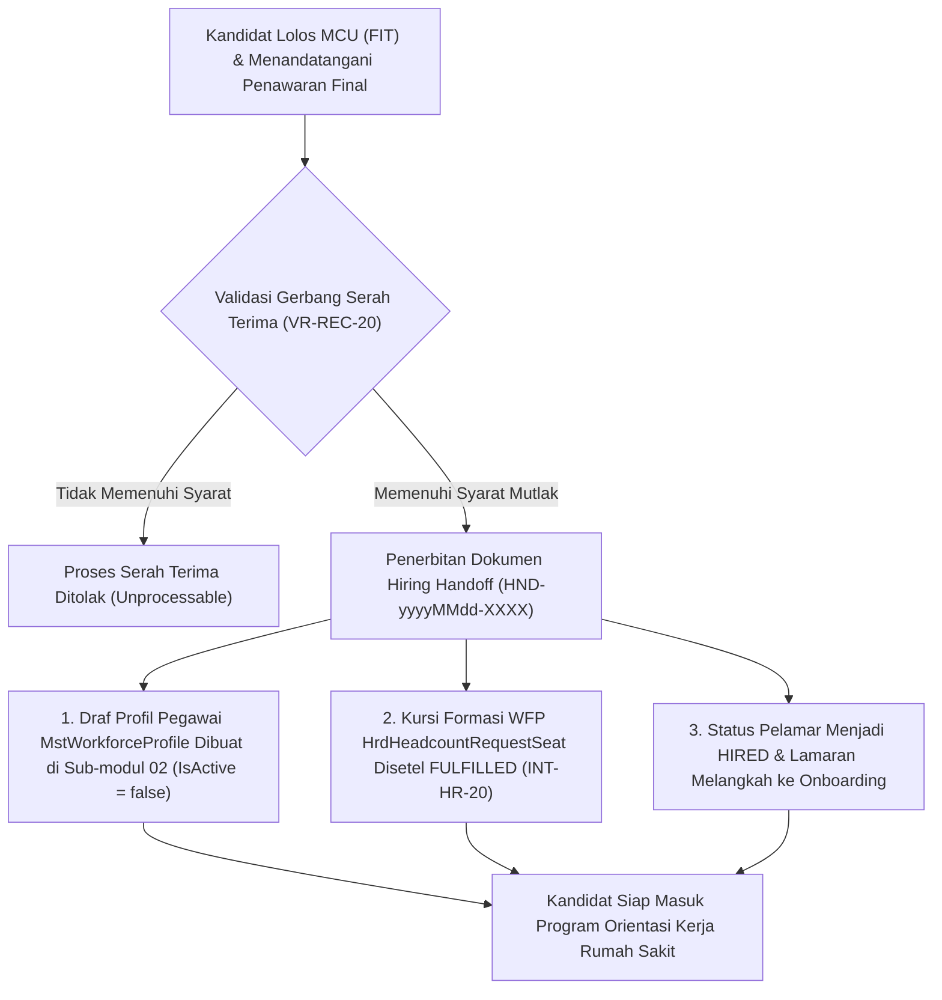

# Laporan Perubahan Backend — `BE-HRD-061`

## Metadata

| Field | Nilai |
| --- | --- |
| Task ID | `BE-HRD-061` |
| Judul | API Serah Terima Rekrutmen ke Onboarding Sub-modul 05 & Sinkronisasi Kursi WFP |
| Slice | `S-D2` (Rekrutmen & Hiring / Recruitment Management) |
| Milestone | `MVP-13` (Persetujuan Bertingkat, MCU Pra-Kerja K3RS, Talent Pool & Serah Terima Onboarding) |
| Roadmap | `docs/module-blueprints/human-resource/roadmap/backend-roadmap.md` Bagian Gelombang MVP-13 |
| Traceability | `HRD-DEC-075`, `HRD-DEC-078`, `FR-REC-10`, `VR-REC-20`, `AT-HRD-D2-11`, `INT-HR-20`, `INT-HR-23` |
| Dependency | `BE-HRD-058` ✅, `BE-HRD-059` ✅, `BE-HRD-052` ✅ |
| Klasifikasi | `HIGH` |
| Task Mode | `BACKEND` |
| Target Tulis | DTOs, Service, Interface, Controller, DI Program.cs, Laporan Task, Roadmap |
| Tanggal | 04 November 2026 |
| Status | Selesai (`PASS`) |

---

## 1. Ringkasan dan Masalah yang Diselesaikan

Titik temu antara proses rekrutmen eksternal dan manajemen kepegawaian internal rumah sakit sering mengalami diskoneksi data jika tidak ada mekanisme serah terima formal (*hiring handoff*). Kesalahan input ulang data calon pegawai oleh staf administrasi personalia dapat memicu duplikasi data pegawai, ketidaksesuaian NIK, atau kekosongan kursi perencanaan tenaga kerja (*Workforce Planning* / WFP) yang tercatat masih terbuka padahal sudah terisi.

Melalui task `BE-HRD-061`, jembatan integrasi serah terima diimplementasikan secara otomatis dan terisolasi:
1. **Prasyarat Mutlak Serah Terima (`VR-REC-20`)**: Dokumen serah terima (*Hiring Handoff*) hanya dapat diterbitkan bila:
   - Kandidat telah menyetujui surat penawaran kerja final (`FinalAccepted`).
   - Kandidat telah lulus uji kesehatan pra-kerja dengan status `FIT` atau `FIT_WITH_RESTRICTIONS`.
2. **Pembentukan Draf Profil Pegawai Baru di Sub-modul 02 (`HRD-DEC-075`, `AT-HRD-D2-11`)**: Sistem secara otomatis membentuk entitas `MstWorkforceProfile` baru:
   - Kode profil terformat unik `WFP-yyyyMMdd-XXXX`.
   - Mengambil data nama, NIK, email, dan nomor telepon yang telah tervalidasi dari direktori pelamar.
   - Status profil disetel `IsActive = false` (Pending Onboarding) sehingga kandidat belum memiliki akses login sistem rumah sakit sebelum program orientasi selesai.
3. **Sinkronisasi Kursi Formasi WFP (`INT-HR-20`, `INT-HR-23`)**: Mengikat kursi formasi pada `HrdHeadcountRequestSeat`, mengubah status kursi menjadi `HeadcountSeatStatus.Fulfilled`, serta mencatat tanggal pemenuhan (`FulfilledAt`) dan ID pengisi secara presisi.
4. **Pembaruan Status Lamaran & Kandidat**: Menetapkan tahapan lamaran menjadi `ApplicationStage.Handoff` dan status kandidat menjadi `CandidateStatus.Hired`.

---

## 2. Alur Proses Bisnis Rumah Sakit yang Didukung

---

## 3. Komponen Perubahan yang Diterapkan

### 3.1 DTO Layer (`HiringHandoffDtos.cs`)
- `GenerateHiringHandoffRequest`: Input ID penawaran final, ID kursi formasi WFP (opsional), dan catatan serah terima.
- `ConfirmHiringHandoffRequest`: Catatan konfirmasi tanda terima oleh unit onboarding.
- `HiringHandoffResponse` & `HiringHandoffListItemResponse`: Rincian nomor handoff, profil pegawai baru, dan status integrasi WFP.
- `HiringHandoffQuery`: Filter pencarian per status terpaginasi.

### 3.2 Service Layer (`IHiringHandoffService.cs` & `HiringHandoffService.cs`)
- Validasi status penawaran dan kelaikan MCU (`VR-REC-20`).
- Auto-generation kode `HND-yyyyMMdd-XXXX` dan `WFP-yyyyMMdd-XXXX`.
- Instansiasi `MstWorkforceProfile` dengan penentuan `UserType` yang tepat (`Doctor` / `Employee`).
- Pembaruan status kursi formasi `HrdHeadcountRequestSeat` menjadi `Fulfilled`.

### 3.3 Controller Layer (`HiringHandoffController.cs`)
- Route: `api/v1/corporate/human-resource/recruitment/handoffs`
- Tag Swagger: `Corporate / Human Resource / Recruitment Management / Hiring Handoff`
- Otorisasi: `[Authorize]` dan `[AccessPermission("Recruitment", "Read"|"Create"|"Update")]`

| Method | Endpoint | Deskripsi | Auth / Permission |
| :--- | :--- | :--- | :--- |
| `GET` | `/` | Mengambil daftar berkas serah terima terpaginasi | Read |
| `GET` | `/{id}` | Mengambil detail dokumen serah terima dan profil draf pegawai | Read |
| `POST` | `/generate` | Menerbitkan dokumen serah terima & membentuk draf profil pegawai | Create |
| `POST` | `/{id}/confirm-transfer` | Mengonfirmasi penerimaan berkas oleh tim orientasi / onboarding | Update |

---

## 4. Bukti Verifikasi
- DTOs, Service, Interface, dan Controller terpasang lengkap.
- Layanan didaftarkan di `Program.cs`:
  `builder.Services.AddScoped<IHiringHandoffService, HiringHandoffService>();`
