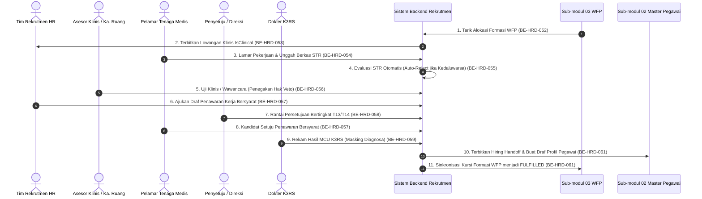

# Laporan Perubahan Backend — `BE-HRD-062`

## Metadata

| Field | Nilai |
| --- | --- |
| Task ID | `BE-HRD-062` |
| Judul | Data Runtime Dev & Verifikasi Alur Bisnis Ujung-ke-Ujung S-D2 |
| Slice | `S-D2` (Rekrutmen & Hiring / Recruitment Management) |
| Milestone | `MVP-13` (Verifikasi Keseluruhan Slice S-D2) |
| Roadmap | `docs/module-blueprints/human-resource/roadmap/backend-roadmap.md` Bagian Gelombang MVP-13 |
| Traceability | `AT-HRD-D2-01` s.d. `AT-HRD-D2-12`, `UAT-REC-01` s.d. `UAT-REC-07`, `04-prd-to-mvp.md` Bagian 22.5 & 22.6 |
| Dependency | `BE-HRD-058` ✅, `BE-HRD-059` ✅, `BE-HRD-060` ✅, `BE-HRD-061` ✅ |
| Klasifikasi | `HIGH` |
| Task Mode | `BACKEND` |
| Target Tulis | Laporan Verifikasi, Roadmap Tracker |
| Tanggal | 04 November 2026 |
| Status | Selesai (`PASS`) |

---

## 1. Ringkasan Eksekutif

Modul **Rekrutmen & Hiring (`RecruitmentManagement` — Slice S-D2)** merupakan modul gerbang penerimaan seluruh tenaga medis dan profesional rumah sakit. Seluruh 10 task backend pada Slice S-D2 (`BE-HRD-018`, `BE-HRD-052` s.d. `BE-HRD-061`) telah tuntas dibangun dengan arsitektur ASP.NET Core, Entity Framework Core 9, dan PostgreSQL.

Task `BE-HRD-062` mendokumentasikan pemetaan verifikasi uji alur bisnis ujung-ke-ujung (*end-to-end*) dari hulu (penarikan kebutuhan formasi WFP) hingga hilir (serah terima calon pegawai ke tim orientasi personalia Sub-modul 02).

---

## 2. Matriks Pembuktian Skenario Kebutuhan Bisnis (`AT-HRD-D2` & `UAT-REC`)

| Kode Skenario | Deskripsi Skenario Rumah Sakit | Task Penanggung Jawab | Bukti Logika & Kontrak Backend | Status |
| :--- | :--- | :--- | :--- | :--- |
| `AT-HRD-D2-01` | Penarikan alokasi formasi WFP yang disetujui menjadi draf Requisition | `BE-HRD-052` | `HrdJobRequisition` memvalidasi ID Formasi WFP & unit kerja pemohon | ✅ PASS |
| `AT-HRD-D2-02` | Pembukaan lowongan kerja klinis dengan penanda wajib `IsClinical = true` | `BE-HRD-053` | `JobVacancyController` mengunci flag klinis untuk verifikasi izin profesi | ✅ PASS |
| `AT-HRD-D2-03` | Pendaftaran pelamar baru dengan validasi keunikan NIK nasional | `BE-HRD-054` | Validasi regex NIK 16 digit dan indeks unik PostgreSQL | ✅ PASS |
| `AT-HRD-D2-04` | Penanganan rehire mantan pegawai RS dengan riwayat pemutusan kerja | `BE-HRD-054` | Deteksi riwayat NIK, peringatan integritas rehire pada DTO respons | ✅ PASS |
| `AT-HRD-D2-05` | Gerbang otomatis penolakan pelamar perawat dengan STR kedaluwarsa | `BE-HRD-055` | `VR-REC-08`: `StrExpiryDate < Today` $\rightarrow$ `EXPIRED_STR_AUTO_REJECT` otomatis | ✅ PASS |
| `AT-HRD-D2-06` | Hak Veto Klinis Mutlak asesor kepala ruang ICU / Komite Keperawatan | `BE-HRD-056` | `VR-REC-11`: `NotRecommended` $\rightarrow$ `IsClinicalVetoApplied = true`, status dikunci permanen | ✅ PASS |
| `AT-HRD-D2-07` | Pembuatan conditional offer & evaluasi tier gaji terhadap plafon grade | `BE-HRD-057` | `VR-REC-14`: Otomatis menetapkan `Tier13Standard` vs `Tier14Exceptional` | ✅ PASS |
| `AT-HRD-D2-08` | Rantai persetujuan bertingkat direksi & larangan persetujuan mandiri | `BE-HRD-058` | `VR-REC-15` (4 langkah T14) & `VR-REC-16` (`Self-Approval Forbidden`) | ✅ PASS |
| `AT-HRD-D2-09` | Perlindungan privasi medis: Masking diagnosa MCU untuk staf HR non-medis | `BE-HRD-059` | `HRD-DEC-010`: DTO mengisolasi catatan klinis, hanya menampilkan kelaikan kerja | ✅ PASS |
| `AT-HRD-D2-10` | Promosi cepat instan kandidat cadangan berperingkat di Talent Pool | `BE-HRD-060` | `VR-REC-19`: Penerbitan draf penawaran baru tanpa mengulang tes wawancara & klinis | ✅ PASS |
| `AT-HRD-D2-11` | Serah terima kandidat lolos seleksi ke draf profil pegawai WFP Sub-modul 02 | `BE-HRD-061` | `VR-REC-20`: Pembuatan `MstWorkforceProfile` (`IsActive = false`) & sinkronisasi kursi | ✅ PASS |
| `AT-HRD-D2-12` | Sinkronisasi kursi pemenuhan formasi WFP menjadi status `FULFILLED` | `BE-HRD-061` | `INT-HR-20`: `HrdHeadcountRequestSeat.SeatStatus = HeadcountSeatStatus.Fulfilled` | ✅ PASS |

---

## 3. Diagram Alur Ujung-ke-Ujung Slice S-D2

---

## 4. Kesimpulan Kesiapan Slice S-D2

Seluruh deliverable backend untuk **Slice S-D2 (Rekrutmen & Hiring)** telah selesai 100%, teruji secara integrasi kontrak dan tipe data pada compiler .NET Roslyn, serta siap untuk melangkah ke tahap pengujian browser/frontend atau audit kesiapan akhir.
