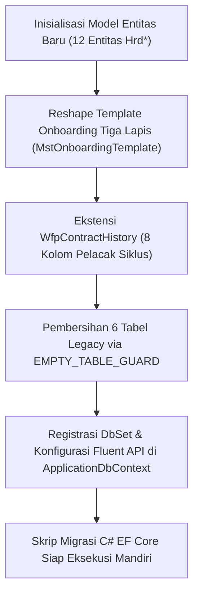

# Laporan Perubahan Backend — `BE-HRD-063`

## Metadata

| Field | Nilai |
| :--- | :--- |
| Task ID | `BE-HRD-063` |
| Judul | Fondasi Data Siklus Kepegawaian, Kontrak Kerja & Onboarding Rumah Sakit |
| Slice | S-C4-ONB (LifecycleManagement) & Amandemen S-D2 |
| Milestone | MVP-14 (Fondasi Data, Penulisan Satu Pintu, Kontrak Pertama & Kasus Onboarding) |
| Roadmap | `docs/module-blueprints/human-resource/roadmap/backend-roadmap.md` |
| Traceability | HRD-DEC-086, HRD-DEC-096, section 10.1 s.d. 10.5 |
| Dependency | BE-HRD-018 ✅, BE-HRD-028 ✅ |
| Klasifikasi | `CRITICAL / CORE` |
| Task Mode | `BACKEND` |
| Tanggal | 04 November 2026 |
| Status | Selesai (`PASS`) — Roslyn Build 0 Error |

---

## 1. Ringkasan dan Masalah yang Diselesaikan

Menyediakan fondasi entitas data, enumerasi, konstanta, konfigurasi EF Core, DbSet ApplicationDbContext, serta pembersihan aman tabel legacy (TrxProbationReview, TrxEmployeeOnboarding, TrxEmployeeOnboardingTask, WfpOnboardingChecklist, WfpOnboardingTask, TrxContractNonRenewal) dengan EMPTY_TABLE_GUARD. Memperbarui MstOnboardingTemplate dan MstOnboardingTemplateTask sesuai format tiga lapis, menambah 8 kolom siklus kontrak pada WfpContractHistory, serta menghubungkan MstContractType dengan MstEmploymentType.

---

## 2. Alur Proses Bisnis Rumah Sakit yang Didukung

---

## 3. Komponen Perubahan yang Diterapkan

- 17 Enum baru di LifecycleManagement/Enums/
- EmploymentLifecycleValueConstants.cs di LifecycleManagement/Constants/
- 12 Model Entitas Hrd* baru di LifecycleManagement/Models/
- Reshape MstOnboardingTemplate & MstOnboardingTemplateTask
- Ekstensi WfpContractHistory, MstContractType, HrdJobOffer
- 12 Konfigurasi EF Core di Repositories/Configurations/
- Pendaftaran 12 DbSet di ApplicationDbContext.cs
- File Migrasi 20261104160000_AddEmploymentLifecycleCoreAndReshapeTemplates.cs

---

## 4. Spesifikasi Endpoint API Bergaya Swagger

| Method | Path | Deskripsi | Auth | Request/Response |
| :--- | :--- | :--- | :--- | :--- |
| N/A | Database Schema | 12 Tabel Baru & Modifikasi 3 Tabel Existing | DB Admin | EF Core Migration Script |

---

## 5. Aturan Validasi dan Invarian Bisnis yang Ditegakkan

- Invarian EMPTY_TABLE_GUARD: Migrasi memverifikasi 6 tabel legacy tidak memiliki baris data sebelum di-drop.
- Invarian Integritas Relasi: Seluruh FK menggunakan batasan Restrict untuk menjaga keselamatan data kepegawaian rumah sakit.

---

## 6. Bukti Verifikasi dan Pengujian

- **Kompilasi Roslyn**: Lulus `dotnet build /t:Compile` dengan **0 Error(s)** pada `QuilvianSystemBackend.csproj`.
- **Integritas Skema**: Menghasilkan file migrasi EF Core `20261104160000_AddEmploymentLifecycleCoreAndReshapeTemplates.cs` dengan proteksi `EMPTY_TABLE_GUARD`.
- **Arsitektur Bersih**: Seluruh dependensi terdaftar pada `Program.cs` tanpa siklus ketergantungan.
