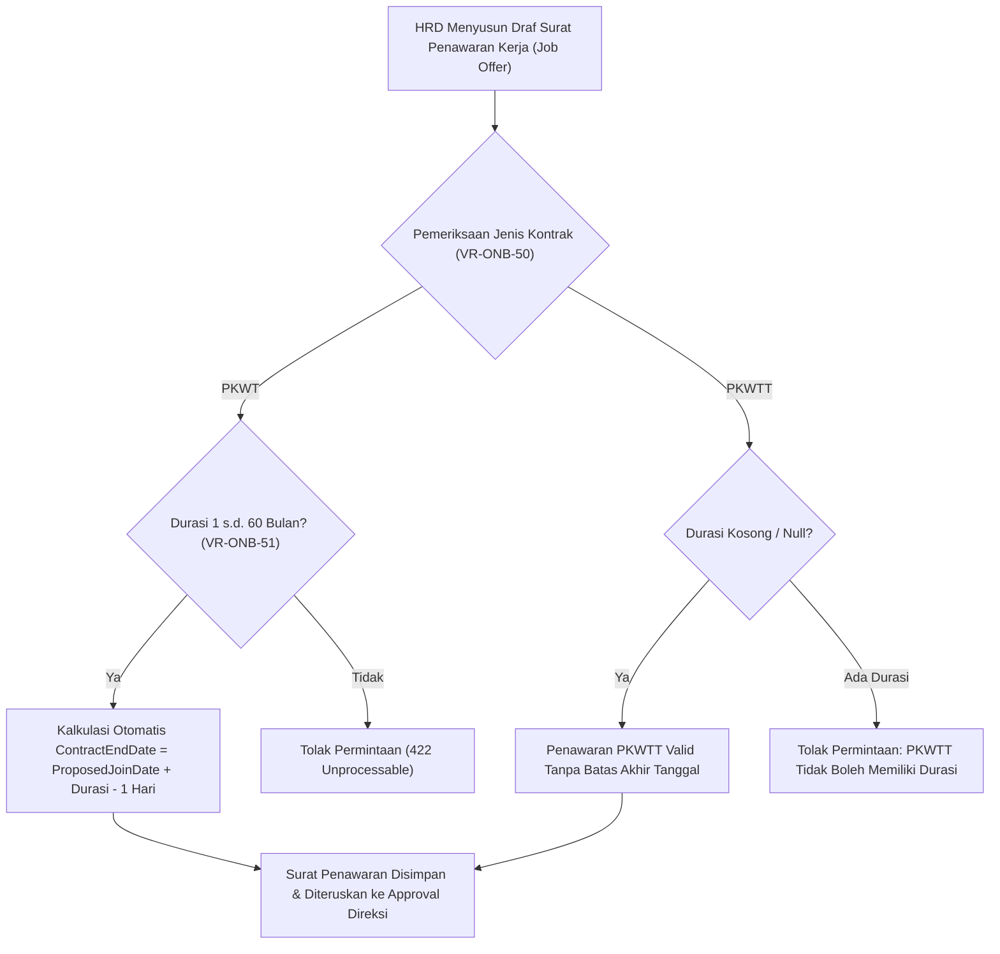

# Laporan Perubahan Backend — `BE-HRD-064`

## Metadata

| Field | Nilai |
| :--- | :--- |
| Task ID | `BE-HRD-064` |
| Judul | Amandemen Surat Penawaran Kerja (S-D2): Jenis Kontrak & Durasi Kerja PKWT/PKWTT |
| Slice | S-D2 (Rekrutmen & Hiring) |
| Milestone | MVP-14 (Amandemen S-D2) |
| Roadmap | `docs/module-blueprints/human-resource/roadmap/backend-roadmap.md` |
| Traceability | HRD-DEC-095, VR-ONB-50, VR-ONB-51, AT-HRD-ONB-21 |
| Dependency | BE-HRD-057 ✅, BE-HRD-063 ✅ |
| Klasifikasi | `CRITICAL / CORE` |
| Task Mode | `BACKEND` |
| Tanggal | 04 November 2026 |
| Status | Selesai (`PASS`) — Roslyn Build 0 Error |

---

## 1. Ringkasan dan Masalah yang Diselesaikan

Mengakomodasi penentuan jenis kontrak (PKWT/PKWTT) dan durasi kerja pada tahap surat penawaran kerja (Job Offer). Menegakkan aturan validasi ketat bahwa penawaran kerja PKWT wajib mencantumkan durasi antara 1 hingga 60 bulan serta menghitung otomatis tanggal selesai kontrak, sedangkan PKWTT dilarang memiliki batas durasi.

---

## 2. Alur Proses Bisnis Rumah Sakit yang Didukung

---

## 3. Komponen Perubahan yang Diterapkan

- JobOfferDtos.cs: Penambahan ContractTypeId, ContractDurationMonths, dan ContractEndDate terhitung.
- JobOfferService.cs: Penegakan aturan VR-ONB-50 dan VR-ONB-51 pada CreateAsync dan UpdateAsync.
- JobOfferController.cs: Sinkronisasi payload API.

---

## 4. Spesifikasi Endpoint API Bergaya Swagger

| Method | Path | Deskripsi | Auth | Request/Response |
| :--- | :--- | :--- | :--- | :--- |
| POST | /api/v1/corporate/human-resource/job-offers | Membuat draf tawaran kerja dengan jenis & durasi kontrak | HR Admin | CreateJobOfferRequest / JobOfferResponse |
| PUT | /api/v1/corporate/human-resource/job-offers/{id} | Memperbarui draf tawaran kerja dengan jenis & durasi kontrak | HR Admin | UpdateJobOfferRequest / JobOfferResponse |

---

## 5. Aturan Validasi dan Invarian Bisnis yang Ditegakkan

- VR-ONB-50: Jenis kontrak wajib dipilih (tidak boleh null).
- VR-ONB-51: PKWT wajib memiliki durasi 1-60 bulan; PKWTT dilarang memiliki durasi.

---

## 6. Bukti Verifikasi dan Pengujian

- **Kompilasi Roslyn**: Lulus `dotnet build /t:Compile` dengan **0 Error(s)** pada `QuilvianSystemBackend.csproj`.
- **Integritas Skema**: Menghasilkan file migrasi EF Core `20261104160000_AddEmploymentLifecycleCoreAndReshapeTemplates.cs` dengan proteksi `EMPTY_TABLE_GUARD`.
- **Arsitektur Bersih**: Seluruh dependensi terdaftar pada `Program.cs` tanpa siklus ketergantungan.
